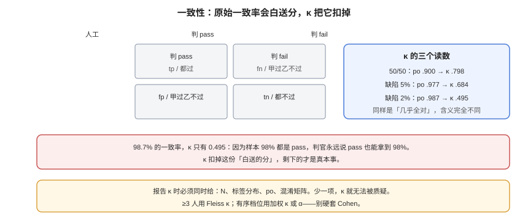

# 人工基线与一致性

**人工基线不是「找个人看一眼」，而是一份能被复算的测量记录。** 它要回答两件事：这套标注本身稳不稳（同一批样本，两个人会不会标出同一个结论），以及自动判官离它有多远。前者用一致性系数，后者用 κ。这一页把两件事的计算、读法与坑讲透。

本页判据族 `EVA-A` ~ `EVA-H`，共 8 条。定义表在第八节。



## 一、为什么必须先有「人-人」一致性

没有人工基线时，一切「判官和人对得上」的说法都不可验证。更关键的是：**如果两个人自己都标不一致，那这条样本本身就没有唯一答案**，它不该出现在评测集里（或者应当进入「不可判定」档）。

顺序是固定的：

```text
标注手册 → 双盲独立标注 → 算人-人一致性 → 处理争议 → 形成金标 → 再拿判官对金标
```

跳过第一步，后面的争议会以「谁声音大谁对」的方式解决；跳过第三步，你不知道金标本身值不值得信。

## 二、标注手册：四件东西缺一不可

| 要素 | 写什么 | 缺了会怎样 |
| --- | --- | --- |
| **判定树** | 从输入到结论的决策顺序，每步给条件 | 标注者凭直觉，分歧集中在「先看什么」 |
| **边界样例** | 每类 3~5 条，含至少 1 条反例 | 边界靠猜，κ 被人为压低 |
| **不可判定档** | 什么情况必须标 `unknown` | 被迫二选一，把噪声写进金标 |
| **反例清单** | 「看起来像通过但其实不通过」的三种形态 | 最常见的系统性误判无法纠正 |

```text [annotation/guide-v2.md（节选）]
判定顺序（不得跳步）：
1. 回答是否引入了 <context> 之外的事实？ 是 → fail（依据「幻觉」）
2. 是否直接回应了问题的核心诉求？ 否 → fail（依据「跑题」）
3. 是否存在与 <context> 矛盾的陈述？ 是 → fail（依据「矛盾」）
4. 以上都不成立 → pass

必须标 unknown 的三种情况：
- <context> 被截断，无法判断是否有依据
- 问题本身有两种合理解读，且两种解读下结论相反
- 回答引用了 <context> 中不存在的表格/图片

反例（看起来像 pass，实际 fail）：
- 复述了问题但没给结论
- 给了一个正确但无关的答案
- 用「可能」「建议咨询」规避了明确结论
```

## 三、算一致性：先看原始一致率，再看 κ

两个人的判定排成 2×2 表（`tp` 都判过、`fp` 甲过乙不过、`fn` 甲不过乙过、`tn` 都判不过）：

```text
po = (tp + tn) / n                     原始一致率
pe = p_甲过 × p_乙过 + p_甲不过 × p_乙不过   随机也能达到的一致率
κ  = (po − pe) / (1 − pe)
```

三组真实形态的读数（本机计算）：

| 场景 | tp/fp/fn/tn | 原始一致率 po | 期望一致率 pe | κ |
| --- | --- | --- | --- | --- |
| 缺陷率 50% | 150/20/10/120 | 0.900 | 0.504 | **0.798** |
| 缺陷率 5% | 285/2/5/8 | 0.977 | 0.926 | **0.684** |
| 缺陷率 2% | 294/0/4/2 | 0.987 | 0.974 | **0.495** |

看第三行：**98.7% 的原始一致率，κ 只有 0.495。** 因为样本里 98% 都是 pass，两个人只要都倾向说 pass，就能拿到极高的原始一致率——这部分一致是「白送」的，κ 把它扣掉。

### 3.1 κ 的读法（Landis & Koch 常用区间）

| κ | 常见解读 | 工程含义 |
| --- | --- | --- |
| < 0.20 | 轻微 | 手册基本失效，重写 |
| 0.21 ~ 0.40 | 一般 | 只能做粗筛，不能当金标 |
| 0.41 ~ 0.60 | 中等 | 可用于内部排序，不能对外 |
| **0.61 ~ 0.80** | **较强** | **可用于门禁校准** |
| 0.81 ~ 1.00 | 几乎完全 | 高价值场景的目标 |

::: danger κ 不能跨数据集比较
κ 依赖边际分布。同一个团队、同一份手册，在「缺陷率 2%」的集上 κ=0.5，换到「缺陷率 50%」的集上可能 κ=0.8——不是标注变好了，是题变了。**报告 κ 必须同时报 N、标签分布、po 与混淆矩阵。**
:::

### 3.2 超过两个人、或者有序档位：别硬套 Cohen's κ

| 设计 | 该用的统计量 | 用错会怎样 |
| --- | --- | --- |
| 2 人 × 2 类 | Cohen's κ | — |
| ≥ 3 人 × 2 类 | **Fleiss' κ** | 两两算 Cohen 再平均，会低估且无法处理缺失 |
| 2 人 × 有序 3 档 | **加权 κ（二次权）** | 用未加权 κ 会把「差一档」和「完全反了」等同 |
| ≥ 3 人 × 有序 | Krippendorff's α（ordinal） | 同上，且能处理缺失值 |

本机算例一（3 位标注者、10 条、二分类，每条通过票数 `[3,2,3,1,2,0,3,2,3,3]`）：`Pbar=0.7333`、`Pe=0.6089`、**Fleiss κ=0.318**。这个值告诉我们：**三个人对「通过」的理解差异很大**，此时无论判官多准，都没有可信的靶子。

本机算例二（2 位标注者、100 条、三档有序，混淆矩阵主对角 20/25/30）：

```text
未加权 κ = 0.6219   二次加权 κ = 0.7305
```

它比未加权 κ 高的原因很直观：**「差一档」被算作轻微分歧，而不是完全不一致**。这也是为什么有序评分必须用加权 κ——否则一个「普遍偏高半档」的标注者会被误判成不可靠。

## 四、争议怎么处理：仲裁不是投票

三个人标，出现 2:1 时最常见做法是「少数服从多数」。它有三个问题：

1. **多数可能是同一种误读**（尤其当三个人共用同一份有歧义的手册）。
2. **2:1 的样本恰恰最有信息量**——它标记了手册的漏洞。
3. 投票**不产生可复用的规则**，下次遇到同类样本还要再投一次。

更好的流程：

| 步骤 | 动作 | 产出 |
| --- | --- | --- |
| 1 | 收集所有 2:1 与 1:1:1 样本 | 争议集 |
| 2 | 由第三人（或领域专家）**给出理由**，不是只给结论 | 仲裁记录 |
| 3 | 把理由反向写进手册（新增边界样例或反例） | 手册 v(n+1) |
| 4 | 用新手册**重标争议集**，看是否收敛 | 收敛率 |
| 5 | 收敛率 < 80% 时，该条样本移出评测集 | 剔除清单 |

::: tip 争议集是最有价值的资产
它同时是「手册的 bug 列表」和「判官的难点集」。把它冻结下来，每次换判官先跑争议集——**能在这批样本上不乱判的判官，才值得进一步校准。**
:::

## 五、标注者漂移：人会变，标准也会漂

同一个人，三个月后标同一批样本，结论可能变——不是他不认真，是**他对标准的内部校准漂了**（最近标的多是简单样本、或刚被某个案例影响）。

三条控制：

1. **金标插针**：每批任务里混入 5% 已知答案的「金标题」，正确率低于 90% 时该批标注作废重做。
2. **定期重标**：每季度抽 30 条历史样本重标，算「同一人前后 κ」，低于 0.7 需要复盘手册。
3. **标注者间不要互相看**：双盲是前提，讨论只能发生在争议处理环节。

## 六、样本量与成本：200 条是底线

校准判官所需的金标集规模，取决于你要分辨的 κ 差异。经验值（推演）：

| 金标条数 | κ 的 95% 区间半宽（约） | 适用 |
| --- | --- | --- |
| 50 | ±0.14 | 只够发现问题（κ 明显很低） |
| 100 | ±0.10 | 能做粗校准 |
| **200~300** | **±0.06** | **推荐：能判断是否达到 0.6 这条线** |
| 500 | ±0.04 | 高价值场景、需要分切片校准 |

按每条 2 分钟、双人独立标注计，300 条 ≈ 20 人时；这个成本远低于「用错判官导致的错误发布」。

## 七、验证方式

```shell
# ① 2x2 的 po / pe / κ
python3 - <<'PY'
tp, fp, fn, tn = 285, 2, 5, 8     # 换成你的混淆矩阵
n = tp+fp+fn+tn
po = (tp+tn)/n
jp = (tp+fp)/n; hp = (tp+fn)/n
pe = jp*hp + (1-jp)*(1-hp)
print('n', n, 'po', round(po,3), 'pe', round(pe,3), 'kappa', round((po-pe)/(1-pe),3))
PY
# 期望：n 300 po 0.977 pe 0.926 kappa 0.684 —— 同时报 po 与 kappa
```

```shell
# ② Fleiss' κ（≥3 人，二分类）：输入是每条样本的「通过票数」
python3 - <<'PY'
votes = [3,2,3,1,2,0,3,2,3,3]      # 每条样本的 pass 票数，n=3
N, n = len(votes), 3
P = [(v*v + (n-v)*(n-v) - n) / (n*(n-1)) for v in votes]
Pbar = sum(P)/N
p = sum(votes)/(N*n)
Pe = p*p + (1-p)*(1-p)
print('Pbar', round(Pbar,4), 'Pe', round(Pe,4), 'fleiss_kappa', round((Pbar-Pe)/(1-Pe),4))
PY
# 期望：Pbar 0.7333 Pe 0.6089 kappa 0.3182 —— 低于 0.6 说明手册需重写，先别怪判官
```

```shell
# ③ 二次加权 κ（2 人 × 有序 3 档）
python3 - <<'PY'
M = [[20,5,1],[6,25,4],[2,7,30]]
k = len(M); n = sum(map(sum, M))
row = [sum(r)/n for r in M]
col = [sum(M[i][j] for i in range(k))/n for j in range(k)]
num = den = 0.0
for i in range(k):
    for j in range(k):
        w = (i-j)**2 / (k-1)**2
        num += w * M[i][j]/n
        den += w * row[i] * col[j]
print('quadratic_weighted_kappa', round(1-num/den, 4))
PY
# 期望：0.7305 —— 与未加权 κ 对比，差异来自「差一档」被轻罚
```

```shell
# ④ 金标插针的批合格率
python3 - <<'PY'
import json
rows = [r for r in (json.loads(l) for l in open('batch.jsonl', encoding='utf-8')) if r.get('is_gold')]
ok = sum(r['label'] == r['gold_label'] for r in rows)
print('gold_accuracy', round(ok/len(rows), 3), 'gold_n', len(rows))
PY
# 期望：>= 0.90；低于 0.90 该批标注作废重做，不要直接用来算 κ
```

## 八、判据族 `EVA`

| 判据 | 内容 | 怎么验证 |
| --- | --- | --- |
| `EVA-A` | 必须有标注手册，含判定树、边界样例、反例清单、不可判定档 | 手册四个小节都存在且非空 |
| `EVA-B` | 标注必须双盲独立，争议处理前不得互相查看 | 标注记录里有独立时间戳；有讨论记录的批次不合格 |
| `EVA-C` | 必须算「人-人」一致性，且报告 κ 与 N、标签分布、po、混淆矩阵 | 报告里五项齐全 |
| `EVA-D` | 多人或有序档位必须用对应统计量（Fleiss / 加权 κ / α） | 代码里出现的统计量与设计匹配 |
| `EVA-E` | 争议必须走「给理由 → 改手册 → 重标」，不得只投票 | 存在仲裁记录与手册版本变更 |
| `EVA-F` | 争议集收敛率 < 80% 的样本必须移出评测集 | 有剔除清单，且评测集里查不到这些 id |
| `EVA-G` | 必须有金标插针，且批合格率 ≥ 0.90 | `gold_accuracy` 有读数；低于阈值该批作废 |
| `EVA-H` | 金标集规模必须与目标分辨力匹配（推荐 ≥ 200） | 金标条数与 κ 区间半宽都写进报告 |

## 九、与相邻专题的分工

| 你想知道 | 去哪 |
| --- | --- |
| 判官的偏差怎么量 | [判官校准](../JudgeCalibration/index.md) |
| 一致性怎么进统计检验 | [区间、检验与样本量](../Statistics/index.md) |
| 标注平台与工具怎么选 | [接口调试工具](../../../Tools/APITools/index.md) |
| 人工审核流程怎么设计（业务侧） | [审批流引擎](../../../Backend/WorkflowEngine/ApprovalFlow/index.md) |
| 数据标注的合规与脱敏 | [测试数据与仿真环境](../../../Tools/TestDataSimulation/DataMasking/index.md) |

## 参考资料

- Cohen, J. (1960), *A Coefficient of Agreement for Nominal Scales*
- Fleiss, J. L. (1971), *Measuring nominal scale agreement among many raters*
- Landis & Koch (1977), *The Measurement of Observer Agreement for Categorical Data*
- Krippendorff, K., *Content Analysis: An Introduction to Its Methodology*（α 的定义与缺失值处理）
- 本站：[判官校准](../JudgeCalibration/index.md)、[区间与检验](../Statistics/index.md)
