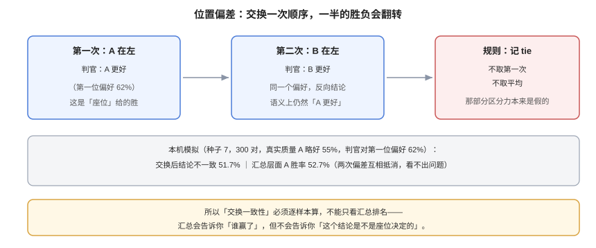

# 判官校准：让 LLM 打分可信

**LLM 判官不是「更便宜的人工」，它是一个有系统性偏好的测量仪器。** 仪器的偏差可以标定、可以补偿，但前提是你先量过它。这一页给出三种偏差的量化方法、rubric 的写法、多次采样与多数票的取舍，以及一条最小校准闭环：**判官先考过试，再让它批卷子**。

本页判据族 `EVJ-A` ~ `EVJ-H`，共 8 条。定义表在第七节。



## 一、先选协议：单点还是成对

| 维度 | 单点（pointwise，1~5 或 0/1） | 成对（pairwise，A vs B） |
| --- | --- | --- |
| 稳定性 | 分数随运行漂移，锚点会「浮动」 | 判别任务更容易，稳定性通常更好 |
| 位置偏差 | 不存在 | **存在，必须交换顺序** |
| 可解释性 | 能给出绝对水位，适合画趋势 | 只能给相对胜负，绝对水位要靠锚点 |
| 成本 | N 次调用 | 朴素 O(N²)，实际用「同题两版」只有 2N |
| 适合 | 门禁（对着固定水位）、长期趋势 | 选型、改版对比、人工对齐 |

工程上最常用的是混合：**门禁用单点 + 固定 rubric 判据（每条 0/1），选型与改版用成对 + 交换顺序。** 单点之所以能用于门禁，是因为它对着一个**固定的金标集**，而不是对着「上次的分数」。

## 二、三种偏差，各有一个可算的指标

### 2.1 位置偏差：看「交换一致性」

做法：同一对答案跑两次，第二次交换 A/B 位置。定义

```text
交换一致性 SC = 两次结论在语义上一致（或都判 tie）的样本数 / 总样本数
```

本机模拟（固定种子 7，300 对，真实质量 A 略好 55%，判官对第一位有 62% 偏好）：

| 读数 | 值 | 含义 |
| --- | --- | --- |
| 交换后结论不一致（翻转）比例 | **51.7%** | 一半的胜负是「座位」决定的 |
| 交换后 A 的胜率 | 52.7% | 汇总层面看不出问题，因为两次偏差互相抵消 |

**这是位置偏差最阴的地方：汇总胜率看起来很合理（52.7%），逐样本看却有一半在翻转。** 只看汇总排名，永远不会发现它。

处理规则只有一条：**两次不一致的样本记 `tie`，不要取第一次、也不要取平均。** 记 `tie` 会让区分力下降，但那部分区分力本来就是假的。

### 2.2 长度偏差：看「分数与长度的相关性」

做一组**受控对**：同一内容，一份简洁版、一份把同样信息换个说法展开（不新增事实）。然后看判官偏好与长度的关系。

| 观察 | 结论 | 处理 |
| --- | --- | --- |
| 长度不同的受控对里，长版胜率 ≈ 50% | 无明显长度偏差 | 保持 |
| 长版胜率 60%~75% | 轻度偏好 | rubric 里加「冗余扣分」项 |
| 长版胜率 > 75% | 重度偏好 | 判官不能用于开放式质量评分 |

注意：**真实回答里长答案常常确实更好**，所以「分数与长度正相关」本身不是偏差证据，**受控对**才是。

### 2.3 自我偏好：看「家族交叉」

把生成方与判官方做成矩阵：`generator_family × judge_family`。如果「同族」那几格的胜率系统性高于「异族」格，就是自我偏好。

| 判官方 \ 生成方 | 家族 A | 家族 B |
| --- | --- | --- |
| **家族 A** | 同族（偏高） | 异族 |
| **家族 B** | 异族 | 同族（偏高） |

实践结论：**能用异族判官就用异族**；必须同族时，把「同族胜率」单独报出来作为已知偏差，而不是假装没有。

::: danger 一个常见自欺
「我用的是最强的模型当判官，所以没有偏差。」——强度与偏差是两个维度。最强的模型也会有位置偏好与长度偏好，只是幅度可能更小。**没有量过，就等于没有控制。**
:::

## 三、rubric 怎么写：让分数可审计

一个不能审计的分数，无法在争议时使用。可用的 rubric 有三个特征：

1. **拆成可分别判定的条目**：每条独立给 0/1，不要一个笼统的 1~10。
2. **先推理后判定**：要求判官先写出「依据哪一句」，再给分。反过来（先给分再解释）得到的是事后合理化。
3. **输出结构化**：JSON 里带 `criteria[]`、`evidence`、`verdict`，便于程序校验与抽样复核。

```text [judge/rubric-v3.md]
你是评审员。只依据 <context> 与 <answer> 判定，不使用外部知识。

对以下三条逐条判定，每条先引用 <answer> 中的原句作为 evidence，再给 0 或 1：
1. 直接回答了 <question> 的核心诉求（不是泛泛而谈）。
2. 所有事实性陈述都能在 <context> 找到依据（不得引入 context 之外的事实）。
3. 没有为了显得完整而重复或堆砌同义内容（冗余即 0）。

输出 JSON：
{"criteria":[{"id":1,"evidence":"...","score":0},{"id":2,...},{"id":3,...}],
 "reasoning":"一句话总结","verdict":"pass|fail"}
```

三条纪律：

- **禁止「整体印象分」**：只要出现一个综合分，判官就会把它当成主目标，条目分退化成装饰。
- **禁止在 rubric 里写示例答案**：示例会把判官拉向「长得像示例」的答案，这是另一种长度/风格偏差。
- **`verdict` 由条目分算出，不由判官直接给**：`pass` 当且仅当三条全 1。判官只负责条目，规则负责汇总——这样汇总口径可复算。

## 四、多次采样：什么时候值得，什么时候是浪费

| 策略 | 成本 | 适用 | 副作用 |
| --- | --- | --- | --- |
| 单次判定 | 1× | 确定性高、rubric 严格、温度 0 | 单点抖动直接进分数 |
| 三次多数票 | 3× | 门禁、争议样本 | 掩盖「三票都错」的系统偏差 |
| 三次全一致才算通过 | 3× | 高风险场景（合规、医疗） | 通过率显著下降，需重定阈值 |

::: warning 多数票治不了系统偏差
多数票降低的是**方差**（随机抖动），不降低**偏差**（系统性偏好）。位置偏差、长度偏差、同族偏好都是偏差——三票会一致地错。**先校准偏差，再谈降方差。**
:::

## 五、校准闭环：让判官定期「考试」

最小闭环五步，缺一步它就退化成「一次性验证」：

| 步 | 动作 | 频率 | 产出 |
| --- | --- | --- | --- |
| 1 | 维护金标集（人工判过的 200~500 条） | 冻结，季度换 1/3 最旧的 | `goldset@version` |
| 2 | 用判官跑金标集，算混淆矩阵与 κ | 每次换判官 / 换 rubric / 每月 | κ、灵敏度、特异度 |
| 3 | 与上一次比较，超过阈值就告警 | 每次 | 漂移告警 |
| 4 | 重校准：改 rubric、加 few-shot、换判官 | 触发时 | 新 `judge_version` |
| 5 | 记录「本次校准的适用范围」 | 每次 | 报告里的 `limitations` |

阈值建议（推演，按风险调整）：**κ ≥ 0.6 才允许用于门禁；κ < 0.6 时判官只能用于「排序参考」；κ < 0.4 时判官结论不进任何报表。**

::: tip 校准集必须与门禁集分开
用同一套样本既校准判官又卡门禁，等于「用考题当练习题」——κ 会很好看，因为判官见过了。**金标集（校准）与评测集（门禁）必须物理分开**，且金标集不进任何训练与提示示例。
:::

## 六、验证方式

```shell
# ① 交换一致性（需要 pairs.jsonl：{"id","a","b"} 与两次判定结果 verdicts.jsonl）
python3 - <<'PY'
import json
v = {}
for l in open('verdicts.jsonl', encoding='utf-8'):
    r = json.loads(l)
    v.setdefault(r['id'], {})[r['order']] = r['winner']   # order: 'ab' / 'ba'
def flip(w):  # 把 ba 的顺序结论映射回同一坐标
    return {'A':'B', 'B':'A', 'tie':'tie'}[w]
n = ok = 0
for i, d in v.items():
    if 'ab' in d and 'ba' in d:
        n += 1
        ok += (d['ab'] == flip(d['ba']))
print('swap_consistency', round(ok/n, 3), 'n', n)
PY
# 期望：>= 0.90 可用；0.7~0.9 需对不一致样本记 tie；< 0.7 说明判官不能用于成对比较
```

```shell
# ② 长度偏差：受控对上的胜率（pairs 里带 ctrl=true）
python3 - <<'PY'
import json
win = n = 0
for l in open('verdicts.jsonl', encoding='utf-8'):
    r = json.loads(l)
    if r.get('ctrl') and r['order'] == 'ab':
        n += 1
        win += (r['winner'] == 'A')   # A 固定为「长版」
print('longer_wins', round(win/n, 3), 'n', n)
# 期望：0.45~0.55。> 0.75 说明长度偏差严重，开放式评分不可用
```

```shell
# ③ 判官 vs 人工：混淆矩阵与 Cohen's kappa
python3 - <<'PY'
tp, fp, fn, tn = 150, 20, 10, 120   # 换成你的金标集读数
n = tp+fp+fn+tn
po = (tp+tn)/n
jp = (tp+fp)/n; hp = (tp+fn)/n
pe = jp*hp + (1-jp)*(1-hp)
print('po', round(po,3), 'pe', round(pe,3), 'kappa', round((po-pe)/(1-pe),3))
PY
# 期望：kappa >= 0.6；同时把 po 与 kappa 一起报（po 会系统性高估）
```

```shell
# ④ 同一输入重复跑，看自一致率（intra-judge stability）
python3 - <<'PY'
import json, collections
d = collections.defaultdict(list)
for l in open('repeat.jsonl', encoding='utf-8'):
    r = json.loads(l)
    d[r['id']].append(r['verdict'])
same = sum(1 for k in d if len(set(d[k])) == 1)
print('self_consistency', round(same/len(d), 3), 'items', len(d))
PY
# 期望：>= 0.95。低于 0.95 时，单次判定不足以支撑门禁
```

## 七、判据族 `EVJ`

| 判据 | 内容 | 怎么验证 |
| --- | --- | --- |
| `EVJ-A` | 成对比较必须交换顺序，且不一致样本记 tie | `swap_consistency` 有读数；不一致样本在结果里是 `tie` |
| `EVJ-B` | 必须做过长度受控对实验 | 存在 `ctrl=true` 的样本与 `longer_wins` 读数 |
| `EVJ-C` | 判官与生成方必须做家族交叉，同族胜率单独报告 | 存在 `generator_family × judge_family` 矩阵 |
| `EVJ-D` | rubric 必须条目化、先证据后判定、输出 JSON | 判官输出能被 JSON 解析，且含 `criteria[].evidence` |
| `EVJ-E` | 汇总判定必须由条目分算出，不得由判官直接给综合分 | 代码里存在 `pass = all(score)` 之类可复算逻辑 |
| `EVJ-F` | 判官必须与人工金标集算过 κ，且 κ ≥ 0.6 才用于门禁 | 报告里有 `kappa` 字段与金标集版本 |
| `EVJ-G` | 校准集与门禁集必须物理分离 | 两个数据文件的指纹不同，且无交集（按 id 取交集为空） |
| `EVJ-H` | 判官版本必须包含模型名 + rubric 哈希 + 温度 + 采样策略 | `judge_version` 可唯一定位到一次具体配置 |

## 八、与相邻专题的分工

| 你想知道 | 去哪 |
| --- | --- |
| 人工怎么标、κ 怎么解释 | [人工基线与一致性](../HumanAlignment/index.md) |
| 判官结论怎么进 CI 门禁 | [回归门禁](../RegressionGate/index.md) |
| 提示词本身怎么写（不涉及校准） | [结构化提示词](../../PromptEngineering/StructuredPrompts/index.md) |
| 判官被提示注入攻击怎么办 | [提示词安全](../../PromptSecurity/Overview/index.md) |
| 评测集怎么冻结 | [评测集构建与冻结](../DatasetDesign/index.md) |

## 参考资料

- Zheng et al., *Judging LLM-as-a-Judge with MT-Bench and Chatbot Arena*（[arXiv:2306.05685](https://arxiv.org/abs/2306.05685)）：位置/冗长/自我增强偏差
- Wang et al., *Large Language Models are not Fair Evaluators*（[arXiv:2305.17926](https://arxiv.org/abs/2305.17926)）：调换顺序翻转排名
- Liu et al., *G-Eval*（[arXiv:2303.16634](https://arxiv.org/abs/2303.16634)）：rubric + 思维链评分
- Verga et al., *Replacing Judges with Juries*（[arXiv:2404.18796](https://arxiv.org/abs/2404.18796)）：多家族小模型评审团
- 本站：[人工基线](../HumanAlignment/index.md)、[回归门禁](../RegressionGate/index.md)
