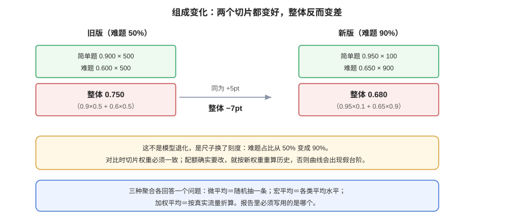

# 指标口径：一个数字的六种含义

**「准确率 0.84」这句话里至少有六个可以争论的点**：样本怎么算一条、未判定怎么记、多个子集怎么合、k 次采样怎么算、成本和延迟算不算进指标、聚合口径写在哪儿。这六个点不写清，两个团队报的数就不可比，而不可比比不准更麻烦——它会让你以为在做对比。

本页判据族 `EVM-A` ~ `EVM-H`，共 8 条。定义表在第七节。



## 一、一条样本算不算「通过」：三档而不是两档

二值化是最容易出问题的地方。工程上应当有三档，且**第三档不折叠**：

| 判定 | 记法 | 是否计入分母 | 典型来源 |
| --- | --- | --- | --- |
| 通过 | `pass` | 是 | 判官条目全 1 |
| 不通过 | `fail` | 是 | 任一条目 0 |
| 无法判定 | `unknown` | **是**（但要单列） | 判官输出不可解析、上下文截断、题目本身有歧义 |

把 `unknown` 悄悄并入 `fail` 或 `pass`，是最常见的口径造假（往往不是故意）：

- 并入 `pass`：解析失败率高的版本会显得更好——**因为它连输出都没产出**。
- 并入 `fail`：一个格式小改动导致的解析失败，会让质量看起来崩了。

正确做法：**主指标 = `pass / (pass + fail)`，同时报 `unknown_rate`。** `unknown_rate > 3%` 时主指标不可用，先修解析。

## 二、pass@k 与 pass^k：方向相反的两个指标

`pass@k` 出自 Codex 论文，含义是「生成 k 次，至少一次通过」；`pass^k` 是「生成 k 次，k 次全通过」。两者在高分区间**结论经常相反**。

以 n=200、通过 150 条（单次通过率 0.75）为例（本机计算）：

| 指标 | k=1 | k=3 | k=5 | k=10 |
| --- | --- | --- | --- | --- |
| `pass@k`（至少一次对） | 0.750 | — | **0.9992** | ≈1.000 |
| `pass^k`（k 次全对） | 0.750 | 0.4219 | **0.2373** | — |

同一个系统，`pass@5` 是 99.9%，`pass^5` 是 23.7%。**这两个数都可以诚实地写进报告，但它们回答的问题完全不同**：

- 代码补全、候选生成、搜索建议 → 用 `pass@k`（用户会挑，只要有一个对的就行）。
- 自动执行、批量处理、无人值守 Agent → 用 `pass^k`（没有人挑，必须次次对）。

::: danger 用错指标会做出反向决策
「pass@5 已经 99.9% 了，可以全自动上线」——这句话在 Agent 场景里是灾难：它把「五次里有一次能用」当成了「每次都可用」。**先问「有没有人来挑」，再选指标。**
:::

`pass@k` 的无偏估计式（不要用「跑 k 次数成功次数」的朴素做法，它在小样本上偏乐观）：

```text
pass@k = 1 − C(n − c, k) / C(n, k)
```

其中 `n` 是每题的采样次数、`c` 是其中通过的次数。注意这里的 `n` 是**采样次数**，不是样本条数——两个 `n` 混用是这一节最常见的错误。

## 三、聚合：宏平均、微平均、加权平均

三个切片（抽取 / 生成 / 判定）的通过率如下，三种聚合给出三个数：

| 切片 | 条数 | 通过率 |
| --- | --- | --- |
| 抽取 | 80 | 0.925 |
| 生成 | 110 | 0.818 |
| 判定 | 70 | 0.700 |

- **微平均**（先合并分子分母）：(74 + 90 + 49) / 260 = **0.819**，被条数最多的「生成」主导。
- **宏平均**（各切片平均）：(0.925 + 0.818 + 0.700) / 3 = **0.814**，每个切片等权。
- **加权平均**（按线上流量权重）：若线上 70% 是生成、20% 抽取、10% 判定，则 0.7×0.818 + 0.2×0.925 + 0.1×0.700 = **0.828**。

三个数都「对」，但它们回答的问题不同：微平均回答「随机抽一条，通过的概率」，宏平均回答「各类任务的平均水平」，加权平均回答「按真实流量折算的体验」。**报告里必须写清用的是哪个。**

## 四、组成变化：每个切片都变好，整体却变差

这是最容易被误读成「回归」的现象。算例（本机计算）：

| 版本 | 简单题（通过率 / 条数） | 难题（通过率 / 条数） | 整体 |
| --- | --- | --- | --- |
| 旧版 | 0.900 / 500 | 0.600 / 500 | **0.750** |
| 新版 | 0.950 / 100 | 0.650 / 900 | **0.680** |

两个切片的通过率都提升了 5 个百分点，整体却从 0.750 掉到 0.680——因为新版评测集里难题占比从 50% 涨到 90%。**这不是模型退化，是尺子换了刻度。**

两条纪律：

1. **对比时切片权重要一致**：要么固定配额（推荐），要么按同一套线上权重重算。
2. **组成变了必须重算历史**：如果确实要改配额，用新权重把旧版本重跑一遍（或按切片分数重加权），否则历史曲线会在改配额那天出现一个假台阶。

## 五、质量指标必须成对出现

单看质量会做出「又慢又贵但分数高 1 个点」的决策。最小的一组配对指标：

| 类别 | 指标 | 口径要求 |
| --- | --- | --- |
| 质量 | 主指标（按上节口径） | 带区间 + 切片 |
| 质量 | `unknown_rate` | 单列，不折叠 |
| 延迟 | p50 / p95（端到端，含重试） | 必须含重试；只报 p50 会掩盖长尾 |
| 成本 | 每千次请求的模型费用 | 含判官成本（评测本身也要花钱） |
| 稳定性 | 同输入 N 次结论一致率 | 见[判官校准](../JudgeCalibration/index.md) |

::: tip 判官成本也要算进去
很多团队把「评测成本」和「推理成本」分开算，于是在选型时选了「质量高 0.5 个点、单次贵 3 倍」的方案，然后在评测上又花了一笔判官费。**把评测成本摊进每次发布的成本里**，选型结论经常会变。
:::

## 六、把口径写成契约

口径不是文档里的一段话，而是一份可被程序读取的配置。最小字段：

```json [eval/metrics.contract.json]
{
  "metric": "task_pass_rate",
  "unit": "sample",
  "numerator": "verdict == 'pass'",
  "denominator": "verdict in ('pass','fail')",
  "unknown_policy": "report_separately",
  "aggregation": "micro",
  "slices": ["task", "length", "language", "difficulty"],
  "secondary": ["unknown_rate", "latency_p95_ms", "cost_per_1k_usd"],
  "ci": { "method": "bootstrap", "resamples": 2000, "level": 0.95 }
}
```

有了这份契约，「口径变了」这件事就会变成一次 diff，而不是一次口头约定。

## 七、验证方式

```shell
# ① pass@k 与 pass^k 同时算出来，看两者是否背离
python3 - <<'PY'
from math import comb
n, c = 200, 150           # n=每题采样次数, c=其中通过次数
for k in (1, 3, 5, 10):
    at = 1 - comb(n-c, k)/comb(n, k) if n-c >= k else 1.0
    hat = (c/n) ** k
    print(f'k={k}: pass@k={at:.4f}  pass^k={hat:.4f}')
PY
# 期望：k=5 时 pass@5≈0.9992、pass^5≈0.2373 —— 两个数一起进报告
```

```shell
# ② 同一份结果，三种聚合各算一次
python3 - <<'PY'
slices = {'extract': (80, 74), 'generate': (110, 90), 'judge': (70, 49)}
weights = {'extract': 0.2, 'generate': 0.7, 'judge': 0.1}
micro = sum(p for _, p in slices.values()) / sum(n for n, _ in slices.values())
macro = sum(p/n for n, p in slices.values()) / len(slices)
wavg = sum(weights[k]*p/n for k, (n, p) in slices.items())
print(round(micro,3), round(macro,3), round(wavg,3))
PY
# 期望：0.819 0.814 0.828 —— 三个都「对」，报告里必须写用的是哪个
```

```shell
# ③ 组成变化的对照：切片都变好、整体变差
python3 - <<'PY'
old = (500*0.90 + 500*0.60) / 1000
new = (100*0.95 + 900*0.65) / 1000
print('old', old, 'new', new)
PY
# 期望：old 0.75 / new 0.68 —— 若你的报告出现这种情况，先查配额，别急着归因模型
```

```shell
# ④ 检查 unknown 有没有被折叠进主指标
python3 - <<'PY'
import json
rows = [json.loads(l) for l in open('results.jsonl', encoding='utf-8')]
kinds = {}
for r in rows:
    kinds[r['verdict']] = kinds.get(r['verdict'], 0) + 1
print(kinds)
PY
# 期望：三种 verdict 都出现（至少 unknown 计数可见）。只有 pass/fail 两键，说明已被折叠
```

## 八、判据族 `EVM`

| 判据 | 内容 | 怎么验证 |
| --- | --- | --- |
| `EVM-A` | 判定必须三档（pass/fail/unknown），unknown 不折叠 | 结果文件里三种 verdict 可计数 |
| `EVM-B` | 主指标分母必须写明（是否含 unknown） | `metrics.contract.json` 里有 `denominator` |
| `EVM-C` | 必须同时给出 `unknown_rate`，且 > 3% 时主指标作废 | 报表含该字段；超阈值时主指标标灰 |
| `EVM-D` | 采样类任务必须区分 `pass@k` 与 `pass^k`，并说明用哪个 | 报告里有指标名与 k 值，且写明「有人挑 / 无人挑」 |
| `EVM-E` | `pass@k` 必须用无偏估计式，不得用「数成功次数」 | 代码里出现组合数公式或等价实现 |
| `EVM-F` | 聚合方式（微/宏/加权）必须写进契约 | 契约文件里有 `aggregation` 字段 |
| `EVM-G` | 对比时切片权重必须一致，或按同一权重重算历史 | 两次运行的切片配额相同，或旧版已按新权重重算 |
| `EVM-H` | 质量指标必须与延迟、成本成对出现 | 报表同时含 `latency_p95_ms` 与 `cost_per_1k_usd` |

## 九、与相邻专题的分工

| 你想知道 | 去哪 |
| --- | --- |
| 区间怎么算、差几个点才显著 | [区间、检验与样本量](../Statistics/index.md) |
| RAG 的 faithfulness / recall 怎么定义 | [RAG 评估](../../RAG/Evaluation/index.md) |
| 检索排序指标（nDCG、MRR） | [多模态检索评估](../../MultimodalRetrieval/Evaluation/index.md) |
| 性能与容量口径（水位线、SLO） | [性能与容量工程](../../../Ops/PerformanceEngineering/index.md) |
| 线上 A/B 怎么分流与判定 | [在线评估](../../LLMObservability/OnlineEval/index.md) |

## 参考资料

- Chen et al., *Evaluating Large Language Models Trained on Code*（[arXiv:2107.03374](https://arxiv.org/abs/2107.03374)）：`pass@k` 的无偏估计式
- scikit-learn 文档：[Precision-Recall 与微/宏平均](https://scikit-learn.org/stable/modules/model_evaluation.html)：聚合口径的权威定义
- Efron & Tibshirani, *An Introduction to the Bootstrap*：区间估计
- 本站：[评测集构建](../DatasetDesign/index.md)、[区间与检验](../Statistics/index.md)、[回归门禁](../RegressionGate/index.md)
