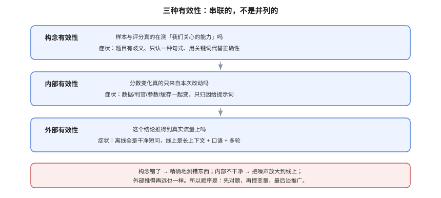

# 评测工程全景：三种有效性

**评测的第一性问题不是「跑多少条」，而是「这条样本测的东西，和我以为它测的东西，是不是同一个」。** 这一层错了，后面所有工作——更大数据集、更强判官、更严阈值——都只是在把误差放大。本页给出三种有效性、四类评测对象、五种失效模式，以及一次评测必须交付的六件东西。

本页判据族 `EVO-A` ~ `EVO-H`，共 8 条。定义表在第七节。

## 一、三种有效性，缺一层就白测

这三个词来自测量学，落到工程上各有非常具体的症状。

| 有效性 | 问的是什么 | 工程上的症状 | 典型误判 |
| --- | --- | --- | --- |
| **构念有效性**（construct validity） | 这条样本真的在测「我们关心的能力」吗 | 题目本身有歧义、答案有多种正确写法、评分标准只认一种句式 | 用「是否包含关键词」代替「是否回答正确」，训练出会背关键词的模型 |
| **内部有效性**（internal validity） | 分数变化真的来自本次改动吗 | 评测集、判官版本、参数、缓存、并发都在变，一起变了却只归因给提示词 | 三次运行三个数，挑最好的一次写进报告 |
| **外部有效性**（external validity） | 这个结论能推到真实流量上吗 | 评测集全是干净短问题，线上是长上下文 + 多轮 + 口语 | 离线 0.92，线上投诉率上涨 |

三者是串联的：**构念错了，内部再严谨也是精确地测错东西；内部不干净，外部推得再远也是把噪声放大到线上。**

::: tip 一个便宜的检查
每次评测前问一句：**「如果我把模型换成上一版，这套样本能区分出来吗？」** 如果答案不确定，说明样本要么太简单（两者都满分），要么评分太松（两者都过）——构念有效性已经出问题了。
:::

## 二、四类评测对象，各有各的假绿点

「评测」不是一个动作，而是四个高度不同的动作。混在一起做，最常见的后果是**用一个层的结论去替另一个层签字**。

| 对象 | 输入 | 输出 | 最容易的假绿 | 该用什么判据 |
| --- | --- | --- | --- | --- |
| **基础模型能力** | 公开题目 | 一个分数 | 训练数据污染 | 污染检测 + 私有留出集 |
| **提示词 / 系统提示** | 固定模型 + 改提示 | 相对胜负 | 只测「格式对不对」，不测「答得对不对」 | 成对比较 + 交换顺序 |
| **检索链路** | 查询 + 文档库 | 召回/排序质量 | 召回集本身被切得太干净 | 分层召回 + 干扰文档 |
| **端到端 / Agent 轨迹** | 多轮任务 | 任务完成率 | 只看最终答案，不看中间越权与重试 | 轨迹断言 + 工具调用审计 |

Agent 这一类最容易被「最终答案对了」掩盖：它可能多调了 14 次工具、越权读了两张不该读的表、把失败重试当成了成功。**最终答案只是一个结果位，过程本身也是被评测对象。**

## 三、五种失效模式

这五种情况在报表上都「有评测」，实际可信度差别巨大。识别方法写在最后一列，都可以今天下班前做完。

### 3.1 自证式评测

用生成模型自己当判官，且判官与候选同族。

- 看起来：判官给分很快，成本低。
- 实际上：同族偏好让分数系统性上浮，且**上浮量与改动无关**，于是「改得越多分越高」。
- 识别：把同一个答案原样喂两次（A 与 A），看判官是否给出一致结论；再把 A 与「A 的同族改写」对比，看胜率是否显著高于人工。

### 3.2 口径漂移

两次运行之间，指标定义、数据集、判官提示悄悄变了。

- 看起来：分数在涨。
- 实际上：涨的是口径。
- 识别：报告里是否带 `dataset_version` 与 `judge_version` 两个指纹。**没有指纹的对比，一律视为不可比。**

### 3.3 门禁噪声

阈值卡在分数抖动的量级上，于是门禁时红时绿。

- 看起来：拦住了风险。
- 实际上：开发者学会了「重跑一次」。
- 识别：同一份代码连跑 5 次，统计通过率。低于 100% 就说明阈值落在噪声带里。

### 3.4 切片掩盖

整体持平，某个切片崩了。

- 看起来：整体 0.80 → 0.80，无回归。
- 实际上：长问题从 0.72 掉到 0.55，被短问题的提升抵掉了。
- 识别：报告里有没有**固定的切片集合**（长度、语言、意图、租户规模）。只有总分没有切片，等于没有评测。

### 3.5 人工不可复现

标注靠「看着给」，两个人给出两套标准。

- 看起来：有人工复核。
- 实际上：复核结论不可复算，争议无法仲裁。
- 识别：抽 30 条让两位标注者独立标一次，算一次 κ（算法见[人工基线](../HumanAlignment/index.md)）。κ < 0.6 时，人工基线本身不能当基准。

::: danger 五种失效的共同根因
它们都不是「模型不行」，而是**评测被当成了报表动作而不是测量动作**：报表要的是数字好看，测量要的是数字可被质疑。修的方向不是加指标，而是**给每个数字配上它的来源、区间与适用范围**。
:::

## 四、判官在低缺陷率下会「精确率崩塌」

这一条值得单独讲，因为它是「评测看起来很准」的最大来源。

假设判官的灵敏度（真有问题时判为有问题）与特异度（真没问题时判为没问题）都是 **0.90**——这已经是很不错的判官了。把它放到不同缺陷率的样本上，正判精确率（PPV）如下（本机计算，公式见验证方式）：

| 样本里的缺陷率 | PPV（判官说「有问题」时真的有问题） | 读法 |
| --- | --- | --- |
| 50% | 0.900 | 半对半错的数据集，判官值得信 |
| 20% | 0.692 | 三次报警里有一次是误报 |
| 5% | **0.321** | 三次报警里两次是误报 |
| 2% | **0.155** | 六次报警里五次是误报 |

结论很反直觉：**判官本身没变，样本越「干净」，它的告警越不可信。** 所以「用判官在线上巡检」和「用判官在离线集上卡门禁」是两件事——线上缺陷率天然低，判官报警必须再过一层规则或人工，否则团队会被误报训练成「忽略告警」。

## 五、一次评测必须交付的六件东西

少任何一件，这个分数在两周后都不可复现。

| # | 交付物 | 最小要求 | 缺了会怎样 |
| --- | --- | --- | --- |
| 1 | **数据集指纹** | 内容哈希 + 样本数 + 冻结日期 | 无法判断「是不是换了题」 |
| 2 | **判官版本** | 模型名 + 提示词哈希 + 采样参数 + 温度 | 无法判断「是不是换了裁判」 |
| 3 | **指标口径** | 公式 + 聚合方式（宏/微）+ 未判定怎么算 | 两个团队报的数不可比 |
| 4 | **区间** | 95% 置信区间或标准差 + 样本量 | 无法判断「差 2 个点算不算差」 |
| 5 | **切片** | 至少 4 个固定切片的分项分数 | 整体持平会掩盖局部崩塌 |
| 6 | **结论边界** | 这套样本**不能**回答什么 | 结论被推到不适用的场景 |

::: tip 第 6 条最容易被跳过
「这套样本不能回答什么」比「它能回答什么」更有价值。例如：只覆盖中文单轮、只覆盖 ≤ 2k 上下文、不含工具调用——那么「上下文提到 8k 时是否退化」这个问题，本次评测**没有回答**，不能拿它当证据。
:::

## 六、分层评测：把成本花在该花的地方

三层结构是当前工程上最稳的折中（下一层校准上一层）：

| 层 | 覆盖 | 单条成本 | 作用 | 失效时的表现 |
| --- | --- | --- | --- | --- |
| **L1 确定性规则** | 100% 样本 | 约 0 | 格式、JSON 合法性、必含字段、禁用词、长度上限 | 假绿极少，但只能测「形状」 |
| **L2 判官 / 模型评分** | 5%~100% | 低 | 语义正确性、忠实度、语气 | 会漂移，必须定期用 L3 校准 |
| **L3 人工金标** | 200~500 条固定集 | 高 | 校准 L2、仲裁争议、给出可信上限 | 成本高、速度慢，不能做全量 |

关键纪律只有一条：**L3 不是用来「多测一点」，而是用来「证明 L2 可信」。** 把人工花在随机抽样上，得到的是一堆无法复用的一次性结论；把人工花在固定金标集上，得到的是一个可以复用的校准器。

## 七、判据族 `EVO`

| 判据 | 内容 | 怎么验证 |
| --- | --- | --- |
| `EVO-A` | 每套评测集必须写明「测的是什么能力」，且与评分方式一致 | 文档里能找到一句「本集测 X」；若评分只查关键词而声称测「正确性」，即不合格 |
| `EVO-B` | 每次评测必须带数据集指纹与判官版本两个字段 | 报告 JSON 里存在 `dataset_hash` 与 `judge_version`；缺一即不合格 |
| `EVO-C` | 评测对象必须标明层级（模型/提示/检索/端到端），不得跨层签字 | 报告标题或字段里有 `layer`；用提示层结论批准检索改动即不合格 |
| `EVO-D` | 五种失效模式必须有对应的识别动作，且至少执行过一种 | 能指出「本周做过哪一次自证检查」，并给出读数 |
| `EVO-E` | 判官在低缺陷率场景下的告警必须再过一层，不得直接触发人工 | 抽查一条历史告警，能追到规则或人工复核记录 |
| `EVO-F` | 报告必须含 95% 区间或标准差与样本量 | `n` 与 `ci95` 两个字段同时存在 |
| `EVO-G` | 报告必须含至少 4 个固定切片的分项分数 | 切片名与阈值在配置里写死，不随运行变化 |
| `EVO-H` | 报告必须写明「本套样本不能回答什么」 | 报告末尾存在 `limitations` 字段，且非空 |

## 八、与相邻专题的分工

| 你想知道 | 去哪 |
| --- | --- |
| 样本怎么建、怎么冻结 | [评测集构建与冻结](../DatasetDesign/index.md) |
| 判官怎么校准 | [判官校准](../JudgeCalibration/index.md) |
| 区间与检验怎么算 | [区间、检验与样本量](../Statistics/index.md) |
| 门禁怎么接 CI | [回归门禁](../RegressionGate/index.md) |
| 流水线怎么从观测平台取数 | [离线评估与回归门禁](../../LLMObservability/OfflineEval/index.md) |
| RAG 指标的定义 | [RAG 评估](../../RAG/Evaluation/index.md) |

## 参考资料

- Cronbach & Meehl (1955), *Construct Validity in Psychological Tests*：构念有效性的原始论述
- Shadish, Cook & Campbell, *Experimental and Causal Inference*：内部/外部有效性的经典框架
- Zheng et al., *Judging LLM-as-a-Judge with MT-Bench and Chatbot Arena*（[arXiv:2306.05685](https://arxiv.org/abs/2306.05685)）
- 本站：[评测集构建](../DatasetDesign/index.md)、[判官校准](../JudgeCalibration/index.md)、[回归门禁](../RegressionGate/index.md)
