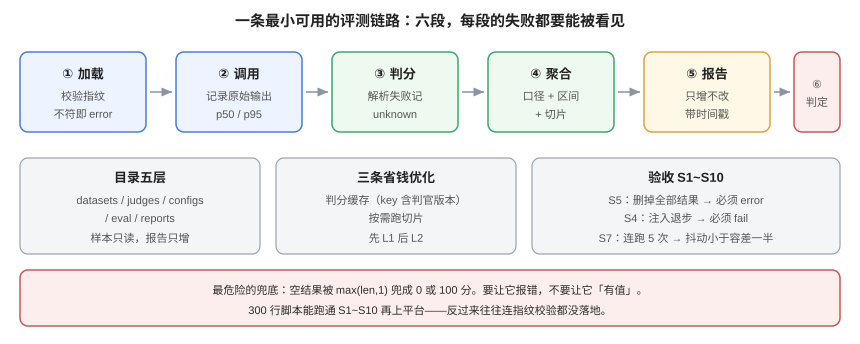

# 实战：从零搭一条评测流水线

**这一页把前面八页拼成一个能跑的东西**：一个目录、一份配置、一个运行器、一份报告、一条 CI 判定。目标不是「搭一个平台」，而是**在一个下午之内拥有一条可复现、可归因、能卡门的评测链路**——它只有 300 行代码，但每一个数字都能追到样本。

本页判据族 `EVP-A` ~ `EVP-H`，共 8 条。定义表在第八节。



## 一、先选型：看「要断言的是什么单位」

选型的决定性因素不是功能表，而是**你的判据落在哪一层**：

| 框架 | 核心抽象 | 最适合断言 | 不适合 |
| --- | --- | --- | --- |
| **promptfoo** | 声明式 config matrix（prompts × providers × tests） | 「这套配置比那套好」、提示词回归、红队 | 多轮 Agent 轨迹的细粒度断言 |
| **DeepEval** | pytest 风格的用例 + 指标断言 | 「某个组件输出是否满足指标阈值」 | 跨配置的大矩阵对比 |
| **Inspect AI** | Task = dataset + solver + scorer | 「可审计、可复现的一次实验」（含沙箱执行） | 只想快速跑一遍提示词 |
| **Ragas** | RAG 专用指标 | 召回、忠实度、答案相关性 | 非 RAG 场景 |
| **自研 runner** | 你自己定义的 JSON 契约 | 需要把门禁、归因、报告全部捏在自己手里 | 团队没人维护时（会烂掉） |

::: tip 一条实用判断
**如果你的判据是「这一次发布能不能过」，选能输出结构化报告 + 退出码的；如果你的判据是「这两个提示词谁更好」，选能跑矩阵对比的。** 两者可以共存：矩阵对比选型，单配置门禁发布。
:::

## 二、目录结构：五层，各管一件事

```text
eval/
├─ datasets/
│  └─ support-qa/
│     ├─ samples.jsonl          # 冻结的样本（只读）
│     └─ dataset.lock           # 指纹 + 配额 + 冻结日期
├─ judges/
│  └─ rubric-v3.md              # 判官提示（版本化，不内联在代码里）
├─ configs/
│  ├─ baseline.yaml             # 基线引用（release-2026-09-20）
│  └─ gate.yaml                 # 容差、切片阈值、豁免引用
├─ eval/
│  ├─ run.py                    # 运行器：加载 → 调用 → 判分 → 聚合 → 报告
│  ├─ judge.py                  # 判官调用与缓存
│  ├─ metrics.py                # 口径（pass/unknown、微宏平均、bootstrap）
│  └─ gate.py                   # 判定与退出码
└─ reports/
   └─ 2026-10-19T10-12-03Z.json # 每次运行一份，不可覆盖
```

四条纪律：

1. **样本只读**：运行器不允许写 `datasets/`。要改就开新版本目录。
2. **判官提示独立成文件**：它的哈希要进 `judge_version`，内联在代码里就没法独立版本化。
3. **报告只增不改**：文件名带时间戳，历史报告永久保留（归因要靠它）。
4. **配置与代码分离**：容差、阈值、豁免都在 `configs/`，改阈值不需要改代码、不需要过代码评审——但**必须过配置评审**（否则调阈值会变成逃避门禁的暗门）。

## 三、运行器的六段，每段的失败都要能被看见

| 段 | 做什么 | 失败时的表现 | 必须写进报告 |
| --- | --- | --- | --- |
| 1 加载 | 读样本 + 校验指纹与配额 | 指纹不符直接 `error` | `dataset`、`n` |
| 2 调用 | 调被测系统，记录原始输出 | 超时/限流 → 重试后仍失败记 `error` | `latency_p50/p95` |
| 3 判分 | 判官按 rubric 打分 | 解析失败记 `unknown`（**不是 fail**） | `judge_version` |
| 4 聚合 | 按契约算指标 + 区间 + 切片 | 空结果必须报错 | `point`、`ci95`、`slices` |
| 5 报告 | 写 JSON（含 blocking/next） | 写失败即 `error` | 全部 |
| 6 判定 | 与基线比较，返回退出码 | 见[门禁](../RegressionGate/index.md) | `status` |

```python [eval/run.py（核心 40 行，可直接改）]
import json, hashlib, sys, time
from pathlib import Path
from eval.judge import judge_one
from eval.metrics import pass_rate, bootstrap_ci
from eval.gate import decide

def load(dataset_dir: Path):
    rows = [json.loads(l) for l in open(dataset_dir / "samples.jsonl", encoding="utf-8")]
    rows.sort(key=lambda r: r["id"])
    h = hashlib.sha256()
    for r in rows:
        h.update(json.dumps(r, ensure_ascii=False, sort_keys=True).encode())
    lock = json.load(open(dataset_dir / "dataset.lock", encoding="utf-8"))
    if h.hexdigest() != lock["sha256"] or len(rows) != lock["samples"]:
        raise SystemExit("ERROR dataset fingerprint mismatch")   # 退出码 3
    return rows, lock

def run(rows, judge_version):
    out = []
    for r in rows:
        t0 = time.perf_counter()
        answer = call_system(r)                    # 你接模型/服务的地方
        v = judge_one(r, answer, judge_version)    # 返回 pass/fail/unknown
        out.append({"id": r["id"], "verdict": v, "ms": (time.perf_counter()-t0)*1000,
                    "slice": r["slice"]})
    return out

def main():
    rows, lock = load(Path("datasets/support-qa"))
    judge_version = "judge-rubric-v3@gpt-x@t0"
    res = run(rows, judge_version)
    unknown = sum(1 for x in res if x["verdict"] == "unknown") / len(res)
    p = pass_rate(res)                              # 分母排除 unknown
    lo, hi = bootstrap_ci(res, seed=42)
    report = {"status": None, "dataset": f"support-qa@{lock['version']}",
              "judge_version": judge_version, "n": len(res), "point": p,
              "ci95": [lo, hi], "unknown_rate": unknown, "slices": slice_stats(res)}
    report["status"], code = decide(report, "configs/gate.yaml")
    Path(f"reports/{time.strftime('%Y-%m-%dT%H-%M-%SZ')}.json").write_text(
        json.dumps(report, ensure_ascii=False, indent=2))
    sys.exit(code)                                  # 0/1/2/3 四态
```

::: danger 三个必须现在就写对的细节
1. **`unknown` 单独计数**：解析失败不能算 fail，也不能算 pass（见[指标口径](../MetricsDefinition/index.md)）。
2. **指纹不符直接退出**：不要「警告后继续」——那等于允许在漂移的数据上做对比。
3. **空结果必须报错**：`sum([])/len([])` 会抛异常，但很多实现用 `max(len,1)` 兜底，于是空集变成 0 分或 100 分。**兜底是最危险的写法。**
:::

## 四、成本与并发：三条不花钱的优化

| 优化 | 做法 | 省多少（推演） |
| --- | --- | --- |
| **判分缓存** | key = `(sample_id, judge_version, output_hash)` | 重复运行省 80%+ 判官调用 |
| **分层抽样跑** | PR 只跑受影响切片（如改了检索只跑检索相关 120 条） | 时间省 60% |
| **先 L1 后 L2** | 格式崩的样本不进判官 | 避免为垃圾输出付费 |

缓存要注意一件事：**缓存 key 里必须有判官版本**。否则换了 rubric 之后命中旧缓存，你会得到一个「用旧尺子量新东西」的分数，而且看不出来。

## 五、一条命令跑起来

```shell
python -m eval.run --dataset support-qa@v3 --judge judge-rubric-v3 --out reports/
echo "exit=$?"
```

期望输出（示意）：

```text
dataset=support-qa@v3 n=300 judge=judge-rubric-v3@gpt-x@t0
point=0.783 ci95=[0.733,0.823] unknown=0.007
slices: short=0.860 medium=0.780 long=0.710 spoken=0.740 multi=0.630
status=pass exit=0
```

## 六、验收序列 `S1~S10`

按顺序做，每步都有可观察的收尾。**任何一步做不出读数，就不要进入下一步。**

| 步 | 动作 | 通过标准 |
| --- | --- | --- |
| `S1` | 跑一次，记录 `n / point / ci95` | 三个数都在，且 `n` 与锁文件一致 |
| `S2` | 故意改一条样本，重跑 | 指纹不符 → 退出码 3 |
| `S3` | 把判官温度改成 0.9，跑 3 次 | `unknown_rate` 或点估计明显波动 → 说明温度没固定 |
| `S4` | 注入 20 条必然失败的样本 | 点估计下降、`blocking` 非空、退出码 1 |
| `S5` | 删除全部结果，跑一次 | 退出码 3，**不是** 0 |
| `S6` | 换 rubric 但不换缓存 key | 分数应变（证明 key 含判官版本） |
| `S7` | 连跑 5 次（同配置） | `spread_pt` 小于容差一半 |
| `S8` | 打开一个已过期豁免 | 门禁忽略该豁免，仍红 |
| `S9` | 查看报告 JSON | 含 `dataset / judge_version / n / ci95 / slices / blocking / next` |
| `S10` | 把一个切片阈值调严 3pt | 该切片变 `warn` 或 `fail`，退出码随之变化 |

::: tip `S5` 是最容易被跳过、也最值得做的一步
「没有结果」被当成「全部通过」，是评测门禁里最隐蔽的假绿。它不会报错，只会安静地给你一个 0 或 100。**用一条命令证明它不会。**
:::

## 七、从脚本长成平台：什么时候该升级

| 信号 | 说明 | 该做什么 |
| --- | --- | --- |
| 超过 3 个团队共用同一份样本 | 样本治理需要权限与流程 | 上数据集服务 + 版本目录 |
| 一次运行超过 30 分钟 | 并发与缓存成为瓶颈 | 引入任务队列与结果缓存 |
| 报告需要人人在网页上看 | JSON 不够用了 | 接观测平台（如 LangSmith / Braintrust / Phoenix） |
| 判官超过 5 个版本 | 校准闭环需要自动化 | 把[判官校准](../JudgeCalibration/index.md)的闭环做成定时任务 |

**不要一上来就上平台。** 300 行脚本能跑通 `S1~S10` 之后再升级，迁移成本最低；反过来先上平台，往往连「指纹校验」这种基础约束都没落地。

## 八、判据族 `EVP`

| 判据 | 内容 | 怎么验证 |
| --- | --- | --- |
| `EVP-A` | 目录必须五层分离（datasets/judges/configs/eval/reports） | `ls` 能看到五个目录，且样本目录只读 |
| `EVP-B` | 样本目录不允许被运行器写入 | 运行后 `git status datasets/` 为空 |
| `EVP-C` | 判官提示必须独立文件且其哈希进 `judge_version` | 报告里的 `judge_version` 能追到 rubric 文件哈希 |
| `EVP-D` | 报告必须只增不改，文件名带时间戳 | `reports/` 里无同名覆盖 |
| `EVP-E` | 阈值与豁免必须在配置文件，不在代码里 | `configs/gate.yaml` 存在且被 `gate.py` 读取 |
| `EVP-F` | 必须通过 `S1~S10` 全部验收 | 十条都有读数记录 |
| `EVP-G` | 判分缓存 key 必须含判官版本 | 换 rubric 后分数变化（`S6`） |
| `EVP-H` | 升级平台前必须已稳定运行脚本版 ≥ 2 周 | 有运行历史与 `spread_pt` 记录 |

## 九、与相邻专题的分工

| 你想知道 | 去哪 |
| --- | --- |
| 样本怎么建、怎么冻结 | [评测集构建与冻结](../DatasetDesign/index.md) |
| 判官怎么校准 | [判官校准](../JudgeCalibration/index.md) |
| 门禁怎么定阈值、怎么留豁免 | [回归门禁](../RegressionGate/index.md) |
| 红了怎么归因 | [变红归因](../Attribution/index.md) |
| 在 GitHub Actions 里怎么组织流水线 | [CI/CD](../../../Tools/CICD/Overview/index.md) |
| 观测平台怎么接 trace 与在线评估 | [LLM 可观测性](../../LLMObservability/Overview/index.md) |

## 参考资料

- promptfoo 文档：[Configuration reference](https://www.promptfoo.dev/docs/configuration/guide/)
- DeepEval 文档：[Metrics and test cases](https://docs.confident-ai.com/)
- Inspect AI 文档：[Tasks, solvers, scorers](https://inspect.aisi.org.uk/)
- Ragas 文档：[Metrics](https://docs.ragas.io/)
- 本站：[回归门禁](../RegressionGate/index.md)、[离线评估与回归门禁](../../LLMObservability/OfflineEval/index.md)
