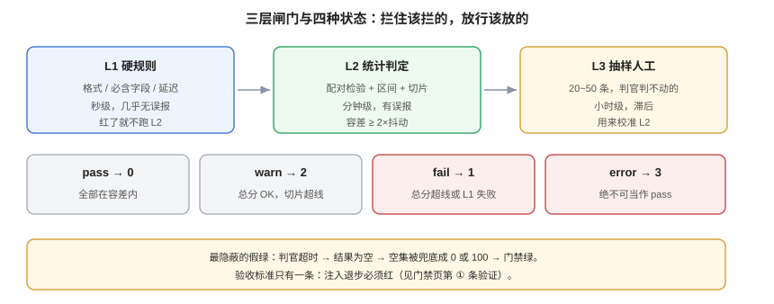

# 回归门禁：让分数拦住发布

**门禁的价值不在于「有没有」，而在于「它红过几次、红得对不对」。** 一个从来没红过的门禁，要么阈值定得极松，要么它根本没接进流程。这一页给出三层闸门的分工、阈值怎么从历史数据里长出来、噪声怎么治、豁免怎么留痕，以及一条最低要求：**门禁必须能被证伪**。

本页判据族 `EVG-A` ~ `EVG-H`，共 8 条。定义表在第八节。



## 一、三层闸门，各拦一类问题

| 层 | 拦什么 | 判定方式 | 典型耗时 | 误报特性 |
| --- | --- | --- | --- | --- |
| **L1 硬规则** | 格式崩、必含字段缺失、拒答率暴涨、延迟超限 | 确定性，逐条 | 秒级 | 几乎无误报 |
| **L2 统计判定** | 质量真的退步（在噪声之上） | 配对检验 + 区间 + 切片 | 分钟级 | 有误报，靠容差控制 |
| **L3 抽样人工** | 判官判不动的（新意图、语气、合规） | 抽样 20~50 条 | 小时级 | 低，但滞后 |

顺序不能反：**L1 红就不要跑 L2**——格式都解析不了，质量分算出来也是垃圾（`unknown_rate` 会直接告诉你是这种情况）。

## 二、阈值从历史数据里长出来

三种定阈值的做法，只有第三种能长期成立：

| 做法 | 过程 | 什么时候会失效 |
| --- | --- | --- |
| 拍脑袋 | 「低于 0.8 就拦」 | 换数据集/换判官当天失效 |
| 贴着当前分数 | 「基线 0.783，低 0.5pt 就拦」 | 噪声带内反复红绿 |
| **历史分布 + 不回退承诺** | 用最近 N 次同配置运行的分布算容差 | 需要维护基线，但可解释、可审计 |

具体算法（推演口径，按自己的读数替换）：

```text
容差 = max(2 × 历史同配置运行的分数标准差, 目标最小可检测效应)
阈值 = 基线分数 − 容差
```

若历史 5 次同配置运行的分数为 `0.783 / 0.779 / 0.791 / 0.775 / 0.787`，标准差约 0.006（0.6pt），则容差取 1.2pt 与 MDE（300 条时 4.5pt）中的较大者 = **4.5pt**，阈值 ≈ 0.738。

::: danger 两个最常见的定阈值错误
1. **容差小于噪声**：阈值贴着均值，门禁必然时红时绿，团队三周内学会「重跑一次」。
2. **基线随每次运行滚动**：`baseline = 上次的分数` 会让门禁永远追不上退步——每周退 0.3pt，十周退 3pt，而门禁每次都说「没退」。**基线必须固定在一个通过人工验收的版本上。**
:::

## 三、灰区：让「不确定」有一席之地

只有红/绿两态的门禁会迫使你在「误报」和「漏报」之间选一个。三态更实用：

| 状态 | 触发条件 | 后果 | 退出码 |
| --- | --- | --- | --- |
| `pass` | 所有切片都在容差内 | 放行 | 0 |
| `warn` | 总分在容差内，但**某切片**超出容差 | 放行但记 issue，需指定跟进人 | 2 |
| `fail` | 总分超出容差，或 L1 硬规则失败 | 阻断 | 1 |
| `error` | 运行本身失败（解析、超时、配额） | 阻断，且**不得**当作 pass | 3 |

`error` 单独一档非常关键：**评测跑挂了绝不能被当成通过**。很多门禁的假绿就来自「判官超时 → 结果为空 → 空集的平均分是 0/0 → 被当成 100%」。

## 四、门禁的输出必须是一份契约

```json [gate/report.json]
{
  "status": "fail",
  "dataset": "support-qa@v3",
  "judge_version": "judge-rubric-v3@gpt-x@t0",
  "n": 300,
  "point": 0.741,
  "baseline": { "ref": "release-2026-09-20", "point": 0.783 },
  "tolerance_pt": 4.5,
  "ci95": [0.690, 0.789],
  "test": { "name": "mcnemar_exact", "b": 24, "c": 12, "p_value": 0.061 },
  "slices": {
    "long":   { "point": 0.55, "delta_pt": -16.0, "status": "fail" },
    "short":  { "point": 0.86, "delta_pt": 0.5,   "status": "pass" }
  },
  "blocking": ["slice:long"],
  "next": "先查长上下文切片（见归因页 S1~S4）"
}
```

这份报告要能被三拨人读：CI 读 `status` 与退出码、开发者读 `blocking` 与 `next`、事后审计读 `baseline.ref` 与 `judge_version`。

## 五、噪声治理：flaky 样本与重跑规则

门禁抖动有四个来源，对应的治法不同：

| 来源 | 现象 | 治法 |
| --- | --- | --- |
| 判官随机性 | 同一输入结论翻转 | 温度固定 + 三次多数票（仅门禁） |
| 不稳定样本 | 少数样本反复翻转 | 移入 `quarantine` 列表，单独统计、不计入主指标 |
| 阈值贴噪声 | 分数在阈值附近震荡 | 容差 ≥ 2 × 抖动（见[统计](../Statistics/index.md)） |
| 外部依赖 | 检索库、工具接口抖动 | 固定快照，或对该切片单列 |

**重跑规则必须写死并留痕**：只允许在 `status=error` 时自动重跑一次；`fail` 重跑得到的 pass 必须标注「重跑通过」，并计入月度统计。否则「重跑到绿」会变成团队的标准动作。

## 六、CI 接线：省时间的三条

1. **按需跑切片**：PR 只改了检索层，就跑检索相关切片；全量跑留给 `main` 合并前。用 `paths` 过滤实现，但**全量结论仍以 main 为准**。
2. **缓存判官结果**：以 `(sample_id, judge_version, model_output_hash)` 为 key 缓存判定。同一份输出重复判定是纯浪费，而且会引入随机噪声。
3. **门禁与部署解耦**：门禁是 PR 的一步，不依赖部署环境；部署前再跑[上线前置闸门](../../../../project/Complete/TeamBoard/PreLaunchGate/index.md)那一套（两件事，别混）。

```yaml [.github/workflows/eval-gate.yml（节选）]
- name: eval gate
  run: |
    python -m eval.run --dataset support-qa@v3 --judge judge-rubric-v3 \
      --baseline release-2026-09-20 --out gate/report.json
  # 退出码即结论：0 pass / 1 fail / 2 warn / 3 error
  continue-on-error: false

- name: comment on fail
  if: failure()
  run: python -m eval.comment --report gate/report.json
```

::: warning `continue-on-error: true` 是最常见的「假门禁」
它让步骤显示为成功，红点消失，报告躺在 artifact 里没人看。要么不接，要么接成阻断——**中间态等于没接**。
:::

## 七、豁免：允许破例，但必须留痕

真实项目一定有「本次接受退步」的时候（例如为了修一个更严重的问题）。豁免不是禁止，而是要求三件事：

| 要素 | 要求 | 缺了会怎样 |
| --- | --- | --- |
| **范围** | 指明具体切片与幅度（如 `long: -5pt 以内`） | 「整体接受退步」等于关掉门禁 |
| **期限** | 到期自动失效（如 2 周） | 临时豁免变成永久豁免 |
| **补偿动作** | 谁在什么时候修回来 | 退步没人认领，缓慢累积 |

```json [gate/waivers.json]
[
  {
    "id": "W-2026-10-19-01",
    "scope": { "slice": "long", "max_delta_pt": -5.0 },
    "reason": "长上下文检索改造分两批，本批先修召回",
    "owner": "team-search",
    "expires": "2026-11-02",
    "compensation": "batch-2 上线后重跑 long 切片，必须回到 -1pt 以内"
  }
]
```

## 八、验证方式

门禁的验收标准只有一条：**它必须能被证伪**。

```shell
# ① 故意打破一个已知判据，门禁必须红（最重要的验证）
python3 - <<'PY'
import json, subprocess, sys
base = json.load(open('gate/report.json'))
base['slices']['long']['point'] = 0.40          # 人为制造 -31pt 退步
json.dump(base, open('/tmp/broken.json','w'))
print('injected regression into /tmp/broken.json')
PY
./eval.sh --report /tmp/broken.json --check
# 期望：退出码 1，且 blocking 里含 slice:long。退出码 0 说明门禁是恒真的
```

```shell
# ② 正常变更下必须绿（避免门禁只会红）
./eval.sh --baseline release-2026-09-20 --check
echo "exit=$?"
# 期望：exit=0 或 2（warn）；若常态是 1，说明容差太小或基线过期
```

```shell
# ③ 恒真检测：把数据集换成「全好样本」，门禁应当仍能算出正常分数而不是 1.0
python3 - <<'PY'
import json
rows = [json.loads(l) for l in open('results.jsonl', encoding='utf-8')]
bad = sum(1 for r in rows if r['verdict'] == 'fail')
print('n', len(rows), 'fail', bad, 'pass_rate', round(1-bad/len(rows),3))
PY
# 期望：pass_rate 明显低于 1.0。若恒为 1.0，说明判官/解析在读不到结果时默认通过
```

```shell
# ④ error 不等于 pass：故意让判官超时
EVAL_JUDGE_TIMEOUT_MS=1 ./eval.sh --check; echo "exit=$?"
# 期望：exit=3（error），且报告里 status=error。exit=0 说明空结果被当成了通过
```

```shell
# ⑤ 豁免是否过期
python3 - <<'PY'
import json, datetime
now = datetime.date(2026, 10, 19)
for w in json.load(open('gate/waivers.json')):
    exp = datetime.date.fromisoformat(w['expires'])
    print(w['id'], 'EXPIRED' if exp < now else 'active', (exp-now).days, 'days left')
PY
# 期望：没有 EXPIRED。有则说明豁免已经变成永久豁免
```

## 九、判据族 `EVG`

| 判据 | 内容 | 怎么验证 |
| --- | --- | --- |
| `EVG-A` | 门禁必须分三层，L1 红时不得继续跑 L2 | 运行日志里 L1 失败后无 L2 输出 |
| `EVG-B` | 容差必须 ≥ 2 × 历史同配置分数抖动 | 有 5 次运行的 `spread_pt` 与阈值容差对照 |
| `EVG-C` | 基线必须固定在通过验收的版本上，不得随运行滚动 | 报告里 `baseline.ref` 指向具体版本号 |
| `EVG-D` | 必须有 `warn` 与 `error` 两态，且 `error` 不视为通过 | 制造超时后退出码为 3 |
| `EVG-E` | 门禁必须能被证伪：注入退步后确实红 | 执行第 ① 条验证，退出码 1 |
| `EVG-F` | CI 步骤不得使用 `continue-on-error: true` 绕过阻断 | 工作流文件里该字段不存在或为 false |
| `EVG-G` | 重跑必须留痕，且只允许 `error` 自动重跑一次 | 报告里有 `rerun` 计数与原始状态 |
| `EVG-H` | 豁免必须含范围、期限、补偿动作，且过期自动失效 | `waivers.json` 三项齐全，且无 EXPIRED |

## 十、与相邻专题的分工

| 你想知道 | 去哪 |
| --- | --- |
| 评测流水线怎么从观测平台取样本、怎么定时跑 | [离线评估与回归门禁](../../LLMObservability/OfflineEval/index.md) |
| 指标口径与区间怎么算 | [指标口径](../MetricsDefinition/index.md)、[区间与检验](../Statistics/index.md) |
| 红了之后怎么定位 | [变红归因](../Attribution/index.md) |
| 上线前的七道部署闸门 | [上线前置闸门](../../../../project/Complete/TeamBoard/PreLaunchGate/index.md) |
| 质量闸门在 CI 里怎么接、怎么做变异测试 | [质量闸门接线](../../../../project/Complete/TeamBoard/CiQualityGate/index.md) |
| 代码测试的覆盖率门禁 | [单元测试与覆盖率](../../../Frontend/Testing/Overview/index.md) |
| 发布与回滚策略 | [发布与回滚](../../../Tools/CICD/DeployRollback/index.md) |

## 参考资料

- Google Testing Blog：[*Test Flakiness – One of the main challenges of automated testing*](https://testing.googleblog.com/2016/05/flaky-tests-at-google-and-how-we.html)
- Martin Fowler：[*Feature Toggles (aka Feature Flags)*](https://martinfowler.com/articles/feature-toggles.html)（「豁免也要有生命周期」的同构思路）
- 本站：[离线评估与回归门禁](../../LLMObservability/OfflineEval/index.md)、[变红归因](../Attribution/index.md)
