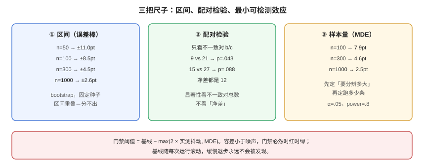

# 区间、检验与样本量

**「这次比上次高 2.3 个点」这句话，在 300 条样本上通常什么也证明不了。** 这一页把三件事算清楚：这个分数的误差棒有多宽（区间）、两个分数的差是不是真的（配对检验）、要分辨某个差距需要多少条（样本量）。三件事都不需要复杂工具，Python 标准库足够。

本页判据族 `EVS-A` ~ `EVS-H`，共 8 条。定义表在第七节。



## 一、区间：先给分数配一根误差棒

评测指标本质上是「从一个样本里估出来的比例」。既然是估计，就必须带区间。bootstrap 是最省事、假设最少的方法：

```text
重复 B 次：从 n 条样本里「有放回」抽 n 条，算一次指标 → 得到 B 个值
取这 B 个值的 2.5% 与 97.5% 分位 → 95% 置信区间
```

在 p=0.78、B=2000、固定种子下（本机计算）：

| 样本量 n | 95% CI | 半宽 | 一句话读法 |
| --- | --- | --- | --- |
| 50 | [0.660, 0.880] | ±11.0pt | 只够判断「有没有崩」 |
| 100 | [0.690, 0.860] | ±8.5pt | 5pt 以内的改动看不出来 |
| 300 | [0.733, 0.823] | **±4.5pt** | 门禁的最低配置 |
| 1000 | [0.754, 0.806] | ±2.6pt | 能分辨 3pt 左右 |

::: tip 两条实用规则
1. **报告里没有区间的分数，不要用来比较。** 两个区间重叠得多，就是分不出。
2. **半宽要小于「你想分辨的最小差距」。** 目标差距 3pt 却用 300 条（±4.5pt），注定得出「无变化」。
:::

## 二、检验：配对，而不是两组独立比较

同一批样本上跑两个版本，是**配对**数据——每条样本在两版上的结果相关。用两组比例检验（如卡方）会低估显著性，正确做法是只看**不一致的那些对**：

| | 新版通过 | 新版不通过 |
| --- | --- | --- |
| **旧版通过** | a（都过） | b（**退步**） |
| **旧版不通过** | c（**进步**） | d（都不过） |

- 一致的对（a、d）不提供「谁更好」的信息；
- 只有 b 与 c 有意义，检验它们是否对称。

McNemar 精确检验就是对这个 2×2 做二项检验（H0：b 与 c 等概率）。本机计算结果：

| b（退步） | c（进步） | 净差 c−b | 精确 p 值 | 读法 |
| --- | --- | --- | --- | --- |
| 6 | 9 | +3 | 0.607 | 完全看不出 |
| 12 | 13 | +1 | 1.000 | 完全看不出 |
| **9** | **21** | **+12** | **0.043** | 显著（α=0.05） |
| 15 | 27 | +12 | 0.088 | **同样净差 12，却不显著** |
| 30 | 45 | +15 | 0.105 | 净差更大，仍不显著 |

最后两行是本页最重要的一课：**显著性取决于「不一致对的总数」，不是「净差」。** 15 对 27 与 30 对 45，净差都是 12（或 15），但后者的不一致对翻倍，同样比例的差异就淹没在噪声里。

::: danger 三个会让 p 值失真的操作
1. **反复偷看**：跑一次看看，不显著就再跑一次，看到红了才停——这是在放大假阳性率。要停就必须用序贯检验，或固定「只跑一次」。
2. **只报最好的那次**：连跑 5 次取最高分，等于把噪声当作真实提升。
3. **多重比较不校正**：4 个切片 × 3 个指标 = 12 次比较，α=0.05 下期望有 0.6 次假阳性。要么校正（Bonferroni：α/12），要么把切片结论标为「探索性」。
:::

## 三、样本量：先算能分辨多少，再决定跑多少

配对设计下，可检出的净差与「不一致对数量」有关。按 α=0.05、power=0.8 近似（z≈2.80）：

| 样本量 | 假设不一致率 8% | 不一致对 ≈ | 可检出净差（约） |
| --- | --- | --- | --- |
| 100 | 8 对 | 8 | **±7.9pt** |
| 300 | 24 对 | 24 | ±4.6pt |
| 1000 | 80 对 | 80 | ±2.5pt |

这张表和第一节的区间半宽表结论一致：**想分辨 3pt，就得准备 1000 条。** 这不是统计学的苛求，而是「用 300 条去测 2pt 改动」本来就是在测噪声。

## 四、门禁噪声：为什么阈值不能贴着均值和方差

假设每条样本有 3% 的概率因为判官抖动而翻转结论（这个数字很保守）。那么：

| 样本量 | 「至少一条翻转」的概率 | 翻转条数标准差 | 折算成分数抖动 |
| --- | --- | --- | --- |
| 50 | 0.782 | 1.21 条 | ≈2.41pt |
| 200 | **0.998** | 2.41 条 | ≈1.21pt |
| 1000 | ≈1.000 | 5.39 条 | ≈0.54pt |

读法有两层：

1. **「至少一条翻转」几乎必然发生**（200 条时 99.8%）。所以门禁不能设计成「任何一条样本变化就红」——那是必然红。
2. **但整体分数抖动会随 n 变小**（2.41pt → 1.21pt → 0.54pt）。这正是「扩样本能稳门禁」的数学原因，也是为什么小样本门禁必须留更宽的容差。

设计阈值时用这条式子定位：**容差 ≥ 2 × 分数抖动**。200 条样本对应约 1.2pt 抖动，所以阈值不应小于 2.5pt；否则每次运行都在红绿之间摇摆。

## 五、报告怎么写：五个数，缺一不可

| 字段 | 例 | 作用 |
| --- | --- | --- |
| `n` | 300 | 分母，决定一切 |
| `point` | 0.783 | 点估计 |
| `ci95` | [0.733, 0.823] | 误差棒 |
| `p_value` + `test` | 0.043 / mcnemar_exact | 与基线比较的显著性 |
| `effect` | +2.3pt（不一致对 9 vs 21） | 效应量 + 来源，便于复查 |

```json [reports/2026-10-19-support-qa.json]
{
  "run_id": "2026-10-19T10-12-03Z",
  "dataset": "support-qa@v3",
  "judge_version": "judge-rubric-v3@gpt-x@t0",
  "n": 300,
  "point": 0.783,
  "ci95": [0.733, 0.823],
  "baseline": { "point": 0.760, "n": 300 },
  "test": { "name": "mcnemar_exact", "b": 9, "c": 21, "p_value": 0.043 },
  "effect": { "delta_pt": 2.3, "note": "不一致对 9 退步 / 21 进步" },
  "slices": { "long": 0.71, "short": 0.82, "zh_spoken": 0.74, "multi_step": 0.63 }
}
```

::: warning 别把「不显著」写成「没有变化」
p=0.088 的正确表述是「本次样本量下未能检出差异」，不是「两版一样」。前者留了余地，后者是一个未被证明的结论。**尤其当效应量与历史趋势一致时，「未检出」往往只是样本不足。**
:::

## 六、验证方式

```shell
# ① bootstrap 95% 区间（固定种子，可复现）
python3 - <<'PY'
import random
def ci(p, n, B=2000, seed=42):
    rnd = random.Random(seed); s = []
    for _ in range(B):
        s.append(sum(1 for _ in range(n) if rnd.random() < p) / n)
    s.sort()
    return s[int(0.025*B)], s[int(0.975*B)]
for n in (50, 100, 300, 1000):
    lo, hi = ci(0.78, n)
    print(n, round(lo,3), round(hi,3), 'halfwidth_pt', round((hi-lo)/2*100,1))
PY
# 期望：n=300 时 halfwidth_pt≈4.5；n=50 时≈11.0
```

```shell
# ② McNemar 精确检验（只看不一致对）
python3 - <<'PY'
import math
def mcnemar(b, c):
    n = b + c
    if n == 0: return 1.0
    k = min(b, c)
    p = 2 * sum(math.comb(n, i) for i in range(k+1)) / 2**n
    return min(1.0, p)
for b, c in [(6,9), (12,13), (9,21), (15,27), (30,45)]:
    print(f'b={b} c={c} p={mcnemar(b,c):.4f}')
PY
# 期望：p=0.6072 / 1.0000 / 0.0428 / 0.0884 / 0.1053
# 注意 (9,21) 与 (15,27) 净差都是 12，p 却差一倍——显著性看不一致对总数
```

```shell
# ③ 最小可检测效应（近似式，用于估算要跑多少条）
python3 - <<'PY'
import math
z = 1.96 + 0.8416
for n in (100, 300, 1000):
    d = 0.08 * n                      # 假设不一致率 8%
    print(n, 'discordant≈', round(d), 'MDE_pt≈', round(z*math.sqrt(d)/n*100, 1))
PY
# 期望：100→7.9pt / 300→4.6pt / 1000→2.5pt
```

```shell
# ④ 门禁噪声：同一份代码连跑 5 次，看通过率
for i in 1 2 3 4 5; do ./eval.sh --out reports/run-$i.json >/dev/null; done
python3 - <<'PY'
import json, glob
vals = [json.load(open(f))['point'] for f in sorted(glob.glob('reports/run-*.json'))]
print('runs', len(vals), 'min', min(vals), 'max', max(vals), 'spread_pt', round((max(vals)-min(vals))*100, 1))
PY
# 期望：spread_pt 小于阈值容差的一半；否则阈值落在噪声带里，门禁必然反复红绿
```

## 七、判据族 `EVS`

| 判据 | 内容 | 怎么验证 |
| --- | --- | --- |
| `EVS-A` | 每个分数必须带 95% 区间与样本量 | 报告里有 `ci95` 与 `n` |
| `EVS-B` | 区间方法必须写明（bootstrap / 解析），bootstrap 要固定种子 | 报告或契约里有 `ci.method` 与 `seed` |
| `EVS-C` | 版本对比必须用配对检验，不得用两组独立检验 | 报告里 `test.name` 为 `mcnemar_exact` 或等价 |
| `EVS-D` | 必须报告不一致对的 b/c，而不只报 p 值 | 报告里有 `b` 与 `c` |
| `EVS-E` | 同一批结论最多只看一次；多次比较必须校正或标为探索性 | 有比较次数记录；多切片结论带校正说明 |
| `EVS-F` | 「未检出差异」不得写成「没有变化」 | 抽查报告措辞，出现「两版一致」而无区间支撑即不合格 |
| `EVS-G` | 样本量必须满足 MDE ≤ 目标分辨差距 | 报告里能给出 MDE 与目标差距的对比 |
| `EVS-H` | 门禁阈值容差必须 ≥ 2 × 实测分数抖动 | 连跑 5 次的 `spread_pt` 与阈值容差可对照 |

## 八、与相邻专题的分工

| 你想知道 | 去哪 |
| --- | --- |
| 指标口径怎么定 | [指标口径](../MetricsDefinition/index.md) |
| 人-人一致性怎么算 | [人工基线](../HumanAlignment/index.md) |
| 门禁怎么接 CI、豁免怎么留痕 | [回归门禁](../RegressionGate/index.md) |
| A/B 实验的流量分配与判定 | [实验驱动](../../../Tools/ObservabilityDriven/Experiments/index.md) |
| 线上指标的可信区间与告警阈值 | [告警设计](../../../Ops/Monitoring/Alerting/index.md) |

## 与「数据合成与标注工程」专题的分工

本页讲**评测结论的统计推断**（显著性、置信区间、多重比较）。专题 [数据合成与标注工程](../../SyntheticData/index.md) 里也有一段统计，但它算的是**标注一致性指标的区间**，不是模型效果的区间——两者用的是同一套自助法，样本单位不同。

| 问题 | 本页 | 该专题 |
| --- | --- | --- |
| 两个模型差 2 个点显著吗 | 本页核心（配对检验、bootstrap） | 不涉及 |
| κ / α 的区间怎么算 | 不涉及 | [一致性度量](../../SyntheticData/Agreement/index.md)：自助法，给出宽度表 |
| 需要多少样本 | 按效应量算 | 按「想把区间宽度压到多少」算 |
| 点估计能不能跨规模比 | 本页强调不能 | 该专题用实测把这条钉死 |

::: danger 一个具体的反例
同一份标注质量，只改样本量，κ 的点估计是：n=50 → **0.560**，n=100 → **0.364**，n=800 → 0.485。**小样本的点估计纯粹是噪声**，而区间宽度从 0.502 收到 0.131。

这条对评测同样成立：拿 200 条评测集算出的准确率，与拿 2,000 条算出的准确率**不能直接比大小**。本页的显著性检验正是为此存在，但它的前提是「两次评测用的是同一批样本」——跨规模比较请回到区间。
:::

## 参考资料

- McNemar, Q. (1947), *Note on the sampling error of the difference between correlated proportions*
- Dietterich, T. (1998), *Approximate Statistical Tests for Comparing Supervised Classification Learning Algorithms*
- Efron & Tibshirani, *An Introduction to the Bootstrap*
- Benjamini & Hochberg (1995), *Controlling the False Discovery Rate*
- 本站：[指标口径](../MetricsDefinition/index.md)、[回归门禁](../RegressionGate/index.md)
