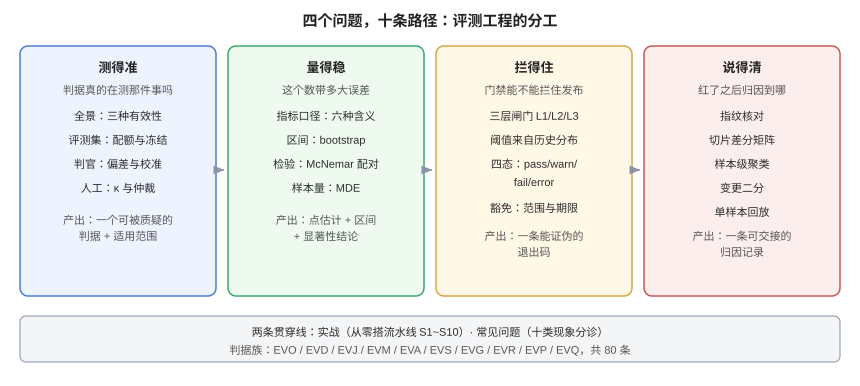

# 模型评测工程与判据校准

「评测」在多数团队里是一张跑分表：改完提示词，跑一遍，分数从 0.81 变成 0.84，于是发布。问题在于——**0.84 这个数，可能连「比 0.81 好」都证明不了**：它可能来自 300 条样本里 9 条的抖动，可能因为评测集换了 200 条难样本，也可能因为判官今天更偏爱长答案。

本专题只回答一个问题：**当你手里有一个分数时，凭什么相信它说的那件事？** 围绕这个问题拆成四段——**测得准**（判据有效性与人工对齐）、**量得稳**（样本量、区间与检验）、**拦得住**（回归门禁）、**说得清**（变红之后归因到哪条样本、哪次变更）。数据集、判官、指标、门禁、归因，都是这四段的载体。

面向已经在跑评测、并且**要用评测结果做发布决定**的算法、后端与质量工程同学。读完你应当能回答：**我们那个 0.84，误差棒有多宽？换一批样本还站得住吗？**

::: tip 一句话理解
**评测工程不是「把分数算出来」，而是「让分数带上它自己的误差与适用范围」。** 一个没有区间的分数，只能用来写周报，不能用来卡发布。
:::

## 本专题的十页

| 页面 | 回答的问题 | 判据族 |
| --- | --- | --- |
| [评测工程全景：三种有效性](Overview/index.md) | 评测到底在测什么，哪一层最容易假绿 | `EVO-A` ~ `EVO-H` |
| [评测集构建与冻结](DatasetDesign/index.md) | 样本从哪来、要多少条、怎么防污染与漂移 | `EVD-A` ~ `EVD-H` |
| [判官校准：让 LLM 打分可信](JudgeCalibration/index.md) | 位置偏差、长度偏差、自偏好怎么量、怎么压 | `EVJ-A` ~ `EVJ-H` |
| [指标口径：一个数字的六种含义](MetricsDefinition/index.md) | accuracy、pass@k、宏平均各回答什么 | `EVM-A` ~ `EVM-H` |
| [人工基线与一致性](HumanAlignment/index.md) | κ 怎么算、为什么 98% 一致率只有 κ=0.5 | `EVA-A` ~ `EVA-H` |
| [区间、检验与样本量](Statistics/index.md) | 差 3 个点算真的变好吗 | `EVS-A` ~ `EVS-H` |
| [回归门禁：让分数拦住发布](RegressionGate/index.md) | 阈值从哪来、噪声怎么治、豁免怎么留痕 | `EVG-A` ~ `EVG-H` |
| [变红归因：从分数到样本](Attribution/index.md) | 门禁红了，先看哪三条线索 | `EVR-A` ~ `EVR-H` |
| [实战：从零搭一条评测流水线](Practice/index.md) | 目录、配置、运行器、报告、CI 怎么拼 | `EVP-A` ~ `EVP-H` |
| [常见问题与最佳实践](FAQ/index.md) | 十二类现象怎么分诊、上线自查清单 | `EVQ-A` ~ `EVQ-H` |

## 先看一组会让人不舒服的读数

下表是本机用 Python 标准库算出来的（脚本见各页「验证方式」，可原样复现）。三行数据说的是同一件事：**原始一致率会系统性地高估判官**。

| 场景 | 原始一致率 | 期望一致率（随机也能达到） | Cohen's κ |
| --- | --- | --- | --- |
| 正负样本各半 | 0.900 | 0.504 | **0.798** |
| 缺陷率 5% | 0.977 | 0.926 | **0.684** |
| 缺陷率 2% | 0.987 | 0.974 | **0.495** |

第三行是最典型的现场：**判官和人工「98.7% 一致」，κ 只有 0.495**——因为样本里 98% 都是「通过」，判官只要永远说「通过」，就能拿到 98% 的一致率。κ 扣掉了这份「白送的分」，剩下的才是真本事。

::: danger 这三种情况，评测结果不能用来做发布决定
1. **没有区间**：只报点估计。300 条样本上 ±4.5pt 的 95% 区间是常态，差 2 个点根本分不出胜负。
2. **没有冻结**：评测集每天都在被「顺手补两条」，两次运行的差异里混着数据差异，归因永远做不完。
3. **判官没校准**：判官与人工的 κ 从未算过，却用它卡发布——**这等于让一个没考过试的人批卷子**。
:::

## 本专题与相邻专题的分工

「评测」这个词在库里被至少六个专题用过，边界必须写死，否则读者会在六个页面之间反复横跳：

| 你想要的 | 去哪里 |
| --- | --- |
| **评测流水线怎么接观测平台、trace 怎么回流成样本** | [离线评估与回归门禁](../LLMObservability/OfflineEval/index.md)（工程接线层） |
| **线上指标怎么采、A/B 怎么分流、灰度怎么判定** | [在线评估](../LLMObservability/OnlineEval/index.md) |
| **RAG 的 faithfulness / context recall 怎么算** | [RAG 评估](../RAG/Evaluation/index.md)（指标定义层） |
| **多模态检索的召回与排序指标** | [多模态检索评估](../MultimodalRetrieval/Evaluation/index.md) |
| **微调前后的效果对比怎么做** | [微调评估](../FineTuning/Evaluation/index.md) |
| **提示词改版怎么快速对比（工具视角）** | [提示词评估](../PromptEngineering/Evaluation/index.md) |
| **实验平台怎么开实验、指标怎么读** | [实验驱动](../../Tools/ObservabilityDriven/Experiments/index.md) |
| **上线前那七道闸门之一：质量闸门怎么接 CI** | [质量闸门接线](../../../project/Complete/TeamBoard/CiQualityGate/index.md) |

::: warning 一句话划界
相邻专题回答「**指标怎么算、流水线怎么接**」，本专题回答「**这个数能不能信、能信到什么程度、凭什么拦住发布**」。指标定义是原料，评测工程是质检——原料再好，质检没做，出来的仍然是「看起来像测量」的东西。
:::

## 判据纪律

本专题十页各有一族判据，共 **80 条**（10 族 × 8 条），前缀逐页唯一，全库不与他处撞号：

| 页面 | 判据族 | 数量 | 判据回答的三个问题 |
| --- | --- | --- | --- |
| 评测工程全景 | `EVO` | 8 | 约定是什么 / 定错的后果 / 怎么验证没被破坏 |
| 评测集构建与冻结 | `EVD` | 8 | 同上 |
| 判官校准 | `EVJ` | 8 | 同上 |
| 指标口径 | `EVM` | 8 | 同上 |
| 人工基线与一致性 | `EVA` | 8 | 同上 |
| 区间、检验与样本量 | `EVS` | 8 | 同上 |
| 回归门禁 | `EVG` | 8 | 同上 |
| 变红归因 | `EVR` | 8 | 同上 |
| 实战 | `EVP` | 8 | 同上 |
| 常见问题 | `EVQ` | 8 | 同上 |

每条判据的「怎么验证」都必须是一条**能跑的命令或一次能观察到的现象**，不接受「检查评测是否充分」这类形容词。

## 本专题的实测口径

文中数字分三类，**严格区分**（历史上把推演写成实测，是比数字错更严重的问题）：

1. **本机计算**：2026-10-19 在本机 Python **3.13.12** 上用标准库跑出，命令写在页面里（kappa、bootstrap、McNemar、二项解析），可原样复现。
2. **本机模拟**：固定随机种子（`random.Random(7)`）的蒙特卡洛，标注「模拟」，只用来展示**量级**，不作为任何产品的真实读数。
3. **引用**：文献或官方文档的结论，标注出处；不确定的一律写「待核实」。

::: danger 不要把三类混着读
区分方法：**计算带命令与输出、模拟带种子、引用带链接**。看到只有一个漂亮数字、既没有命令也没有出处的，就当它是推演。
:::

## 会过期的事实（2026-10 核对）

| 事实 | 当前口径 | 为什么重要 |
| --- | --- | --- |
| 「LLM-as-a-judge」的系统性偏差（位置、冗长、自我偏好）最早由 MT-Bench / Chatbot Arena 一文系统量化 | 强判官在特定协议下可接近人类一致率，但**不是普适保证** | 引用「85% 与人类一致」时必须带上协议与领域 |
| 位置偏差可以被「交换顺序再判一次」压住 | 交换后仍不一致的样本应记 `tie`，而不是取第一次 | 这是最便宜的一条偏差控制 |
| `pass@k` 的原始定义来自 Codex 论文，用 1 − C(n−c,k)/C(n,k) 的无偏估计 | 它衡量「k 次里至少一次对」，**不是**「k 次都对」 | 两者结论经常相反，尤其在高分区间 |
| Cohen's κ 对**边际分布**敏感，同一一致率可以对应差异极大的 κ | 报告 κ 必须同时报混淆矩阵 | 「κ 悖论」是真实存在的，不是算错 |
| 主流评测框架的核心抽象不同（config 矩阵 / pytest 断言 / task-scorer 实验） | 选型看「要断言的是什么单位」，不是看星数 | 见[实战](Practice/index.md)的选型表 |

## 学习路径

1. 先读[全景](Overview/index.md)，用「五问」判断你现在缺的是**有效性**、**稳定性**还是**可归因性**——多数团队缺的是前两项。
2. 再读[评测集](DatasetDesign/index.md)与[判官校准](JudgeCalibration/index.md)，这两页决定「同样的模型，换个人跑会不会得出同一个结论」。
3. 接着读[指标口径](MetricsDefinition/index.md)与[人工基线](HumanAlignment/index.md)，把「一个数字」拆成「一个数字 + 一个适用范围」。
4. 然后读[统计](Statistics/index.md)与[门禁](RegressionGate/index.md)，这是「能不能卡发布」的分水岭。
5. 最后读[归因](Attribution/index.md)与[实战](Practice/index.md)，把 `S1~S10` 抄成自己的验收序列；遇到现象查[常见问题](FAQ/index.md)的分诊表。

## 参考资料

- Zheng et al., *Judging LLM-as-a-Judge with MT-Bench and Chatbot Arena*, NeurIPS 2023 Datasets & Benchmarks（[arXiv:2306.05685](https://arxiv.org/abs/2306.05685)）：位置偏差、冗长偏差、自我增强偏差的原始量化
- Wang et al., *Large Language Models are not Fair Evaluators*（[arXiv:2305.17926](https://arxiv.org/abs/2305.17926)）：仅调换顺序即可翻转排名
- Liu et al., *G-Eval: NLG Evaluation using GPT-4 with Better Human Alignment*, EMNLP 2023（[arXiv:2303.16634](https://arxiv.org/abs/2303.16634)）：rubric + 思维链的评分范式
- Chen et al., *Evaluating Large Language Models Trained on Code*（[arXiv:2107.03374](https://arxiv.org/abs/2107.03374)）：`pass@k` 的无偏估计式
- Cohen, J. (1960), *A Coefficient of Agreement for Nominal Scales*, Educational and Psychological Measurement
- McNemar, Q. (1947), *Note on the sampling error of the difference between correlated proportions*
- Sainz et al., *NLP Evaluation in Trouble: On the Desirability of LLM Benchmarks*（[arXiv:2310.18018](https://arxiv.org/abs/2310.18018)）：污染与评测失效
- 本站相邻专题：[离线评估与回归门禁](../LLMObservability/OfflineEval/index.md)、[在线评估](../LLMObservability/OnlineEval/index.md)、[RAG 评估](../RAG/Evaluation/index.md)
