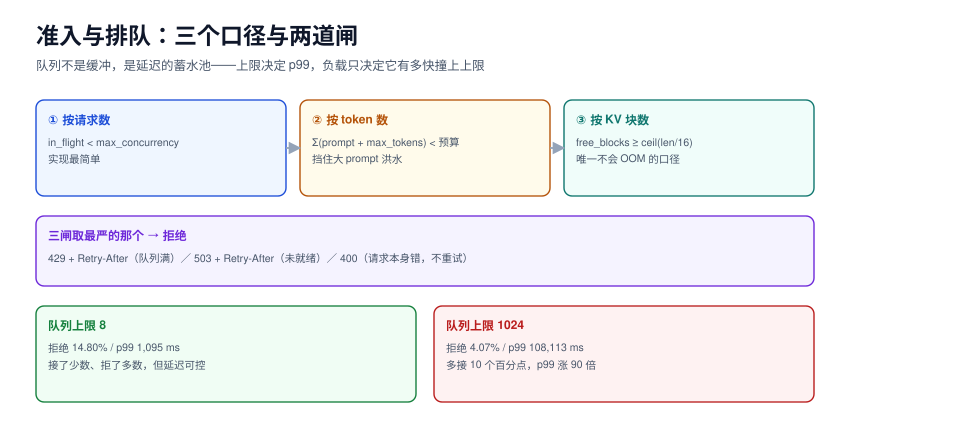

# 准入与排队：把「无限等待」换成「明确失败」

推理服务的容量是软的：显存不够时不会崩，只会变慢；队列满了也不会崩，只会越来越慢。所以「准入」不是可选项，它是**唯一能在过载时保住延迟的闸门**。

这一页讲三件事：按什么口径判「接不接」（请求数 / token 数 / KV 块数）、拒的时候回什么、排队按什么顺序。



本页判据族 `IFA-A` ~ `IFA-H`，共 8 条。定义表见文末「本页判据」一节。

## 一、为什么必须有准入

回到仿真实测（M/M/1，服务均值 100 ms，队列上限 64）：

| 负载 ρ | 排队 p50 | 排队 p99 | 拒绝率 | 系统状态 |
| --- | --- | --- | --- | --- |
| 0.70 | 111.0 ms | 1,426.8 ms | 0.00% | 延迟主导 |
| 0.90 | 581.9 ms | 4,212.2 ms | 0.01% | 开始抬升 |
| 0.95 | 1,326.4 ms | 6,251.9 ms | 0.22% | 排队主导 |
| 1.00 | 3,097.9 ms | 7,045.4 ms | 1.62% | 已达饱和 |
| 1.05 | 4,879.7 ms | 7,396.5 ms | 5.28% | 过载 |
| 1.15 | 5,624.4 ms | 7,770.4 ms | **13.38%** | 严重过载 |

注意最后两行：负载超过 1 之后，**排队时间反而趋平**（7,397 → 7,770 ms），因为队列被上限截住了，多出来的流量全部转成拒绝。这说明一个反直觉的事实：

::: tip 一句话理解
过载时，系统的排队时间**由队列上限决定，不由负载决定**。想让 p99 可控，调的不是负载，是上限。
:::

## 二、三个准入口径

| 口径 | 判什么 | 优点 | 缺点 | 适用 |
| --- | --- | --- | --- | --- |
| **按请求数** | `in_flight < max_concurrency` | 实现最简单，一条计数器 | 大小请求一视同仁：8 条 8k 上下文的请求和 8 条 100 token 的请求都算「8」 | 请求长度方差小的场景 |
| **按 token 数** | `sum(prompt + max_tokens) < token_budget` | 与算力直接对应，能挡住「大 prompt 洪水」 | 需要预知 `max_tokens`；估算偏差会误拒 | prefill 主导、长文档问答 |
| **按 KV 块数** | `kv_blocks_free >= ceil((prompt + max_tokens)/block)` | 与显存直接对应，是**唯一不会 OOM 的口径** | 要实现块分配器；碎片会让估算不准 | decode 主导、长上下文、高并发 |

三者不是互斥的，生产上通常**同时挂三把闸**，取最严的那个：

```python [admission.py]
"""三口径准入器（示意实现，读者在自己工程里落地）。"""


class Admission:
    def __init__(self, max_inflight=64, token_budget=32768,
                 block_size=16, kv_blocks=2048, reserve_ratio=0.1):
        self.max_inflight = max_inflight
        self.token_budget = token_budget
        self.block_size = block_size
        # 留 10% 块给「已经在 decode 的请求继续生长」，否则新请求会把老请求挤死
        self.kv_blocks = int(kv_blocks * (1 - reserve_ratio))
        self.inflight = 0
        self.tokens = 0
        self.blocks = 0

    def _need_blocks(self, prompt_tokens, max_tokens):
        total = prompt_tokens + max_tokens
        return -(-total // self.block_size)  # 向上取整

    def try_admit(self, prompt_tokens, max_tokens):
        need_b = self._need_blocks(prompt_tokens, max_tokens)
        need_t = prompt_tokens + max_tokens
        if self.inflight >= self.max_inflight:
            return False, "inflight"
        if self.tokens + need_t > self.token_budget:
            return False, "token_budget"
        if self.blocks + need_b > self.kv_blocks:
            return False, "kv_blocks"
        self.inflight += 1
        self.tokens += need_t
        self.blocks += need_b
        return True, "ok"

    def release(self, prompt_tokens, max_tokens):
        self.inflight -= 1
        self.tokens -= prompt_tokens + max_tokens
        self.blocks -= self._need_blocks(prompt_tokens, max_tokens)
```

三条实现纪律：

1. **按 `max_tokens` 预留，不按实际值预留**。按实际值预留会「先放进来、再 OOM」，那时只能杀进程。
2. **块要留余量**（上面的 `reserve_ratio`）。decode 阶段每个请求每步都在长，留 10% 是常见起点；不留余量的结果是「新请求一进来，老请求就被迫抢占」——详见[KV 缓存调度](../KVCache/index.md)。
3. **释放必须成对**。异常路径（客户端断开、序列被取消）没有 `release` 就会永久泄漏配额，表现为「跑几小时后明明没流量却一直 429」。

## 三、拒的时候回什么

| 响应 | 语义 | 客户端该做什么 | 什么时候用 |
| --- | --- | --- | --- |
| `429 Too Many Requests` + `Retry-After: 2` | 「现在不行，等会儿再来」 | 按 `Retry-After` 退避重试 | 队列满、配额耗尽 |
| `503 Service Unavailable` + `Retry-After` | 「服务暂时不可用」 | 退避重试，且要能切备用 | 模型未加载完、全部副本不健康 |
| `400 Bad Request` | 「请求本身有问题」 | **不要重试** | prompt 超长、参数非法 |

::: danger 三种写法会把过载变成雪崩
1. **排队到超时才拒**：客户端在 30 s 后才收到 504，那时它已经重试了两次，实际负载是原始的三倍（见[过载保护](../Overload/index.md)的 3.79 倍实测）。正确做法是**在准入那一刻就拒**，拒绝耗时控制在 100 ms 内。
2. **拒的时候回 500**：客户端与网关的监控会把 5xx 当服务故障，触发告警、熔断、甚至自动扩容——而真实原因是「我们主动保护」，不是「服务坏了」。429 与 503 的区别必须严格。
3. **不写 `Retry-After`**：客户端只能自己猜退避时间，常见实现是「固定 100 ms 重试」，在过载时等于连续打点。给出服务端视角的合理等待（通常 1~5 s）比任何客户端算法都准。
:::

## 四、排队顺序

准入决定「进不进」，排队顺序决定「进了之后排第几」。四种策略：

| 策略 | 规则 | 短请求 p99 | 长请求 p99 | 适用 |
| --- | --- | --- | --- | --- |
| FIFO | 先到先服务 | 差（被长请求挡） | 公平 | 请求长度均匀 |
| SJF（最短优先） | 按预估输出长度升序 | 最好 | **可能饿死** | 有可靠长度预估 |
| 分桶轮转 | 按长度分 3~5 桶，桶间轮转 | 好 | 有界 | 通用推荐 |
| 令牌桶配额 | 每租户/每桶按令牌配额取 | 可控 | 可控 | 多租户 |

实测（80% 短请求 50 token / 20% 长请求 1500 token，max_batch=8）：

| 场景 | 策略 | 短请求 TTFT p50 | 短请求 p99 | 长请求 p50 | 长请求 p99 |
| --- | --- | --- | --- | --- | --- |
| 饱和（λ=2.5/s） | FCFS | 120,021.6 ms | 179,773.3 ms | 115,592.7 ms | 179,371.6 ms |
| 饱和（λ=2.5/s） | 两级优先 | **3,437.0 ms** | **12,262.0 ms** | 145,795.0 ms | 207,408.5 ms |
| 轻载（λ=1.0/s） | FCFS | 64.3 ms | 136.8 ms | 62.2 ms | 160.2 ms |
| 轻载（λ=1.0/s） | 两级优先 | 64.3 ms | 136.8 ms | 62.2 ms | 160.2 ms |

两个必须记住的读数：

1. **饱和时优先级的收益是 35 倍**（120,022 → 3,437 ms），代价是长请求 p99 涨 15.6%（179,372 → 207,409 ms）。这是一笔明显划算的交易，但**前提是有优先级**。
2. **轻载时两者完全一样**（64.3 vs 64.3 ms，一位小数都不差）。所以：**分级不是常态优化，是拥塞时的分配规则**。平时不用调，过载时它决定谁先死。

## 五、可运行验证

用最小脚本验证「队列上限决定 p99」这件事（不依赖任何推理引擎）：

```python [queue_probe.py]
"""三档队列上限的排队 p99 对照（纯标准库，可直接运行）。"""
import random
import statistics

random.seed(20261023)
MU = 1 / 100.0  # 服务均值 100 ms


def simulate(rho, qcap, n=200000):
    lam = rho * MU
    t = busy = 0.0
    q, waits, rej = [], [], 0
    for _ in range(n):
        t += random.expovariate(lam)
        while q and q[0] <= t:
            q.pop(0)
        if busy <= t:
            busy = t
        if len(q) + (1 if busy > t else 0) >= qcap:
            rej += 1
            continue
        start = max(t, busy)
        waits.append(start - t)
        busy = start + random.expovariate(MU)
        q.append(busy)
    waits.sort()
    p99 = waits[int(0.99 * (len(waits) - 1))]
    return statistics.mean(waits), p99, rej / n


for qcap in (8, 64, 1024):
    mean, p99, rej = simulate(1.05, qcap)
    print(f"qcap={qcap:>5} 排队均值={mean:9.1f}ms p99={p99:10.1f}ms 拒绝率={rej*100:5.2f}%")
```

本机实际输出（与上文表格同源，随机流不同会有小幅差异，量级与趋势必须一致）：

```text
qcap=    8 排队均值=    321.6ms p99=    1095.5ms 拒绝率=14.80%
qcap=   64 排队均值=   4526.1ms p99=    7420.0ms 拒绝率= 4.99%
qcap= 1024 排队均值=  93802.8ms p99=  108113.0ms 拒绝率= 4.07%
```

判读：**p99 随队列上限线性上涨，拒绝率只降了几个百分点**——这就是「准入必须收紧」的量化依据。

## 本页判据

| 编号 | 判据 | 看什么现象 | 不满足时改哪里 |
| --- | --- | --- | --- |
| `IFA-A` | 队列上限是常量且可配 | 配置里有 `max_queue_depth`，默认值不是 0（无限） | 设上限，并按 p99 目标反推（通常 ≤ 2× 目标延迟 / 服务时间） |
| `IFA-B` | 三口径至少挂两把闸 | 同时有条数限制与 token 或块数限制 | 补第二把闸，优先补 KV 块口径 |
| `IFA-C` | 按 `max_tokens` 预留 | 准入时用的是请求声明的上限，不是实际长度 | 改成预留，否则会「放进来越界」 |
| `IFA-D` | 拒绝语义分层 | 429 / 503 / 400 各有明确触发条件 | 按第三节的表重写错误码映射 |
| `IFA-E` | 拒绝带 `Retry-After` | 429 响应头里有秒数 | 补上，值取服务端当前 p99 排队时间 |
| `IFA-F` | 拒绝耗时受控 | 拒绝响应 < 100 ms | 不要在拒绝路径上做重活（日志同步落盘、全量指标打点） |
| `IFA-G` | 释放与获取成对 | 断连、取消、异常三条路径都能释放配额 | 用 `try/finally` 或上下文管理器，配一个「泄漏哨兵」指标 |
| `IFA-H` | 优先级只在饱和时生效 | 轻载时高/低优先级延迟无差；饱和时差异显著 | 若轻载也有差异，说明优先级抢了不该抢的资源 |

## 参考资料

- vLLM 中的 `max_num_seqs` / `max_num_batched_tokens` 语义：<https://docs.vllm.ai/en/latest/configuration/engine_args.html>
- HTTP 429 与 `Retry-After`：RFC 9110 §15.5.29、§10.2.3
- Little's law（并发 = 到达率 × 停留时间）：<https://en.wikipedia.org/wiki/Little%27s_law>
- Google SRE Book, *Handling Overload*：<https://sre.google/sre-book/handling-overload/>
