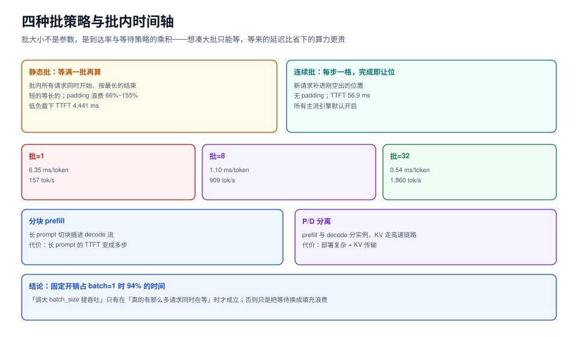

# 批处理成形：批大小是等出来的

「把 batch_size 调到 32 就能提吞吐」这句话在推理服务里只对一半。批大小不是一个参数，它是**到达率与等待策略的乘积**：请求不够时，想凑大批只能等，等来的延迟比省下的算力更贵。

这一页把「一批请求怎么成形」讲成可算的东西：一步的成本模型、四种批策略的代价、填充浪费怎么算、批内公平怎么保。



本页判据族 `IFB-A` ~ `IFB-H`，共 8 条。定义表见文末「本页判据」一节。

## 一、一步的成本模型

推理的一步（step）成本可以近似成两项：

```text
step_ms ≈ 固定开销(内核启动、调度、通信) + 每 token 成本 × 本步处理的 token 数
```

用本专题的仿真台参数：`step_ms = 6.0 + 0.35 × 并发条数 + 0.06 × prefill token 数`。三项的含义：

| 项 | 含义 | 谁决定 | 能不能优化掉 |
| --- | --- | --- | --- |
| 6.0 ms | 固定开销（内核启动、采样、框架调度） | 引擎与硬件 | 不能，只能**摊薄** |
| 0.35 ms/条 | decode 时每条序列读一遍权重的边际成本 | 显存带宽 | 靠量化、靠更大的批摊薄 |
| 0.06 ms/token | prefill 的每 token 成本 | 算力 | 靠更强算力或前缀复用 |

由这个模型立刻能推出三档理论上限：

| 批大小 | 每 token 摊销 | 理论吞吐 |
| --- | --- | --- |
| 1 | 6.35 ms | **157 tok/s** |
| 8 | 1.10 ms | **909 tok/s** |
| 32 | 0.54 ms | **1,860 tok/s** |

**固定开销占了 batch=1 时 94% 的时间**。这就是为什么「提高并发」对推理服务几乎是万能的：不是算力变强了，是同一份 6 ms 摊到了更多人头上。

## 二、四种批策略

| 策略 | 怎么成形 | 批内时间轴 | 主要代价 |
| --- | --- | --- | --- |
| **静态批**（static batching） | 攒够 N 条或等满 T 毫秒，整批一起跑到底 | 批内所有请求同时开始、同时结束（按最长的算） | 短的等长的 + padding 浪费 |
| **连续批**（continuous / iteration-level） | 每个 step 结束后，完成的让位、新到的补位 | 每个请求各走各的步数 | 调度器复杂度、批内长度不齐 |
| **分块 prefill**（chunked prefill） | 长 prompt 拆成多块，与 decode 混在同一批 | prefill 被切开插进 decode 流 | 长 prompt 的 TTFT 变长 |
| **P/D 分离**（disaggregated） | prefill 与 decode 跑在不同实例，KV 通过高速链路搬 | 两段独立扩容 | 部署复杂度 + KV 传输开销 |

### 静态批的两种死法

仿真读数（同一份权重、同一到达率 λ=3 req/s、117,065 个输出 token）：

| 策略 | 吞吐 | TTFT p50 | TTFT p99 | padding 浪费 |
| --- | --- | --- | --- | --- |
| 连续批（max_batch=8） | **491 tok/s** | **74.3 ms** | **982.8 ms** | 0 |
| 静态批（窗口 100 ms） | 201 tok/s | 156,922.9 ms | 343,201.4 ms | 66.2% |
| 静态批（窗口 2000 ms） | 278 tok/s | 79,380.1 ms | 181,114.4 ms | **155.3%** |

- **窗口小（100 ms）**：批攒不起来，平均批 ≈ 1 条，固定开销摊不掉，容量只有 201 tok/s，**装不下 λ=3 的负载** → 队列无限增长，TTFT 的 15 万毫秒全部是排队积压。
- **窗口大（2000 ms）**：批能攒到 5~6 条，但批内按最长的跑，短的被 pad 到最长 → **padding 浪费 155.3%**（比有用计算还多）。

低负载下（λ=1，所有策略都不过载）差异更直观：

| 策略 | TTFT p50 | TTFT p99 | padding 浪费 |
| --- | --- | --- | --- |
| 连续批 | **56.9 ms** | **156.4 ms** | 0 |
| 静态批（100 ms 窗口） | 4,441.6 ms | 10,676.6 ms | 51.0% |
| 静态批（2000 ms 窗口） | 3,018.4 ms | 7,838.0 ms | 113.6% |

**78 倍的首字延迟差**，全部来自「等批」。所以选型问题不是「谁吞吐高」，而是「你愿意用多少首字延迟换多少吞吐」。

::: tip 一句话理解
静态批买的是「稳定的批形状」，付的是「等批的时间」；连续批买的是「不用等」，付的是「调度器复杂度」。前者适合离线批推理（离线可以等），后者是线上对话的唯一选择。
:::

## 三、填充浪费怎么算

静态批把批内所有序列补齐到最长的那条，浪费的算力是：

```text
padding_waste = (Σ 批内最长长度 − Σ 各自真实长度) / Σ 各自真实长度
```

用本机的长度分布（对数正态，p50 ≈ 120 token）实测：批内长度方差越大，浪费越狠。

| 批内长度分布 | 平均浪费 | 说明 |
| --- | --- | --- |
| 全部相同（如批量摘要，都限 512） | ≈ 0% | 静态批的唯一优势场景 |
| p50=120、长尾 3000（对话） | 66.2%（窗口 100 ms）/ 155.3%（窗口 2000 ms） | 批次越大、方差越大，越浪费 |

**推论：只要输出长度不可预知，静态批的浪费就无法通过调参消除。** 这也是连续批成为所有主流引擎默认策略的原因（vLLM `0.32.0`、SGLang `0.5.22` 均默认开启）。

## 四、连续批的最小实现

```python [continuous_batcher.py]
"""连续批调度骨架：每步只走一格，完成即让位（示意实现）。"""
from collections import deque


class Request:
    __slots__ = ("rid", "arrive_ms", "prompt_tokens", "max_tokens",
                 "generated", "first_token_ms", "done_ms")

    def __init__(self, rid, arrive_ms, prompt_tokens, max_tokens):
        self.rid = rid
        self.arrive_ms = arrive_ms
        self.prompt_tokens = prompt_tokens
        self.max_tokens = max_tokens
        self.generated = 0
        self.first_token_ms = None
        self.done_ms = None


class ContinuousBatcher:
    def __init__(self, step_overhead_ms=6.0, per_seq_ms=0.35, per_token_ms=0.06,
                 max_batch=8):
        self.overhead = step_overhead_ms
        self.per_seq = per_seq_ms
        self.per_token = per_token_ms
        self.max_batch = max_batch

    def step_cost(self, active):
        prefill = sum(r.prompt_tokens for r in active if r.generated == 0)
        return self.overhead + self.per_seq * len(active) + self.per_token * prefill

    def run(self, arrivals):
        """arrivals 需按 arrive_ms 升序；返回 (now_ms, 完成的请求列表)。"""
        waiting = deque(arrivals)
        active, finished = [], []
        now = 0.0
        while waiting or active:
            # 1) 到点的请求进队
            while waiting and waiting[0].arrive_ms <= now:
                active_ready = waiting.popleft()
                active.append(active_ready) if len(active) < self.max_batch else waiting.appendleft(active_ready)
                if len(active) >= self.max_batch:
                    break
            if not active:
                now = waiting[0].arrive_ms
                continue
            # 2) 走一步
            now += self.step_cost(active)
            for r in list(active):
                if r.generated == 0:
                    r.first_token_ms = now
                r.generated += 1
                if r.generated >= r.max_tokens:
                    r.done_ms = now
                    active.remove(r)
                    finished.append(r)
        return now, finished


if __name__ == "__main__":
    import random
    random.seed(1)
    batch = ContinuousBatcher()
    reqs, t = [], 0.0
    for i in range(200):
        t += random.expovariate(3 / 1000.0)  # λ = 3 req/s
        reqs.append(Request(i, t, random.randint(200, 1500), random.randint(20, 300)))
    end, done = batch.run(reqs)
    lat = sorted((r.done_ms - r.arrive_ms) for r in done)
    print(f"完成 {len(done)} 条，总耗时 {end/1000:.1f}s，"
          f"p50 端到端 {lat[len(lat)//2]:.0f} ms，p99 {lat[int(len(lat)*0.99)]:.0f} ms")
```

三条实现要点：

1. **`max_batch` 一定要卡在准入侧**，不要只在调度器里判断。否则「进得来但排不上」的请求会一直占着队列内存。
2. **进批与出批都要在同一处改计数**。典型 bug 是「只在出批时减、进批时忘加」，跑了半小时后批里塞了 40 条。
3. **`generated == 0` 才算 prefill**。这条判据必须精确：一旦写错（比如用 `first_token_ms is None`），被抢占过的请求重算时不会计 prefill 成本，成本模型会系统性低估。

## 五、分块 prefill 与 P/D 分离

| 手段 | 解决什么 | 引入什么 | 什么时候值得 |
| --- | --- | --- | --- |
| 分块 prefill | 长 prompt 独占一步导致 decode 抖动（TPOT 尖刺） | 长 prompt 的 TTFT 变长 | 有 >4k 长输入且 TPOT 敏感 |
| P/D 分离 | prefill 与 decode 的资源画像不同，混在一起总有一边浪费 | KV 传输（几十 GB/s 级链路）、两套扩缩容 | 单模型独占多卡、流量稳定且大 |
| 前缀缓存 | 多轮对话 / RAG 的重复 prompt | 显存占用增加（缓存本身要地方放） | 前缀共享率 >30% |

::: danger 分块 prefill 最容易被忽略的副作用
把 8k 的 prompt 切成 8 块塞进 decode 流，**TTFT 会从 1 步变成 8 步**（因为要等前面 7 块算完才产出第一个 token）。如果 SLO 卡的是 TTFT，这个改动会直接把违约率打上去。正确做法是：分块 prefill 只对「超过阈值的输入」开启，阈值取 `SLO_TTFT × prefill_tokens/s` 的 60% 左右，留出排队余量。
:::

## 本页判据

| 编号 | 判据 | 看什么现象 | 不满足时改哪里 |
| --- | --- | --- | --- |
| `IFB-A` | 批策略与负载形态匹配 | 在线对话用连续批；离线批推理才用静态批 | 在线服务不要用固定窗口攒批 |
| `IFB-B` | 批大小上限与准入同源 | `max_batch` 只有一个来源（配置中心），准入与调度读同一个值 | 两处各写一份必然漂移 |
| `IFB-C` | 填充浪费可计算 | 有 `padding_waste` 指标或能算出来 | 记录每批的真实长度与补齐长度 |
| `IFB-D` | 固定开销可摊薄 | 能报出「平均批内条数」；低于 4 时有明确原因 | 提高并发或接受低吞吐，不要只调参数 |
| `IFB-E` | 分块 prefill 有阈值 | 只对超长输入开启，且阈值有算式依据 | 按 SLO 反推阈值，别全局开启 |
| `IFB-F` | TPOT 抖动可归因 | 长 prefill 进入时 TPOT 有尖刺，且能对上时间 | 开分块 prefill 或限制单步 prefill token 数 |
| `IFB-G` | 进批/出批计数成对 | 跑 1 小时后「批内条数」不超过上限 | 修计数器，加断言 `len(active) <= max_batch` |
| `IFB-H` | prefill 判定精确 | 被抢占重算的请求也计入 prefill 成本 | 用 `generated == 0` 判，不用「首 token 是否已产出」 |

## 验证方式

1. 跑上面的 `continuous_batcher.py`，本机实测输出为 `完成 200 条，总耗时 66.9s，p50 端到端 1645 ms，p99 3313 ms`——**p50 与 p99 都在秒级**。若你跑出来是几十秒，说明 `max_batch` 太小或步成本参数与实际不符。

2. 把 `max_batch` 从 8 改成 1，重跑：吞吐应降到约 1/3~1/5，p99 显著变差。这一步证明「批摊薄固定开销」不是空话。

3. 在真实服务上取两个数对齐：

   ```shell
   # 平均批内条数（vLLM 暴露的 gauge，名字以实际版本为准）
   curl -s http://127.0.0.1:8000/metrics | grep -E 'num_requests_running|num_requests_waiting'
   ```

   预期：`running` 小于等于你设的 `max_num_seqs`；`waiting` 在稳态下应接近 0。`waiting` 长期 > 0 就是「批满了、在排队」，此时加副本才有意义。

## 参考资料

- Orca（连续批处理原始论文）：Yu et al., OSDI 2022
- vLLM `max_num_seqs` / `max_num_batched_tokens` / chunked prefill：<https://docs.vllm.ai/en/latest/configuration/optimization.html>
- Sarathi-Serve（分块 prefill 的系统性分析）：Agrawal et al., OSDI 2024
- DistServe（P/D 分离）：Zhong et al., OSDI 2024
