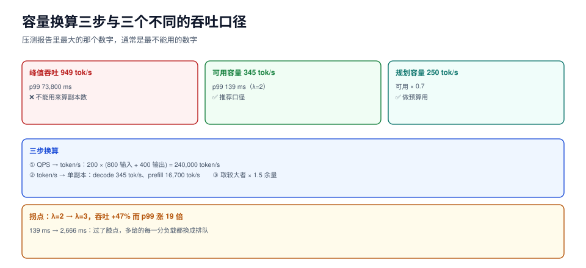

# 容量换算：从 tok/s 到卡数

「我们要支持 200 QPS」这句话在推理服务里没法直接变成副本数。中间缺三个换算：QPS → token/s、token/s → 单副本容量、单副本容量 → 副本数。而每一步都有一个坑：

1. QPS 要乘的是**输入 + 输出**的总 token，不是只看输出；
2. 单副本容量要用「**SLO 达标时的吞吐**」，不是压测峰值；
3. 副本数要留余量，余量要按**到达率方差**定，不是拍一个 1.5。

这一页把三步都算完，并给出每一步的实测依据。



本页判据族 `IFP-A` ~ `IFP-H`，共 8 条。定义表见文末「本页判据」一节。

## 一、三个吞吐口径（不能混用）

同一份仿真数据（单副本、max_batch=8、输出长度对数正态 p50≈120）：

| 口径 | 定义 | 本机读数 | 能不能用来算副本数 |
| --- | --- | --- | --- |
| **峰值吞吐** | 压到过载时能挤出的最大 token/s | **949 tok/s**（λ=6，p99 73,800 ms） | ❌ 会低估 3~5 倍 |
| **可用容量** | SLO 达标时的最大可持续吞吐 | **≈ 345~400 tok/s**（λ=2，p99 139 ms） | ✅ 推荐 |
| **规划容量** | 可用容量 × 安全系数（0.7） | **≈ 250 tok/s** | ✅ 做预算用 |

::: danger 用峰值吞吐算副本数是容量规划里最贵的错误
峰值吞吐 949 是在 p99 = **73.8 秒**时测出来的——那个状态下没有一个用户是满意的。用它算「8000 tok/s 需要 9 个副本」，上线后会稳定地在 p99 上违约 5 倍。**压测报告里那个最大的数字，通常是最不能用的数字。**
:::

## 二、到达率扫描：找到拐点

同一配置下把到达率从 1 扫到 6（每次 180 s 仿真）：

| λ（req/s） | 吞吐 | TTFT p50 | TTFT p99 | 完成/到达 | 状态判读 |
| --- | --- | --- | --- | --- | --- |
| 1 | 182 tok/s | 54.9 ms | 117.7 ms | 179/179 | 富余 |
| 2 | 345 tok/s | 65.0 ms | **139.2 ms** | 324/324 | **可用容量** |
| 3 | 509 tok/s | 81.4 ms | 2,666.0 ms | 542/542 | p99 开始劣化 |
| 4 | 714 tok/s | 2,318.1 ms | 9,616.2 ms | 719/719 | 排队主导 |
| 5 | 906 tok/s | 18,407.3 ms | 40,883.5 ms | 898/898 | 过载 |
| 6 | 949 tok/s | 37,835.8 ms | 73,800.1 ms | **981/1071** | 开始丢请求 |

**拐点在 λ=2 与 λ=3 之间**：吞吐还能涨 47%（345 → 509），但 p99 涨了 19 倍（139 → 2,666 ms）。这就是经典的「膝点」——过了它，多给的每一分负载都换成排队。

判读方法：**把 p99 与吞吐画在同一张图上，找 p99 开始指数上升的那一点**。不要找吞吐最大的点，那个点永远在过载区。

## 三、单副本容量怎么测

三个必测的量：

| 量 | 怎么测 | 本机读数 |
| --- | --- | --- |
| `decode_tok_s`（批内每步的有效 token） | 固定并发跑 decode 密集负载 | batch=1 **157**、batch=8 **909**、batch=32 **1,860**（理论上限） |
| `prefill_tok_s` | 固定输入长度、`max_tokens=1` | 由 `6 + 0.06×token` 反推 ≈ **16,700 tok/s** |
| `max_concurrency`（KV 能撑几条） | 按[KV 缓存](../KVCache/index.md)的算式算，再用准入压到边界验证 | 24 GiB 卡 + 8k 上下文 ≈ **8 条** |

理论上限与实际测得的差距，就是「批填不满」的损耗：

| 批大小 | 理论上限 | λ=3 实测 | 填充率 |
| --- | --- | --- | --- |
| 1 | 157 tok/s | 186 tok/s（λ=1） | — |
| 8 | 909 tok/s | 509 tok/s | **56%** |
| 32 | 1,860 tok/s | 无法达到（KV 只够 8 条） | — |

::: tip 一句话理解
**「理论上限」和「可达吞吐」的差距，几乎全部来自批填不满。** 而批填不满的原因是显存（KV 撑不住更大批），不是算力。所以容量规划的第一约束通常是显存，不是 FLOPS。
:::

## 四、三步换算

以「200 QPS、平均输入 800 token、平均输出 400 token」为例：

```text
第 1 步：QPS → token/s
  总 token 需求 = 200 × (800 + 400) = 240,000 token/s
  其中 decode 部分 = 200 × 400 = 80,000 token/s
  （prefill 与 decode 的成本不同，必须分开算，见下）

第 2 步：token/s → 单副本
  单副本可用容量（decode）= 345 tok/s（按 SLO 达标口径）
  单副本 prefill 能力 = 16,700 tok/s

第 3 步：算副本数，取两者较大值
  按 decode：80,000 / 345 = 232 副本
  按 prefill：200 × 800 / 16,700 = 9.6 → 10 副本
  → decode 是瓶颈，取 232，再乘 1.5 余量 = 348 副本
```

这个数看起来大得离谱，但它是对的：**80,000 tok/s 的 decode 就是需要这么多卡**。如果你觉得不合理，通常是需求本身写错了（比如「200 QPS」其实是峰值而非均值，或者输出长度 400 是高估）。

反过来说，这个算式最有用的地方是**告诉你该优化哪一边**：上例中 prefill 只要 10 个副本、decode 要 232 个，说明「优化 prefill」几乎没有意义，所有精力都该放在「提高每步的有效 token 数」（更大批、更小模型、更低精度）。

### 小规模场景的对照

| 目标 | decode 需求 | 副本数（345 tok/s/副本） | 1.5 倍余量 |
| --- | --- | --- | --- |
| 20 QPS × 400 tok | 8,000 tok/s | 24 | 36 |
| 200 QPS × 400 tok | 80,000 tok/s | 232 | 348 |

（表中「副本」指本页仿真口径的单副本，真实数值请用你自己压测出的 `decode_tok_s` 替换。）

## 五、成本口径

每百万输出 token 的成本：

```text
cost_per_Mtok = 副本小时单价 × 副本数 / (单副本 tok/s × 3600) × 1,000,000
```

以「单副本 345 tok/s、副本小时单价 12 元」为例：

```text
cost_per_Mtok = 12 / (345 × 3600) × 1e6 = 9.66 元 / 百万 token
```

三个必须一起报的数（只报一个都会误导）：

| 指标 | 含义 | 为什么必须一起报 |
| --- | --- | --- |
| 每百万 token 成本 | 单位经济性 | 单独看会诱导「压低质量换成本」 |
| 平均 GPU 利用率 | 资源浪费程度 | 低于 30% 说明副本配多了或用错了规格 |
| p99 达标率 | 合同完成度 | 成本再低，违约也没意义 |

## 六、余量怎么定

| 余量系数 | 适用 | 依据 |
| --- | --- | --- |
| 1.2 | 流量极平稳（内部批处理） | 到达率方差小，ρ 几乎不越界 |
| **1.5** | 常规线上服务 | 日峰谷比 3 倍以内，ρ 规划在 0.7 |
| 2.0 | 有明显突刺（营销、开盘） | 突刺时 ρ 会短时越过 1 |
| 不靠余量 | 靠预热池 + 准入 | 余量换成「弹性能力」，见[冷启动](../ColdStart/index.md) |

## 本页判据

| 编号 | 判据 | 看什么现象 | 不满足时改哪里 |
| --- | --- | --- | --- |
| `IFP-A` | 三个吞吐口径分开 | 文档里出现「峰值」「可用」「规划」三个数，且不混用 | 重写容量表，标明每个数的口径 |
| `IFP-B` | 副本数用可用容量算 | 算式分母是 SLO 达标吞吐 | 换分母；峰值吞吐只作参考 |
| `IFP-C` | prefill 与 decode 分开算 | 两段各有算式的分子分母 | 分开算，取较大者 |
| `IFP-D` | 拐点有实测 | 有 λ 扫描表，且标出 p99 开始劣化的点 | 补一次扫描，至少 5 个负载点 |
| `IFP-E` | 显存是显式约束 | `max_concurrency` 有算式，且与实际一致 | 按 KV 算式算，并用准入压到边界验证 |
| `IFP-F` | 余量有依据 | 余量系数对应到流量方差，不是拍脑袋 | 按第六节选，写明理由 |
| `IFP-G` | 成本三数同报 | 单位成本 + 利用率 + p99 达标率一起出现 | 补另两个，别单独汇报成本 |
| `IFP-H` | 扩容触发有阈值 | 扩容指标是队列深度或 p99，不是 CPU | 换指标（推理服务 CPU 常年不高） |

## 验证方式

1. 扫一次你自己的拐点（把 `--rate` 换成你的压测工具参数）：

   ```shell
   for r in 1 2 3 4 5; do
     echo "=== rate=$r ==="
     hey -z 60s -q $r -m POST -T 'application/json' \
       -d '{"model":"m","messages":[{"role":"user","content":"hi"}],"max_tokens":200}' \
       http://127.0.0.1:8000/v1/chat/completions | grep -E 'Requests/sec|99%'
   done
   ```

   预期：`Requests/sec` 随 rate 上升而上升，但 `99%` 延迟出现一个明显的跳变点。**那个跳变点就是拐点**，把它对应的 `Requests/sec × 平均输出 token` 作为可用容量。

2. 验证「峰值 ≠ 可用」：继续加压到拒绝出现，记下此时的吞吐与 p99。预期 p99 会是拐点处的 20 倍以上。这个数字**只用于说明差距，不用于规划**。

3. 核对显存约束：把 `max_num_seqs` 逐步调大，观察 `gpu_cache_usage_perc`。预期到某个值后它长期贴 100% 且抢占次数上升——那个值就是显存允许的最大并发。

## 参考资料

- vLLM 性能调优与吞吐/延迟权衡：<https://docs.vllm.ai/en/latest/configuration/optimization.html>
- NVIDIA 关于 decode 阶段受显存带宽限制的分析：<https://developer.nvidia.com/blog/mastering-llm-techniques-inference-optimization/>
- Little's law（并发 = 到达率 × 停留时间）：<https://en.wikipedia.org/wiki/Little%27s_law>
- Google SRE Workbook, *Capacity Planning*：<https://sre.google/workbook/>
