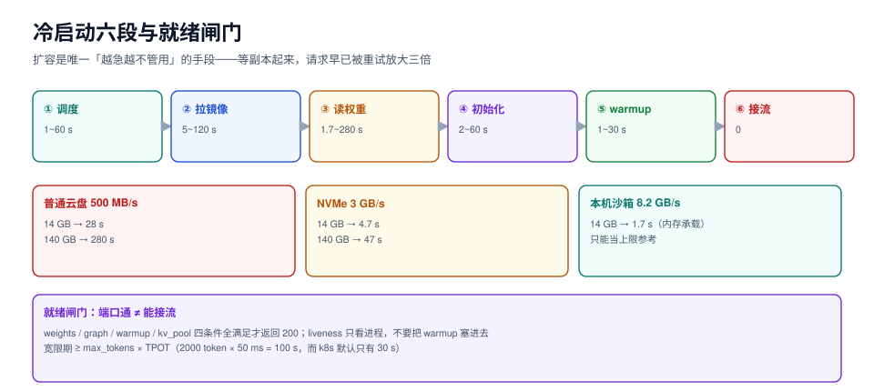

# 冷启动与弹性：加载时间不属于推理

扩容在推理服务里是**唯一一种「越急越不管用」的手段**。流量暴涨时你想加副本，但新副本要先拉镜像、读权重、建 CUDA graph、跑 warmup，几十秒到几分钟之后才能接第一个请求。而客户端的超时是秒级的——等副本起来，请求早已被重试放大（实测放大 3.58 倍，见[过载保护](../Overload/index.md)）。

这一页把冷启动拆成六段，讲清哪段能省、哪段省不掉、以及「扩了副本但没接上流量」这件事怎么避免。



本页判据族 `IFC-A` ~ `IFC-H`，共 8 条。定义表见文末「本页判据」一节。

## 一、六段分解

| 段 | 做什么 | 典型量级 | 能省吗 | 怎么省 |
| --- | --- | --- | --- | --- |
| ① 调度 | 建 Pod / 分配节点 / 挂载卷 | 1~60 s | 部分 | 预留节点、预热池 |
| ② 拉镜像 | 从镜像仓库下载 | 5~120 s | 能 | 镜像分层、节点缓存、P2P 分发 |
| ③ 读权重 | 从对象存储/本地盘读几十 GB | **1.7~280 s**（见下表） | 能 | 本地 NVMe、权重预取、更高带宽 |
| ④ 初始化 | 建 CUDA context、编译内核、建 CUDA graph | 2~60 s | 部分 | 内核预热（如 `vllm preload` 类机制） |
| ⑤ warmup | 跑几条假请求，把显存池与图都摸热 | 1~30 s | 不能 | 必须做，别省 |
| ⑥ 首次接流 | readiness 通过，进负载均衡 | 0 | — | 用②~⑤全部完成作为就绪条件 |

**③ 的读数**（本机实测，512 MiB 顺序读，`F_NOCACHE` 绕页缓存）：

| 存储类型 | 顺序读带宽 | 14 GB 权重 | 40 GB 权重 | 140 GB 权重 |
| --- | --- | --- | --- | --- |
| 普通云盘 / SATA SSD | ~500 MB/s | 28 s | 80 s | 280 s |
| NVMe SSD | ~3 GB/s | 4.7 s | 13 s | 47 s |
| **本机（沙箱，内存承载）** | **8,226 MB/s** | **1.7 s** | 4.9 s | 17.0 s |

::: danger 别把本机读数当生产读数
本机 `F_NOCACHE` 实测 8,226 MB/s、页缓存命中 8,870 MB/s（只差 1.1 倍），说明**这台机器的存储是内存承载的**——真实磁盘上「冷读」和「热读」通常差 3~10 倍。所以在做容量方案时，**必须用目标环境的实测带宽**，本页的 8.2 GB/s 只能当作「上限参考」。
:::

另外两个本机读数（进程级）：

| 操作 | 耗时 | 含义 |
| --- | --- | --- |
| `python3 -c 'pass'` | 208.8 ms | Python 解释器启动的固定成本 |
| `python3 -c 'import json,math,statistics'` | 214.8 ms | 标准库导入几乎是免费的（+6 ms） |
| `python3 -c 'import numpy'` | 231.1 ms（rc=1，未安装） | 第三方大包的导入成本是百毫秒级 |

对 Python 侧的推理服务，**解释器 + 框架导入的几百毫秒是每次冷启动都要付的**，它在「权重读取 1.7 s」面前不算大，但在「小模型 + 高频伸缩」的场景里会变成主要成本。

## 二、冷启动对 SLO 的真实影响

假设 SLO 是 TTFT p99 ≤ 500 ms，你有 3 个副本，流量涨到需要 5 个：

| 时刻 | 发生什么 | 用户看到的 |
| --- | --- | --- |
| T+0 | 流量翻倍，3 个副本 ρ 从 0.5 涨到 1.0 | 排队开始，p99 抬升 |
| T+10 s | HPA 触发扩容 | 仍然只有 3 个副本在服务 |
| T+40 s | 新副本镜像拉完，开始读权重 | 老副本 ρ 已 >1，开始拒绝 |
| T+70 s | warmup 完成，readiness 通过 | 终于有 5 个副本 |
| T+70 s 之后 | 排队消化 | 需要几十秒回到稳态 |

**这 70 秒里所有「扩容」的钱都花了，服务却一直在最差状态。** 所以弹性的核心不是「扩得多快」，而是**「在扩容完成之前靠什么活着」**：

1. **准入收紧**（保延迟、丢请求）——见[准入与排队](../Admission/index.md)
2. **降级**（换小模型、缩短 `max_tokens`）——见[过载保护](../Overload/index.md)
3. **预留容量**（min replicas 覆盖峰值的一定比例）——本页

## 三、三种弹性策略

| 策略 | 机制 | 冷启动影响 | 成本 | 适用 |
| --- | --- | --- | --- | --- |
| **HPA（指标驱动）** | 按 CPU/队列深度扩 | 每次都付完整冷启动 | 低 | 流量变化慢（分钟级） |
| **预留池（min replicas）** | 常驻 N 个副本，N 覆盖基线 | 无（不缩到 0） | 高（闲时也付） | 有稳定基线流量 |
| **预热池（warm pool）** | 维护若干「已加载权重、未接流」的实例，扩容时直接把流量切过去 | 只剩 ⑥ | 中 | 峰值可预测、要求秒级扩容 |

预热池是最实用的折中：把「③读权重 + ④初始化 + ⑤warmup」提前做完，扩容时只做「加入负载均衡」。代价是这些实例占着显存不干活——所以要按「峰值超出基线的比例」来定池大小，通常 10%~30%。

## 四、就绪闸门：别让 warmup 中的副本接流

这是最常见的翻车点：readiness 只检查「端口通了」，而端口在权重还没读完时就通了。结果新副本接到请求、OOM 或超时，触发客户端重试，把负载又打回老副本。

```python [readyz.py]
"""就绪闸门：四个条件全部满足才允许接流（示意实现）。"""
import os
import threading

STATE = {"weights": False, "graph": False, "warmup": False, "kv_pool": False}
_lock = threading.Lock()


def mark(name):
    with _lock:
        STATE[name] = True


def is_ready():
    with _lock:
        return all(STATE.values())


def warmup(engine, probe_prompt="hello", probe_max_tokens=8, rounds=3):
    """跑几轮假请求，把显存池、CUDA graph、采样路径都摸热。"""
    mark("weights")
    # 1) 建一次 CUDA graph（不同 batch 形状各跑一次，避免首次真实请求时现场建图）
    for batch in (1, 2, 4, 8):
        engine.probe(batch_size=batch)
    mark("graph")
    # 2) 跑几轮真实前向，把 KV 池分配器摸热
    for _ in range(rounds):
        engine.generate(probe_prompt, max_tokens=probe_max_tokens)
    mark("warmup")
    # 3) 确认 KV 池可用块数达到预期（权重加载失败的常见表现就是这里数字偏小）
    if engine.kv_blocks_free() >= engine.kv_blocks_expected() * 0.9:
        mark("kv_pool")


if __name__ == "__main__":
    # HTTP 侧：/readyz 只在 is_ready() 为真时返回 200
    print("ready" if is_ready() else "not-ready", os.getpid())
```

四条实现要点：

1. **readiness 与 liveness 分开**。liveness 只看「进程活着」，readiness 看「能接流」。把 warmup 塞进 liveness 会导致还没热就被 k8s 杀掉重启，无限循环。
2. **warmup 要覆盖多种 batch 形状**。只 warmup batch=1，第一个 batch=8 的真实请求仍会现场建图，TTFT 出现秒级尖刺。
3. **KV 池大小要做断言**。权重加载不完整时进程不报错，只是 KV 池变小，表现为「并发能力莫名其妙掉一半」。
4. **预热请求不能进业务指标**。否则每次扩容都会在监控上留下一个「TTFT 异常」的假尖刺，把值班引到错误方向。

## 五、缩容比扩容更危险

缩容时正在处理的请求会被中断。三种处置：

| 处置 | 做法 | 副作用 |
| --- | --- | --- |
| 立即杀 | 直接删实例 | 长回答被截断，客户端看到半截流 |
| 优雅退出 | 摘流量 → 等待 `terminationGracePeriodSeconds` → 退出 | 需要时间 ≥ 最长回答时长 |
| 排空（drain） | 摘流量 + 拒绝新请求 + 等 in-flight 归零 | 最安全，但要配合准入 |

`terminationGracePeriodSeconds` 必须 ≥ 你的 `max_tokens × TPOT` 上限。一个 2000 token、TPOT 50 ms 的回答要 100 s，而 k8s 默认宽限期只有 30 s——**默认值必然截断长回答**。

## 本页判据

| 编号 | 判据 | 看什么现象 | 不满足时改哪里 |
| --- | --- | --- | --- |
| `IFC-A` | 冷启动六段有分解读数 | 每段有耗时记录，能指出瓶颈在哪段 | 加打点；至少区分「读权重」与「初始化」 |
| `IFC-B` | 用目标环境的带宽换算 | 权重加载时间按实测带宽算，不照抄他机读数 | 在目标机型上跑一次 `dd` 或等价工具 |
| `IFC-C` | readiness 覆盖 warmup | 端口通 ≠ 就绪；四条件全满足才 200 | 把 warmup 完成作为就绪条件 |
| `IFC-D` | liveness 不包含 warmup | 预热期间不会被重启 | 拆成两个探针，liveness 只看进程 |
| `IFC-E` | warmup 覆盖多 batch 形状 | 至少 warmup batch=1/2/4/8 | 补形状，否则首批大请求有秒级尖刺 |
| `IFC-F` | KV 池大小有断言 | 加载后校验可用块 ≥ 预期 90% | 加断言，防止「静默半加载」 |
| `IFC-G` | 宽限期 ≥ 最长回答 | `terminationGracePeriodSeconds` ≥ max_tokens × TPOT | 调大宽限期或限制 max_tokens |
| `IFC-H` | 预热请求不污染业务指标 | 监控里没有「扩容即异常」的假尖刺 | 预热流量打标并排除 |

## 验证方式

1. 量一次你自己的权重读取带宽（把路径换成你的模型目录）：

   ```shell
   # macOS：F_NOCACHE 绕过页缓存，模拟冷读
   python3 - <<'PY'
   import fcntl, os, time
   path = "/path/to/model.safetensors"
   fd = os.open(path, os.O_RDONLY)
   fcntl.fcntl(fd, 48, 1)          # F_NOCACHE
   size = os.fstat(fd).st_size
   buf = bytearray(1 << 20); t0 = time.perf_counter()
   while os.readv(fd, [buf]):
       pass
   dt = time.perf_counter() - t0
   print(f"{size/dt/1e6:,.0f} MB/s, {size/2**30:.1f} GiB in {dt:.2f}s")
   PY
   ```

   预期：与本页表格里对应存储类型同量级。若显著更高（如 8 GB/s），说明文件在内存里，**这次读数不能当作冷启动预算**。

2. 验证就绪闸门：把服务起在 warmup 尚未完成的状态，`curl -i /readyz`。预期返回非 200；warmup 完成后返回 200。中间这段时间 `kubectl get endpoints` 里不该出现该 Pod。

3. 验证缩容不截断：把宽限期设为 10 s，然后对一个 `max_tokens=2000` 的请求发起生成，同时触发缩容。预期能看到流被截断——这个实验是用来**证明默认值不够**的，做完记得调回来。

## 参考资料

- Kubernetes Pod 生命周期与探针：<https://kubernetes.io/docs/concepts/workloads/pods/pod-lifecycle/>
- `terminationGracePeriodSeconds` 语义：<https://kubernetes.io/docs/concepts/workloads/pods/pod-lifecycle/#pod-termination>
- vLLM 启动与预热相关参数：<https://docs.vllm.ai/en/latest/configuration/engine_args.html>
- NVIDIA 关于 CUDA graph 捕获与首请求延迟的说明：<https://docs.nvidia.com/cuda/cuda-c-programming-guide/>
