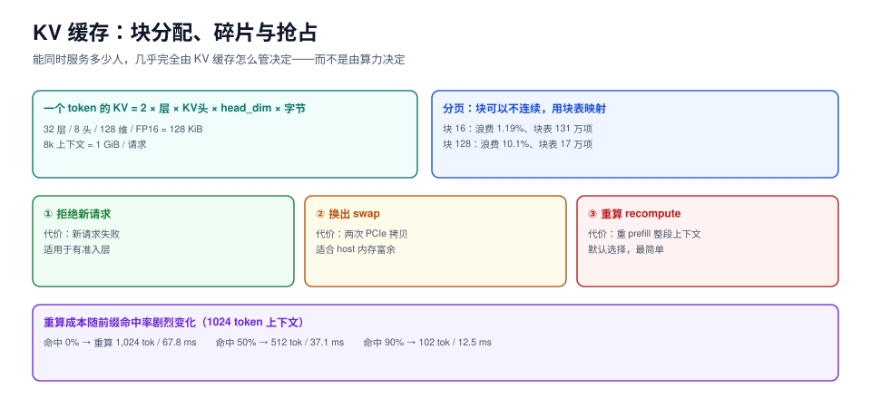

# KV 缓存调度：块、抢占与前缀复用

推理服务里真正稀缺的不是算力，是**显存**。权重是固定的（一次加载，尺寸不变），KV 缓存是流动的（每个请求每生成一个 token 都在长）。所以「能同时服务多少人」几乎完全由 KV 缓存怎么管决定。

这一页讲四件事：一个 token 的 KV 到底多大、块怎么切、显存不够时抢谁、共享前缀怎么复用。



本页判据族 `IFK-A` ~ `IFK-H`，共 8 条。定义表见文末「本页判据」一节。

## 一、先算清一个 token 的 KV 有多大

```text
每 token 的 KV 字节数 = 2(K 和 V) × 层数 × KV 头数 × head_dim × 每元素字节数
```

以常见的 7B 级模型为例（32 层、8 个 KV 头（GQA）、head_dim=128、FP16）：

```text
2 × 32 × 8 × 128 × 2 B = 131,072 B = 128 KiB / token
```

于是：

| 上下文长度 | 单请求 KV | 24 GiB 显存能放几个请求（权重占 16 GiB） |
| --- | --- | --- |
| 2k | 256 MiB | ≈ 32 |
| 8k | **1 GiB** | ≈ 8 |
| 32k | 4 GiB | ≈ 2 |
| 128k | 16 GiB | 0（放不下） |

::: tip 一句话理解
**上下文长度每翻一倍，并发能力就减半。** 这就是为什么「支持 128k 上下文」和「支持 100 并发」通常不能同时成立——它们是同一个显存池的两种花法。
:::

想让并发上去，只有三条路：**降精度**（FP16 → FP8 直接减半）、**减层/减头**（换更小的模型）、**共享前缀**（复用的部分不重复占）。

## 二、块怎么切

连续分配（每条序列要一段连续显存）的问题是**外部碎片**：显存总量够，但没有一段足够长的连续空间。分页（PagedAttention）把 KV 切成固定大小的块，块可以不连续，用一张块表映射——和操作系统的虚拟内存是同一套思路。

块大小是一个纯权衡：

| 块大小 | 平均内部碎片 | p95 内部碎片 | 平均块数/请求 | 2 万请求的块表项 |
| --- | --- | --- | --- | --- |
| 8 | **0.56%** | 1.98% | 130.8 | **2,616,020** |
| 16 | 1.19% | 4.23% | 65.7 | 1,313,020 |
| 32 | 2.47% | 8.47% | 33.1 | 661,539 |
| 64 | 4.91% | 17.07% | 16.8 | 335,702 |
| 128 | **10.10%** | 34.74% | 8.6 | 172,911 |

（长度分布：100~2000 token 均匀分布，2 万条请求，固定种子 20261023。）

读数三句话：

1. **块越小，浪费越少，但块表越大**。块 8 的浪费只有块 128 的 1/18，但块表项是它的 **15 倍**。块表本身也要占显存与访存带宽，不是免费的。
2. **块 16 是常见折中**：浪费 1.19%、块表 131 万项。vLLM 的默认块大小就在这个量级。
3. **块 64 以上时 p95 浪费已超 17%**，意味着「长尾请求里每 20 个就有 1 个浪费了六分之一的显存」——在高并发下这就是「明明还有空块，却分配失败」的来源。

## 三、显存不够时抢谁

三种处置，代价完全不同：

| 处置 | 做什么 | 代价 | 什么时候选 |
| --- | --- | --- | --- |
| **拒绝新请求** | 不分配块，回 429 | 新请求失败 | 有准入层、且能快速重试 |
| **换出**（swap） | 把某条序列的块搬到 CPU 内存 | 换出/换入两次拷贝，PCIe 带宽受限 | 有富余的 host 内存与快 PCIe |
| **重算**（recompute） | 丢掉块，等有空间时重新 prefill | **重算整个上下文**的算力 | 默认选择，实现最简单 |

重算的成本取决于**前缀命中有多少**（1024 token 的上下文，按 `step = 6.0 + 0.06 × token` 估算）：

| 前缀命中率 | 需重算 token | 重算耗时 | 释放的 KV |
| --- | --- | --- | --- |
| 0% | 1,024 | **67.8 ms** | 128 MiB |
| 50% | 512 | 37.1 ms | 128 MiB |
| 90% | 102 | **12.5 ms** | 128 MiB |

关键结论：**重算的代价不是常数，它随前缀复用能力剧烈变化**。没有前缀缓存时，抢占一个 8k 上下文的请求要付 8,000 token 的 prefill（约 480 ms）；有 90% 命中时只要 48 ms。所以「抢占策略」和「前缀缓存」是同一件事的两面。

::: danger 抢占最危险的不是慢，是抖动
被抢占的请求会**重新排一次队**。如果抢占判定频繁触发（比如显存水位设在 95%），会出现「A 抢 B、B 抢 A」的活锁：两条请求互相把对方挤出去，谁都跑不完，但占用率一直是满的。表现是「响应时间极长但 GPU 利用率 100%、吞吐为 0」。
:::

防活锁的三条纪律：

1. **抢占只允许发生在「同一批内」，且被抢占者不得插队回到队首**。回到队首等于给活锁加了一层加速。
2. **给每个请求记 `preempt_count`，超过 2 次就不再抢它**，改为等它跑完（牺牲吞吐保正确性）。
3. **水位不能贴着上限**：留 10% 块给 decode 生长，否则每个新请求进来都要抢一次。

## 四、前缀复用

多轮对话、RAG、Agent 循环有一个共同特征：**每条新请求的前缀和上一条高度重合**。前缀复用就是把「算过的 KV」按 token 序列建索引，新请求先做最长前缀匹配，只算剩下的部分。

| 实现 | 索引结构 | 命中粒度 | 代表 |
| --- | --- | --- | --- |
| 块级哈希 | 每块一个 hash（前缀链式） | 块（16 token 量级） | vLLM 自动前缀缓存 |
| 基数树（RadixAttention） | 按 token 前缀建树 | 任意长度前缀 | SGLang |
| 应用层拼接 | 无，靠客户端复用同一 `session` | 无（只在语义层） | 自研方案 |

复用率的算式：

```text
hit_rate = Σ 命中前缀 token / Σ 输入 token
节省的算力 ≈ hit_rate × prefill_tokens × 0.06 ms
```

一个 8k 上下文的 Agent 循环，第二轮开始通常有 60%~90% 的命中率，等于**每轮省掉 4.8k~7.2k token 的 prefill**（约 290~430 ms）。这也是为什么前缀密集的场景 SGLang 的 RadixAttention 优势明显。

::: warning 前缀缓存的三个副作用
1. **显存被缓存占住**。缓存不设上限会把「能容纳的并发」吃掉；必须给缓存设独立配额（通常是 KV 池的 20%~40%），并支持 LRU 淘汰。
2. **命中率不是越高越好**。命中率 90% 但缓存占了一半显存，等于用并发换延迟——要按「每 GiB 显存省下的 prefill 毫秒」算性价比。
3. **前缀必须逐 token 相同**。多一个空格、换一个 `system` 措辞、多一个时间戳，命中率就会掉到 0。这一条在 RAG 场景里最常被忽略：把检索到的文档拼在 prompt 前面时，顺序必须稳定。
:::

## 五、块分配器的最小实现

```python [block_allocator.py]
"""定长块分配器：first-fit + LRU 回收（示意实现）。"""


class BlockAllocator:
    def __init__(self, num_blocks, block_size=16):
        self.block_size = block_size
        self.free = list(range(num_blocks))
        self.owner = {}          # seq_id -> [block_id, ...]
        self.touched = {}        # seq_id -> 最后访问的 step
        self.step = 0

    def need(self, tokens):
        return -(-tokens // self.block_size)

    def alloc(self, seq_id, tokens):
        n = self.need(tokens)
        if len(self.free) < n:
            return False
        self.owner[seq_id] = [self.free.pop(0) for _ in range(n)]
        self.touched[seq_id] = self.step
        return True

    def grow(self, seq_id, tokens):
        """decode 每步调用；返回 False 表示需要抢占或拒绝。"""
        n = self.need(tokens) - len(self.owner.get(seq_id, []))
        if n <= 0:
            self.touched[seq_id] = self.step
            return True
        if len(self.free) < n:
            return False
        self.owner[seq_id].extend(self.free[:n])
        del self.free[:n]
        self.touched[seq_id] = self.step
        return True

    def release(self, seq_id):
        self.free.extend(self.owner.pop(seq_id, []))
        self.touched.pop(seq_id, None)

    def victim(self):
        """挑一个最久未访问的受害者（LRU）。"""
        if not self.touched:
            return None
        return min(self.touched, key=self.touched.get)
```

注意 `victim()` 与 `release()` **必须在同一个临界区里**完成，否则会出现「两个线程挑中同一个受害者」——这是并发块分配器最常见的 double-free 来源。

## 本页判据

| 编号 | 判据 | 看什么现象 | 不满足时改哪里 |
| --- | --- | --- | --- |
| `IFK-A` | 每 token KV 体积可算 | 能按层数/头数/精度算出单请求 KV 占用 | 补算式，用它做准入的块口径 |
| `IFK-B` | 块大小有选择依据 | 有「碎片 vs 块表」的对照数据，不是默认值照抄 | 按上下文长度分布选，多数场景 16 |
| `IFK-C` | 显存水位有留量 | 分配器保留 ≥10% 块给 decode 生长 | 把预留做成参数，别写死 0 |
| `IFK-D` | 抢占可计数 | 每请求有 `preempt_count`，且有上限 | 加计数器，上限 2，超限不再抢占 |
| `IFK-E` | 无活锁 | 抢占率与利用率联查，不存在「利用率满但吞吐 0」 | 禁止被抢占者插回队首；设抢占率告警 |
| `IFK-F` | 前缀缓存有独立配额 | 缓存占用是单独指标，且可淘汰 | 设 LRU 与配额，别让缓存无限长 |
| `IFK-G` | 命中率可观测 | 有 `prefix_hit_rate`，且能按业务线拆分 | 打点；RAG 场景要按文档集拆分 |
| `IFK-H` | 释放路径成对 | 取消/断开/异常三条路径都释放块 | 用 `finally` 释放；块数守恒断言 `used + free == total` |

## 验证方式

1. 算一遍你自己的模型：

   ```shell
   python3 - <<'PY'
   layers, kv_heads, head_dim, bytes_per = 32, 8, 128, 2
   per_token = 2 * layers * kv_heads * head_dim * bytes_per
   for ctx in (2048, 8192, 32768):
       print(f"ctx={ctx:>6} 单请求 KV={ctx*per_token/2**20:8.1f} MiB")
   PY
   ```

   预期：`ctx=8192` 时约 1024 MiB。把 `layers`/`kv_heads` 换成你模型的真实值，得到的数应与引擎日志里的 KV 池大小对得上；对不上说明精度或 GQA 配置记错了。

2. 观察块分配与释放是否守恒：

   ```shell
   curl -s http://127.0.0.1:8000/metrics | grep -Ei 'kv_cache|gpu_cache_usage'
   ```

   预期：`gpu_cache_usage_perc` 在稳态下不长期贴着 100%，且随负载下降而回落。长期贴 100% 说明预占太多或缓存没配额。

3. 打开前缀缓存后，用同一段 4k 前缀连发 10 次，比较第 1 次与第 10 次的 TTFT。预期：第 1 次明显更慢（要算全量 prefill），第 10 次快一个量级。若没有差异，说明缓存没命中（常见原因：prompt 里有时间戳或随机 id）。

## 参考资料

- PagedAttention（vLLM 论文）：Kwon et al., SOSP 2023
- vLLM 前缀缓存设计：<https://docs.vllm.ai/en/latest/features/prefix_caching.html>
- RadixAttention（SGLang）：<https://docs.sglang.ai/>
- GQA（分组查询注意力）：Ainslie et al., *GQA: Training Generalized Multi-Query Transformer Models*, EMNLP 2023
