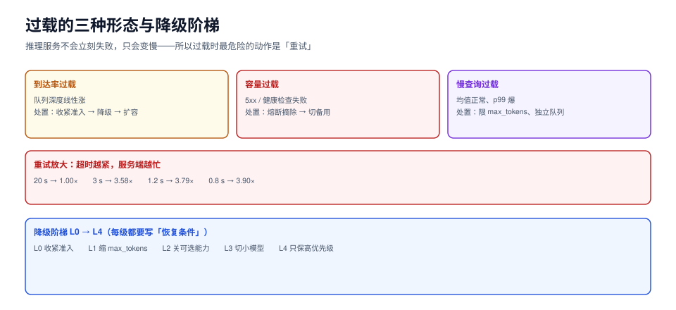

# 过载保护：超时越紧，放大越狠

推理服务的过载和普通 Web 服务有一个本质区别：**它不会立刻失败，只会变慢**。CPU 打满的 Web 服务会拒连接，显存打满的推理服务会「还在算，但每条都慢 10 倍」。于是客户端超时、重试、再超时、再重试——**服务端收到的负载比真实用户请求多出好几倍**。

这一页讲三件事：重试放大到底有多大、超时应该怎么设、降级阶梯怎么排。



本页判据族 `IFL-A` ~ `IFL-H`，共 8 条。定义表见文末「本页判据」一节。

## 一、重试放大的实测

200 个客户端、每个最多重试 3 次、退避 2 倍、服务端单队列（服务均值 100 ms）：

| 客户端超时 | 打到服务端的请求量 | 相对原始请求 |
| --- | --- | --- |
| 20,000 ms | 1.00× | 基准（几乎不重试） |
| 3,000 ms | **3.58×** | 3.6 倍 |
| 1,200 ms | **3.79×** | 3.8 倍 |
| 800 ms | **3.90×** | 3.9 倍 |

::: danger 最反直觉的一条
**超时设得越紧，服务端越忙。** 从 20 s 收到 3 s，服务端负载涨 3.6 倍；再收到 0.8 s，涨到 3.9 倍。原因很简单：超时不是「放弃等待」，是「**再发一次**」。客户端以为自己在保护自己，实际上在给已经着火的机房浇油。
:::

放大的近似算式（`R` = 最大重试次数，`p` = 单次失败概率）：

```text
amplification ≈ 1 + p + p² + … + p^R ≈ (1 − p^(R+1)) / (1 − p)
```

- `p = 0.5, R = 3` → 1.875×
- `p = 0.8, R = 3` → 2.95×
- `p = 0.95, R = 3` → 3.71×（接近实测的 3.79）

**重试次数是乘数，不是加数。** 把 `R` 从 3 降到 1，最坏放大从 3.71× 降到 1.95×——这一条改动的收益，比多加两台机器还大。

## 二、超时怎么设

超时不能拍脑袋，要按 SLO 反推，而且要**逐跳递减**：

```text
客户端总预算 10 s
 ├─ 网关 9.5 s（留 0.5 s 回传）
 │   ├─ 推理服务 9.0 s（留 0.5 s 序列化）
 │   │   └─ 排队 0.5 s（超了直接 429，不要等到 9 s）
 │   │   └─ prefill + decode 8.5 s
```

三条纪律：

1. **内层超时必须小于外层**。内层比外层大，等于外层先超时、内层白算，还占着显存。
2. **排队有自己的超时**，且远小于总预算。排队 8 秒再算 1 秒，用户等了 9 秒拿到结果——不如在 0.5 秒时告诉他「现在忙」。
3. **超时要往下传（deadline propagation）**。客户端可以带 `X-Request-Deadline`，服务端据此跳过「明显算不完」的请求（预估 `out_tokens × TPOT > 剩余预算` 时直接拒），比算完再丢省得多。

## 三、三种过载形态，三种处置

| 形态 | 起因 | 表现 | 正确处置 |
| --- | --- | --- | --- |
| **到达率过载** | 流量真的超过容量 | 队列深度线性涨、拒绝率上升 | 收紧准入 → 降级 → 扩容 |
| **容量过载** | 副本挂了一半、模型加载失败 | 404/503 增多、健康检查失败 | 熔断摘除 → 切备用 → 告警 |
| **慢查询过载** | 少量超长请求占满批位 | 平均延迟正常、p99 爆掉 | 限制单请求 `max_tokens`、长请求走独立队列 |

第三种最隐蔽：**平均延迟看起来完全正常**（大量短请求把均值拉低），只有 p99 在报警。判据是「p99/p50 > 5 且队列深度不涨」——说明不是排队问题，是批位被少数长请求占了。

## 四、降级阶梯

降级要**从代价最小往上排**，且每一级都要能独立开关：

| 级别 | 动作 | 影响 | 恢复条件 |
| --- | --- | --- | --- |
| L0 | 收紧准入（降低 `max_queue_depth`） | 拒绝率上升、延迟受控 | 队列深度回落 |
| L1 | 缩短 `max_tokens` 上限 | 长回答被截断 | p99 恢复 |
| L2 | 关闭前缀缓存以外的可选能力（重排序、多轮上下文裁剪） | 质量下降 | 同上 |
| L3 | 切小模型 / 备用模型 | 质量明显下降 | 主模型容量恢复 |
| L4 | 只服务高优先级流量 | 低优先级全部 429 | 紧急 |

::: warning 降级必须能自动恢复
只做了「降级开关」没做「恢复条件」，是过载处置里最常见的半成品：出事时手工打开，事后忘了关，服务带着 L2 降级跑了两周。每一级都要写死**恢复条件与恢复后的验证动作**（通常是「观察 10 分钟 p99 稳定在阈值 70% 以下」）。
:::

## 五、退避与抖动

固定间隔重试是「同步打点」，三次重试会在服务端形成三个尖峰。正确的退避：

```python [retry.py]
"""带抖动的指数退避 + 截止时间传播（示意实现）。"""
import random
import time


class Deadline:
    def __init__(self, total_ms):
        self.end = time.monotonic() + total_ms / 1000.0

    def left_ms(self):
        return max(0.0, (self.end - time.monotonic()) * 1000.0)

    def expired(self):
        return self.left_ms() <= 0


def retry(fn, deadline, max_attempts=3, base_ms=200, cap_ms=2000):
    last = None
    for attempt in range(max_attempts):
        if deadline.expired():
            raise TimeoutError("deadline exceeded before attempt")
        try:
            return fn(deadline.left_ms())
        except (TimeoutError, ConnectionError) as e:
            last = e
            # full jitter：在 [0, base*2^n] 里均匀取值，避免同步重试
            backoff = random.uniform(0, min(cap_ms, base_ms * (2 ** attempt))) / 1000.0
            if deadline.left_ms() / 1000.0 <= backoff:
                break
            time.sleep(backoff)
    raise last
```

四条要点：

1. **抖动必须从 0 开始（full jitter）**。用「固定 ±10%」只打散了 20%，用 full jitter 才能把尖峰摊平。
2. **退避时间要占预算**。算出「睡完就超时」时应当立刻放弃，不要「睡完再发一次注定超时的请求」。
3. **只重试可重试的错误**。429（带 `Retry-After`）可以；400、内容审核拒绝不能。
4. **重试要计数并上报**。`retry_attempts` 是判断「服务端是否在自我加压」的唯一指标。

## 六、熔断：把死掉的副本摘出去

熔断三态：闭合（正常）→ 打开（全拒）→ 半开（放少量探针）。推理服务的熔断要额外考虑两点：

- **失败判定不能只看 5xx**。推理服务的「失败」很多时候是超时（客户端侧），服务端记的是 200。所以熔断要基于**服务端侧的超时/取消率**，而不是 HTTP 状态码。
- **半开探针的成本是显存**。放 1 个探针请求进去，如果它是个 8k 长请求，会占 1 GiB KV。探针必须用固定的小请求（如 `max_tokens=8`）。

## 本页判据

| 编号 | 判据 | 看什么现象 | 不满足时改哪里 |
| --- | --- | --- | --- |
| `IFL-A` | 重试次数 ≤ 2 | 配置里最大重试是 1~2 次，不是 3 次以上 | 降到 1~2，配合服务端 `Retry-After` |
| `IFL-B` | 超时逐跳递减 | 内层超时 < 外层超时 | 重排超时表，内层留 5%~10% 余量 |
| `IFL-C` | 排队有独立超时 | 排队超时 << 总预算 | 设 `queue_timeout`，默认 0.5~1 s |
| `IFL-D` | 截止时间会传播 | 请求头里有 deadline，服务端据此快速拒 | 加 `X-Request-Deadline`，在准入处判 |
| `IFL-E` | 退避带 full jitter | 重试时间戳在服务端呈均匀分布 | 换成 full jitter |
| `IFL-F` | 降级分级且有恢复条件 | 每级都有「何时恢复」与恢复后验证 | 补恢复条件，别只做开关 |
| `IFL-G` | 熔断基于超时率 | 熔断指标包含服务端侧超时与取消 | 改成「超时 + 取消 + 5xx」的复合判定 |
| `IFL-H` | 重试可观测 | 有 `retry_attempts`、`upstream_overload` 指标 | 打点，并接到过载告警 |

## 验证方式

1. 复现放大效应（纯标准库，不需要推理引擎）：

   ```python
   # retry_amp.py：200 客户端、3 次重试、服务均值 100 ms
   import heapq, random
   random.seed(20261023)

   def storm(timeout_ms, n=200, sec=60, mu=1/100.0):
       q = [(t / n * 1000.0, 0) for t in range(n)]
       heapq.heapify(q)
       free, hits, uniq = 0.0, 0, 0
       while q:
           ta, att = heapq.heappop(q)
           if ta > sec * 1000:
               break
           hits += 1
           uniq += 1 if att == 0 else 0
           start = max(ta, free)
           free = start + random.expovariate(mu)
           if free - ta > timeout_ms and att < 3:
               heapq.heappush(q, (ta + timeout_ms * 2 ** att, att + 1))
       return hits / max(1, uniq)

   for to in (20000, 3000, 1200, 800):
       print(f"timeout={to:>5}ms → {storm(to):.2f}x")
   ```

   预期：`20000ms → 1.00x`、`3000ms → 3.5x 左右`、`800ms → 3.9x 左右`。**只要趋势一致就说明你的客户端也在放大**。

2. 在你的网关上取 `retry_attempts / requests` 的比值。稳态下应 < 0.05；> 0.5 说明重试策略在给系统加压。

3. 手工演练一次降级：把 `max_tokens` 上限从 4096 降到 512，观察 p99 是否回落、以及有多少请求被截断（`finish_reason=length` 的比例）。**降级的代价必须能被量出来**，否则无法判断「值不值得降」。

## 参考资料

- Google SRE Book, *Handling Overload* 与 *Addressing Cascading Failures*：<https://sre.google/sre-book/addressing-cascading-failures/>
- AWS Architecture Blog, *Exponential Backoff and Jitter*：<https://aws.amazon.com/blogs/architecture/exponential-backoff-and-jitter/>
- gRPC 截止时间传播：<https://grpc.io/docs/guides/deadlines/>
- RFC 9110 §10.2.3（`Retry-After`）：<https://www.rfc-editor.org/rfc/rfc9110.html>
