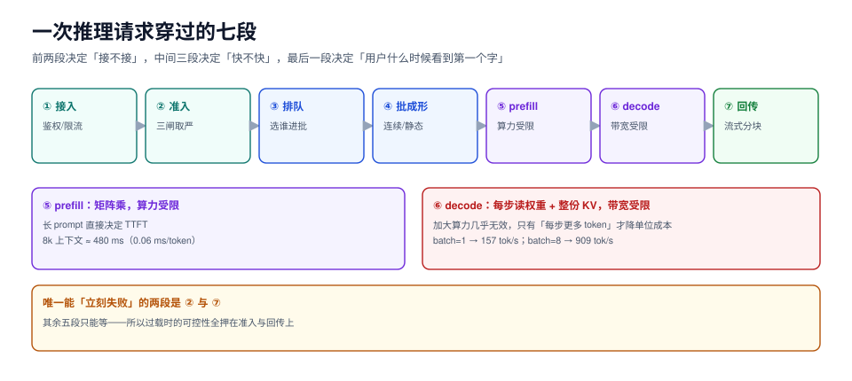

# 总览：一次推理请求穿过的七段

一个 `POST /v1/chat/completions` 从进网关到吐出最后一个 token，中间要过七道关口。九成的「推理服务慢」都出在后面五道，而九成的排查动作都停在第一道（看网关耗时）。

这一页把七段拆开，标清**每段吃的是哪种资源、坏了会表现成什么、看哪个指标能定位**。后面八页各讲一段。



本页判据族 `IFO-A` ~ `IFO-H`，共 8 条。定义表见文末「本页判据」一节。

## 一、七段链路

| 段 | 做什么 | 吃哪种资源 | 这段坏了的表现 | 对应的指标 |
| --- | --- | --- | --- | --- |
| ① 接入 | 鉴权、限流、协议转换 | 网关 CPU + 连接数 | 4xx 变多、连接被打满 | `http_reject_rate`、并发连接数 |
| ② 准入 | 判「接不接」、进哪个队列 | 队列容量（内存） | 队列无限长、排队时间无上界 | `queue_depth`、`admission_reject` |
| ③ 排队调度 | 选下一个进批的请求 | 调度器 CPU（微秒级） | 短请求被长请求挡住 | `queue_wait_p99` |
| ④ 批成形 | 把 N 条请求塞进同一个 step | 算力（SM 占用） | 批填不满、固定开销摊不掉 | `batch_fill_ratio` |
| ⑤ prefill | 把 prompt 算成 KV | 算力（矩阵乘） | TTFT 高、且与输入长度强相关 | `prefill_tokens/s`、`ttft_p99` |
| ⑥ decode | 每 step 生成 1 个 token | **显存带宽**（不是算力） | TPOT 高、且与并发数强相关 | `tpot_p50`、`tokens/s` |
| ⑦ 回传 | 流式分块、压缩、断开 | 网关 + 网络 | 客户端看到首字晚、长流被截断 | `time_to_first_byte` |

三段必须记住的性质：

1. **⑤ 和 ⑥ 的瓶颈不在同一个硬件部件上**。prefill 是矩阵乘，算力受限；decode 每生成一个 token 都要把权重和整份 KV 读一遍，**显存带宽受限**。所以「加大算力」对 decode 几乎无效，只有「提高每步的有效 token 数」（批处理）才救得了 decode 的单位成本。
2. **③ 的开销是微秒级，④ 的收益是倍数级**。调度器自己再慢也慢不到毫秒，但它**决定谁进批**——一个错误的准入顺序能让 p99 差 35 倍（见[服务分级](../SLO/index.md)）。
3. **② 和 ⑦ 是唯一能「立刻失败」的两段**。其余五段都只能等，所以过载时的可控性全在这两端。

## 二、三种稀缺资源，三种代价

调度的全部工作是在三种资源之间做分配，每种分配都把代价转给某一方：

| 资源 | 稀缺时的表现 | 让给谁 | 代价转给谁 |
| --- | --- | --- | --- |
| **算力**（SM） | 批填不满，固定开销占比高 | 大 batch 的前台请求 | 排队中的请求等更久 |
| **显存**（KV 块） | 新请求没块可用 | 已进入 decode 的请求 | 新请求被拒或被抢占重算 |
| **时间**（SLO） | p99 超阈 | 优先级的短请求 | 长请求被饿死 |

::: tip 一句话理解
看到「吞吐上不去」，先问是哪种资源卡住；看到「延迟高」，先问代价转给了谁。**调度不创造资源，只决定谁承担等待。**
:::

## 三、五个必失点

这五条在库里其它专题里都只被一句带过，本专题每条都给实测读数。

### 必失点 1：把「队列」当成「缓冲」

队列不是缓冲，是**延迟的蓄水池**。仿真实测（M/M/1、服务均值 100 ms、队列上限 64）：

| 负载 ρ | 排队 p50 | 排队 p99 | 拒绝率 |
| --- | --- | --- | --- |
| 0.70 | 111.0 ms | 1,426.8 ms | 0.00% |
| 0.90 | 581.9 ms | 4,212.2 ms | 0.01% |
| 0.95 | 1,326.4 ms | 6,251.9 ms | 0.22% |
| 1.00 | 3,097.9 ms | 7,045.4 ms | 1.62% |
| 1.05 | 4,879.7 ms | 7,396.5 ms | 5.28% |
| 1.15 | 5,624.4 ms | 7,770.4 ms | 13.38% |

从 ρ=0.7 到 0.95，**负载只涨 36%，p99 排队涨 4.4 倍**。这条曲线是后面所有容量规划的底座：**永远不要把稳态负载规划到 0.9 以上**，因为到达率本身有方差，ρ 的瞬时值会越过 1。

### 必失点 2：以为「接了」比「拒了」友好

同一份负载（ρ=1.05）只改队列上限：

| 队列上限 | 拒绝率 | 排队 p99 | 端到端 p99 |
| --- | --- | --- | --- |
| 8 | **14.88%** | 1,098.8 ms | 1,198.8 ms |
| 64 | 5.06% | 7,580.1 ms | 7,680.1 ms |
| 1024 | 3.65% | **108,232.3 ms** | 108,332.3 ms |

队列从 8 放到 1024，**只多接住 11 个百分点**的请求，却把 p99 从 1.2 s 拉到 108 s。108 秒的等待对客户端等于「超时」，对服务端等于「一个还占着连接的僵尸请求」。**准入的价值不是省资源，是把「无限等待」换成「明确失败」。**

### 必失点 3：把 batch_size 当旋钮

同一份权重、同一个到达率（λ=3 req/s）：

| 策略 | 吞吐 | TTFT p50 | padding 浪费 |
| --- | --- | --- | --- |
| 连续批（max_batch=8） | **491 tok/s** | 74.3 ms | 0 |
| 静态批（窗口 100 ms） | 201 tok/s | 156,922.9 ms | 66.2% |
| 静态批（窗口 2000 ms） | 278 tok/s | 79,380.1 ms | 155.3% |

静态批在这个到达率下**容不下负载**（201 < 到达的 540 tok/s），TTFT 的 15 万毫秒是排队积压，不是调度开销。真正的结论是：**批大小由到达率决定，不是由参数决定**——详见[批处理成形](../Batching/index.md)。

### 必失点 4：用同一个 SLO 卡首字与每字

TTFT 由「排队 + prefill」决定，TPOT 由「decode 的批大小」决定。同一个 8 并发配置下，两者可以同时存在**好一个坏一个**：批大了 TPOT 变差、批小了 TTFT 变差。把它们合成一个「端到端延迟」指标，等于放弃定位能力——详见[服务分级](../SLO/index.md)。

### 必失点 5：过载时先扩副本

扩副本有 **分钟级** 的冷启动（本机实测：14 GB 权重冷读 1.7 s，但这只是读盘，还没算初始化与预热，见[冷启动](../ColdStart/index.md)），而超时是**秒级**的。等副本起来，流量早已被重试放大三倍。正确顺序是：**先收紧准入 → 再关重试 → 最后才扩副本**——详见[过载保护](../Overload/index.md)。

## 四、读数的分工：把「排队」和「计算」分开

只看端到端延迟永远定位不到根因。四段读数必须分开打点：

| 读数 | 从哪来 | 它只回答一个问题 |
| --- | --- | --- |
| `queue_wait` | 准入时间戳 → 进批时间戳 | 是不是在排队 |
| `prefill_ms` | 进批 → 第一个 token | 输入侧贵不贵 |
| `tpot_ms` | 第一个 token → 最后一个 token / (n-1) | 每字贵不贵 |
| `batch_size_at_admit` | 进批那一刻的批内条数 | 资源有没有被摊薄 |

```text [打点位置示意]
t0 请求到达网关
t1 通过准入、进队列          → queue_wait = t1 - t0（应接近 0）
t2 被调度器选进批            → admit_wait = t2 - t1  ← 真正的排队时间
t3 第一个 token 产出         → prefill_ms = t3 - t2
t4 最后一个 token 产出       → tpot_ms = (t4 - t3) / (out_tokens - 1)
```

::: warning 两个容易记错的口径
1. **`queue_wait` 和 `admit_wait` 不是一回事**。前者在网关侧、包含网络与鉴权；后者才是「调度让你等」。混在一起会把网络抖动算成调度问题。
2. **TPOT 的分母是 `out_tokens - 1`**。从第一个 token 到最后一个 token 之间只有 `n-1` 个间隔，写成分母 `n` 会让短回答的 TPOT 系统性偏小——越短的请求偏得越多，最后得出结论「短请求更快」，而实际只是分母错了。
:::

## 五、谁该读这一页

| 角色 | 关心的段 | 落到哪页 |
| --- | --- | --- |
| 应用开发 | ①⑦ | [过载保护](../Overload/index.md)（重试与超时怎么写） |
| 推理平台 | ③④⑤⑥ | [批处理成形](../Batching/index.md)、[KV 缓存调度](../KVCache/index.md) |
| SRE / 值班 | ②③ | [准入与排队](../Admission/index.md)、[服务分级](../SLO/index.md) |
| 容量规划 | ⑤⑥ + 卡 | [容量换算](../Capacity/index.md)、[冷启动与弹性](../ColdStart/index.md) |

## 本页判据

| 编号 | 判据 | 看什么现象 | 不满足时改哪里 |
| --- | --- | --- | --- |
| `IFO-A` | 七段打点齐全 | 一次请求能取出 `queue_wait` / `prefill_ms` / `tpot_ms` / `batch_size_at_admit` 四个读数 | 补打点，别用端到端延迟代替 |
| `IFO-B` | 稳态负载有上限 | 容量规划里明确写出「规划负载 ≤ 0.7ρ」并给出到达率方差 | 把规划点从 0.9ρ 降到 0.7ρ，扩副本或加准入 |
| `IFO-C` | 准入有明确上限 | 队列长度是一个可配置常量，不是「无限制」 | 设 `max_queue_depth`，并配套 429 语义 |
| `IFO-D` | 拒绝快于等待 | 拒绝的响应时间 < 100 ms，且带 `Retry-After` | 队列满时立刻返回，不要先排队再拒 |
| `IFO-E` | 批策略与到达率匹配 | 记录 `batch_fill_ratio`，低负载时不强求大批 | 低负载换低延迟策略，高负载才追吞吐 |
| `IFO-F` | TTFT 与 TPOT 分开定 SLO | 两个指标各有阈值与分位数，不是一个「端到端延迟」 | 拆开定，分别配预算 |
| `IFO-G` | 过载处置有顺序 | 运行手册写明「先准入、再关重试、最后扩容」 | 调整顺序，扩副本不作为第一动作 |
| `IFO-H` | 每种资源都有对应读数 | 算力看 `batch_fill_ratio`、显存看 `kv_blocks_free`、时间看 `queue_wait_p99` | 缺哪种就补哪种，不要用一个指标包打天下 |

## 验证方式

1. 在你自己的服务上打一次点，确认四个读数都能取出来：

   ```shell
   curl -s -o /dev/null -w 'total=%{time_total}s ttfb=%{time_starttransfer}s\n' \
     -X POST http://127.0.0.1:8000/v1/chat/completions \
     -H 'Content-Type: application/json' \
     -d '{"model":"your-model","messages":[{"role":"user","content":"hi"}],"stream":true}'
   ```

   预期：`ttfb` 明显小于 `total`（流式生效）；两个数都拿得到，说明分段计时可行。

2. 把负载压到 ρ≈0.9，观察 `queue_wait_p99` 是否出现「非线性抬升」。若 p99 > 5×p50，说明已进入排队主导区，此时任何「优化计算」的动作收益都很小。

3. 把队列上限从默认值改成 8，重放同一份流量：应看到拒绝率上升、p99 显著下降。两个数一起看，才能确认「拒绝换延迟」这个交易成立。

## 参考资料

- vLLM 调度器文档：<https://docs.vllm.ai/en/latest/design/scheduler.html>
- Orca: Yu et al., *Orca: A Distributed Serving System for Transformer-Based Generative Models*, OSDI 2022（连续批处理的原始论文）
- Little's law 与排队论基础：<https://en.wikipedia.org/wiki/Little%27s_law>
- SGLang 调度与 RadixAttention：<https://docs.sglang.ai/>
