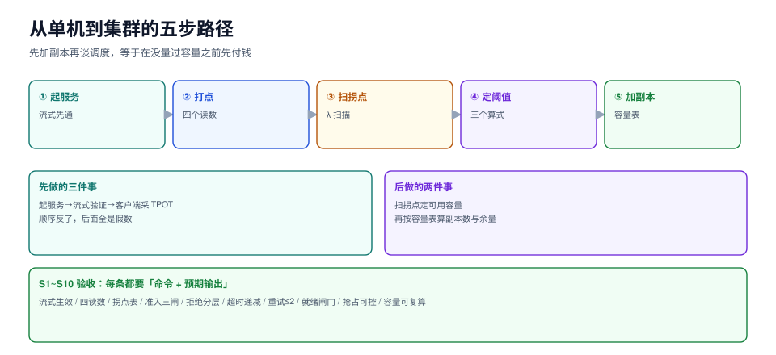

# 实战：单机到集群的可验收路径

前面八页讲的是「每一段怎么算」。这一页把它们串成一条可以照着走的路径：**从一张卡上的单实例开始，量出四个数，定出三个阈值，最后才谈加副本**。

顺序不能反。先加副本再谈调度，等于在没量过容量之前先付钱。



本页判据族 `IFX-A` ~ `IFX-H`，共 8 条。定义表见文末「本页判据」一节。

## 一、五步路径

| 步 | 做什么 | 产出 | 验收判据 |
| --- | --- | --- | --- |
| ① 单实例起来 | 起一个 OpenAI 兼容服务，跑通一次流式请求 | 可用的 `/v1/chat/completions` | 流式生效（TTFB << total） |
| ② 打点 | 四个读数分开记：`queue_wait` / `prefill_ms` / `tpot_ms` / `batch_size` | 一份能出 p50/p99 的报表 | 四个数都能取到且互不重叠 |
| ③ 扫拐点 | 从 λ=1 扫到过载，记吞吐与 p99 | 一张 λ 扫描表 | 能指出拐点位置 |
| ④ 定阈值 | 按 SLO 反推准入、超时、告警 | 一份参数表 | 三个阈值都有算式依据 |
| ⑤ 加副本 | 按可用容量算副本数 + 余量 | 容量表与成本表 | 峰值压测 p99 达标 |

## 二、第 ① 步：起一个能测的服务

```shell
# 用官方镜像起一个 OpenAI 兼容服务（示例；模型与卡按实际情况替换）
docker run --gpus all --rm -p 8000:8000 \
  -v ~/.cache/huggingface:/root/.cache/huggingface \
  vllm/vllm-openai:latest \
  --model Qwen/Qwen2.5-7B-Instruct \
  --max-model-len 8192 \
  --max-num-seqs 8 \
  --gpu-memory-utilization 0.90
```

启动日志里必须核对四个数（对不上就别往下走）：

| 日志项 | 应该看到什么 | 对不上说明什么 |
| --- | --- | --- |
| `KV cache size` | 与你按层数/头数算出的量同量级 | 精度或 GQA 配置记错了 |
| `max_num_seqs` | 等于你传的值 | 参数没生效 |
| `GPU blocks` | 大于 `max_num_seqs × 单请求块数` | 并发配太大，会频繁抢占 |
| `graph capturing finished` | 有这一行 | CUDA graph 没建，首请求会有秒级尖刺 |

验证流式（这一步是「服务真的能流式返回」的唯一证据）：

```shell
curl -sN -X POST http://127.0.0.1:8000/v1/chat/completions \
  -H 'Content-Type: application/json' \
  -d '{"model":"Qwen/Qwen2.5-7B-Instruct","stream":true,
       "messages":[{"role":"user","content":"用三句话解释什么是 KV 缓存"}],
       "max_tokens":200}' | head -5
```

预期：输出是一行行 `data: {...}` 的 SSE 分块，而不是一次性吐出整个 JSON。**如果 curl 卡住十秒然后一次性出来，说明 `stream` 没生效**，后面所有 TTFT 读数都是假的。

## 三、第 ② 步：四个读数怎么取

推理服务的指标有三层来源，别混在一起：

| 读数 | 来源 | 取法 |
| --- | --- | --- |
| `queue_wait` | 服务端打点（准入 → 进批） | 自己埋点，引擎一般不直接给 |
| `prefill_ms` | 引擎日志或 tracing | 首个 token 的时间戳 − 进批时间戳 |
| `tpot_ms` | 客户端流式时间戳 | 逐 chunk 记录到达时间 |
| `batch_size` | 引擎 metrics | `num_requests_running` 的均值 |

客户端采 TPOT 的最小脚本（不依赖任何 SDK）：

```python [stream_bench.py]
"""流式采集 TTFT / TPOT（只用标准库）。"""
import json
import time
import urllib.request

URL = "http://127.0.0.1:8000/v1/chat/completions"


def one_call(prompt, max_tokens=200):
    body = json.dumps({
        "model": "m", "stream": True, "max_tokens": max_tokens,
        "messages": [{"role": "user", "content": prompt}],
    }).encode()
    req = urllib.request.Request(URL, data=body,
                                 headers={"Content-Type": "application/json"})
    t0 = time.perf_counter()
    first, stamps = None, []
    with urllib.request.urlopen(req, timeout=120) as resp:
        for raw in resp:
            line = raw.decode().strip()
            if not line.startswith("data:"):
                continue
            payload = line[5:].strip()
            if payload == "[DONE]":
                break
            now = time.perf_counter()
            if first is None:
                first = now
            stamps.append(now)
    if not stamps:
        return None
    ttft = (first - t0) * 1000
    tpot = ((stamps[-1] - first) / (len(stamps) - 1) * 1000) if len(stamps) > 1 else 0.0
    return ttft, tpot, len(stamps)


if __name__ == "__main__":
    rows = [one_call("解释一下连续批处理") for _ in range(30)]
    rows = [r for r in rows if r]
    ttft = sorted(r[0] for r in rows)
    tpot = sorted(r[1] for r in rows)
    print(f"n={len(rows)} TTFT p50={ttft[len(ttft)//2]:.0f}ms p99={ttft[int(len(ttft)*0.99)]:.0f}ms "
          f"TPOT p50={tpot[len(tpot)//2]:.1f}ms")
```

预期：TTFT 在几百毫秒到几秒、TPOT 在十几到几十毫秒。若 TPOT 小于 1 ms，说明 chunk 里一次带了多个 token（正常，按 chunk 数算 TPOT 会偏小）——此时要按 `usage.completion_tokens` 修正分母。

## 四、第 ③ 步：扫拐点

```shell
# 五个负载点，每点 60 s；只记吞吐与 p99
for r in 1 2 4 8 16; do
  echo "=== concurrency=$r ==="
  hey -z 60s -c $r -m POST -T 'application/json' \
    -d '{"model":"m","messages":[{"role":"user","content":"hi"}],"max_tokens":200}' \
    http://127.0.0.1:8000/v1/chat/completions 2>/dev/null | grep -E 'Requests/sec|50%|99%'
done
```

判读规则（**只看两个数**）：

1. `Requests/sec` 还在涨 → 没到拐点；
2. `99%` 延迟涨幅 > 3 倍 → 过了拐点。

两者同时出现的那一刻，取前一个点的吞吐作为**可用容量**。本专题仿真台给出的对应数字见[容量换算](../Capacity/index.md)的 λ 扫描表。

## 五、第 ④ 步：三个阈值

| 参数 | 算式 | 本专题示例值 |
| --- | --- | --- |
| `max_queue_depth` | `2 × 目标 p99 / 单请求服务时间` | 目标 p99 1 s、服务 100 ms → **20** |
| `queue_timeout` | `0.5 × TTFT 预算` | TTFT 预算 500 ms → **250 ms** |
| 队列深度告警阈值 | `0.6 × max_queue_depth` | **12**，持续 2 分钟 |

三条都要写进配置，且**只有一个来源**（配置中心或环境变量），不要在代码里再写一份默认值。

## 六、第 ⑤ 步：加副本

```text
副本数 = ceil(可用容量需求 / 单副本可用容量 × 余量)
```

算完之后必须做一次**验收压测**：把流量打到「规划容量 × 1.0」，确认：

- TTFT p99 达标；
- TPOT p99 达标；
- 拒绝率 < 1%（正常情况不该拒）；
- 没有抢占风暴（`preempt_count` 增速平稳）。

## 七、S1~S10 验收清单

十条，每条都要给出**命令 + 预期输出**，缺一条就不算交付。

| 编号 | 项 | 判定 |
| --- | --- | --- |
| S1 | 流式生效 | `curl -N` 能看到多行 `data:` |
| S2 | 四个读数可取 | 报表里同时有 TTFT、TPOT、排队、批大小 |
| S3 | 拐点已测 | λ 扫描表能指出拐点位置 |
| S4 | 准入三闸 | 条数、token、KV 块三项中至少两项生效 |
| S5 | 拒绝语义分层 | 429 / 503 / 400 各有触发条件与验证用例 |
| S6 | 超时逐跳递减 | 内层 < 外层，且排队有独立超时 |
| S7 | 重试 ≤ 2 次且带抖动 | 压测时 `retry_attempts` 可控 |
| S8 | 就绪闸门 | warmup 完成前不接流 |
| S9 | 抢占可控 | `preempt_count` 有上限，无活锁 |
| S10 | 容量表可复算 | 别人拿你的表能用同样算式复现副本数 |

## 八、交付物清单

一份可交付的方案至少包含五件东西：

1. **容量表**：目标 QPS、平均输入/输出、单副本可用容量、副本数、余量、成本；
2. **参数表**：准入三闸、超时表、重试策略、降级阶梯；
3. **读数面板**：TTFT / TPOT / 队列深度 / 批大小 / 抢占次数 / 拒绝率；
4. **压测报告**：λ 扫描表 + 拐点结论 + 峰值与可用的差距；
5. **演练记录**：至少一次降级演练、一次缩容演练、一次重试风暴复现。

## 本页判据

| 编号 | 判据 | 看什么现象 | 不满足时改哪里 |
| --- | --- | --- | --- |
| `IFX-A` | 五步顺序不乱 | 先量容量再定副本，不是先扩再调 | 按本页顺序重排 |
| `IFX-B` | 启动日志四项核对 | KV 大小、`max_num_seqs`、块数、graph 捕获都有记录 | 补核对，别跳过 |
| `IFX-C` | 流式已验证 | `curl -N` 多行输出 | 修 `stream` 参数或网关缓冲 |
| `IFX-D` | 客户端能独立测 TPOT | 有不依赖 SDK 的采集脚本 | 用本页 `stream_bench.py` |
| `IFX-E` | 拐点有表 | λ 扫描表 ≥ 5 个点 | 补扫描 |
| `IFX-F` | 阈值有算式 | 三个阈值都能反推到 SLO | 补算式，别用默认值 |
| `IFX-G` | 验收压测做过 | 有「规划容量 × 1.0」的压测记录 | 补压测，四个数全看 |
| `IFX-H` | 交付物五件齐全 | 容量表、参数表、面板、压测报告、演练记录 | 缺哪件补哪件 |

## 验证方式

1. 跑一遍 `stream_bench.py`，确认 TTFT 与 TPOT 都能算出来，且重复 30 次的 p99/p50 比值在 2~4 之间。比值 > 10 说明系统还在排队，回到第 ③ 步重新扫拐点。

2. 用 `docker stats` 或 `nvidia-smi` 对照：压测期间 GPU 利用率应稳定在 80% 以上（decode 密集时可能只有 60%，因为卡在访存）。**GPU 利用率低但延迟高，几乎一定是排队或调度问题，不是算力问题。**

3. 把 `max_queue_depth` 从 20 改到 5 重跑验收压测：预期拒绝率上升、p99 下降。若 p99 没变，说明瓶颈不在队列——去查 prefill 或 KV 抢占。

## 参考资料

- vLLM 官方基准测试流程：<https://docs.vllm.ai/en/latest/performance/benchmarks.html>
- `hey` 压测工具：<https://github.com/rakyll/hey>
- OpenAI 兼容接口规范（流式 SSE）：<https://platform.openai.com/docs/api-reference/chat/streaming>
- Google SRE Workbook, *Implementing SLOs*：<https://sre.google/workbook/implementing-slos/>
