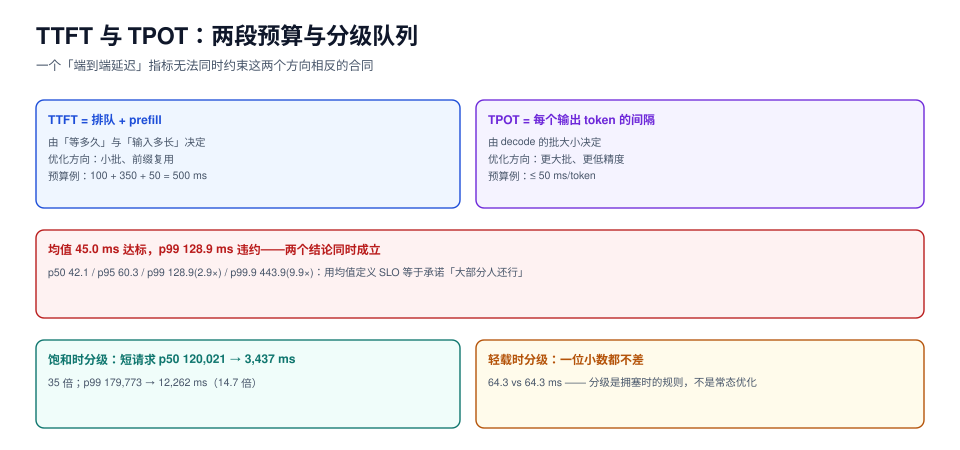

# 服务分级：TTFT 与 TPOT 是两种合同

线上推理服务只有一份合同的时候，几乎必然出现「按平均值全部达标、按 p99 全部违约」。原因不是指标算错，而是**合同把一个二维问题压成了一维**：

- **首字延迟（TTFT, Time To First Token）**：从请求到达到第一个 token，由「排队 + prefill」决定。
- **每字延迟（TPOT, Time Per Output Token）**：第一个 token 之后的平均间隔，由「decode 的批大小」决定。

这两件事的优化方向**是相反的**：批越大 TPOT 越差、TTFT 越好；批越小反过来。用一个「端到端延迟」卡它们，等于要求「同时把批调大和调小」。



本页判据族 `IFS-A` ~ `IFS-H`，共 8 条。定义表见文末「本页判据」一节。

## 一、拆预算

一条请求的端到端时间可以精确分解：

```text
E2E = queue_wait + prefill_ms + (out_tokens − 1) × TPOT + 网络回传
```

以「TTFT ≤ 500 ms、TPOT ≤ 50 ms、输出 200 token」为例：

| 预算项 | 分配 | 依据 |
| --- | --- | --- |
| `queue_wait` | 100 ms | 稳态 p99 排队应小于它；超出说明准入太松 |
| `prefill_ms` | 350 ms | 8k 上下文的 prefill 在 0.06 ms/token 下约 480 ms，**超了就要靠前缀复用或分块** |
| 首 token 回传 | 50 ms | 网络与网关开销 |
| **TTFT 合计** | **500 ms** | 前两项之和 |
| `TPOT` | 50 ms | 对应批内约 1.10 ms/token × 并发配额 |
| **E2E 合计** | 500 + 199 × 50 ≈ **10.5 s** | 长回答的端到端天然很长，不要用 E2E 卡 |

::: tip 一句话理解
**TTFT 是「服务响应承诺」，TPOT 是「阅读速度承诺」。** 用户能忍受一个 10 秒的长回答，但不能忍受 10 秒才看到第一个字。所以两个指标必须分开定，且 TTFT 永远优先。
:::

## 二、均值骗人：p99 与均值的 2.9 倍

固定种子 20261023 的 86.4 万个请求（合成序列，p50 输出 120 token）：

| 统计量 | 值 | 与均值的关系 |
| --- | --- | --- |
| 均值 | 45.0 ms | 1.0× |
| p50 | 42.1 ms | 0.94× |
| p95 | 60.3 ms | 1.34× |
| p99 | **128.9 ms** | **2.9×** |
| p99.9 | **443.9 ms** | **9.9×** |

如果 SLO 写成「平均延迟 ≤ 50 ms」，这份数据是**达标**的（45.0 ms）；但每 100 个用户就有 1 个等了 129 ms、每 1000 个有 1 个等了 444 ms。**用均值定义 SLO，等于承诺「大部分人还行」**，而用户体验由最差的那批人决定。

三条口径纪律：

1. **SLO 必须写在分位数上**，且分位数要写清（p99 还是 p95）。
2. **分母要写清**：按请求算、按会话算、按用户算，三个数完全不同。按请求算最常用，按用户算最接近体感。
3. **样本量要写清**：p99 至少需要 1,000 个样本才有统计意义，p99.9 需要 10 万。低流量服务报 p99.9 是在报噪声。

## 三、分级：拥塞时唯一有效的分配手段

实测（80% 短请求 50 token / 20% 长请求 1500 token，max_batch=8）：

| 场景 | 策略 | 短请求 TTFT p50 | 短请求 p99 | 长请求 p50 | 长请求 p99 |
| --- | --- | --- | --- | --- | --- |
| **饱和**（λ=2.5/s） | FCFS | 120,021.6 ms | 179,773.3 ms | 115,592.7 ms | 179,371.6 ms |
| **饱和**（λ=2.5/s） | 两级优先 | **3,437.0 ms** | **12,262.0 ms** | 145,795.0 ms | 207,408.5 ms |
| **轻载**（λ=1.0/s） | FCFS | 64.3 ms | 136.8 ms | 62.2 ms | 160.2 ms |
| **轻载**（λ=1.0/s） | 两级优先 | 64.3 ms | 136.8 ms | 62.2 ms | 160.2 ms |

三条结论，每条都能直接写进方案：

1. **饱和时分级把短请求 p50 从 120 s 拉到 3.4 s（35 倍），p99 从 180 s 拉到 12 s（14.7 倍）**。这不是「优化」，这是「救活」。
2. **代价只有长请求 p99 +15.6%**（179,372 → 207,409 ms）。因为它本来就在排队，只是排得更久。
3. **轻载时两者一位小数都不差**。所以分级**不需要在平时开启调优**——它是一个拥塞时的规则，平时完全无感。

::: danger 分级的三种失败形态
1. **饿死（starvation）**：低优先级请求永远排不到。判据不是「延迟高」，而是「有些请求**从未开始**」。必须配老化（见下）。
2. **优先级伪造**：客户端自己声明 `priority: high`，等于所有请求都高。优先级必须由**服务端**根据来源（内部/外部、付费档位、接口类型）判定，绝不能读请求体。
3. **不分场景全开**：给所有接口都分级，结果两个级别的负载互相压制。分级只应对**已知有混合长度**的入口开启（如对话 + 文档问答共用一个池）。
:::

## 四、防饿死：老化与配额

纯优先级队列在持续高优先级流量下会永久饿死低优先级。三种解法：

| 解法 | 机制 | 优点 | 代价 |
| --- | --- | --- | --- |
| **老化**（aging） | 等待越久优先级越高：`eff_prio = base + wait_ms / 1000` | 简单，保证有界等待 | 高优先级也不能「永远优先」 |
| **配额**（quota） | 每个级别保证最低份额（如低优先级至少占 20% 批位） | 有硬保证 | 需要预留容量 |
| **分池** | 不同级别跑在不同副本上 | 彻底隔离 | 成本翻倍，利用率下降 |

推荐组合：**配额（保证下限）+ 老化（保证上限）**。实现上就是两级队列轮转，每 N 个 step 强制从低优先级取一次。

```python [priority_queue.py]
"""带配额与老化的两级队列（示意实现）。"""


class PriorityQueue:
    def __init__(self, low_quota_every=4, aging_ms=5000):
        self.queues = {"high": [], "low": []}
        self.low_quota_every = low_quota_every
        self.aging_ms = aging_ms
        self.tick = 0

    def push(self, req, now_ms, level="high"):
        self.queues[level].append((now_ms, req))

    def pop(self, now_ms):
        self.tick += 1
        # 配额：每 low_quota_every 次强制服务一次低优先级（保证下限）
        force_low = (self.tick % self.low_quota_every == 0 and self.queues["low"])
        # 老化：低优先级等太久就提前（保证上限）
        if self.queues["low"]:
            waited, _ = self.queues["low"][0]
            if now_ms - waited > self.aging_ms:
                force_low = True
        order = ("low", "high") if force_low else ("high", "low")
        for level in order:
            if self.queues[level]:
                return self.queues[level].pop(0)[1]
        return None
```

注意：`pop` 里改 `self.tick` 是**副作用**，多线程下必须加锁；生产实现通常把配额判定做进调度器主循环，而不是队列本身。

## 五、告警：燃烧率而不是阈值

SLO 99.9% 意味着每月允许 **43.2 分钟**的违约。用「错误预算」算燃烧率：

| 窗口 | 燃烧率 | 含义 | 动作 |
| --- | --- | --- | --- |
| 1 小时 | **14.4** | 按此速度 2 天烧完全月预算 | 立刻告警、值班介入 |
| 6 小时 | 6 | 5 天烧完 | 工单 |
| 3 天 | 1 | 正好用完 | 记录 |

「p99 > 500 ms 持续 5 分钟」这种静态阈值在低流量时天天误报（样本不足），在高流量时又太钝。**用燃烧率把「超了多少」变成「还剩多少」**，才能同时对齐严重程度与剩余预算。

## 本页判据

| 编号 | 判据 | 看什么现象 | 不满足时改哪里 |
| --- | --- | --- | --- |
| `IFS-A` | TTFT 与 TPOT 分开定 | 两个指标各有阈值与分位数 | 拆开，不要用 E2E 卡 |
| `IFS-B` | SLO 写在分位数上 | 文档与告警里出现的是 p99/p95，不是均值 | 改口径；均值只作趋势参考 |
| `IFS-C` | 分母与样本量写清 | SLO 文档写明「按请求 / 按会话」与最小样本数 | 低流量服务不报 p99.9 |
| `IFS-D` | 优先级由服务端判定 | 优先级来自接口/来源/档位，不读请求体 | 去掉客户端可伪造的字段 |
| `IFS-E` | 有防饿死机制 | 低优先级有配额或老化，且有「最久等待」指标 | 加配额 + 老化，两者都要 |
| `IFS-F` | 分级只在拥塞时生效 | 轻载时两级延迟无差异（差 <5%） | 若轻载也有差异，说明配额配错了 |
| `IFS-G` | 分级有代价记录 | 长请求 p99 的涨幅在方案里写清楚 | 补一条「我们接受了什么」 |
| `IFS-H` | 告警用燃烧率 | 告警规则里有窗口 + 燃烧率倍数 | 替换静态阈值，配 14.4/6/1 三档 |

## 验证方式

1. 算一次你自己的预算表：把 `queue_wait + prefill_ms + (n-1)×TPOT` 加起来，与线上 p99 端到端比。若算出来比实测小很多，说明有未计入的一段（通常是网关或回传）。

2. 用两个级别的混合负载压一次，比较 p99：

   ```shell
   # 短请求（低 max_tokens）与长请求（高 max_tokens）交替打
   for i in $(seq 1 50); do
     curl -s -o /dev/null -X POST http://127.0.0.1:8000/v1/chat/completions \
       -H 'Content-Type: application/json' \
       -d '{"model":"m","messages":[{"role":"user","content":"短"}],"max_tokens":16}' &
     curl -s -o /dev/null -X POST http://127.0.0.1:8000/v1/chat/completions \
       -H 'Content-Type: application/json' \
       -d '{"model":"m","messages":[{"role":"user","content":"长"}],"max_tokens":1500}' &
   done; wait
   ```

   预期：不开分级时短请求的 TTFT 会被长请求明显拖高；开分级后短请求 TTFT 收敛、长请求变慢。两边都要看，只看一边等于自欺。

3. 检查饿死：连续压 10 分钟后，取「低优先级请求的最大等待时间」。若接近压测时长，说明配额没生效。

## 参考资料

- Google SRE Workbook, *Alerting on SLOs*（燃烧率窗口）：<https://sre.google/workbook/alerting-on-slos/>
- vLLM 优先级调度：<https://docs.vllm.ai/en/latest/configuration/optimization.html>
- Little's law 与排队延迟：<https://en.wikipedia.org/wiki/Little%27s_law>
- DistServe（TTFT/TPOT 分离作为一等目标的系统设计）：Zhong et al., OSDI 2024
