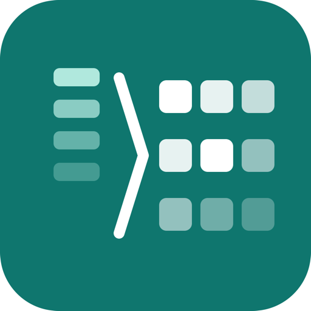
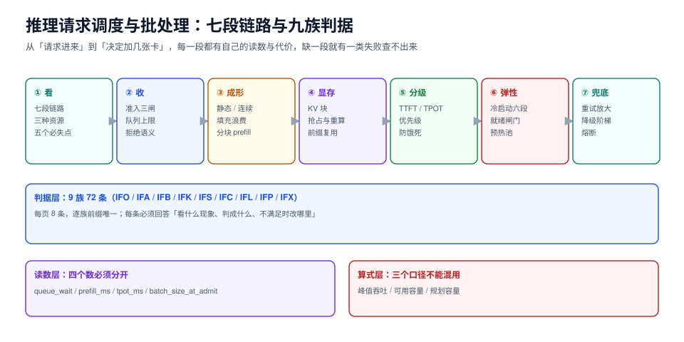

# 推理请求调度与批处理

把模型跑起来只解决「能答」，调度解决「同时答、按合同答、答不完时谁先答」。同一张卡、同一个引擎、同一份权重，换个调度策略，吞吐能差 2.4 倍、首字延迟能差 78 倍、过载时的失败方式能从「等 3 秒报错」变成「等 3 分钟然后超时」。

本专题面向要把推理服务真正跑成线上服务的人：不回答「怎么装 vLLM」，而回答**请求进来之后，排在哪、谁先算、显存不够时抢谁、SLO 破了先牺牲谁、卡不够时加几张**——每一件都给出可复算的算式与可复跑的读数。

::: tip 一句话理解
调度的全部工作，是把三种稀缺资源（**算力、显存、时间**）在请求之间分配；每一种分配都有代价，**没有「更快的调度」，只有「把代价放到谁身上」的调度**。
:::

::: info 本专题与相邻专题的分工
- **引擎怎么选、怎么起服务** → [推理服务部署](../LocalModel/InferenceServer/index.md)：那里回答「vLLM / llama.cpp / 云端 API 选哪个、命令怎么敲」，本专题从「服务已经在跑」之后接手。
- **压测脚本怎么写、指标怎么取** → [模型性能与压测](../LocalModel/Performance/index.md)：那里管「怎么量出一个数」，本专题管「量出来的数怎么用来定副本数」。
- **量化到几位、精度掉多少** → [模型量化](../LocalModel/Quantization/index.md)：量化直接影响显存与每 token 成本，本专题只在[容量换算](Capacity/index.md)里引用它的结果，不重复讲算法。
- **卡怎么选、显存带宽多少** → [硬件与显存](../LocalModel/Hardware/index.md)：带宽决定 decode 的上限，本专题[容量换算](Capacity/index.md)用它的带宽数推算单副本天花板。
- **端侧运行时（手机、嵌入式）** → [端侧运行时](../EdgeInference/Runtime/index.md)：端侧没有「多副本」这个概念，调度退化为单请求排队，本专题不谈。
- **多模型之间怎么路由、怎么降级** → [模型路由与降级](../ModelRouting/index.md)：路由决定「请求去哪个模型」，本专题决定「到了这个模型之后排第几」。
- **请求链路的追踪与成本** → [链路追踪](../LLMObservability/Tracing/index.md)、[成本核算](../LLMObservability/Cost/index.md)：那里按 trace 与 token 记账，本专题提供「每个请求的排队时间与计算时间怎么分开记」。
- **多租户的配额与隔离** → [配额执行](../../Backend/MultiTenantSaaS/QuotaEnforcement/index.md)、[噪声邻居](../../Backend/MultiTenantSaaS/NoisyNeighbor/index.md)：那里是「按租户限速」，本专题是「限完之后在同一个批里怎么排」，两者串起来才闭环。
- **服务端通用的过载保护** → [高并发设计](../../Backend/HighConcurrency/index.md)：那里的熔断、限流、隔离是通用手段，本专题只补推理特有的「重试放大」与「超时即失败」两条。
- **项目侧的监控与告警** → [EventOrderHub 监控与告警](../../../project/Complete/EventOrderHub/Monitoring/index.md)：那边把「自检」翻译成指标，本专题的 TTFT / TPOT / 队列深度就是同一套思路在推理侧的版本。
:::

## 目录

- [总览：一次推理请求穿过的七段](Overview/index.md)
- [准入与排队：把「无限等待」换成「明确失败」](Admission/index.md)
- [批处理成形：批大小是等出来的](Batching/index.md)
- [KV 缓存调度：块、抢占与前缀复用](KVCache/index.md)
- [服务分级：TTFT 与 TPOT 是两种合同](SLO/index.md)
- [冷启动与弹性：加载时间不属于推理](ColdStart/index.md)
- [过载保护：超时越紧，放大越狠](Overload/index.md)
- [容量换算：从 tok/s 到卡数](Capacity/index.md)
- [实战：单机到集群的可验收路径](Practice/index.md)

## 专题地图

## 判据纪律

沿用全库写法：**每页 8 条，编号形如 `IFA-A`**，逐页前缀唯一，可被 `utils/audit` 下的判据类巡检机械核对。每条判据都要能回答三件事：**看什么现象、判成什么、不满足时改哪里**。

| 页 | 判据族 | 这一族管什么 | 条数 |
| --- | --- | --- | --- |
| 总览 | `IFO-A` ~ `IFO-H` | 七段链路、三种稀缺资源、必失点 | 8 |
| 准入与排队 | `IFA-A` ~ `IFA-H` | 队列上限、拒绝语义、令牌预算 | 8 |
| 批处理成形 | `IFB-A` ~ `IFB-H` | 批策略、填充浪费、批内公平 | 8 |
| KV 缓存调度 | `IFK-A` ~ `IFK-H` | 块大小、碎片、抢占、前缀复用 | 8 |
| 服务分级 | `IFS-A` ~ `IFS-H` | TTFT/TPOT 合同、优先级、饿死 | 8 |
| 冷启动与弹性 | `IFC-A` ~ `IFC-H` | 加载分解、预热、副本伸缩 | 8 |
| 过载保护 | `IFL-A` ~ `IFL-H` | 背压、超时、重试放大、降级 | 8 |
| 容量换算 | `IFP-A` ~ `IFP-H` | 吞吐上限、卡数、余量、成本 | 8 |
| 实战 | `IFX-A` ~ `IFX-H` | 验收清单、压测方法、交付物 | 8 |

合计 **9 族 72 条**。

## 事实与版本速览

下表只放会影响判据的事实，口径与来源都写清；**二手对比页的版本号互相矛盾，一律以官方 release 为准**。

| 事实 | 口径（核对时间 2026-10-23） |
| --- | --- |
| vLLM `0.32.0`（2026-10-18） | PagedAttention + 连续批处理 + 自动前缀缓存 + chunked prefill；官方 release 页为准（二手对比页仍在写 0.30/0.31，说明这类文章的平均滞后约 2 周） |
| SGLang `0.5.22`（2026-10-19） | RadixAttention（基数树前缀复用）；前缀共享型流量（Agent 循环、多轮对话、RL rollout）的主场 |
| TensorRT-LLM `1.2.1`（2026-04-20） | in-flight batching + paged KV；NVIDIA 专用编译路径，版本节奏明显慢于前两者 |
| Hugging Face TGI 已归档 | 仓库 2026-03-21 归档、进入维护模式；**新部署不要选**，老项目要写清迁移路径 |
| 连续批处理是所有主流引擎的默认 | 差别不在「有没有」，而在**准入时看什么**（请求数 / token 数 / KV 块数）与**抢占时牺牲谁** |
| 单 token 的 KV 体积可按算式推出 | `2 × 层数 × KV 头数 × head_dim × 字节数`；32 层 / 8 个 KV 头 / 128 维 / FP16 ≈ **128 KiB/token**，8k 上下文 ≈ **1 GiB/请求** |
| 首字延迟（TTFT）与每 token 延迟（TPOT）是两个合同 | 前者主要由排队 + prefill 决定，后者由 decode 的批大小决定；**用同一个 SLO 卡两者，必然有一边长期违约** |

## 三条底线

::: danger 三条不可让步的底线
1. **准入必须有上限，且拒绝要快**。仿真实测：队列上限 1024 时拒绝率只降 1.4 个百分点（5.06% → 3.65%），但排队 p99 从 **7.7 s 涨到 108.3 s**。接了却让人等 108 秒，比立刻回 429 更伤——前者占着连接、耗着客户端超时、还会触发重试放大。
2. **批大小不能当调参旋钮，它是到达率的函数**。同一份权重，静态批（等满一批再算）在 λ=1 req/s 时平均批次只有 1 条，吞吐被固定开销压到 **201 tok/s**；连续批同一时刻 **491 tok/s**。想靠「把 batch_size 调大」提吞吐，先确认有那么多请求同时在等。
3. **过载时先关的是重试，不是副本**。客户端超时从 20 s 收到 3 s，打到服务端的请求量放大 **3.58 倍**；收到 0.8 s 放大 **3.90 倍**。副本数不变、超时变紧，等于自己给自己加了一倍负载。
:::

## 阅读顺序

先读[总览](Overview/index.md)建立七段链路的全局图；接着按你当前的痛点挑一条主线：

- **延迟抖、p99 难看** → [准入与排队](Admission/index.md) → [批处理成形](Batching/index.md) → [服务分级](SLO/index.md)
- **显存不够、并发上不去** → [KV 缓存调度](KVCache/index.md) → [容量换算](Capacity/index.md)
- **高峰期雪崩、越重试越慢** → [过载保护](Overload/index.md) → [冷启动与弹性](ColdStart/index.md)
- **要交一份能验收的方案** → 直接跳[实战](Practice/index.md)，按里面的 S1~S10 走

## 参考资料

- vLLM 官方文档：<https://docs.vllm.ai/>
- vLLM 论文（PagedAttention）：Kwon et al., *Efficient Memory Management for Large Language Model Serving with PagedAttention*, SOSP 2023
- SGLang 官方文档：<https://docs.sglang.ai/>
- SGLang 论文（RadixAttention）：Zheng et al., *SGLang: Efficient Execution of Structured Language Model Programs*, 2023
- Orca 论文（连续批处理 / iteration-level scheduling）：Yu et al., OSDI 2022
- NVIDIA TensorRT-LLM：<https://github.com/NVIDIA/TensorRT-LLM>
