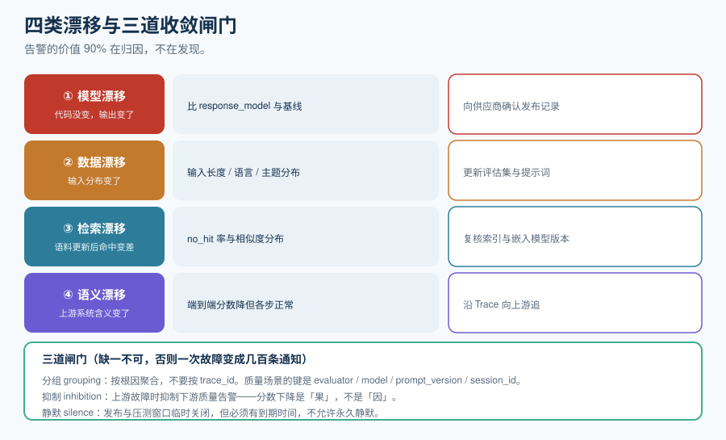

# 质量告警与漂移

传统告警的判据是「超过阈值」；质量告警的判据往往没有明确的阈值——**忠实度从 0.86 掉到 0.81，哪一条规则该报警？** 这一页讲清楚怎么把「质量在变差」这种模糊判断变成可值班、可收敛、可归因的告警。

::: tip 一句话理解
传统告警回答「系统坏了吗」；质量告警回答「**它还在按我上次验收时的样子工作吗**」。前者是硬阈值，后者是**基线对比 + 变化归因**。
:::

## 一、四类漂移

「漂移」这个词涵盖四种完全不同的现象，处置动作也完全不同。

| 类型 | 现象 | 根因 | 如何发现 | 处置 |
| --- | --- | --- | --- | --- |
| **① 模型漂移** | 代码与提示词没变，输出风格/质量变了 | 供应商静默升级或路由到不同型号 | `gen_ai.response.model` 与基线比较 | 向供应商确认发布记录；用固定的[离线评估集](../OfflineEval/index.md)复跑确认 |
| **② 数据漂移** | 输入分布变了（新用户群、新话题、更长上下文） | 用户行为变化、营销活动、上游数据源变化 | 输入长度/语言/topic 分布的统计对比 | 更新评估集与提示词；这不是「故障」，是「需求变了」 |
| **③ 检索漂移** | 语料更新后命中质量下降 | 文档被替换 / 切分策略变化 / 嵌入模型升级 | 检索 `status=no_hit` 率、相似度分布 | 复核索引版本与嵌入模型一致性 |
| **④ 语义漂移** | 上游系统的输出含义变了 | 依赖的另一个 LLM 服务改版 | 端到端质量分数下降，但本服务各步「正常」 | 沿 Trace 向上游追 |



::: danger 只能发现 ①④、发现不了 ②③ 的典型症状
「我们把所有指标都接上了，但质量下降时没人知道为什么。」原因通常是**只监控了质量分数与延迟**，没有监控**输入分布与检索状态**。

- 数据漂移（②）的信号在**输入侧**——必须记录输入长度分布、语言分布、`no_hit` 率。
- 检索漂移（③）的信号在**中间步骤**——必须记录 `returned` 条数与相似度。

只盯最终分数，你只能知道「变差了」，不能知道「为什么变差」。而**质量告警的 90% 价值在归因**，不在发现。
:::

## 二、告警的三档强度

按「假警报成本 vs 漏报成本」分三档，**不要所有指标都用同一档**。

| 档 | 触发方式 | 通知渠道 | 适合指标 | 主要风险 |
| --- | --- | --- | --- | --- |
| **P1 立即打扰** | 硬红线，命中即呼人 | 电话 / 值班群 @ | 服务不可用、越狱红线 > 0、错误率 > 5% | 假警报消耗团队信任——**必须先把红线做准** |
| **P2 群内提醒** | 超过基线一定幅度，持续 N 分钟 | 团队频道 | 忠实度 P50 掉到基线的 95% 以下且持续 30 分钟、每千次成功成本环比 +30% | 提醒疲劳 |
| **P3 日报** | 只进日报，不打扰 | 邮件 / 日报机器人 | 趋势类指标、分布变化 | 会被忽略，所以**周报里必须有一个人看** |

::: warning 质量指标不要用 P1
质量分数是**统计量**，天然有波动。把它接到电话告警，等于每隔几天制造一次假警报。正确做法是：**硬红线（越狱成功率、格式合规率）用 P1，统计型质量分数用 P2/P3**。这与[安全门禁](../../PromptSecurity/RegressionGate/index.md)的「红线 0 容忍」是同一套逻辑。
:::

## 三、告警的收敛：分组、抑制、静默

三道闸门缺一不可，否则一次故障会变成几百条通知。这三道闸门与运维侧的[告警路由](../../../Ops/Monitoring/Alerting/index.md)是**同一套机制**，只是在质量指标上有不同的分组键。

| 闸门 | 作用 | 质量场景下的分组键 |
| --- | --- | --- |
| **分组（grouping）** | 把同因的告警合并成一条 | `evaluator`（忠实度/相关性）、`model`、`prompt_version`、`session_id` |
| **抑制（inhibition）** | 上游故障时抑制下游噪声 | 模型服务不可用时，抑制全部质量分数告警（它们的下降是「果」不是「因」） |
| **静默（silence）** | 计划内变更期间临时关闭 | 发布窗口、压测窗口、语料重建窗口——**必须设到期时间** |

::: tip 分组键选错会毁掉告警
如果按「trace_id」分组，每条 Trace 的告警都是独立的一条，等于不分组。
如果按「evaluator」分组，一次模型漂移会把所有评估器的告警压成几条——而这正是你要的：**一条说「忠实度整体掉了，因为模型从 A 换成了 B」**。

**判据：分组键应当能表达「根因」，而不是「症状」的位置。**
:::

## 四、质量 SLO：把「好不好」变成可承诺的数

SLO（Service Level Objective）让质量进入运营体系。三条线的示例：

| SLO | 指标定义 | 目标 | 错误预算消耗规则 |
| --- | --- | --- | --- |
| **质量 SLO** | 采样评估中「忠实度 ≥ 0.8」的比例（7 天滚动） | ≥ 95% | 每低 1 个百分点，消耗 20% 预算 |
| **成本 SLO** | 每千次成功交互成本 | ≤ 基线 ×1.2 | 连续 3 天超出即触发评审 |
| **延迟 SLO** | 端到端 P95 | ≤ 基线 ×2 | 与[通用延迟 SLO](../../../Ops/Monitoring/index.md)共用口径 |

::: info 质量 SLO 与常规 SLO 的一个关键差别
常规 SLO 的「好请求」是二元的（成功/失败）。质量 SLO 的分子是**采样估计**出来的——它的置信区间取决于采样量。因此**采样率越低，质量 SLO 的抖动越大**，容易产生假警报。

实务做法：对小流量场景，把质量 SLO 的窗口拉长（例如 14 天滚动而不是 7 天），或者把目标从比例改成**分位数**（如「忠实度 P10 ≥ 0.6」），后者对采样波动更稳健。
:::

## 五、影子流量：在不影响用户的前提下比较

「影子流量」是把真实请求**复制一份**送给新版本，用户只看旧版本的结果，新旧结果都记录下来打分。

| | 影子流量（shadow） | 灰度（canary） |
| --- | --- | --- |
| 用户看到哪个 | **只看旧版** | 一部分用户看新版 |
| 风险 | 零用户风险 | 有真实用户风险 |
| 能回答 | 「新版会不会变差」 | 「新版在真实用户下会不会变差」 |
| 成本 | **双倍推理成本**（每请求跑两次） | 按灰度比例增加 |
| 适合 | 高风险变更（换模型、改检索）、有合规要求 | 常规变更 |

::: warning 影子流量的成本必须事先算
影子流量是**实打实双倍推理**。切忌在高峰期开影子，也切忌让影子请求污染线上指标——**影子结果要打上独立标签**（如 `shadow=true`），否则你的延迟与成本看板会被它直接翻倍，而这两条恰是判断「新版本是否更贵更慢」的依据。
:::

## 六、验证方式

```shell
# 1) 分组生效：同一根因的多条告警应压成 1 条
#    做法：把模型服务打挂，观察 5 分钟
curl -s "$ALERT_MGR/api/v2/alerts?active=true" | jq 'length'
#    期望：得到的是少量「聚合后」告警；若数量随 Trace 数线性增长，说明分组键写错了

# 2) 抑制生效：上游故障时质量告警应被抑制而非刷屏
#    期望：告警列表里存在带有 "inhibitedBy" 字段、指向模型故障告警的条目

# 3) 静默有到期时间（不允许永久静默）
curl -s "$ALERT_MGR/api/v2/silences" | jq '.[] | {id, endsAt}'
#    期望：所有静默的 endsAt 都非空且在未来；出现 null 即为违规

# 4) 告警能被证伪：注入一个必然触发条件并确认收到通知（这一步不能省）
#    期望：在通知渠道里实际收到 1 条对应告警，且内容含 evaluator / model / prompt_version
```

## 与「邮件送达工程」专题的分工（第 179 天补充）

| 问题 | 本页回答 | 邮件送达工程回答 |
| --- | --- | --- |
| 什么指标值得告警 | 成本、延迟、失败率、质量漂移 | 告警**怎么送到人**，以及送不到时怎么发现 |
| 告警分级 | P1~P3 与升级路径 | 邮件通道自身的分级（认证失败 vs 被限流是两类） |
| 抑制与聚合 | 同一根因合并、静默窗口 | 聚合后的发信量仍在收件方限流之内 |
| 值班交接 | 谁看哪一类 | 值班邮箱的退信要有人处理，否则会静默失效 |

::: danger 本页特有的坑：模型故障时告警邮件暴增
一次模型供应商故障会让「失败率」告警在几十秒内触发上百次，如果每次都发一封邮件，会在最需要通知的时候触发收件方限流（`421 4.7.28`），后续告警全部发不出去。

正确做法：告警邮件必须先经本页的聚合规则**收敛到「每个根因一封」**，再交给邮件通道；邮件侧对同一 `biz_id` 幂等，避免聚合漏掉的重复。
:::

## 参考资料

- Prometheus Alertmanager 配置（分组、抑制、静默的权威定义）：https://prometheus.io/docs/alerting/latest/configuration/
- Google SRE 工作手册（SLO 与错误预算）：https://sre.google/workbook/implementing-slos/
- Langfuse Monitors（v4 起支持成本、质量、延迟阈值告警）：https://langfuse.com/docs
- OpenTelemetry GenAI 指标（流式延迟等）：https://github.com/open-telemetry/semantic-conventions-genai
