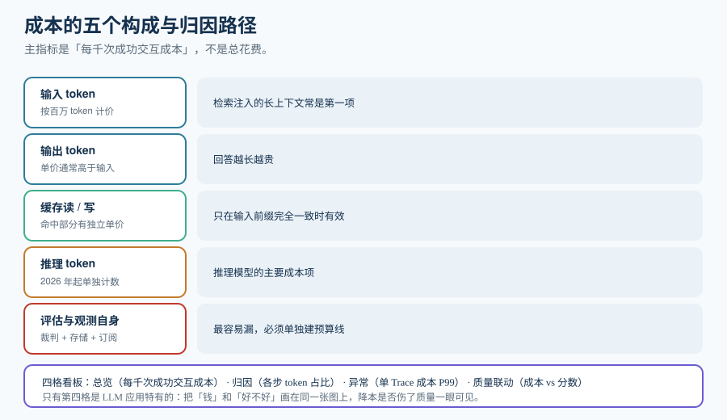

# 成本与单位经济学

「这个月 LLM 账单涨了 3 倍」是一句无用的话——它没有指出**涨在哪一步、由哪类请求带来、值不值**。成本看板的目标就是把这句话变成可归因的结论。

::: tip 一句话理解
不要看「总花费」，要看**「每千次成功交互的成本」**。前者会随流量一起涨（这是好事），后者才会告诉你系统是不是在变贵。
:::

## 一、成本的五个构成

| 构成 | 计量口径 | 归因到哪一层 |
| --- | --- | --- |
| **输入 token** | 按百万 token 计价 | span 级（尤其检索注入的长上下文） |
| **输出 token** | 通常单价高于输入 | span 级 |
| **缓存读 / 写** | 命中缓存的输入 token 有独立（更低）单价 | span 级；由 `cache` 相关属性区分 |
| **推理（reasoning）token** | 自 2026 年起被单独计数 | span 级；推理模型的主要成本项 |
| **评估与观测自身** | 裁判调用 + 存储 + 平台订阅 | **trace 之外的独立预算线** |

::: info 「评估成本」必须单独建一条预算线
这一项最容易被漏。公开分析里给出的一个具体陷阱是：**跑一个评估器约等于多一次裁判调用；跑三个（忠实度 + 有害性 + 工具正确性）就乘三**。如果采样率不变而评估器从 1 个加到 3 个，评估成本直接翻三倍——而它不会出现在你的推理账单里，因为它走的是**另一个模型调用**，容易被归到「其他」。
:::



## 二、单位经济学：把「贵」变成可比较的数

三个指标，从粗到细：

| 指标 | 公式 | 用途 |
| --- | --- | --- |
| **每千次请求成本** | `总成本 / (请求数 / 1000)` | 与流量规模脱钩，看趋势 |
| **每千次**成功**交互成本** | `总成本 / (成功请求数 / 1000)` | **推荐主指标**：质量下降会推高「重试与追加轮次」，这个指标能反映出来 |
| **每步成本占比** | `某 span 成本 / Trace 总成本` | 定位该优化哪一步 |

### 一个必须建立的朴素事实

```sql
-- 每步成本占比：找出吃掉预算的那一步
select
  name                                              as step,
  sum(input_tokens + output_tokens)                 as tokens,
  round(100.0 * sum(input_tokens + output_tokens)
        / sum(sum(input_tokens + output_tokens)) over (), 1) as pct
from spans
where kind in ('LLM', 'RETRIEVER', 'EMBEDDING')
  and ts >= now() - interval '24 hours'
  -- 注意：这里用的是「内部模型」的字段名；若直接查平台，需按语义约定现状写 coalesce
group by name
order by tokens desc;
```

**经验：检索注入的长上下文常常是成本第一位。** 一次检索召回 4 个片段、每个片段 2000 token，就是把 8000 token 输入塞进每一次生成——**而其中真正被用到的可能只有一段**。这一条比「换更便宜的模型」往往更有效，因为后者直接损失质量。

## 三、四个降本杠杆（按「是否损失质量」排序）

| 杠杆 | 做法 | 质量影响 | 风险 |
| --- | --- | --- | --- |
| **① 压上下文** | 重排后只保留 Top-N 片段；对历史消息做摘要 | 通常**提升**（噪声减少） | 过度截断会丢关键信息——用[在线评估](../OnlineEval/index.md)验证 |
| **② 缓存** | 命中相同前缀的请求复用计算结果 | 无（同输入同输出） | **只在输入前缀完全一致时有效**；需要看清缓存单位是「前缀」还是「整条」 |
| **③ 路由降级** | 简单请求走小模型，复杂请求走大模型 | 有（取决于路由判据） | 判据错了会静默降质；必须把**响应模型**记进 Trace |
| **④ 换供应商 / 换模型** | 同价位换型号 | 取决于基准 | 「更便宜 + 更准」是可能的，但**必须以你自己的评估集为准** |

::: danger 三个会「不报错地把账算错」的坑
1. **把两代 token 字段相加**。`gen_ai.usage.prompt_tokens`（旧）与 `gen_ai.usage.input_tokens`（新）是**同一个值**。相加会让成本翻倍，且不报错。见 [Trace 模型](../Tracing/index.md)第三节的 `coalesce` 写法。
2. **忽略保留期升级**。以 LangSmith 为例：开启评估反馈、run 规则或标注队列会把 Trace **静默升级到 400 天保留、费率约翻倍**。账单变化时先查这一项，它有明确的价格解释。
3. **把平台计量单位当美元**。SaaS 观测平台普遍采用**计量单位**（如 LCU / LSU），不同操作消耗不同单位数。做预算模型时要把「行为 → 单位数 → 美元」这条链理清，而不是只看承诺的单价。
:::

## 四、路由降级：把「响应模型」记下来

这是存在静默降质风险的一步，所以它必须与观测硬绑定。

```python [router.py]
# 伪代码：两档路由 + 强制记录响应模型
TIER_MODEL = {"small": "model-small-x", "large": "model-large-x"}

def route(question: str, context_len: int) -> str:
    """路由判据要简单可解释，便于归因。"""
    # 判据：长上下文或复杂问句走大模型
    return "large" if context_len > 6000 or any(k in question for k in ("比较", "分析", "为什么")) else "small"

def ask(question: str, context: list[str]):
    tier = route(question, sum(len(c) for c in context))
    requested = TIER_MODEL[tier]
    resp = call_model(model=requested, messages=build(context, question))
    return {
        "answer": resp.text,
        # 关键：请求模型与响应模型都记。两者不同 = 发生了服务端路由或 fallback
        "gen_ai.request.model": requested,
        "gen_ai.response.model": resp.model,
        "gen_ai.usage.input_tokens": resp.usage.input,
        "gen_ai.usage.output_tokens": resp.usage.output,
    }
```

::: warning 为什么 `response.model` 如此重要
服务端 fallback（供应商侧路由、内容策略改道、模型影子更新）会让**实际服务的模型**与你请求的不同。不记录它，就会出现两个都无法解释的现象：① 同样的代码与提示词，成本和风格变了；② 质量在某个时间点整体偏移，但你没有任何变更记录。
:::

## 五、成本看板：四格就够

| 面板 | 指标 | 用途 | 告警条件 |
| --- | --- | --- | --- |
| **总览** | 每千次成功交互成本（近 7 天趋势） | 主指标 | 环比上升 > 30% |
| **归因** | 各 span 名称的 token 占比 | 找出该优化的那一步 | 单步占比 > 60% |
| **异常** | 单 Trace 成本 P99 与 Top-N 最贵请求 | 发现「一次请求烧掉一天预算」 | P99 > 基线 5 倍 |
| **质量联动** | 成本 vs 质量分数（双轴） | 判断降本是否伤了质量 | 成本降而分数同步降 |

::: tip 第四格是这个看板的价值所在
前三格都是传统成本分析能做的事；**只有第四格是 LLM 应用特有的**。它把「钱」和「好不好」放在同一张图上——降本动作是否伤了质量，看一眼就知道。没有这一格，成本优化就是盲目的。
:::

## 六、验证方式

```shell
# 1) 账实相符：内部分账与供应商账单同量级（差异 < 5%）
python3 cost_report.py --day 2026-10-12            # 期望：输出内部估算总额
# 与供应商控制台的当日账单对比：期望差异 < 5%；差异大 → 先去查「两代字段相加」与缓存命中口径

# 2) 每步占比合理（不应出现单一 span 占比 100%）
python3 cost_report.py --day 2026-10-12 --by-span  # 期望：至少两个 span 有非零占比

# 3) 响应模型监控有数据（没有 = 静默降级无法发现）
python3 cost_report.py --day 2026-10-12 --model-mismatch
# 期望：输出「request.model != response.model」的次数；若恒为 0，需确认字段是否真的被采集（可能是埋点缺失而非无降级）

# 4) 评估预算独立可见
# 期望：评估花费在报表中单独一列，不与推理成本混在一起
python3 cost_report.py --day 2026-10-12 --include-eval
```

## 参考资料

- LangSmith 定价与计量单位说明：https://www.langchain.com/pricing
- Langfuse 成本追踪与模型定价配置：https://langfuse.com/docs/model-usage-and-cost
- OpenTelemetry GenAI 缓存 token 与推理 token 属性（v1.40.0 / v1.41.0）：https://github.com/open-telemetry/semantic-conventions-genai
- OpenInference 规范（EMBEDDING / RETRIEVER span 的成本归因）：https://github.com/Arize-ai/openinference
