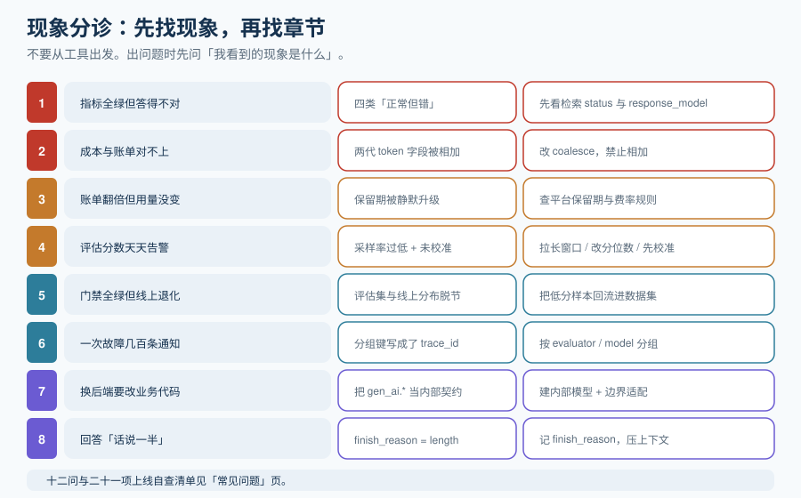

# 常见问题与最佳实践

这一页是收口页：先给一张按现象定位的分诊表，再回答十二个高频问题，然后给出一份可逐条自查的上线清单。**分诊表的使用方式是「从现象出发」**——出问题时先找到你的现象，再按表格指向具体章节。

## 一、分诊表：按现象定位

| 现象 | 最可能的原因 | 先看什么 | 处置 |
| --- | --- | --- | --- |
| 指标全绿但用户说答得不对 | 「正常但错」的四种形态之一 | [概述 · 四类正常但错](../Overview/index.md) | 先看检索 `status` 与 `response_model` |
| 观测平台里没有 LLM 专属字段 | 埋点只做了通用 OTel | [Trace 模型](../Tracing/index.md) | 补 `gen_ai.*` 或自建字段映射 |
| 成本比账单低一半 / 高一倍 | **两代 token 字段被相加或漏算缓存** | [成本 · 三个坑](../Cost/index.md) | 改 `coalesce`，禁止相加 |
| 账单突然翻倍但用量没变 | **保留期被静默升级**（如开启评估反馈） | [成本 · 三个坑](../Cost/index.md) | 查平台的保留期与费率规则 |
| 评估分数波动剧烈、天天告警 | 采样率过低 + 未校准裁判 | [在线评估 · 校准](../OnlineEval/index.md) | 拉长窗口 / 改分位数 / 先校准 |
| 门禁总是绿的，但线上还是退化 | 门禁数据集与线上分布脱节 | [离线评估 · 数据集来源](../OfflineEval/index.md) | 把生产低分样本回流进集 |
| CI 里评估跑 20 分钟没人等 | 全量集进了每次提交 | [离线评估 · CI 集成](../OfflineEval/index.md) | L1 冒烟进提交、L2 进 PR、L3 每日 |
| 一次故障收到几百条通知 | 分组键写成了 `trace_id` | [告警 · 收敛](../Alerting/index.md) | 按 `evaluator` / `model` / `prompt_version` 分组 |
| 质量下降但代码没变 | 模型漂移（供应商侧） | [告警 · 四类漂移](../Alerting/index.md) | 比对 `response_model` 与基线 |
| 「Agent 没调用我的工具」 | 通常是静默超时，不是没调用 | [Trace 模型](../Tracing/index.md) | 给每次工具调用建 span 并记耗时与错误 |
| 回答「话说一半」 | `finish_reason = length`（被截断） | [Trace 模型 · span kind](../Tracing/index.md) | 记 `finish_reason`；压上下文或提高窗口 |
| 换后端要改业务代码 | 把 `gen_ai.*` 当成了内部契约 | [Trace 模型 · 三条纪律](../Tracing/index.md) | 建内部模型 + 边界适配 |

## 二、十二个高频问题

**Q1：我只做传统 APM 行不行？**
不行，但也不是二选一。APM 能告诉你「容器健康、接口 200、延迟 400ms」，**唯独不能告诉你「答案对不对」**。行业里的原话是：Datadog 存的信息足够知道「发生过一件事」，不够「重放那件事」。你要的不是替代 APM，而是在它旁边加一层 GenAI 语义层。

**Q2：为什么说 OpenTelemetry 的 GenAI 约定不能直接当表结构？**
因为它**全部是 Development 级**。约定可以在两个 release 之间改名、改类型甚至删除，不受 Stable 约定那套弃用周期保护。而 `gen_ai.api` 相关的属性从 2024 年到 2026 年已经改过多轮（`system` → `provider.name`、`prompt_tokens` → `input_tokens`、GenAI 内容 2026 年 6 月迁出主仓库）。所以：**内部保留自己的模型，在导出边界映射。**

**Q3：我把新旧两代 token 字段都存了，相加可以吗？**
**绝对不可以。** 新旧字段是同一个值的两个名字。相加会让成本凭空翻倍，而且不报错、不告警。正确写法是 `coalesce(new, old)`。

**Q4：在线评估的采样率设多少合适？**
分层设，不要一个数。错误、截断、检索未命中、负反馈一律 **100%**；正常流量 **1%~5%**。量级感受：正常流量采样从 10% 降到 3%，裁判花费约降 70%。

**Q5：LLM 裁判可信吗？**
**未校准不可信，校准后可有限使用。** 四个已知偏差：同源偏差（裁判与被测模型同源）、位置偏差（成对比较偏好位置）、长度偏差（偏好长回答）、一致性不足。缓解方法是换异源裁判、交换位置各跑一次、rubric 中写明长度不加分、固定种子与温度。**用 30~50 条人工标注校准，是能否用于告警与门禁的前置条件。**

**Q6：离线评估集要多大？**
分层给：L1 冒烟 3~10 条（每次提交）、L2 主集 50~200 条（每个 PR）、L3 全量 500~2000 条（每日/发布前）、L4 对抗（与安全专题共用）。**关键不是总数，而是回流比例**——建议线上回流占 50%~70%。

**Q7：为什么 CI 里评估那么慢？**
因为裁判调用是网络调用。公开实测：**串行跑 10 条用例约 126.8 秒**。推论：L2 必须并行，L4 不能进每次提交。

**Q8：观测数据会不会泄露用户隐私？**
会，这是必须显式处理的一条。三档：全量记录（只适合内网无个人数据）、结构 + 脱敏内容（主流）、只记元数据（**回答不了「为什么答错」**）。**脱敏必须只在一处实现**，否则漏一处就是泄露。

**Q9：自建真的省钱吗？**
不一定。自建把「订阅费」换成了「基础设施 + 运维工时」：典型拓扑是 ClickHouse + PostgreSQL + Redis + 对象存储（外加应用与 worker 容器）。**把月度工时乘内部小时费率写进模型再比较。**

**Q10：影子流量和灰度有什么区别？**
影子流量：真实请求复制一份给新版，**用户只看旧版**，零用户风险，代价是双倍推理成本。灰度：一部分真实用户看新版，有真实用户风险。高风险变更（换模型、改检索）用影子；常规变更用灰度。**影子结果必须打独立标签**，否则污染线上看板。

**Q11：质量指标能接电话告警吗？**
统计型质量分数（忠实度、相关性）**不要**接 P1。它们是统计量，天然波动，会造成大量假警报并消耗团队信任。硬红线（越狱成功率、格式合规率）才用 P1，统计分数用 P2/P3。

**Q12：GenAI 观测和「把 LLM 调用接进 OTel」是一回事吗？**
不是。接入 OTel 只解决「有 span」，还缺三件事：**LLM 语义字段**（模型、token、finish_reason）、**质量分数**（第四类信号，不属于三支柱）、**成本归因与质量告警**。这也是本专题存在的理由。

## 三、上线自查清单

- [ ] 一次请求能查到**完整** span 树，且只有 1 个根 span（父子不断裂）
- [ ] 采样是「整棵保留或整棵丢弃」，不存在子 span 有、父 span 无
- [ ] 错误 / 截断 / 检索未命中 / 负反馈的 Trace **100% 保留**
- [ ] `retrieve` 有 `status`（`hit`/`no_hit`/`error`）与 `returned`
- [ ] LLM span 同时记 `request_model` 与 **`response_model`**
- [ ] 记 `finish_reason`，并能按 `length` 筛选
- [ ] 记 `input_tokens` / `output_tokens` / 缓存 token / 推理 token
- [ ] 查询用 `coalesce`，**没有任何一处把新旧 token 字段相加**
- [ ] 内部主数据模型与外部语义约定解耦（只有一层适配）
- [ ] 版本矩阵已落盘并带日期（框架 / 插桩 / SDK / 导出器 / 平台 / `OTEL_SEMCONV_STABILITY_OPT_IN`）
- [ ] `session_id` / `user_id` 已下推到每一条 observation
- [ ] payload 保留期与脱敏策略有明文配置，脱敏只在一处实现
- [ ] 已有一条「每千次**成功**交互成本」曲线，而非只看总额
- [ ] 评估采样规则被记录（`eval.sampled` / `eval.rule`），可回答「为什么这条没被打分」
- [ ] 裁判已用 30~50 条人工标注校准，结论与 `judge_version` 一并落盘
- [ ] 分数已挂回 Trace（可在排障时看见），而不只在报表里
- [ ] 低分样本可一键回流为离线样本，并带 `source_trace_id`
- [ ] 门禁在**故意破坏**时确实变红（判据可被证伪）
- [ ] 告警分组、抑制、静默三道闸门都已验证；**无永久静默**
- [ ] 人工反馈通道存在，且反馈是校准的锚
- [ ] 有明确的「什么时候不需要做到这个程度」的边界说明

## 四、十二条最佳实践

1. **先建 Trace，再谈评估。** 顺序反了，评估没有对象。
2. **`response_model` 必记。** 静默降级是成本与质量同时失真的头号来源。
3. **`status` 三态必记。** 空数组无法区分「没有资料」与「检索坏了」。
4. **内部模型是自己的，外部约定是别人的。** 在边界映射，不在核心依赖。
5. **`coalesce` 而不是相加。** 这条能防住一个翻倍且不报错的账目错误。
6. **采样分层，错误必留。** 一个数解决不了观测成本。
7. **规则型先行，裁判型收尾。** 能用 5 行代码判的，不要花裁判预算。
8. **裁判必须校准并用人工标注兜底。** 它是打分器，不是裁判。
9. **数据集以回流为主。** 构造用例测的是团队的想象，回流样本测的是用户的现实。
10. **门禁要快、阈值要能刷新、豁免要有流程。** 三个条件缺一个就会被绕过。
11. **质量分数 P2/P3，硬红线 P1。** 告警的信任是一次性资源。
12. **成本与质量画在同一张图上。** 否则降本就是盲目的。

## 五、术语表

| 术语 | 含义 |
| --- | --- |
| **Trace / Span** | 一次请求的完整记录 / 记录中的一个步骤；span 通过父子关系构成树 |
| **Span kind** | 步骤类型：`AGENT` / `LLM` / `CHAIN` / `TOOL` / `RETRIEVER` / `EMBEDDING` |
| **OTLP** | OpenTelemetry 的传输协议；**传输层 Stable**，与字段名的稳定性无关 |
| **`gen_ai.*`** | OpenTelemetry GenAI 语义约定的属性前缀；2026 年年中仍**全部为 Development 级** |
| **`OTEL_SEMCONV_STABILITY_OPT_IN`** | 控制新老属性代际的环境变量（如 `gen_ai_latest_experimental`） |
| **Session / Thread** | 多轮对话的聚合单元；会话级评估能发现单轮看不见的问题 |
| **在线评估** | 对线上真实流量采样打分 |
| **离线评估** | 对固定数据集在变更前后跑分对比（LLM 的回归测试） |
| **LLM-as-judge** | 用模型给输出打分；有同源、位置、长度、一致性四类偏差 |
| **Code evaluator** | 平台内运行的确定性脚本评估器 |
| **影子流量（shadow）** | 真实请求复制一份给新版，用户只看旧版 |
| **灰度（canary）** | 一部分真实用户看新版 |
| **漂移（drift）** | 模型 / 数据 / 检索 / 语义四类变化导致质量偏移 |
| **错误预算** | SLO 允许的失败额度；质量 SLO 的分子是采样估计值，采样率低则抖动大 |
| **保留期（retention）** | payload 与元数据的存储时长；与成本直接相关，且可能被某些行为静默升级 |
| **LCU / LSU** | 部分 SaaS 观测平台的计量单位（计算 / 存储）；预算模型要理清「行为 → 单位数 → 金额」 |

## 参考资料

- OpenTelemetry GenAI 语义约定（含稳定性状态与迁移记录）：https://github.com/open-telemetry/semantic-conventions-genai
- OpenInference span kind 规范：https://github.com/Arize-ai/openinference
- Langfuse 文档（自托管、评估、监控）：https://langfuse.com/docs
- LangSmith 文档：https://docs.smith.langchain.com/
- Arize Phoenix 文档：https://docs.arize.com/phoenix
- DeepEval 文档：https://docs.confident-ai.com/
- Prometheus Alertmanager 分组/抑制/静默：https://prometheus.io/docs/alerting/latest/configuration/
