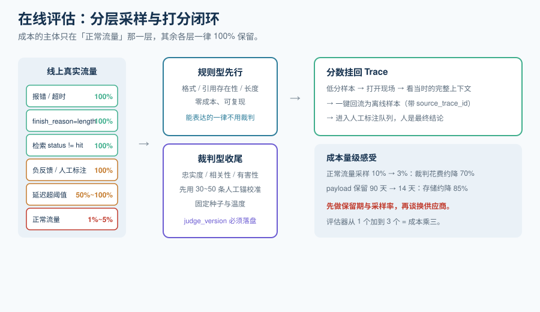

# 在线评估

有了 Trace，你知道了「发生了什么」；**在线评估回答的是「发生的这件事好不好」**。它是把观测栈从「调试工具」升级成「质量管理体系」的那一步，也是成本最容易失控的一步——因为评估的单价是**裁判模型的一次调用**。

::: tip 一句话理解
离线评估问的是「这个变更会不会让输出变差」（发布前，用固定数据集）；在线评估问的是「**此刻线上真实的输出有多好**」（发布后，用抽样流量）。两者共用指标定义，但数据来源、采样方式、成本模型完全不同。
:::

## 一、评估单元：单轮还是会话

选错评估单元，分数会系统性失真。

| 单元 | 评什么 | 能发现 | 发现不了 |
| --- | --- | --- | --- |
| **单轮（per-turn）** | 这一次回答本身 | 检索空转、幻觉、格式错误、答非所问 | 跨轮的问题 |
| **会话（per-session / thread）** | 整段交互作为一个整体 | 用户在第 3 轮表达不满、Agent 反复调用同一个工具、上下文被截断、多轮目标未达成 | —— |

**必须用会话级的四种情况**（单轮永远看不见）：

1. 用户在多轮之后才表达不满（前面几轮单看都「还行」）。
2. Agent 对同一个工具连续重复调用（每一轮单独看都正常，连起来是「绕圈子」）。
3. 上下文在第 N 轮被截断，导致后半段质量骤降。
4. 多轮任务的最终目标达成与否（单轮只能评「这一步答得对不对」）。

## 二、采样：在线评估的成本开关



在线评估的成本 ≈ **评估单价 × 采样率 × 流量**。评估单价取决于裁判模型（前沿模型比小模型贵一个数量级以上）。所以**采样率是这套体系里最有效的成本旋钮**。

### 2.1 分层采样

不要用「按比例随机抽」。用分层：

| 层 | 采样率 | 理由 |
| --- | --- | --- |
| 报错（5xx / 超时） | **100%** | 量小、信息量最大 |
| `finish_reason = length` | **100%** | 截断是「答案不完整」的主因，且占比低 |
| 检索 `status != hit` | **100%** | 类别①故障的唯一信号 |
| 用户负反馈 / 人工标注队列 | **100%** | 已经有人工信号，最值得自动复核 |
| 延迟超过阈值 | **50%~100%** | 慢请求往往伴随长上下文 |
| **正常流量** | **1%~5%** | 这是唯一可压缩的部分，也是成本主体 |

### 2.2 采样率对成本的真实影响

一个可直接复用的量级感受（按前沿裁判模型计价）：把**正常流量**的在线评估采样率从「十分之一」（约 10,000 次被打分）降到 **3%**（约 3,000 次），裁判花费大约从每月 $450 降到 **$135**，降幅约 **70%**。

::: tip 先做这两个动作，再考虑换供应商
公开分析里有一个共识性的结论：**「保留期」和「采样率」这两个变量对总成本的影响，几乎总是大于「换一家供应商」**。
- 把 payload 保留期从 90 天降到 14 天，payload 存储大致降 85%，而元数据与分数**仍可按 90 天保留**。
- 把在线评估采样率从 10% 降到 3%，裁判花费降约 70%。
两件事一起做，通常已经省下比换供应商更多的钱。**先做保留期与采样率，再谈采购。**
:::

### 2.3 采样必须可复现

采样决策要**记录进 Trace 的 metadata**（`eval.sampled=true/false`、`eval.rule=<规则名>`）。原因：当有人问「这条为什么没被打分」时，你需要能回答；而且同一条 Trace 在离线复跑时应当有相同的评估路径。

## 三、三类 evaluator

| 类型 | 实现 | 优点 | 局限 | 建议占比 |
| --- | --- | --- | --- | --- |
| **规则型（rule-based）** | 确定性代码：正则、JSON schema 校验、长度、必含字段 | 零成本、零延迟、结果完全可复现 | 覆盖窄，只能查「形式」不能查「内容」 | 尽量多——凡是能用规则表达的，**一律不要用裁判** |
| **裁判型（LLM-as-judge）** | 用模型给输出打分（0~1 或分级） | 覆盖语义质量：忠实度、相关性、有害性、是否答非所问 | 有成本、有延迟、**有系统性偏差** | 只用于规则表达不了的质量维度 |
| **代码型（code evaluator）** | 平台内跑的确定性脚本（Python / TS） | 可访问 Trace 全字段、可做复杂逻辑 | 需要工程投入 | 用作「规则型的加强版」 |

**判据：能用规则型的，不要用裁判型。** 一个常见的浪费是：用裁判模型去判断「输出是不是合法 JSON」——这是 5 行代码的事，却花掉了可观的裁判预算。

## 四、LLM 裁判的偏差与校准

裁判模型不是裁判，它是一个**有系统性偏差的打分器**。四个已知偏差：

| 偏差 | 表现 | 缓解 |
| --- | --- | --- |
| **同源偏差** | 裁判与被测模型同源（甚至同家）时，倾向于给相似风格的答案高分 | 换不同厂商的裁判；或用人工标注校准后写进评估文档 |
| **位置偏差** | 成对比较时偏好排在前面/后面的那个 | 成对比较时**交换位置各跑一次**，取一致结论 |
| **长度偏差** | 倾向给更长的回答高分 | 在评分 rubric 里显式要求「长度不构成加分理由」 |
| **一致性不足** | 同一个输入两次运行给出不同分数 | 用**固定种子 + 温度 0**；对关键指标做多次采样取中位数 |

### 校准方法（这是本页最实操的一节）

**第一步：拿 30~50 条人工标注做锚。**

```python
# 伪代码：用人工标注校准裁判
import statistics

def calibrate(human_labels: list[float], judge_scores: list[float], tol: float = 0.1):
    """
    human_labels / judge_scores: 同一批样本上的人工分与裁判分，取值 0~1。
    返回需要的人工干预结论。
    """
    diffs = [j - h for h, j in zip(human_labels, judge_scores)]
    bias = statistics.mean(diffs)                 # 系统性偏移：+ 表示裁判偏松
    mad  = statistics.mean(abs(d) for d in diffs) # 平均绝对偏差

    verdict = []
    if abs(bias) > tol:
        verdict.append(f"裁判系统性{'偏松' if bias > 0 else '偏严'} {abs(bias):.2f}，需在 rubric 中修正")
    if mad > 2 * tol:
        verdict.append(f"平均绝对偏差 {mad:.2f} 过大，评分不可用于门禁，先改 rubric 或换裁判模型")
    if not verdict:
        verdict.append("校准通过：偏差与稳定性在容差内，可用于告警与门禁")
    return verdict

print(calibrate([0.8, 0.3, 0.9, 0.5], [0.9, 0.5, 0.95, 0.6]))
# 平均偏差 +0.1125 → 命中「偏松」分支；平均绝对偏差 0.1125 未超 2×容差，故不追加稳定性警告
# 期望输出：['裁判系统性偏松 0.11，需在 rubric 中修正']
```

**第二步：把校准结论写进评估器的 `version`。** 裁判也是一个需要版本管理的组件——rubric 改了、裁判模型换了、温度变了，都是**新版本**，分数不可跨版本直接比较。

**第三步：设定「人工介入阈值」。** 裁判分数只用来**筛出可疑样本**，最终结论由人工在标注队列里给出。业界的一个基本共识：高风险决策上，人工评估不会消失，只是被更好地集成进工作流（标注队列、批量分配、标注者一致性追踪）。

## 五、把评估结果挂回 Trace

评估分数不能只活在报表里，它必须**作为事件挂到被评估的那次操作上**。这样你才能做三件事：

1. **从分数跳回现场**：看到低分 → 打开对应的 Trace → 看到当时喂进去的完整上下文。
2. **关联分析**：低分与哪些属性相关？特定模型？特定检索片段？特定用户？
3. **离线回流**：把低分样本一键加入[离线评估集](../OfflineEval/index.md)。

::: info 对应到语义约定
OpenTelemetry 在 **v1.38.0（2025-10）** 增加了 `gen_ai.evaluation.result` 事件，让评估分数可以与它评估的那次操作关联。这是这个领域「观测与评估应当同源」的规范级确认。
:::

## 六、一个完整的最小在线评估闭环

```shell
# 1) 从观测平台拉取最近 24 小时内、命中采样规则的 Trace（按平台的 API 为准）
#    期望：返回的 JSON 数组长度 > 0，且每条都带 metadata.eval.sampled = true
curl -s -H "Authorization: Bearer $LLMO_TOKEN" \
  "$LLMO_BASE/api/public/traces?fromTimestamp=2026-10-12T00:00:00Z&tags=eval-eligible" \
  | jq 'length, .[0].metadata'

# 2) 对每个 Trace 跑规则型评估（零成本那部分先做掉）
#    期望：rule_violations 为空表示形式检查通过；非空则直接进标注队列
python3 eval_rules.py --input traces.json --out rules.json

# 3) 再对通过了规则检查的样本跑裁判评估（成本部分）
#    期望：输出 scores.jsonl，每行形如 {"trace_id": "...", "faithfulness": 0.86, "judge_version": "v3"}
python3 eval_judge.py --input traces.json --out scores.jsonl

# 4) 把分数写回观测平台的评估事件
#    期望：平台 UI 上对应 Trace 出现分数与 evaluator 名称；失败时命令返回非 0
python3 eval_push.py --scores scores.jsonl
```

::: warning 评估闭环的三个常见失败
1. **分数没写回 Trace**：只存在 CSV 里，于是没人能在排障时看到它——评估白做。
2. **裁判版本没记录**：分数跨版本比较，得出「质量下降了」的假结论（实际只是换了 rubric）。
3. **采样规则不记录**：无法回答「这条为什么没被评」，也无法证明覆盖率。
:::

## 参考资料

- OpenTelemetry `gen_ai.evaluation.result` 事件（v1.38.0 起）：https://github.com/open-telemetry/semantic-conventions-genai
- Langfuse 评估器与在线评估规则：https://langfuse.com/docs/scores
- LangSmith 评估与标注队列文档：https://docs.smith.langchain.com/
- DeepEval 指标文档（含 faithfulness / relevancy 等定义）：https://docs.confident-ai.com/
- Arize Phoenix 评估与 OpenInference 互操作：https://docs.arize.com/phoenix
