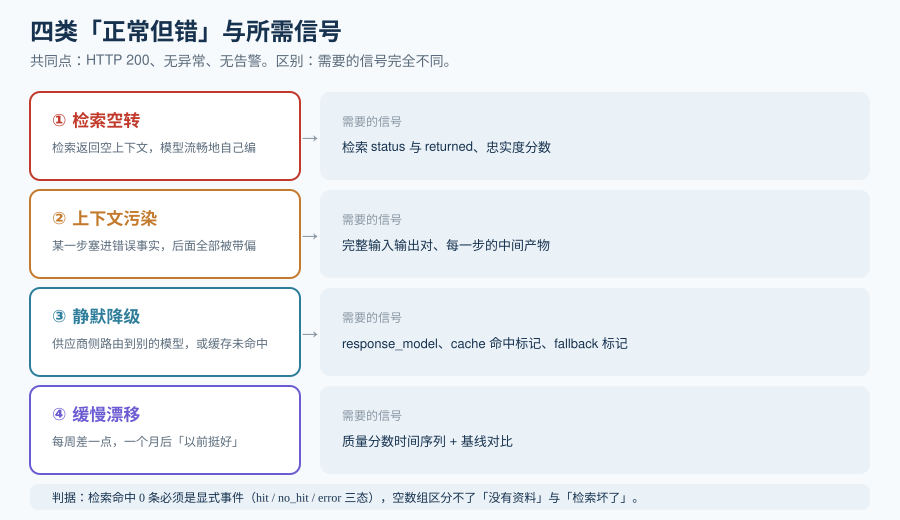

# 概述：HTTP 200 掩盖了什么

LLM 应用的故障有一类特殊形态：**系统指标全绿，答案全错**。容器在跑、接口 200、P99 延迟 400ms、错误率 0.05%——所有传统告警都很安静，但用户在工单里写「它今天答得不对」。这一页先说清楚这类故障为什么无法被现有监控体系捕捉，再给出观测的最小可用边界。

::: tip 一句话理解
传统监控的对象是**「请求有没有完成」**；LLM 观测的对象是**「这条回答是怎么被拼出来的」**。前者是一个状态码，后者是一条记录：模型看到了什么、检索召回了什么、它说了什么、花了多少 token。少了后面这条记录，故障就只存在于用户的记忆里。
:::

## 一、四类「正常但错」

按表现形态分四类，每一类的信号需求不同——这是决定你采什么的第一性依据，比看任何工具的功能清单都重要。

| 类别 | 典型表现 | 传统体系为何看不见 | 需要补的信号 |
| --- | --- | --- | --- |
| **① 检索空转** | 检索返回空上下文，模型流畅地自己编 | 每一步都成功，没有异常抛出 | 检索结果条数与内容、引用与答案的一致性分数 |
| **② 上下文污染** | 某一步塞进了错误事实，后面全部被带偏 | 错误是**语义**层面的，不是类型层面的 | 完整输入输出对、每一步的中间产物 |
| **③ 静默降级** | 供应商侧路由到了别的模型 / 缓存未命中 | `gen_ai.request.model` 与 `gen_ai.response.model` 不同，但没人记录响应模型 | 响应模型、缓存命中标记、fallback 标记 |
| **④ 缓慢漂移** | 每周差一点点，一个月后「以前挺好」 | 没有任何单次请求失败，指标是渐变的 | 时间序列化的质量分数 + 基线对比 |



**类别 ① 是最高频的一类**。行业里反复出现的同一个故事：RAG 机器人「正常」运行一周，每个问题都答得很流利，直到有人打开 Trace 才发现检索器已经连续多天空返回——模型一直在没有资料的情况下即兴作答。没有任何异常、没有任何日志、没有任何告警。

::: danger 一个必须写进设计里的判据
**「检索命中 0 条」必须是显式记录的事件，而不是一个自然的空数组。** 空数组在代码里既是「确实没有相关资料」也是「检索坏了」，这两种含义无法区分。正确做法是给检索结果加上 `status`（`hit` / `no_hit` / `error`）与 `returned`（条数）字段，并在 `no_hit` 连续出现时告警。本专题的[在线评估](../OnlineEval/index.md)会把「忠实度」分数与 `no_hit` 率做成一对必须同时看的指标。
:::

**类别 ③ 的成本很隐蔽**：`gen_ai.response.model` 是「实际服务的模型」，它与 `gen_ai.request.model` 不同就意味着发生了服务端路由或 fallback。不做记录的话，成本预测与质量归因**同时**失效——你既不知道账单为什么变了，也不知道质量为什么变了。

## 二、观测的三层信号

分清三层，能避免把「日志」当「观测」。

| 层 | 记录什么 | 典型载体 | 回答的问题 |
| --- | --- | --- | --- |
| **层 1：指标（Metrics）** | 聚合数值：调用量、token 数、成本、延迟分位、错误率 | Prometheus / 平台内置 Metrics API | 「整体健康吗、趋势如何」 |
| **层 2：轨迹（Traces）** | 单次请求内每一步的树状记录：输入、输出、耗时、token、模型 | OTLP → 观测平台 / 自建后端 | 「**这一次**为什么差」 |
| **层 3：评估（Evaluations）** | 对输出质量打的分：忠实度、相关性、有害性、工具正确性 | 评估结果附加到 span 上 | 「答得好不好、变化了没有」 |

三层之间的关系不是并列，而是**逐层依赖**：没有层 2 的输入输出，层 3 的打分对象就不存在；没有层 3 的分数，层 1 的指标里就永远只有「快慢与贵贱」，没有「好坏」。

::: info 与「可观测性三支柱」的关系
通用可观测性说的三支柱是**指标 / 日志 / 链路**。本专题的「层 3 评估」不属于这三支柱——它是 LLM 应用独有的第四类信号，因为**「正确性」既不是指标也不是日志**。这也是「LLM 观测」与「给服务加个 OTel」的根本区别，详见[平台选型](../Platforms/index.md)。
:::

## 三、观测设计的四条边界

任何观测栈都要在下面四条边界上做决定。做决定时先写边界，再看工具——反过来做的话，你选的是工具的功能，而不是自己的需求。

### 边界一：记什么（内容捕获的范围）

记录完整的输入输出是排障的前提，但完整内容可能包含个人信息、商业机密、用户会话。三档可选：

1. **全量记录**——排障能力最强，数据合规压力最大。只适合内网、无个人数据的场景。
2. **记录结构 + 脱敏内容**——主流选择。保留每步的输入输出，但对已知的敏感字段做掩码；观测平台的采集侧通常支持在写入前打码。
3. **只记元数据**——只记长度、token 数、模型、耗时，不记内容。能回答「慢在哪一步、贵在哪一步」，但**回答不了「为什么答错」**。

::: warning 三档的取舍要说清楚
选第 3 档要有心理准备：它能告诉你**有这个故障**，但不能告诉你**故障是什么**。很多团队在事故第一次发生时才发现这一点，然后在最需要数据的那一刻开始补埋点——已经晚了。
:::

### 边界二：采多少（采样率）

LLM 请求的 payload 体积远大于普通 HTTP 请求（一次带长文上下文的调用可能几十 KB 到几百 KB），全量留存成本很高。采样策略分两层，**两层要分开设**：

- **轨迹采样**：按比例保留 Trace。调试期可以 100%，稳定后降到 5%~20%，同时保证**错误与慢请求 100% 保留**。
- **评估采样**：对保留下来的 Trace 再抽一部分送去打分。评估的单价是「裁判模型的一次调用」，比存储贵得多，因此这一层的比例通常显著低于轨迹采样（[在线评估](../OnlineEval/index.md)有完整算法）。

### 边界三：谁负责（数据出不出你的环境）

一句话判据：**如果 prompt 和回答里含有「法律上不能给第三方」的数据，自建就不是可选项而是约束。**

| 方案 | 数据在哪 | 代价 |
| --- | --- | --- |
| SaaS 观测平台 | 厂商云 | 零运维；但数据出境，且**用量随「话痨程度」线性增长**（一个 Agent 请求可能产生十几次子调用） |
| 自托管观测平台 | 你的基础设施 | 需要维护多个有状态服务（典型为 ClickHouse + Postgres + Redis + 对象存储） |
| 自建 OTel 管道 + 通用后端 | 你的基础设施 | 复用已有的 Collector 与后端，但没有 LLM 专属视图，检索与评估要自己做 |

### 边界四：怎么用（观测的出口）

观测数据只有三个出口，缺一个这套栈就只是「好看」：

1. **排障**：从告警/投诉 → 定位到具体 Trace → 看每一步。
2. **回归**：把有代表性的生产 Trace 变成[离线评估集](../OfflineEval/index.md)的样本。
3. **告警**：把[质量分数与成本](../Alerting/index.md)接到值班渠道。

## 四、最小可用的起步三步

不要一开始就上平台。这三步在**任何**技术栈上都能当天完成，而且做完之后你会清楚地知道该选哪个平台。

**第一步：让一次请求变成一棵有名字的树。**

```python [tracing_min.py]
# 伪代码：最小埋点。核心只有一件事——每一步都有名字、输入、输出、耗时。
from time import perf_counter

def traced(name, **attrs):
    def deco(fn):
        def wrapper(*args, **kwargs):
            started = perf_counter()
            out = fn(*args, **kwargs)          # 出异常时也要记：见下面的 try/finally
            span = {
                "name": name,                   # 例如 "retrieve" / "chat"
                "duration_ms": round((perf_counter() - started) * 1000, 1),
                **attrs,                        # 例如 model="gpt-x", returned=4
            }
            print(span)                         # 先打到 stdout，接平台时换导出器
            return out
        return wrapper
    return deco

@traced("retrieve", kind="RETRIEVER")
def retrieve(question: str) -> list[str]:
    return ["..."]                              # 返回命中的片段

@traced("chat", kind="LLM", model="<model-id>")
def chat(context: list[str], question: str) -> str:
    return "..."                                # 调用模型
```

```shell
# 期望输出：两行 JSON，各自带 name / duration_ms，且 chat 的耗时显著大于 retrieve。
python3 tracing_min.py
# {"name": "retrieve", "duration_ms": 12.4, "kind": "RETRIEVER"}
# {"name": "chat", "duration_ms": 812.0, "kind": "LLM", "model": "<model-id>"}
```

**第二步：补三个字段。** 只加三个，不要贪多：

| 字段 | 为什么是这三个 | 不补的后果 |
| --- | --- | --- |
| `gen_ai.request.model` + `gen_ai.response.model` | 成本归因与静默降级的唯一依据 | 账单变了无法解释；供应商换了模型你不知道 |
| `gen_ai.usage.input_tokens` / `output_tokens` | 单位经济学的分子 | 只能看「总花费涨了」，无法归因到哪一步、哪类问题 |
| `status`（检索的 `hit` / `no_hit` / `error`） | 类别①故障的唯一可见信号 | 检索空转长期不可见，见本节开头那个故事 |

**第三步：把最贵或最慢的一次调用挖出来。** 用平台的筛选或自己写一条聚合查询，回答「过去 24 小时里，哪一类请求的 token 消耗是其余请求的 10 倍」。这一步做完，你就有了选型的真实依据。

::: tip 验证方式
最小埋点的验收不是「代码跑通」，而是**能回答三个具体问题**：① 昨天 15:00 那次答错的请求，喂给模型的完整输入是什么？② 过去一周检索 `no_hit` 的比例是多少？③ 哪个环节贡献了 80% 的 token？三个问题都能答出来，才算 L1 达标（对照[专题首页的成熟度自评](../index.md)）。
:::

## 五、什么时候不需要做到这个程度

观测也是有成本的。以下情况**可以先不做**：

1. **还没上线**——本地脚本调用模型做原型，用 print 就够了，等有真实流量再上。
2. **流量极低且无质量要求**——比如内部一次性工具，用错重跑即可。
3. **已经有了等效手段**——如果业务侧本来就把每次回答和人工结论一起落库，那你已经有一份「事实上的评估集」，先把它接上质量分数，不需要先搭平台。

**唯一不能省的是「完整输入输出对」**——因为没有它，上面所有分析都无从谈起。

## 六、与可观测性深入的分工

本页面对的故障是**语义层面**的：指标全绿、答案全错。它的观测对象是「这条回答是怎么被拼出来的」，最小不可省的资产是**完整输入输出对**。

[运维 · 可观测性深入](../../../Ops/Observability/index.md) 面对的是**基础设施层面**：请求有没有完成、慢在哪一跳、哪一行代码烧了 CPU。两者可以共用同一条 OTLP 管道（这是它被设计成通用的原因），但**不要指望一方替代另一方**：

| 问句 | 去哪边 |
| --- | --- |
| 「这次回答为什么不对」——模型看到了什么、召回了什么、说了什么 | 本页：需要 span 上挂**输入输出对与检索命中** |
| 「这次请求为什么慢」——是模型慢、检索慢，还是自己的后处理慢 | [可观测性深入](../../../Ops/Observability/index.md)：需要分段 spans 与依赖耗时 |
| 「`OTEL_EXPORTER_OTLP_ENDPOINT` 指向哪、采样率设多少、要不要过网关」 | [Collector 管道](../../../Ops/Observability/Collector/index.md) |
| 「全量落输入输出，一天成本多少」 | [观测成本治理](../../../Ops/Observability/Cost/index.md)：输入输出是**大字段**，是成本模型里最贵的一项 |

::: warning 一个容易被忽略的顺序问题
**先决定采样策略，再决定「要留哪些字段」。** LLM 的输入输出是天然的高成本大字段，一旦决定全量保留，之后想降成本就只能改历史数据的口径——而历史数据改不了。所以本页的[平台选型](../Platforms/index.md)与基础设施侧的[采样决策](../../../Ops/Observability/Sampling/index.md)必须**同时评审**：采样器决定「有多少条进来」，字段策略决定「每条有多重」，两者相乘才是账单。
:::

## 参考资料

- OpenTelemetry GenAI 语义约定（span、属性、指标与事件定义）：https://github.com/open-telemetry/semantic-conventions-genai
- OpenInference 规范（LLM / CHAIN / TOOL / RETRIEVER / EMBEDDING / AGENT 六种 span kind）：https://github.com/Arize-ai/openinference
- Langfuse 自托管文档（最小部署拓扑与所需服务）：https://langfuse.com/self-hosting
