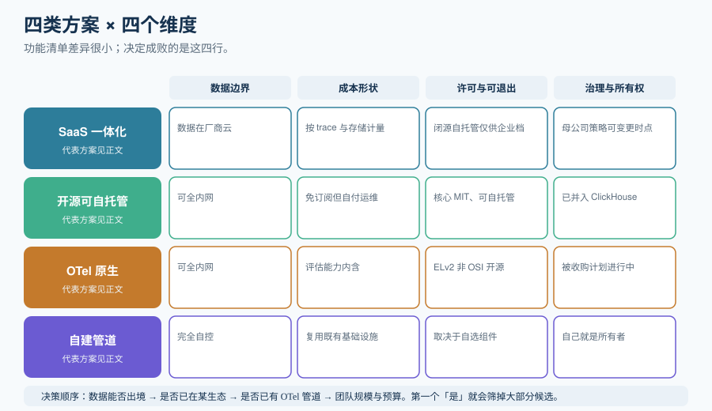

# 平台选型

选观测平台时，功能清单的差异其实很小——真正让项目失败的是另外四件事：**数据能不能出你的环境、成本怎么随用量增长、许可证允许你做什么、以及被谁拥有**。这一页按这四个维度做对照，并把 2026 年的几个关键变化写清楚。

::: tip 一句话理解
不要问「哪个平台功能全」。要问「**哪个平台的数据模型和我的部署约束相容**」。功能可以后补，数据出境与许可证限制不能后补。
:::

## 一、四个维度

| 维度 | 为什么先看它 | 判据（可直接抄进决策文档） |
| --- | --- | --- |
| **① 数据边界** | prompt 与回答里可能含个人数据、商业秘密 | 「payload 是否必须留在本组织基础设施内？」答「是」→ 只能自托管或自建 |
| **② 成本形状** | LLM 用量的增长不是线性的，一个 Agent 请求可产生十几次子调用 | 「一个典型用户请求会产生几次被计费的记录？计费单位是什么？」 |
| **③ 许可证与可退出性** | 决定你能自建、能转售、还是只能租用 | 「许可证是否 OSI 认可？能否自托管？能否作为服务转售？」 |
| **④ 治理与所有权** | 收购与基金会归属会改变长期路线图 | 「谁拥有它？近 12 个月发生了什么公司层面的变化？」 |

## 二、四类方案对照



| 方案 | 代表 | 数据边界 | 成本形状 | 许可证 / 可退出性 | 典型适合 |
| --- | --- | --- | --- | --- | --- |
| **SaaS 一体化平台** | LangSmith | 数据在厂商云（企业档可 BYOC / 自托管） | 按 **trace 数 + 存储 + 计算单元**计量，与「话痨程度」正相关 | 闭源；自托管仅企业档（商务洽谈） | 已深度使用 LangChain / LangGraph 的团队 |
| **开源可自托管平台** | Langfuse | 可全内网 | 自托管免订阅，但需自付**四个有状态服务的运维** | 核心 **MIT**；可自托管 | 数据不能出境、又要开箱 LLM 视图 |
| **OTel 原生可自托管** | Arize Phoenix | 可全内网 | 同上；评估能力内含 | **Elastic License 2.0（ELv2）——source-available，不是 OSI 开源**：可自托管，**不可作为托管服务提供** | 已用 OTel、想要「观测 + 离线评估」一体 |
| **自建管道** | OTel Collector + 你的通用后端（如 ClickHouse / Tempo） | 完全自控 | 复用已有基础设施，边际成本最低 | 取决于自选组件 | 已有成熟可观测体系、只要 GenAI 语义层 |

::: danger 三个必须写进决策文档的事实
1. **Phoenix 不是 OSI 开源**。它是 ELv2（source-available）：能读、能改、能自托管，**但不能把 Phoenix 本身作为托管服务提供给第三方**。所有「开源 LLM 观测平台」的对比表都该标注这一条。
2. **LangSmith 的自托管不在自助档位**。开源与自托管是两件事：LangSmith 是闭源，自托管要企业合同。如果「数据必须留在自己的 VPC」是硬约束，这一条当场决定选型。
3. **「自建 = 免费」是错的**。自建的账单从「订阅费」换成了「基础设施 + 工时」：典型拓扑是 **ClickHouse + PostgreSQL + Redis + 对象存储**（外加应用与 worker 容器）。按一个月度工时数乘内部小时费率算一遍，很多团队的结论会反过来。
:::

## 三、平台的真实差异在哪

功能表看起来大同小异，差异集中在四处：

### 差异 1：数据模型决定查询能力上限

以 **Langfuse v4** 为例，它把数据模型重构成 `events_full`（不可变宽行）+ 其上 `events_core` 查询投影，**trace 变成 root observation**，UI 主视图是一个按「是否 root observation」过滤的 Observations 表。带来的能力是：全文检索（跨输入、输出、metadata）、可分享的筛选查询、跨长时间范围的看板。

*代价*：如果你有 v3 时代的截图与肌肉记忆，第一屏会认不出来。v4 官方给出的性能说法是「大项目看板加载 10 倍以上」，宣传语里有更高的数字——**这些是厂商自测数字**，选型时当作方向而不是承诺。

### 差异 2：检索速度的数据层

以 **LangSmith** 的 **SmithDB**（2026-05 发布的 Rust 数据层）为例，厂商公布的 P50 是：trace tree 加载 **92ms**、全文检索 **400ms**、run 过滤 **82ms**；定价页给出的对比是 trace 查询 860ms → 71ms、全文检索 6.20s → 400ms。

::: warning 如何读这类数字
这些是**厂商自发布的、自测的自有产品基准**——没有方法论、没有硬件规格、没有对手基线。它可能完全真实，但**它不是证据，不能被当作中立事实引用**。真正要看的是：**你自己的 Trace 体积下，检索与打开一棵树的实际体验**。用你自己的数据做一次 30 分钟的试用，比读十篇对比文更有用。
:::

### 差异 3：评估是「内置」还是「可接」

| 平台 | 评估能力的位置 |
| --- | --- |
| LangSmith | 内置 LLM-as-judge 与 code evaluator，evaluator 本身是**带版本的提示词**，变量注入方式显式；支持线程（会话）级评估 |
| Langfuse | 内置 LLM-as-judge、**code evaluator**（跑确定性脚本）、人工标注、用户反馈；评估器可先在真实 observation 上试跑并预估成本再上线 |
| Phoenix | 评估库内置，且**明确文档化了与 Ragas / deepeval 的互操作** |
| 独立评估框架 | **DeepEval**（pytest 形态）、**promptfoo**（声明式 YAML、Node 项目）、Opik（Apache-2.0，trace + eval 一体） |

**评估能力不必来自观测平台。** 一个非常常见的组合是：Trace 进自建 OTel 管道，评估用 DeepEval 在 CI 里跑，线上采样打分用平台内置。这不是妥协，反而降低了被单一厂商锁定的程度。

### 差异 4：治理与所有权

这一项在 2026 年变得特别重要：

- **Langfuse** 于 2026 年 1 月并入 **ClickHouse**。
- **Arize** 于 2026 年 8 月由 **Dynatrace 宣布收购计划**（公告称交割后双方独立运营、暂无产品与承诺的立即变化，但长期打包与定价走向未明）。
- **Ragas** 仓库迁至 vibrantlabsai，**v0.4.3（2026-01-13）之后再无 release、2026-02-24 起无提交**——它仍是 RAG 指标最好的参考资料，但**不应被当作会被持续修补的依赖**。

::: tip 一条反直觉的建议
把「供应商最近换了 owner」**当成需要当面提问的问题**，而不是当成淘汰理由。正确的动作是：向对方要一份明确的路线图与承诺（许可证是否保持、自托管是否保留、API 兼容窗口多长），并把这些答案写进决策文档。**「问过并且得到了书面回答」本身就是一种风险管理。**
:::

## 四、许可与版本红线速查

| 项目 | 许可 | 版本 / 状态（2026-10） | 红线 |
| --- | --- | --- | --- |
| LangSmith | 闭源 SaaS | SmithDB 数据层（2026-05）；Developer 免费档 5k traces/14 天保留，Plus $39/席/月 | **保留期陷阱**：开启评估反馈、run 规则、标注队列会把 Trace 静默升级到 **400 天保留**、费率约翻倍 |
| Langfuse | 核心 MIT | **v4**（v4.0.0 2026-07-29；v4.56.0 2026-10-09）；v3 仅安全补丁至 **2027-01 底**；Cloud v3 于 **2026-11-16** 下线 | **新装不要从 v3 开始**；升级要按 v4 迁移指南核对基础设施要求 |
| Arize Phoenix | **ELv2** | arize-phoenix **20.17.0**（2026-09-30） | **不得作为托管服务转售**；生产监控（看板、告警、问题聚类）不在 OSS 版内，在付费的 Arize AX |
| DeepEval | Apache-2.0 | 2.1 起 DAG 化指标评估、减少裁判调用 | 裁判模型与被测模型**同源会造成相关性偏差**，必须用人工标注校准 |
| promptfoo | MIT | **Node 项目（npm）** | PyPI 上的同名 `promptfoo` 是**第三方包装**，不是上游项目——这是最常见的第一个坑 |
| Ragas | Apache-2.0 | **维护风险**：v0.4.3（2026-01-13）后无 release，2026-02-24 起无提交 | 引它的**未修补依赖**风险自负，或改用 DeepEval / Opik |

## 五、自托管的最小拓扑与成本现实

以 Langfuse v4 这类「六个服务」的拓扑为例（`langfuse-web` + `langfuse-worker` + PostgreSQL 15+ + ClickHouse ≥ 25.12 + Redis 7+ + S3/MinIO）：

```shell
# 自托管的最小验证动作：拉起来并确认六个服务都健康
git clone --depth=1 https://github.com/langfuse/langfuse.git
cd langfuse

# 生成密钥并写入 .env（NEXTAUTH_URL / NEXTAUTH_SECRET / SALT / ENCRYPTION_KEY / DATABASE_URL
# / CLICKHOUSE_* / REDIS_* 是必需项，缺一不可）
cp .env.example .env

docker compose up -d
# 期望：六个容器全部 Up；访问 http://localhost:3000 打开控制台，能新建项目并看到「无数据」的空状态
docker compose ps
```

::: danger 自建成本里最容易被算成 0 的两项
1. **存储增长**：按公开估算，90 天保留期下 payload 存储约每月 4.2 GB，稳态约 12.6 GB——这还**不含**媒体文件。把保留期从 90 天压到 14 天，payload 占用大致降 85%，而**元数据与分数仍可按 90 天保留**。
2. **运维工时**：升级、备份、访问控制、保留策略执法、值班。**把一个明确的月度小时数乘内部小时费率写进模型**，别写成 0——发布频率本身就是证据：一个每周高频发版的依赖，就是你每周都要处理的升级。
:::

## 六、选型决策清单

按顺序回答，第一个「是」就会把你筛到只剩少数候选：

1. **payload 是否必须留在本组织基础设施内？** 是 → 排除纯 SaaS。
2. **团队是否已经在 LangChain / LangGraph 上？** 是 → LangSmith 的一体化体验价值最高（但仍要先过第 1 条）。
3. **是否已有成熟的 OTel 管道与通用后端？** 是 → 优先只在边界补 GenAI 语义层（[Trace 模型](../Tracing/index.md)第三节），不引入第二套观测系统、第二个值班面、第二张账单。
4. **是否需要「观测 + 离线评估」在一个工具里？** 是 → Phoenix 覆盖面积最宽（注意 ELv2）。
5. **是否只有 1~2 人、预算为零？** 是 → 先用 DeepEval / promptfoo + 自建轻量 Trace，不要过早投资平台。

## 参考资料

- Langfuse 自托管部署与 v4 安装：https://langfuse.com/self-hosting
- LangSmith 文档：https://docs.smith.langchain.com/
- Arize Phoenix 文档与许可证说明：https://docs.arize.com/phoenix
- DeepEval 文档：https://docs.confident-ai.com/
- promptfoo 文档：https://www.promptfoo.dev/docs/
- OpenInference 规范：https://github.com/Arize-ai/openinference
