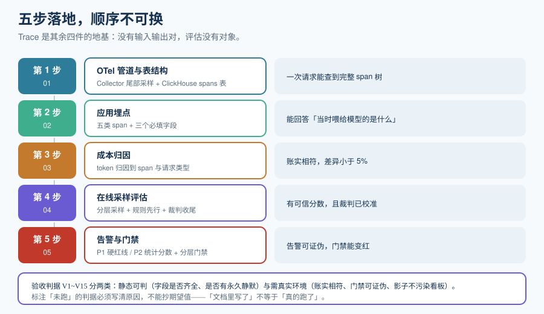

# 实战：给 RAG 服务接上观测与评估

这一页把前面所有决定串成一条可执行路径：给一个已上线的 RAG 问答服务，从零建起「Trace + 在线评估 + 成本归因 + 质量告警 + 离线门禁」五件套。**不假设你有平台预算，也不假设你可以把数据发出去**——先按自建 OTel 管道走一遍，需要平台时只改导出目标。

::: tip 一句话理解
这一页的验收标准是：**一个新同学照做，能在半天内从「只有一个 HTTP 接口」走到「能回答『昨天那次答错为什么答错、花了多少钱、以后还会不会错』」。**
:::

## 一、目标系统

| 项 | 内容 |
| --- | --- |
| 服务 | `POST /api/ask`，接收 `{question, session_id}`，返回 `{answer, citations[]}` |
| 链路 | 入口 → 查询改写（可选）→ 向量检索 → 重排 → 生成 |
| 规模 | 约 5 万次请求/天，平均输入 3000 token、输出 300 token |
| 约束 | **payload 不得离开本组织基础设施**（因此观测后端自建） |
| 现状 | 有应用日志与 APM；**没有** LLM 语义层的 Trace、没有质量分数、没有成本归因 |



## 二、落地顺序（五步，顺序不可换）

**顺序的理由**：Trace 是其余四件的地基——没有输入输出对，评估没有对象、成本无法归因、告警无据可依。**先做评估后做 Trace 是本末倒置。**

| 步 | 产出 | 验收 |
| --- | --- | --- |
| 1 | OTel Collector + 自建后端（ClickHouse 表 `spans`） | 一次请求能在库里查到一棵完整 span 树 |
| 2 | 应用埋点（五类 span + 三个必填字段） | 能回答「当时喂给模型的是什么」 |
| 3 | 成本归因报表 | 账实相符（差异 < 5%） |
| 4 | 在线采样评估 + 人工反馈通道 | 线上有可信分数；裁判已用 30 条人工标注校准 |
| 5 | 质量告警 + 离线门禁 | 告警能被证伪；门禁在故意破坏时确实变红 |

## 三、第 1 步：管道与表结构

```yaml [otel-collector.yaml]
receivers:
  otlp:
    protocols:
      http: { endpoint: 0.0.0.0:4318 }
processors:
  # 尾部采样：错误与超阈值 100% 保留，正常流量按 10% 保留
  tail_sampling:
    decision_wait: 10s
    policies:
      - name: keep-errors
        type: status_code
        status_code: { status_codes: [ERROR] }
      - name: keep-slow-traces
        type: latency
        latency: { threshold_ms: 3000 }
      - name: sample-rest
        type: probabilistic
        probabilistic: { sampling_percentage: 10 }
exporters:
  clickhouse:
    endpoint: tcp://clickhouse:9000
service:
  pipelines:
    traces:
      receivers: [otlp]
      processors: [tail_sampling]
      exporters: [clickhouse]
```

```sql
-- 内部主数据模型：字段名是自己的，不是 gen_ai.*
-- 这样语义约定改名时，只改一层导出适配，不改业务代码与看板。
create table if not exists spans (
  ts               DateTime64(3),
  trace_id         String,
  span_id          String,
  parent_span_id   String,
  name             String,                 -- retrieve / rerank / chat
  kind             LowCardinality(String), -- AGENT/LLM/CHAIN/TOOL/RETRIEVER/EMBEDDING
  status           LowCardinality(String), -- ok / error / no_hit
  duration_ms      Float32,
  provider         LowCardinality(String),
  request_model    LowCardinality(String),
  response_model   LowCardinality(String), -- 记录它：静默降级唯一可见处
  input_tokens     UInt32,
  output_tokens    UInt32,
  finish_reason    LowCardinality(String), -- stop / length / content_filter
  returned         UInt16,                 -- 检索命中条数
  session_id       String,
  user_id          String,
  payload          String                  -- 脱敏后的输入输出（按保留策略）
) engine = MergeTree
partition by toDate(ts)
order by (ts, trace_id, span_id)
ttl toDate(ts) + interval 90 day;          -- 保留 90 天；payload 列可单独设更短的 TTL
```

```shell
# 验证 1：链路通
docker compose up -d otel-collector clickhouse
curl -s -X POST http://localhost:4318/v1/traces -H 'Content-Type: application/json' \
  -d '{"resourceSpans":[]}'   # 期望：HTTP 200，collector 日志无 error

# 验证 2：表已建
docker compose exec clickhouse clickhouse-client --query "desc spans" | head
# 期望：列出全部列；空输出说明 DDL 没执行

# 验证 3：一次真实请求后能查到完整树
curl -s -X POST http://localhost:8080/api/ask -H 'Content-Type: application/json' \
  -d '{"question":"退款流程是什么","session_id":"s-demo"}'
docker compose exec clickhouse clickhouse-client --query \
  "select name, kind, status, duration_ms from spans where session_id='s-demo' order by ts"
# 期望：至少 3 行（retrieve / rerank / chat）；只有 1 行说明 span 没嵌套
```

## 四、第 2 步：埋点（三个必填字段）

```python [instrumentation.py]
# 伪代码：五类 span 的最小埋点。重点是三个必填字段与「检索状态」。
from time import perf_counter

def emit(name, kind, span_input, span_output, parent, **extra):
    """统一出口：所有 span 都从这里落库，保证字段不会漏。"""
    return {
        "name": name, "kind": kind, "parent_span_id": parent,
        "status": extra.pop("status", "ok"),
        "input": span_input, "output": span_output,   # 脱敏在这里做，且只做一次
        **extra,
    }

def retrieve(q, parent):
    t = perf_counter()
    hits = vector_search(q)
    ok = len(hits) > 0
    return emit(
        "retrieve", "RETRIEVER", q, [h["id"] for h in hits], parent,
        # 必填字段之一：检索状态。空数组既可能是「真的没有」也可能是「检索坏了」
        status="hit" if ok else "no_hit",
        returned=len(hits),
        duration_ms=round((perf_counter() - t) * 1000, 1),
    )

def chat(context, q, parent):
    t = perf_counter()
    resp = call_model(messages=build(context, q))
    return emit(
        "chat", "LLM", {"context": [c["id"] for c in context], "q": q}, resp.text, parent,
        # 必填字段之二：请求模型 vs 响应模型
        request_model="model-large-x", response_model=resp.model,
        # 必填字段之三：token（内部字段名，导出时才映射为 gen_ai.*）
        input_tokens=resp.usage.input, output_tokens=resp.usage.output,
        finish_reason=resp.finish_reason,
        duration_ms=round((perf_counter() - t) * 1000, 1),
    )
```

::: danger 四个埋点错误会直接毁掉后续分析
1. **`retrieve` 没有 `status`**。检索空转（[概述](../Overview/index.md)里的类别①）就永远不可见。
2. **不记 `response_model`**。静默降级（类别③）不可见，成本与质量的变化都无法归因。
3. **不记 `finish_reason`**。`length`（被截断）是「答案不完整」的主因，而 HTTP 层是 200。
4. **在多个出口重复脱敏**。脱敏应当**只在一个地方做**（统一 `emit` 出口），否则漏一处就是数据泄露。
:::

## 五、第 3 步：成本归因

```sql
-- 每千次成功交互成本 + 各步 token 占比（一次查询回答两个问题）
with base as (
  select ts, trace_id, name,
         input_tokens + output_tokens as tokens,
         status
  from spans
  where ts >= now() - interval '24 hours'
)
select
  name                                                     as step,
  sum(tokens)                                              as tokens,
  round(100.0 * sum(tokens) / sum(sum(tokens)) over (), 1)  as pct,
  count(distinct trace_id)                                 as traces,
  round(sum(tokens) / count(distinct trace_id), 1)          as tokens_per_trace
from base
group by name
order by tokens desc;
```

```shell
# 验证：账实相符（与供应商控制台当日账单对比，差异应 < 5%）
python3 cost_report.py --day 2026-10-12 --total
# 期望：输出内部估算总额；与账单同量级。

# 验证：不存在单步占比 100%（出现即说明埋点缺失，不是真的只有一个环节）
python3 cost_report.py --day 2026-10-12 --by-span | head -5
```

## 六、第 4 步：在线采样评估

按[在线评估](../OnlineEval/index.md)的分层规则采样，规则型先跑、裁判型后跑：

```shell
# 规则型（零成本）先行：格式、引用存在性、长度、敏感词
python3 eval_rules.py --traces traces.json --out rules.json
# 期望：rule_violations 为空；非空的样本直接进标注队列，不进裁判流程

# 裁判型：只用规则表达不了的维度（忠实度 / 相关性）
python3 eval_judge.py --traces traces.json --out scores.jsonl \
  --judge-model "$JUDGE_MODEL" --judge-version v3 --seed 42
# 期望：scores.jsonl 每行含 trace_id / faithfulness / relevance / judge_version / seed

# 校准检查（先用 30 条人工标注跑过，否则分数不可用于告警）
python3 calibrate.py --human human.jsonl --judge scores.jsonl
# 期望：输出「校准通过」；若报系统性偏松/偏严，先改 rubric 再上线告警

# 写回，使分数在排障时可见
python3 eval_push.py --scores scores.jsonl
```

**人工反馈通道**（同期必须有，它是校准的锚）：在回答下方暴露「有用/没用」，并把反馈作为事件挂到对应 Trace 上。

## 七、第 5 步：告警与门禁

```yaml [alert-rules.yaml]
groups:
  - name: llm-quality
    rules:
      # P1：硬红线，命中即呼人
      - alert: FormatComplianceBroken
        expr: sum(rate(llm_format_violation_total[5m])) > 0
        for: 2m
        labels: { severity: P1 }
      # P2：统计型质量分数，群内提醒（不要用 P1）
      - alert: FaithfulnessDropped
        expr: |
          (sum(rate(llm_score_sum{evaluator="faithfulness"}[30m]))
            / sum(rate(llm_score_count{evaluator="faithfulness"}[30m])))
          < 0.95 * baseline_faithfulness
        for: 30m
        labels: { severity: P2 }
      # P2：检索空转率异常（类别①的主信号）
      - alert: RetrievalNoHitSpike
        expr: sum(rate(llm_retrieval_total{status="no_hit"}[10m]))
              / sum(rate(llm_retrieval_total[10m])) > 0.15
        for: 10m
        labels: { severity: P2 }
```

```shell
# 验证告警能被证伪（这一步不能省）
# 做法：把检索强制返回空数组，跑 15 分钟真实流量
# 期望：RetrievalNoHitSpike 触发 P2；同时因为分组，同一根因只产生 1 条通知
#      （数量随 Trace 数线性增长 = 分组键写错了）
```

## 八、验收判据 V1~V15

| 编号 | 判据 | 类别 |
| --- | --- | --- |
| V1 | 一次请求能在库中查到**完整** span 树，且只有 1 个根 span | 静态可判 |
| V2 | `retrieve` 的 `status` 在 `hit` / `no_hit` / `error` 三态中取值，无空值 | 静态可判 |
| V3 | 每条 LLM span 的 `request_model` 与 `response_model` 均非空 | 静态可判 |
| V4 | 不存在「两代 token 字段同时非空并被相加」的查询（代码评审 + grep） | 静态可判 |
| V5 | 依赖恢复后告警能自动恢复（无粘滞告警） | 静态可判 |
| V6 | 所有静默均有 `endsAt` 且在将来 | 静态可判 |
| V7 | 内部成本估算与供应商账单差异 < 5% | ⏳ 需真实账单 |
| V8 | 采样规则能回答「为什么这条没被打分」（记录 `eval.sampled` / `eval.rule`） | 静态可判 |
| V9 | 裁判已完成 30 条人工标注校准，结论与 `judge_version` 一并落盘 | 静态可判 |
| V10 | 低分样本能一键回流为离线样本，且带 `source_trace_id` | ⏳ 需平台/脚本联通 |
| V11 | 门禁在「故意注入一条坏变更」时确实变红（非恒真） | ⏳ 需 CI 环境 |
| V12 | L1 冒烟层耗时 < 10 秒，L2 并行后 < 3 分钟 | ⏳ 需 CI 环境 |
| V13 | 影子流量结果打独立标签，未污染线上成本与延迟看板 | ⏳ 需灰度环境 |
| V14 | 单 Trace 成本 P99 可查，且能定位最贵的那一次请求 | 静态可判 |
| V15 | payload 保留期与脱敏策略有明文配置，且脱敏只在一处实现 | 静态可判 |

::: warning 关于「实测列纪律」
表中标注 ⏳ 的判据**必须在真实环境跑过才能打勾**，不能抄期望值。本仓项目侧的文档也遵守同一条纪律：写「未跑」就写清楚原因，不写想象中的结果。
:::

## 九、明确不做的四件事

1. **不做全量 payload 永久保留**——保留期与成本直接冲突；按需保留。
2. **不为每个质量指标都配一个裁判**——规则型能表达的一律不用裁判。
3. **不把质量分数接到电话告警**——统计量必然波动，会消耗团队对告警的信任。
4. **不在没有人工校准的情况下用裁判分数做门禁**——未校准的裁判会稳定地做出错误判断。

## 参考资料

- OpenTelemetry Collector 尾部采样处理器：https://opentelemetry.io/docs/collector/
- OpenTelemetry GenAI 语义约定与版本矩阵：https://github.com/open-telemetry/semantic-conventions-genai
- ClickHouse MergeTree 与 TTL：https://clickhouse.com/docs/engines/table-engines/mergetree-family/mergetree
- Prometheus 告警规则语法：https://prometheus.io/docs/prometheus/latest/configuration/alerting_rules/
- OpenInference 规范：https://github.com/Arize-ai/openinference
