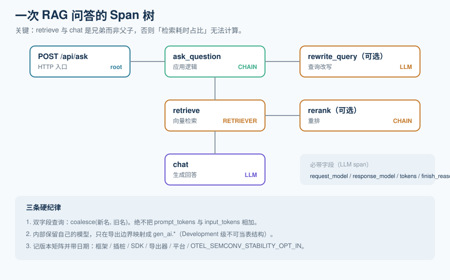

# Trace 模型与会话

观测的地基是 Span 树。埋点错了，上面所有看板、告警、评估都建立在错误的因果链上。这一页讲清楚 LLM 应用的 Trace 该怎么建模、每一类 span 该带哪些字段，以及一个必须知道的前提：**OpenTelemetry 的 GenAI 语义约定目前全部处于 Development 级，没有一个是 Stable**。

::: tip 一句话理解
一次 LLM 交互的 Trace，本质上要回答三个问题：**谁调用了谁**（树结构）、**每一步看到了什么、产出了什么**（输入输出）、**这一步花了多少**（耗时与 token）。三者缺一，Trace 就退化成一条带时间戳的日志。
:::

## 一、Span 树的形状

一个典型的 RAG 问答请求，会展开成这样一棵树：

```text
POST /api/ask                        （HTTP 入口，root span）
└── ask_question                     （应用逻辑，CHAIN）
    ├── rewrite_query                （可选：查询改写，LLM）
    │   ├── gen_ai.request.model 等属性
    │   └── token / 耗时
    ├── retrieve                     （向量检索，RETRIEVER）
    │   ├── returned = 4 / status = hit
    │   └── 命中的片段 ID 与相似度
    ├── rerank                       （可选：重排，CHAIN 或 TOOL）
    └── chat                         （生成，LLM）
        ├── input  = 系统提示 + 上下文 + 问题
        ├── output = 回答
        └── input_tokens / output_tokens / response.model
```



**关键点：`retrieve` 是 `chat` 的兄弟而不是子节点。** 检索与生成是同一层级的两个步骤，画成父子（`chat → retrieve`）会让「检索耗时占总耗时的比例」这类分析无法进行，因为父节点的时间包含子节点。

## 二、六种 span kind

不同工具对 kind 的命名不同，但**概念集合是收敛的**。业界（OpenInference 规范）把它定义为六类：

| span kind | 代表什么 | 必带字段 |
| --- | --- | --- |
| `AGENT` | 一次完整的自主运行（Agent 的顶层） | 目标、迭代轮数、最终结果 |
| `LLM` | 一次模型调用 | `gen_ai.request.model`、`gen_ai.response.model`、输入输出 token 数、finish reason |
| `CHAIN` | 一个组合步骤（编排、后处理、查询改写） | 步骤名、输入输出 |
| `TOOL` | 一次函数 / API 调用 | 工具名、参数、返回、是否报错 |
| `RETRIEVER` | 一次检索（向量、关键词、混合） | 查询、命中条数、片段 ID、相似度 |
| `EMBEDDING` | 一次向量化 | 输入条数、向量维度、模型 |

::: danger 两种常见的埋点错误
1. **把所有步骤都标成 `LLM`**。检索、重排、后处理都标成 LLM，会导致「LLM 调用次数」虚高 3~5 倍，成本看板直接失真（这些步骤确实可能调用模型，但它们不是「生成回答的那次调用」）。
2. **不记录 `finish_reason`**。`length` 意味着**被上下文窗口截断了**，这是「回答不完整」的一类高频原因，而它在 HTTP 层是 200。没有这个字段，你只能靠人眼看出回答「话说一半」。
:::

## 三、OpenTelemetry GenAI 语义约定的真实现状

这是本页最重要的一节。**如果你打算把 `gen_ai.*` 字段直接当作数据库表结构，请先读完这节再动手。**

### 3.1 现状：全部 Development 级

截至 2026 年年中：

| 事实 | 说明 |
| --- | --- |
| **无一 Stable** | 所有 `gen_ai.*` 属性、span、指标、事件都标注为 **Development**——可以在两个 release 之间改名、改类型甚至删除，**不适用 Stable 约定那套弃用周期** |
| **已迁出主仓库** | `semantic-conventions` **v1.42.0（2026-06-12）**把 GenAI 内容移出主仓库，**v1.43.0（2026-07）**移除，迁至独立仓库 `open-telemetry/semantic-conventions-genai` |
| **独立仓库尚无 tagged release** | 截至 2026 年 7 月中，该仓库没有打过 tag，因此**没有可 pin 的 schema URL** |
| **传输层稳定** | OTLP 协议与 span 模型（span、parent-child、resource 属性）是 Stable 的——稳定的是**运输方式**，不是**字段名** |

### 3.2 属性名的历史变迁

字段改名的真实记录（这张表比任何结论都重要，它说明「变化是常态」）：

| 约定版本 | 时间 | 变化 |
| --- | --- | --- |
| v1.27.0 | 2024-08 | `gen_ai.usage.prompt_tokens` / `completion_tokens` → `input_tokens` / `output_tokens` |
| v1.37.0 | 2025-08 | `gen_ai.system` → `gen_ai.provider.name`；按消息的 event 改为结构化消息属性 |
| v1.38.0 | 2025-10 | 新增 `gen_ai.evaluation.result` 事件（评估分数可以与它评的那次操作关联） |
| v1.40.0 | 2026-02 | 新增检索 span、缓存 token 属性、`gen_ai.agent.version` |
| v1.41.0 | 2026-04 | `invoke_agent` 拆成 client 与 internal 两种 span；新增 reasoning token；流式延迟指标 |
| v1.42.0 | 2026-06 | GenAI 内容全部移出主仓库 |
| v1.43.0 | 2026-07 | 从主仓库移除 |

**真实后果已被观测到**：有团队发现单个应用在同一条 Trace 里同时发出**新旧两代**属性——既有旧名 `gen_ai.system` 又没有 `gen_ai.provider.name`，同一个 token 值在两种新旧名字下各出现一次，而 span 名却是新代写法。也就是说，**一条 Trace 内部就可能是混合代际的**。

### 3.3 三条工程纪律

由此推出三条硬纪律，这三条是本专题与「普通 OTel 接入」最大的差别：

1. **双字段查询，永远 `coalesce`，禁止相加。**
   ```sql
   -- 正确：新旧字段取其一
   select
     coalesce(gen_ai_provider_name, gen_ai_system)                       as provider,
     coalesce(gen_ai_usage_input_tokens,  gen_ai_usage_prompt_tokens)     as input_tokens,
     coalesce(gen_ai_usage_output_tokens, gen_ai_usage_completion_tokens) as output_tokens
   from spans
   where kind = 'LLM';
   ```
   ```sql
   -- 错误：相加会把同一个值算两次
   select gen_ai_usage_input_tokens + gen_ai_usage_prompt_tokens as input_tokens from spans;
   -- 后果：成本看板凭空翻倍，且不报错、不告警。
   ```

2. **维护自己的内部模型，在导出边界做映射。** 内部用一套稳定的字段名（provider / model / input_tokens / output_tokens / finish_reason），只在写入观测平台时翻译成 `gen_ai.*`。语义约定改名时，你只改**一层适配**，不改业务代码与看板。

   > **一条 Design 级的判据**：*Development 状态的**外部** schema 不应该成为你的**数据库契约**。*

3. **把版本矩阵写下来并带日期。** 需要固定的至少五项：框架版本、埋点/插桩库版本、OTel SDK 与导出器版本、观测平台版本、以及 `OTEL_SEMCONV_STABILITY_OPT_IN` 的取值（`gen_ai_latest_experimental` 会选择最新的实验性约定，但**并非每个框架都一致地遵守**）。**记下你实测的日期**——否则三个月后没人知道当时是什么组合。

::: warning 「OTel 兼容」目前不构成一条 schema 契约
这句是本节最需要带走的话。OTel 作为**交换层**仍然是最正确的选择：它让你换后端只改环境变量而不改 SDK 调用。但**不要**把「我们上了 OTel」当作「字段问题已经解决了」。
:::

## 四、会话（Session）与用户（User）

单条 Trace 只覆盖一次请求；会话把多轮交互串起来，是排障的第二层。

| 标识 | 挂在哪 | 用途 | 注意 |
| --- | --- | --- | --- |
| `trace_id` | 根 span | 串起一次请求内的所有步骤 | 跨服务传递靠 OTLP 的上下文传播 |
| `session_id` | **每一个** observation | 串起多轮对话 | 老 SDK 只在 trace 上写，需要较新版本才能下推到每一行 |
| `user_id` | 每一个 observation | 定位「某个用户的问题」、做用户级配额 | 与 `session_id` 一样，注意它在多租户下的隐私含义 |

::: info Langfuse v4 的一个具体变化
Langfuse 在 v4 中要求 **Python SDK ≥ 4.7.0 / JS-TS SDK ≥ 5.4.0**，才能把 `user_id`、`session_id` 这类 trace 级属性**下推到每一条 observation** 再入库。旧版 SDK 会把更新分别发往 traces 与 observations 两张表，查询时需要 join 与去重——这正是 v4 重架构（改为 append-only、`trace` 变成 root observation）要解决的问题。
:::

**会话级评估是排障的重要补充**。单轮看不出问题的场景很多：用户在第 3 轮表达了不满、Agent 对同一个工具连续调用了 5 次、上下文在第 7 轮被截断。这类问题只有把会话整体当一个评估单元才能发现，[在线评估](../OnlineEval/index.md)会把「单轮」与「会话级」的评估并列讲。

## 五、采样：Trace 完整性与成本的对撞

采样不是「随机丢数据」，它有三个必须显式区分的语义：

| 语义 | 做法 | 后果 |
| --- | --- | --- |
| **子 span 采样 + 父丢弃** | 只保留部分 span | **Trace 出现断裂**，因果链丢失，比不采样更危险——因为它看起来有数据 |
| **比例采样（head-based）** | 在入口按比例决定是否记录整棵 Trace | 实现简单，但**错误请求可能被丢掉**（事后才知道它错了） |
| **尾部采样（tail-based）** | 先缓冲整棵 Trace，按「是否报错 / 是否超阈值 / 是否命中特定标签」决定保留 | 能保证「重要的都留下」，代价是需要在 Collector 侧缓冲 |

::: tip 一条不变式
**一次 Trace 要么整棵保留，要么整棵丢弃。** 任何会造成父子不完整的采样方式都应该被拒绝。对 LLM 应用还要额外保证：**命中以下条件的 Trace 一律 100% 保留**——报了错、`finish_reason = length`、检索 `status != hit`、延迟超过阈值、被用户打了负反馈。
:::

## 六、最小验证：一次调用要能落到一棵树上

按下面四步验证你的埋点是否正确。**第三步是最容易被跳过的一步，也是最容易暴露问题的。**

```shell
# 第 1 步：确认 span 已经产生（以 OTLP/HTTP 收端为例，用 collector 的 debug 导出器）
# 期望：控制台出现形如 Span#<hex> / Name: chat / Attributes: gen_ai.request.model=...
docker run --rm -p 4318:4318 \
  otel/opentelemetry-collector:latest \
  --config /etc/otelcol/config.yaml   # config 中 exporters: debug

# 第 2 步：确认父子关系正确
# 期望：所有 LLM/RETRIEVER span 的 parent_span_id 都指向同一个 CHAIN span，
#       且只有 1 个 span 的 parent_span_id 为空（根）。
grep -c 'parent_span_id=""' trace_dump.txt        # 期望输出 1

# 第 3 步：确认两代属性没有同时出现非空值（防重复计数）
# 期望：输出 0
grep -E 'gen_ai.usage.(input_tokens|prompt_tokens)' trace_dump.txt | wc -l   # 看是否成对出现

# 第 4 步：确认 token 数非零且与账单量级一致
# 期望：input_tokens 与 output_tokens 都 > 0；把一天的总和乘单价，与账单同量级
```

## 与「模型路由与降级」专题的分工（第 164 天补充）

本页讲 **span 怎么建、trace 怎么串、采样怎么做**，是通用链路规范。一次 LLM 请求比普通 HTTP 多出一层「决策」：为什么选这个模型、为什么触发降级、这次是不是被降级过——这九个字段的定义归 [模型路由与降级 · 可观测](../../ModelRouting/Observability/index.md)。

| 问题 | 归本页 | 归路由专题 |
| --- | --- | --- |
| 一次请求在哪些服务里花了多久 | span 结构与父子关系 | 路由决策作为独立 span 的**九个必填字段** |
| 降级在链路里怎么看出来 | 通用错误与异常标记 | `x-degraded` / `x-degrade-reason` / `x-fallback-depth` 三个响应头（`MRF-C`） |
| 采样率定多少 | 采样策略与成本 | 路由决策必须**全量保留**，不能进采样（否则归因不可复算） |

一句话边界：**trace 记录「发生了什么」，路由可观测记录「为什么这样选」**；后者少一个字段，灰度门禁就无法按原因回滚。

## 与「推理请求调度与批处理」专题的分工

| 问题 | 本页回答 | 调度专题回答 |
| --- | --- | --- |
| 一次请求经过哪些 span | ✅ 链路追踪与父子关系 | ✅ 四个读数的打点位置与口径 |
| 排队时间算谁的 | 只作为 span 属性 | ✅ 明确 `queue_wait` 与 `admit_wait` 的区别 |
| 怎么从 trace 看出瓶颈 | ✅ 按 span 耗时排序 | ✅ 用批大小与 KV 指标判根因 |

**本页特有的一个坑**：把「网关耗时」与「排队时间」打成一个 span，会让调度问题看起来像网络问题。本库的约定是分两个属性记：`queue_wait`（网关到准入）与 `admit_wait`（准入到进批）——前者含鉴权与网络，后者才是调度让你等的。混在一起时，调度优化做完指标不动，因为大头在网络。详见[总览](../../InferenceScheduling/Overview/index.md)。

## 与「工具调用协议与契约工程」专题的分工（第 201 天补充）

本页定的是 span 的形状、语义约定与采样。**跨进程那一段**——`traceparent` 怎么跟着一次工具调用走进另一个进程——归[调用生命周期](../../AgentToolProtocol/Invocation/index.md)。

| 问题 | 归本页 | 归协议专题 |
| --- | --- | --- |
| span 怎么分层、什么 kind | 六种 span kind、GenAI 语义约定 | —— |
| 采样怎么做、尾部采样配多少 | 本页 | —— |
| 工具调用后 trace 为什么断成两棵 | 通常只看到「两条根」 | [调用生命周期](../../AgentToolProtocol/Invocation/index.md)：`_meta` 里的 `traceparent` / `tracestate` / `baggage` |
| 怎么把一次业务操作的所有工具调用串起来 | 靠 `session.id` | [同一页](../../AgentToolProtocol/Invocation/index.md)：`gen_ai.tool.call.id` 与业务幂等键分开记 |

**本页特有的一个坑**：`2026-07-28` 起 MCP 把 OpenTelemetry 传播字段写进了 `_meta`，但**很多客户端只在自己的进程里注入、不往子进程透传**。表现是「工具服务有 trace、宿主也有 trace，但它们是两棵树」。检查方法：工具 span 的 `parent_span_id` 是否指向宿主那次调用的 span；如果为空，说明 `traceparent` 没传过去。

## 参考资料

- OpenTelemetry 语义约定（主仓库，含迁移公告）：https://github.com/open-telemetry/semantic-conventions
- OpenTelemetry GenAI 语义约定（独立仓库）：https://github.com/open-telemetry/semantic-conventions-genai
- OpenInference span kind 规范：https://github.com/Arize-ai/openinference
- OpenTelemetry 尾部采样处理器文档：https://opentelemetry.io/docs/collector/
- Langfuse v4 迁移与 SDK 版本要求：https://langfuse.com/self-hosting
