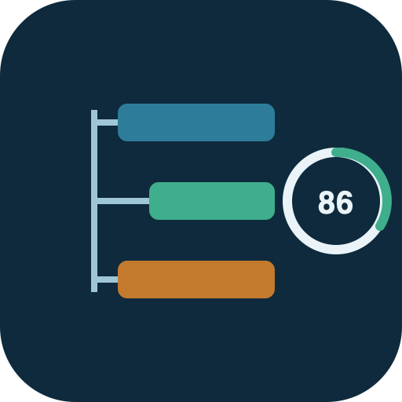
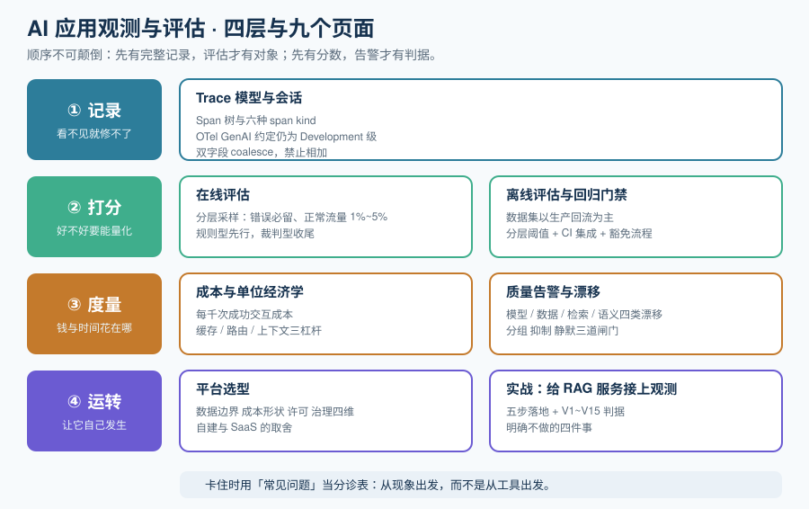

# AI 应用观测与评估

AI 应用观测与评估解决的是这样一类问题：**你的系统一切「正常」——HTTP 200、延迟 300ms、错误率 0.1%，但用户拿到的答案就是不对。** 传统监控体系里没有「答案对不对」这个指标，它只会告诉你容器活着、端口通、没有异常抛出。本专题讲清楚 LLM 应用专属的观测栈怎么搭：Trace 怎么记才能复现一次回答、线上真实流量怎么打分、成本怎么归因到具体的那一步、质量悄悄下滑时靠什么发现，并用一个 RAG 问答服务做一次端到端的完整实战。

::: tip 一句话理解
传统 APM 记的是「这次请求成功了没有」；LLM 观测记的是「**这次回答是怎么被拼出来的，它好在哪、坏在哪、花了多少钱**」。前者是二元结果，后者是一条可复现的推理链——「HTTP 200 掩盖了什么」正是本专题的全部起点。
:::

## 与相邻专题的分工

| 专题 | 讲什么 | 与本专题的关系 |
| --- | --- | --- |
| 本专题 | LLM 应用的**运行时观测 + 在线评估 + 成本归因**：Trace 模型、平台选型、采样打分、看板与告警 | —— |
| [提示词安全与评估](../PromptSecurity/index.md) | **对抗性**测试与安全评估集：注入、越狱、红队、回归门禁 | 那边评的是**构造出来的攻击样本**（能不能被带偏）；本专题评的是**线上真实流量**（答得好不好）。那边的[回归门禁](../PromptSecurity/RegressionGate/index.md)与本专题的[离线评估](./OfflineEval/index.md)共用「数据集 + 阈值」这套机制，但数据来源与阈值口径不同 |
| [提示词工程 · 效果评估](../PromptEngineering/Evaluation/index.md) | 提示词的**方法论级**评估维度 | 那边回答「怎么评价一个提示词好不好」，本专题回答「怎么在生产环境里持续评价它」 |
| [Agent 框架 · 生产化](../AgentFramework/Production/index.md) | 框架视角的**生产化四件套**（部署/可观测/评估/成本）操作清单 | 那边是清单与选型建议，本专题把「可观测 + 评估 + 成本」三块展开到可实施颗粒度 |
| [大模型应用开发 · 成本核算与限流降级](../LLMApp/CostRateLimit/index.md) | 接入层的**成本控制手段**：预算、限流、降级 | 那边是「怎么少花钱」，本专题是「怎么知道钱花在哪一步、值不值」 |
| [运维 · 监控告警](../../Ops/Monitoring/index.md) | 通用可观测性三支柱：指标、日志、链路 | 那边盯的是**基础设施与服务的健康**；本专题盯的是**模型输出的质量与语义**，两者共用 OTLP 管道但语义层完全不同 |
| [运维 · 日志体系](../../Ops/LogSystem/index.md) | 日志采集、结构化、检索 | 日志是「出事后回溯」的原始素材，Trace 是「请求内因果链」的结构化记录；本专题的[平台选型](./Platforms/index.md)专门讲什么时候该自建 OTel 管道 |
| [RAG · 评估体系](../RAG/Evaluation/index.md) | RAG 检索链路的**离线指标**（忠实度、相关性等） | 那边给指标定义与数据集构造，本专题给「把这些指标接到线上流量上」的采样与打分工程 |
| [微调 · 评测与发布门禁](../FineTuning/Evaluation/index.md) | **模型权重**侧的评测与发布阈值 | 那边评模型本身，本专题评「模型 + 提示词 + 检索」组合成的应用 |
| [多模态应用](../Multimodal/index.md) | 图像/语音/视频的接入与处理 | 多模态应用同样是本专题的对象，且多模态评估（对音频、图片打分）是**当前工具链最不成熟**的一块，见[在线评估](./OnlineEval/index.md) |
| [本地模型部署 · 性能调优压测](../LocalModel/Performance/index.md) | 自建推理服务的**吞吐与延迟** | 那边量的是推理引擎；本专题量的是「端到端一次交互」的链路耗时，两者是包含关系 |

::: info 规划中的相邻主题
轮换表后续还有两个与观测相关的 AI 主题：**可观测性深入**（OpenTelemetry、Trace 采样、Profiles）讲通用可观测性底座；**AI 安全与合规**（数据脱敏、内容安全、审计）讲组织级治理。本专题与它们的分工是「GenAI 语义层」与「通用底座 / 合规治理」的差别，页面落地时会补齐链接。
:::

## 专题地图

| 页面 | 内容 | 适合谁读 |
| --- | --- | --- |
| [概述：HTTP 200 掩盖了什么](./Overview/index.md) | 四类「正常但错」、三层信号、观测的边界与最小起步 | 所有人，先读 |
| [Trace 模型与会话](./Tracing/index.md) | Span 树、六种 span kind、OTel GenAI 语义约定的**不稳定现状**、双字段查询 | 写埋点与做排障的人，**重点读** |
| [平台选型](./Platforms/index.md) | LangSmith / Langfuse / Phoenix / 自建 OTel 的四维对照与红线 | 做技术决策的人 |
| [在线评估](./OnlineEval/index.md) | 采样策略、三类 evaluator、LLM 裁判的校准与偏差 | 想给线上流量打分的人，**重点读** |
| [离线评估与回归门禁](./OfflineEval/index.md) | 数据集从生产轨迹回流、分层阈值、CI 集成 | 搭建发布流程的人 |
| [成本与单位经济学](./Cost/index.md) | token 计价、缓存命中、每千次成功的成本、花钱的三类陷阱 | 需要向业务解释账单的人 |
| [质量告警与漂移](./Alerting/index.md) | 四类漂移、告警的三档强度、影子流量与灰度的区别 | 值班与做 SLO 的人 |
| [实战：给 RAG 服务接上观测](./Practice/index.md) | 从零到可交付的完整流程 + V1~V15 验收判据 | 想看完整落地的人 |
| [常见问题](./FAQ/index.md) | 分诊表、十二问、上线自查清单、术语表 | 所有人 |

## 事实与规格速览（2026-10 口径）

按各官方发布页、PyPI 与 npm 核对（检索日 2026-10-13）。**这张表的作用是给你一个「当前时间点」的锚，不是选型结论**——这个领域的版本迭代以周计。

| 对象 | 当前状态 | 需要记住的一句话 |
| --- | --- | --- |
| OpenTelemetry GenAI 语义约定 | **全部 `gen_ai.*` 均为 Development 级，无一 Stable** | `semantic-conventions` v1.42.0（2026-06-12）把 GenAI 内容**移出**主仓库、v1.43.0（2026-07）**移除**，迁至 `open-telemetry/semantic-conventions-genai`；该仓库截至 2026 年 7 月中**尚无 tagged release**，也就**没有可 pin 的 schema URL** |
| OTLP 与 span 模型 | **Stable** | **传输层稳定 ≠ 字段名稳定**。这是理解本专题全部工程取舍的前提 |
| Langfuse | **v4**（v4.0.0 2026-07-29；v4.56.0 2026-10-09） | v4 是**数据模型重架构**（`events_full` + `events_core` 投影、trace 变成 root observation）；v3 仅获安全补丁至 **2027 年 1 月底**；Langfuse Cloud 的 v3 于 **2026-11-16** 下线；核心 MIT 许可，2026-01 起并入 ClickHouse |
| LangSmith | 闭源 SaaS，**SmithDB**（2026-05）为 Rust 数据层 | Developer 免费档 1 席 / 5k base traces / 14 天保留；Plus **$39/席/月** / 10k traces；自托管仅 Enterprise（商务洽谈）。厂商自述 P50：trace tree 92ms、全文检索 400ms |
| Arize Phoenix | **arize-phoenix 20.17.0**（2026-09-30） | OTel / OpenInference 原生，**Elastic License 2.0 而非 OSI 开源**（可自托管，不可作为托管服务转售）；2026-08 Dynatrace 宣布**收购 Arize** 的计划，长期路线图待观察 |
| DeepEval | Apache-2.0，pytest 形态 | 「给 LLM 流水线写单元测试」的最短路径；2.1 起用 DAG 化指标评估减少裁判调用 |
| Ragas | **维护风险项**：v0.4.3（2026-01-13）之后 2026-02-24 起无提交，仓库迁至 vibrantlabsai | RAG 指标定义仍是最好的参考资料，但**不要把它当成会被持续修补的依赖** |
| promptfoo | MIT，**Node 项目（npm）** | PyPI 上的同名 `promptfoo` 是第三方包装，不是上游项目——装错是这个工具最常见的第一个坑 |
| 其他可选 | Opik（Apache-2.0）、Braintrust、W&B Weave、OpenLLMetry / OpenLIT（埋点）、Laminar（Rust，自建需 RabbitMQ + Postgres + ClickHouse + Qdrant 四个有状态服务） | 「自建观测」的真实成本是**四个有状态服务 + 运维工时**，不是「省下一张账单」 |

::: danger 三个最容易踩的事实性错误
1. **把 `gen_ai.*` 当成稳定契约写进数据库**。它是 Development 级，字段可以在两个 release 之间改名甚至删除。正确做法是**在边界处映射**：内部保留自己的主数据模型，只在导出到观测平台时翻译成 `gen_ai.*`。业界已实测到单个应用同时发出新旧两代属性名（同一个 token 值出现在 `gen_ai.system` 与 `gen_ai.provider.name` 下），**合并时只能 `coalesce` 不能相加**。
2. **以为「用了 OTel」就等于「schema 定了」**。协议稳定，语义未定；「OTel 兼容」目前**不构成**一条可依赖的 schema 契约。
3. **把 token 数的两代字段相加**。`gen_ai.usage.prompt_tokens` 与 `gen_ai.usage.input_tokens`（v1.27.0 改名）指的是同一个值，重复计数会让成本看板凭空翻倍，而且**不报错**。
:::

## 关于版本组织

本专题**不建大版本目录**。原因：观测与评估领域的破坏性变化来自**语义约定与数据模型**（OTel `gen_ai.*` 的改名、Langfuse v4 的表结构重排），而不是「框架换代」这类清晰的主版本边界。处理方式是在页内用 `::: info` 标注**生效时点与旧口径**，需要对比时并列写。

需要看「按大版本建目录」的范例，可参考 [Spring5 / Spring6](../../Backend/Java/Frame/Spring/Spring6/index.md)、[Vue2 / Vue3](../../Frontend/Frame/Vue/index.md)，以及 Spring Boot 的 [v2](../../Backend/Java/Frame/SpringBoot/v2/index.md) / [v3](../../Backend/Java/Frame/SpringBoot/v3/index.md) / [v4](../../Backend/Java/Frame/SpringBoot/v4/index.md)。

## 成熟度自评：你在哪一档

| 档位 | 特征 | 下一步 |
| --- | --- | --- |
| L0 盲飞 | 只有应用日志和 APM；出问题靠用户截图复现 | 先给一次请求建一棵 Span 树，哪怕只记输入输出和耗时 |
| L1 可回溯 | 有 Trace，能回答「当时喂给模型的是什么」 | 补齐 token 与成本字段，开始做[成本归因](./Cost/index.md) |
| L2 有分数 | 线上采样打分（至少一个质量指标）+ 人工反馈通道 | 把分数接到告警与[离线回归集](./OfflineEval/index.md) |
| L3 可回归 | 生产轨迹能沉淀成数据集，变更跑门禁，阈值分层 | 补[漂移检测](./Alerting/index.md)，区分「模型换了」与「流量变了」 |
| L4 可运营 | 成本、质量、延迟三条线各有 SLO 与责任人，异常可归因到具体一步 | 保持，并每季度复核语义约定版本矩阵 |

五档之间的差别不是「装了哪个平台」，而是**「能不能在事后 5 分钟内说清楚那一次回答为什么差」**。

## 学习路径

1. **先读[概述](./Overview/index.md)**：确认你的应用属于哪一类「正常但错」，这决定你要采哪些信号。
2. **精读 [Trace 模型](./Tracing/index.md)**：观测的地基是 Span 树；埋点错了，后面所有看板都是错的。
3. **按[平台选型](./Platforms/index.md)做一次四维打分**：别先看功能清单，先看**数据能不能出你的环境**。
4. **落到[在线评估](./OnlineEval/index.md)**：这页决定你的观测栈是「调试工具」还是「质量管理体系」。
5. **用[离线评估](./OfflineEval/index.md)把发现锁住**，再用[成本](./Cost/index.md)与[告警](./Alerting/index.md)让它自动运转。
6. **对照[实战](./Practice/index.md)完整走一遍**，最后通读[常见问题](./FAQ/index.md)收尾。

## 参考资料

- OpenTelemetry 语义约定主仓库与迁移说明：https://github.com/open-telemetry/semantic-conventions
- OpenTelemetry GenAI 语义约定（独立仓库，尚无 tagged release）：https://github.com/open-telemetry/semantic-conventions-genai
- OpenInference span 规范（六种 span kind）：https://github.com/Arize-ai/openinference
- Langfuse 自托管与 v4 迁移文档：https://langfuse.com/self-hosting
- LangSmith 文档与定价：https://docs.smith.langchain.com/
- Arize Phoenix 文档：https://docs.arize.com/phoenix
- DeepEval 文档：https://docs.confident-ai.com/
- promptfoo 文档：https://www.promptfoo.dev/docs/
