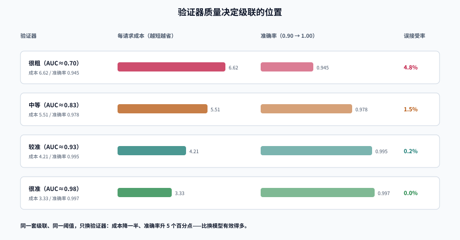

# 成本与质量：把「划算」算成一个数

「路由省钱了」这句话在没有分母的时候没有意义。省了 70% 的单价、但同时多调用 1.5 次、准确率掉 4 个百分点，这笔账到底是赚还是亏？

这一页给四个能直接用的分母、一张可复算的成本-质量前沿，以及一个常被忽略的事实：**级联的上限由验证器决定，不由模型决定**。

## 判据族声明

本页判据族 `MRC-A` ~ `MRC-H`，共 8 条。定义表在第七节。

## 一、四个分母，别用错

| 分母 | 公式 | 什么时候用 | 陷阱 |
| --- | --- | --- | --- |
| **每请求成本** | 总成本 ÷ 请求数 | 容量规划、预算审批 | 忽略重试：实际是「首次调用 × 1.4」 |
| **每千 token 成本** | 总成本 ÷ 总 token × 1000 | 与供应商比价 | 输入输出不同价，混算会失真 |
| **每答对一题成本** | 总成本 ÷ 正确数 | **比较不同档位/不同策略** | 需要评估集；准确率低时这个数会暴涨 |
| **每任务完成成本** | (模型成本 + 重试 + 人工兜底) ÷ 完成任务数 | 端到端决策 | 人工成本要按「分钟 × 时薪」显式计入 |

同一个系统，四个分母可以给出完全不同的结论。举例：某策略把每请求成本从 22 降到 5.5（-75%），但准确率从 0.961 降到 0.900：

```text
每答对一题成本：22 / 0.961 = 22.90  →  5.5 / 0.900 = 6.11   （-73%，仍然划算）
每任务完成成本：若错题需要人工 8 分钟、时薪 120 元，
  则每 1000 题多错 61 题 ⇒ 多花 61 × 8/60 × 120 = 976 元人工；
  模型侧省下 (22-5.5) × 1000 = 16,500 单位 —— 只有当单位成本 < 0.017 元时才真的赚
```

::: warning 分母必须写进报表标题
「成本下降 75%」和「每答对一题成本下降 73%」是两个不同的结论。前者可能只是在**少答对**。所有对外汇报的成本数字，都必须带分母。
:::

## 二、质量不是一个数

「准确率 0.96」这种说法在路由场景里几乎没用，因为**不同难度的请求错在不同地方**。同一批 2000 条合成请求的实跑读数：

| 策略 | 简单题 | 中等题 | 困难题 | 总体 | 每请求成本 |
| --- | --- | --- | --- | --- | --- |
| 全用 S | 0.942 | 0.721 | 0.321 | 0.779 | 1.0 |
| 全用 L | 0.984 | 0.953 | 0.891 | 0.961 | 22.0 |
| 级联 τ=0.50 | 0.994 | 0.953 | 0.861 | 0.962 | 3.97 |
| 级联 τ=0.60 | 0.997 | 0.973 | 0.891 | 0.974 | 5.50 |
| 级联 τ=0.70 | 0.994 | 0.982 | 0.924 | 0.980 | 8.39 |

三个判读要点：

1. **困难题的准确率是天花板**。级联在困难题上最多等于全用大模型（0.891），因为困难题本来就该升级到大模型；级联的收益来自**简单题和中等题**。
2. **总体的 0.974 比全用大模型的 0.961 还高**，这不是数据错误：不同模型错在不同的题上，验证器把「小模型答错」的题挑出来升级了。所以「质量保持率」可以超过 100%。
3. **简单题上多花的钱是纯浪费**。τ 从 0.50 提到 0.70，简单题准确率反而从 0.994 掉到 0.994（打平），成本却涨了 2.1 倍。

## 三、成本-质量前沿：同一笔钱买到什么

把上面的点画在同一张图上，横轴是每请求成本、纵轴是准确率，会看到三条线：


| 成本档位 | 随机路由（按概率给大模型） | 级联 | 差距 |
| --- | --- | --- | --- |
| ~3.1 | 0.796（p=0.1） | 0.936（τ=0.40） | **+14.0pp** |
| ~5.2 | 0.815（p=0.2） | 0.974（τ=0.60） | **+15.9pp** |
| ~7.3 | 0.827（p=0.3） | 0.980（τ=0.70，成本 8.39） | +15.3pp |

**同样花 5 个单位成本，随机路由 0.815，级联 0.974。** 这 16 个百分点就是「路由信号」的全部价值——它不是省钱的技巧，而是**把钱花在对的请求上**的能力。

::: tip 这张图的正确用法
不要问「我的系统该在曲线的哪个点」，要问「**我的业务能接受的最低准确率是多少**」，然后在曲线上找满足它的最低成本点。前者的答案会随心情变，后者是一个可验收的约束。
:::

## 四、级联的账：CPT 与 APGR

借用 RouteLLM 的两个指标，把「省了多少」和「质量挽回了多少」分开记：

- **CPT（call-performance threshold）**：达到目标质量时，调用强模型的比例。**越低越省钱。**
- **APGR（average performance gain recovered）**：相对「全用弱模型 → 全用强模型」这段差距，挽回了多少。

实跑读数（阈值扫描，弱模型基线 0.779，强模型 0.961）：

| 阈值 τ | 成本/请求 | 升级到 M | 升级到 L（CPT） | 准确率 | APGR | 误接受率 |
| --- | --- | --- | --- | --- | --- | --- |
| 0.50 | 3.97 | 27.4% | 7.3% | 0.962 | 1.01 | 3.4% |
| 0.60 | 5.50 | 35.6% | 12.3% | 0.974 | 1.07 | 1.8% |
| 0.70 | 8.39 | 48.5% | 22.6% | 0.980 | 1.11 | 0.6% |
| 0.90 | 22.07 | — | 100% | 0.969 | 1.04 | 0.1% |

读法：

1. **τ=0.90 时 CPT=100%，成本 22.07 已经等于全用大模型，准确率却只有 0.969（低于 τ=0.70 的 0.980）**——因为几乎所有请求都先白调了一次小模型，而且部分「大模型答对了」的答案因为分数不高并没有被真正采纳。
2. **APGR > 1 是可能的**，含义是「比全用大模型还好」。不要把它当成 bug，但要在报表里注明「超过 100% 的部分来自模型间错误不相关」。
3. **误接受率是必须单独监控的数**：它是「小模型答错了但验证器放过了」的比例，直接对应业务上的「静默错误」。

## 五、验证器：级联的真实上限



同一套级联结构、同一阈值，只改验证器的判别力（用 `sigma` 表示噪声，越小越准）：

| 验证器 | 成本/请求 | 准确率 | 相对全用大模型 | 误接受率 |
| --- | --- | --- | --- | --- |
| 很粗（AUC ≈ 0.70） | 6.62 | 0.945 | 0.30× | 4.8% |
| 中等（AUC ≈ 0.83） | 5.51 | 0.978 | 0.25× | 1.5% |
| 较准（AUC ≈ 0.93） | 4.21 | 0.995 | 0.19× | 0.2% |
| 很准（AUC ≈ 0.98） | 3.33 | 0.997 | 0.15× | 0.0% |

**验证器从「很粗」换到「很准」，成本降一半、准确率升 5 个百分点。** 这比换模型有效得多。

### 验证器怎么选

| 任务类型 | 推荐验证器 | 不要用 |
| --- | --- | --- |
| 结构化抽取（JSON、字段） | JSON Schema 校验 + 必填字段断言 | 模型自评 |
| 分类/意图 | 标签集合法性 + 与检索结果的蕴含校验 | 让模型「再确认一次」 |
| 问答（有标准答案） | 独立小模型打分（NLI/相似度） | 与原模型同源的评审 |
| 开放生成 | 规则断言（长度、禁词、引用存在）+ 抽样人工 | 全自动打分（噪声比信号大） |
| 代码 | 编译/单测/静态检查 | 让模型解释自己的代码 |

::: danger 三个会让级联「看起来在工作」的错误
1. **验证器与生成模型同源**。同一个模型家族自评，错误高度相关，误接受率会从 1.8% 涨到 8% 以上。
2. **阈值定在 0.5**。0.5 只是「分数的一半」，不是「质量的一半」。阈值必须按目标误接受率反解。
3. **只看平均准确率**。级联对简单题过度服务、对困难题服务不足，平均值会把两头的问题抵消掉。
:::

## 六、token 结构：路由改变的不只是单价

路由到小模型的隐含假设是「同样的输入输出」。但实际会发生三件事：

| 变化 | 方向 | 影响 |
| --- | --- | --- |
| 输出变长 | 小模型更啰嗦，或格式不稳定导致重试 | 输出 token ↑ 20%~60% |
| 重试变多 | 格式错误、拒答、截断 | 调用次数 ↑ 1.2~1.5× |
| 缓存命中变低 | 不同模型的提示缓存不共享 | 缓存折扣失效 |

所以「小模型单价是 1/20」不等于「成本是 1/20」。**真实比值要用「每答对一题成本」量**，而不是价目表。

## 七、判据定义表

| 判据 | 约定 | 定错了会怎样 | 怎么验证 |
| --- | --- | --- | --- |
| `MRC-A` | 所有成本数字必须带分母 | 「降了 75%」其实是少答对了 | 报表标题含分母（每请求/每答对一题） |
| `MRC-B` | 质量必须按难度分层报告 | 平均值掩盖两端的失衡 | 报表含 easy/medium/hard 三列 |
| `MRC-C` | 验证器必须有独立的 AUC 或误接受率读数 | 不知道级联的上限在哪 | 评估集上算一次 AUC 并记录 |
| `MRC-D` | 验证器不得与生成模型同源 | 错误相关，级联失效 | 部署清单里两者不同源 |
| `MRC-E` | 阈值必须按目标误接受率反解 | 阈值变成拍脑袋 | 有「目标误接受率 → 阈值」的标定记录 |
| `MRC-F` | 成本模型必须计入重试与输出变长 | 省的钱被吃掉 | 成本模型含 `retry_factor` 与 `output_inflation` |
| `MRC-G` | CPT 与 APGR 必须一起看 | 只看成本会牺牲质量，只看质量会浪费 | 周报同时给出两个数 |
| `MRC-H` | 降档必须有最低质量门槛（不可越过的红线） | 极端降档导致业务事故 | 配置里有 `min_quality` 且被校验 |

## 如何验证

```shell
# ① 你的级联在评估集上的前沿：扫描阈值，输出成本/准确率/CPT/APGR
/Users/cuifendemac/.workbuddy/binaries/python/envs/default/bin/python3 - <<'PY'
import random
random.seed(20261018)
N = 2000
diffs = random.choices(["easy", "medium", "hard"], weights=[55, 30, 15], k=N)
T = {"S": (1.0, {"easy": .94, "medium": .72, "hard": .35}),
     "M": (5.0, {"easy": .97, "medium": .90, "hard": .62}),
     "L": (22.0, {"easy": .98, "medium": .95, "hard": .86})}
correct = {t: [random.random() < T[t][1][d] for d in diffs] for t in T}
score = {t: [1/(1+2.718281828**(-random.gauss(1.2 if ok else -1.2, 1.0))) for ok in correct[t]]
         for t in T}
weak, strong = sum(correct["S"])/N, sum(correct["L"])/N
for tau in (0.5, 0.6, 0.7):
    cost = ok = calls = reachL = 0
    for i in range(N):
        for t in ("S", "M", "L"):
            cost += T[t][0]; calls += 1
            if t == "L": reachL += 1
            if t == "L" or score[t][i] >= tau:
                ok += correct[t][i]; break
    acc = ok/N
    print(f"tau={tau:.1f} 成本/请求 {cost/N:5.2f} 准确率 {acc:.3f} "
          f"CPT {reachL/N:5.1%} APGR {(acc-weak)/(strong-weak):.2f}")
PY
```

**预期输出**：`tau=0.6 成本/请求 5.50 准确率 0.974 CPT 12.3% APGR 1.07`（与本页第二节表格一致）。用自己的评估集替换 `T` 与 `diffs` 即可得到真实前沿。

```shell
# ② 误接受率：只统计「验证器放过但答案错」的比例
/Users/cuifendemac/.workbuddy/binaries/python/envs/default/bin/python3 - <<'PY'
accepted = 1000
wrong_accepted = 18      # 从标注结果里数出来
print(f"误接受率 {wrong_accepted/accepted:.2%}")
print("红线：客服类 < 2%；涉及金额/权限 < 0.5%")
PY
```

**预期输出**：`误接受率 1.80%`。判读：超过红线时先换验证器，不要先调阈值——调阈值只是把成本推高。

## 参考资料

- [RouteLLM](https://arxiv.org/abs/2406.18665)——CPT / APGR 的原始定义
- [FrugalGPT](https://arxiv.org/abs/2305.05176)——级联与独立验证器
- [容量规划与成本治理 · 单位成本](../../../Ops/CapacityCost/UnitEconomics/index.md)——分母口径的相邻专题
- 下一站：[超时、重试与对冲](../TimeoutBudget/index.md)
