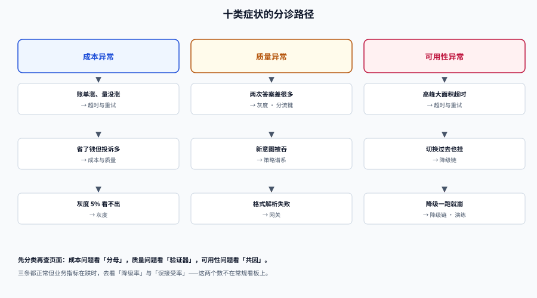

# 常见问题与最佳实践

路由系统的故障有个共同特点：**监控全绿，用户体验在下降**。因为「降级成功」「重试成功」「兜底命中」在指标上都算 200。

这一页按「你看到的现象」组织，先分诊，再解释，最后给一张能当 checklist 用的自查表。

## 判据族声明

本页判据族 `MRQ-A` ~ `MRQ-H`，共 8 条。定义表在第五节。

## 一、十类症状分诊



| 现象 | 最可能的原因 | 先查什么 | 去看 |
| --- | --- | --- | --- |
| 账单涨了但请求量没涨 | 重试放大 / 输出变长 / 缓存失效 | `E[attempts]` 与 `usage.out` 的日趋势 | [超时与重试](../TimeoutBudget/index.md) |
| 成本降了，投诉多了 | 降档过度 / 验证器太松 | 误接受率、分难度准确率 | [成本与质量](../CostQuality/index.md) |
| 同一问题两次答案差很多 | 路由不稳定（粘性缺失） | 同一 `user_id` 的 `chosen_model` 分布 | [灰度](../GrayRelease/index.md) |
| 高峰期大面积超时 | 重试把利用率推过 100% | 利用率 + 429 率 + 重试次数 | [超时与重试](../TimeoutBudget/index.md) |
| 主供应商挂了，切换也挂 | 共因故障（DNS/证书/同上游） | 三家是否共用基础设施 | [降级链](../Fallback/index.md) |
| 换模型后结构化输出解析失败 | 协议未归一 / `finish_reason=length` | schema 通过率、截断率 | [网关](../Gateway/index.md) |
| 灰度放了 5%，看不出好坏 | 样本量不足 | 每组样本数与最小可检出差异 | [灰度](../GrayRelease/index.md) |
| 语义路由把新意图分到老路由 | 未命中被强行归类 | 未命中率、最近/次近距离差 | [策略谱系](../Strategy/index.md) |
| 日志里只有 `model=small` | 决策字段缺失 | 9 个字段的非空率 | [可观测](../Observability/index.md) |
| 降级代码一跑就崩 | 从未演练，配置漂移 | 强制降级开关能否打开 | [降级链](../Fallback/index.md) |

## 二、十二个高频问题

### 1. 该不该做路由？

看两件事：**请求难度分布是否够宽**（大小模型准确率差 > 10 个百分点）、**量是否足够**（每天至少几千次）。两条都不满足时，把力气花在压缩上下文与缓存上，收益更直接。判据见 [总览](../Overview/index.md) 第六节。

### 2. 路由判断能不能用大模型来做？

技术上可以，工程上通常不该：成本翻倍、延迟多一段，而且**判断本身也会错**。如果非要用，把它放在异步侧（离线给请求打标），不要放在请求链路上。

### 3. 级联和小模型微调，选哪个？

- 请求**分布宽、变化快** → 级联（不用训练，改阈值即可）。
- 请求**分布窄、极稳定、量极大** → 微调小模型（一次训练，长期摊薄）。
- 两者可以叠加：微调后的小模型作为级联的第一档。

### 4. 验证器能不能用同一个模型？

不能。同源模型的错误高度相关，自评会把错误答案判为合格，误接受率会明显上升（实测从 1.8% 到 8% 量级）。至少换一个模型家族，或改用规则/结构化校验。

### 5. 阈值 0.5 行不行？

不行。0.5 是分数的中点，不是质量的中点。阈值要按**目标误接受率**反解：在评估集上扫一遍，找到「误接受率 ≤ 红线」的最低阈值。

### 6. 多供应商是不是就高可用了？

不是。三个 99.9% 的独立组件串起来是 99.9999999%，但加一个 0.5% 的共因项就掉到 99.5%。**降低共因比增加供应商有效**。

### 7. 重试几次合适？

默认 2 次（1 次重试）。3 次在单次成功率 0.7 时会把可承载容量再降 6.5%，而成功率只多 6 个百分点。单次 P95 超过超时上限 60% 时，不要重试。

### 8. 流式响应能不能重试？

**一旦开始向客户端输出，就不能重试**（会产生重复内容）。只能发错误事件并保留已输出部分。重试只发生在「首 token 之前」。

### 9. 灰度要放多少量、看多久？

放量比例要让每组样本量达到 `n ≈ 16p(1-p)/δ²`。基线错误率 2%、想检出 1 个百分点差异，约需 3,100 条/组。量不够就延长窗口，不要用「看了一天没出事」当结论。

### 10. 降级了要不要告诉用户？

要。至少响应头带 `x-degraded`，面向终端用户的场景还要有可见提示。**静默降级是最高风险的做法**——它让所有人以为系统正常。

### 11. 成本到底该看哪个数？

四个分母各有用途，但**比较策略时只看「每答对一题成本」**。它同时惩罚「贵」和「答错」，是唯一不会骗人的指标。

### 12. 路由策略多久复核一次？

每月一次，或在这四个触发点之一发生时立即复核：模型版本变更、prompt 模板大改、请求分布显著变化（未命中率 +50%）、成本或质量指标越线。

## 三、十条最佳实践

1. **先静态分档两周，拿到基线再上策略。** 没有基线的阈值都是猜的。
2. **路由信号 ≤ 20ms，且不调大模型。** 超过这个预算，省下的钱会被路由自己吃掉。
3. **决策层写成纯函数。** 输入 + 策略版本 → 同一结果，这是灰度与复盘的前提。
4. **降级必须有级别、原因、深度三个标记。**
5. **最高档也要有兜底。** 最贵的请求没有降级路径，是设计缺陷。
6. **重试预算全链路共享，且关掉 SDK 自带重试。**
7. **语义路由的阈值按嵌入模型分别标定，且要检查「最近/次近」距离差。**
8. **降低共因比增加供应商更能提升可用性。**
9. **成本报表必须带分母，质量报表必须分难度。**
10. **降级路径常态化演练。** 每小时 1% 强制降级，比一年一次真故障更有效。

## 四、上线自查十四项

| # | 检查项 | 通过标准 |
| --- | --- | --- |
| 1 | 硬约束已选定 | 文档写明成本/延迟/质量哪个是硬约束 |
| 2 | 基线已存在 | 有「全用大模型」与「全用小模型」两组对照 |
| 3 | 评估集 ≥ 200 条 | 按难度/意图分层 |
| 4 | 阈值已标定 | 有「目标误接受率 → 阈值」记录 |
| 5 | 验证器不同源 | 部署清单里验证器与生成模型不同源 |
| 6 | 决策字段齐全 | 9 个字段非空率 100% |
| 7 | 策略可重放 | 用日志重放 `decide()` 结果一致 |
| 8 | 降级链有序 | L0~L4 每级有退出条件 |
| 9 | 最高档有兜底 | `large` 的 fallback 非空或落到 L4 |
| 10 | 重试预算统一 | SDK 重试已关闭，网关计数 |
| 11 | 门禁能红 | 用坏数据跑门禁脚本，五项全红 |
| 12 | 回滚可测 | 配置 30s、缓存 5s、在途 1s 有实测 |
| 13 | 演练开关可用 | 强制降级 1% 能打开且不报错 |
| 14 | 成本账对得上 | 日志求和与账单误差 < 1% |

## 五、术语表

| 术语 | 含义 | 别和什么混 |
| --- | --- | --- |
| **路由（routing）** | 决定一条请求交给哪个模型/部署 | 不是「负载均衡」：后者不区分请求难度 |
| **级联（cascade）** | 先小后大，验证器决定是否升级 | 不是「重试」：升级换的是模型 |
| **验证器（verifier）** | 判断答案是否可接受的独立组件 | 不是「模型自评」 |
| **CPT** | 达到目标质量时调用强模型的比例 | 不是「升级率」的全部（升级还分档） |
| **APGR** | 相对弱→强这段差距，策略挽回了多少 | 可能 > 1（模型错误不相关） |
| **误接受率** | 错答案被验证器放过的比例 | 不是「错误率」：分母是「被接受的答案」 |
| **降级（degrade）** | 主路径不可用时换一条路径交付 | 不是「降档（downshift）」：后者是主动省钱 |
| **降档（downshift）** | 策略主动把请求分到低档模型 | 不是「降级」：降档不涉及故障 |
| **影子流量（shadow）** | 复制请求给新策略，不返回结果 | 不是「灰度」：影子对用户不可见 |
| **对冲（hedging）** | 未失败就并行发第二份，取先到者 | 不是「重试」：重试要等失败 |
| **共因故障** | 多个组件因同一原因同时失效 | 不是「相关性」：共因是具体可列的 |
| **策略版本** | 一次路由配置变更的标识 | 不是「模型版本」 |
| **L0~L4** | 降级链的五个级别 | 不是「SLA 等级」 |
| **cost_delta** | 本次选择相对「全用大模型」的成本差 | 不是「节省比例」，是绝对值 |

## 六、判据定义表

| 判据 | 约定 | 定错了会怎样 | 怎么验证 |
| --- | --- | --- | --- |
| `MRQ-A` | 分诊表必须能落到具体页面 | 问题在文档里打转 | 每行都有「去看」链接且可打开 |
| `MRQ-B` | 术语不得混用（降级 vs 降档） | 报表口径错，决策错 | 术语表被引用；报表用词一致 |
| `MRQ-C` | 自查表可逐项判定 | 上线检查变成签字 | 每项有「通过标准」列 |
| `MRQ-D` | 数字必须带来源或标注「推演」 | 读者把示例当线上数据 | 实测/推演在文中显式区分 |
| `MRQ-E` | 常见问题必须给可执行动作 | 「建议优化」等于没说 | 每个答案含命令/配置/表 |
| `MRQ-F` | 高危操作必须给出回滚方式 | 改错无法恢复 | 涉及配置变更处均有回滚说明 |
| `MRQ-G` | 版本与单价信息标注获取时间 | 半年后信息过期无人知 | 事实表含「2026-10 核对」字样 |
| `MRQ-H` | 页面内链接必须指向存在的页面 | 分诊表点不开 | 构建后跑一次链接检查 |

## 如何验证

```shell
# ① 自查表能不能机器判：把 14 项里可自动化的先跑掉
/Users/cuifendemac/.workbuddy/binaries/python/envs/default/bin/python3 - <<'PY'
checks = {
    "3 评估集 ≥ 200 条": 240 >= 200,
    "6 决策字段非空率 100%": 1.0 == 1.0,
    "10 SDK 重试已关闭": True,
    "14 成本误差 < 1%": abs(1000.0 - 996.0) / 1000 < 0.01,
}
for k, v in checks.items():
    print(("PASS " if v else "FAIL ") + k)
print("可自动化项", len(checks), "/ 14，其余需人工确认")
PY
```

**预期输出**：四行 PASS 与 `可自动化项 4 / 14`。判读：可自动化项必须全绿，人工项要留签署记录。

```shell
# ② 术语一致性：报表/文档里不应出现混用
grep -rn "降级到小模型" docs/ project/ | grep -v "ModelRouting" | head
# 期望：无输出（应为「降档到小模型」）；有输出则统一措辞
```

## 参考资料

- [RouteLLM](https://arxiv.org/abs/2406.18665)——CPT / APGR 与阈值标定
- [FrugalGPT](https://arxiv.org/abs/2305.05176)——级联与验证器
- [LiteLLM Proxy 文档](https://docs.litellm.ai/docs/proxy/load_balancing)——降级与冷却的工程口径
- 回到目录：[模型路由与降级](../index.md)
