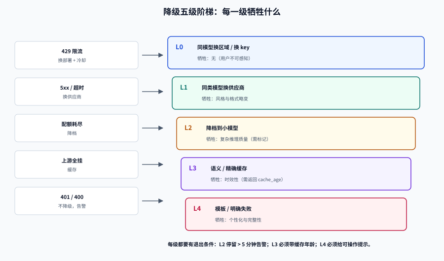

# 降级链：从换区域到明确失败

降级不是「出错时随便找个人顶上」，而是**一条事先排好序、每一级都知道自己牺牲了什么**的路径。

这一页给出一张错误分类矩阵、五级降级阶梯、熔断器的实测行为，以及一个经常被算错的东西：多供应商到底能带来多少可用性。

## 判据族声明

本页判据族 `MRF-A` ~ `MRF-H`，共 8 条。定义表在第八节。

## 一、先分类，再降级

不同错误要走不同的路。把「所有失败都重试」和「所有失败都降级」都是错的。

| 错误 | 典型信号 | 可重试 | 降级到 | 备注 |
| --- | --- | --- | --- | --- |
| **连接失败 / DNS** | `ConnectionError`、`ENOTFOUND` | 是（换区域/换供应商） | 下一档供应商 | 同区域重试没有意义 |
| **429 限流** | HTTP 429、`Retry-After` | 是（带退避，或换 key） | 同模型其他部署 | **立刻给该部署冷却**，不要原地重试 |
| **5xx** | 500/502/503/504 | 是（有限次） | 下一档供应商 | 2 次仍失败即冷却 |
| **超时** | 读超时、首包超时 | 视剩余预算 | 降档 + 短超时 | 预算不足时不重试 |
| **401/403** | 鉴权失败 | **否** | 不降级，告警 | 重试只会刷更多失败 |
| **上下文超长** | `context_length_exceeded` | 否 | 换长上下文模型 / 截断 | 截断是产品决策，必须显式 |
| **内容策略** | `content_policy_violation` | 否 | 换供应商（策略不同）或拒绝 | **不能靠重试绕过合规** |
| **参数/格式错误** | 400、schema 校验失败 | 否 | 修正后由上层重发 | 降级会掩盖 bug |

::: danger 三种「越降越糟」的处理
1. **429 原地重试**：限流说明对方已经在拒绝你，重试只会让冷却时间更长。正确做法是**让这个部署进入冷却，换一个部署**。
2. **内容策略失败后换一家供应商重试**：如果失败原因是你的内容违规，换一家只是换个地方违规；如果原因是对方误判，应该有**显式的申诉/白名单路径**，而不是静默切换。
3. **上下文超长就自动截断**：静默截断会让模型丢掉关键约束，输出看起来正常但答错。必须显式记录 `truncated=true`。
:::

## 二、五级降级阶梯



| 级别 | 动作 | 牺牲 | 用户可感知 | 何时使用 |
| --- | --- | --- | --- | --- |
| **L0** | 同模型换区域/换 key | 无 | 否 | 单区域故障、单 key 限流 |
| **L1** | 同类模型换供应商 | 输出风格与格式略有差异 | 轻微 | 供应商整体故障 |
| **L2** | 降档到小模型 | 复杂推理质量 | 是（需标记） | 成本硬约束、容量不足 |
| **L3** | 走到缓存（精确/语义） | 时效性 | 是（需标记 TTL） | 上游全挂且请求重复度高 |
| **L4** | 规则/模板/明确失败 | 个性化与完整性 | 是 | 兜底，必须给出可操作提示 |

**阶梯的关键不是级数，是「每一级的退出条件」**：L2 停留超过 5 分钟要告警，L3 命中要带 `cache_age`，L4 必须返回可读的错误而不是 500。

```yaml
# 降级链配置（顺序即优先级）
fallback_chain:
  - name: primary
    model: mid-model
    provider: vendor-a
    region: cn-east
  - name: same_model_other_region
    model: mid-model
    provider: vendor-a
    region: cn-north
  - name: same_class_other_vendor
    model: mid-model
    provider: vendor-b
  - name: downshift
    model: small-model
    provider: vendor-b
    degrade_level: 2
  - name: cache
    kind: semantic_cache
    max_age_seconds: 3600
    degrade_level: 3
  - name: template
    kind: canned_answer
    degrade_level: 4
```

## 三、熔断器：实测它到底省了什么

一个标准三态熔断器（10 秒窗口内失败 5 次 → 打开 30 秒 → 半开放 3 个探测、连续成功 2 个则闭合）在一条 120 秒的故障时间线上的行为：

```text
依赖可用性：10~45s 全挂，60~66s 抖动 60% 失败，其余正常
状态迁移： (14s closed→open) (44s open→half_open) (44s half_open→open)
           (74s open→half_open) (75s half_open→closed)
放行并尝试 62 次，成功 55 次，快速拒绝 58 次
```

对比同一条时间线：

| 指标 | 无熔断 | 有熔断 |
| --- | --- | --- |
| 尝试次数 | 120 | 62 |
| 失败次数 | 38 | 7 |
| 拒绝次数 | 0 | 58（1ms 内返回） |
| 失败连接占用 | 38 × 3s = **114s** | 7 × 3s = 21s |

三个细节值得注意：

1. **熔断在 14s 才打开**，虽然依赖 10s 就挂了——因为阈值是「窗口内 5 次失败」，最坏情况下要多打 4 次失败请求。阈值越小越灵敏，但误熔断的概率越高。
2. **44s 的半开探测立刻又打开了**：依赖还没恢复（45s 才好），探测请求失败，熔断器正确地回到 open。这正是半开状态的价值——**用 1 个请求试探，而不是放全量进来**。
3. **75s 才闭合**：因为要求「连续成功 2 个」，而 60~66s 还有抖动，中间又失败了一次，重新等了 30 秒。

::: tip 阈值怎么定
- **失败窗口**取「你的 SLO 统计窗口」的 1/6（如 1 分钟 SLO → 10 秒窗口）。
- **失败次数阈值** ≥ 3，否则单次抖动就会误熔断。
- **打开时长** ≥ 一次依赖恢复的时间（通常 15~30s），太短会反复探测。
- **半开探测数** 1~3，成功阈值取探测数的一半。
:::

## 四、多供应商能带来多少可用性

这是最容易被高估的地方。算一下：

| 场景 | 可用性 |
| --- | --- |
| 单供应商 99.9% | 0.999 |
| 3 家**独立**故障，各 99.9% | **0.999999999**（9 个 9） |
| 3 家 + 0.2% 共因故障 | 0.998 |
| 3 家 + 0.5% 共因故障 | 0.995 |
| 3 家 + 1% 共因故障 | 0.990 |

**"9 个 9" 是数学幻觉。** 现实中一定存在共因项：同一个 DNS、同一张证书、同一个 CDN、同一个上游模型家族（很多「不同供应商」背后是同一家模型）、同一个配额池、同一份配置错误。

所以真实可用性大致是 `1 - max(共因故障率, 单点故障率)`，而不是各自相乘。要提升可用性，**降低共因项比增加供应商更有效**：

| 共因项 | 缓解手段 |
| --- | --- |
| DNS | 多个解析服务 + 本地缓存 + 硬编码兜底 IP |
| 证书 | 提前 30 天轮换 + 双证书并行 |
| 配额 | 每家独立配额 + 全局预算熔断 |
| 上游模型同源 | 至少一家不同模型家族（能接受风格差异） |
| 配置错误 | 配置变更灰度 + 自动回滚（见 [灰度](../GrayRelease/index.md)） |

## 五、降级必须是「有标记的交付」

降级最大的风险不是质量下降，是**没人知道质量下降了**。

三条硬要求：

1. **响应头带标记**：`x-degraded: 2`（级别）、`x-degrade-reason: vendor_b_5xx`、`x-fallback-depth: 2`。
2. **响应体带质量声明**（面向终端用户时）：例如「当前使用简化模型，复杂问题可能不准确」。
3. **审计留痕**：降级事件写入独立日志，含请求 ID、级别、原因、持续时长。

```python
def with_degrade_headers(resp, degrade):
    if degrade is None:
        return resp
    resp.headers["x-degraded"] = str(degrade.level)
    resp.headers["x-degrade-reason"] = degrade.reason
    resp.headers["x-fallback-depth"] = str(degrade.depth)
    metrics.inc("degrade_total", tags={"level": degrade.level, "reason": degrade.reason})
    return resp
```

::: danger 降级路径绝对不能做的四件事
1. **静默降级到规则/模板**，用户以为得到的是模型回答。
2. **拿过期缓存冒充实时结果**，不返回 `cache_age`。
3. **降级后仍返回 200 且不记录**——SLO 会显示"全绿"，实际上是全员降级。
4. **降级路径从未被测试**——它比主路径更容易挂，因为依赖的配置项没人维护。
:::

## 六、降级演练：让这条路径每年至少跑 100 次

```yaml
# 常态化演练：每小时把 1% 的流量强制打到 L2
degrade_drill:
  enabled: true
  ratio: 0.01
  level: 2
  exclude:
    - tenant_tier: flagship
    - intent: billing_change
```

演练要检查四件事：**降级标记是否出现、延迟是否真的更低、错误率是否可控、监控是否告警**。第三项最容易被忽略——降级到小模型后错误率通常会上升 1~3 个百分点，如果监控没有对应的告警阈值，这次演练就是白做。

## 七、降级与路由的关系

两者在同一层实现，但**必须能分开开关**：

| 场景 | 路由策略 | 降级链 |
| --- | --- | --- |
| 正常 | 按难度选档 | 不触发 |
| 供应商故障 | 不变（仍然选同一档） | 触发 L0/L1 |
| 容量不足 | 主动降档（降低平均成本） | 不触发 |
| 成本超预算 | 提高降档比例 | 不触发 |

如果分不开，你会遇到这种局面：供应商抖动导致大量 L1 降级，而成本报表显示「路由策略很省钱」——其实是降级在省钱。

## 八、判据定义表

| 判据 | 约定 | 定错了会怎样 | 怎么验证 |
| --- | --- | --- | --- |
| `MRF-A` | 错误必须先分类再决定重试/降级 | 401 被重试 3 次 | 错误码到动作的映射表存在且被测试 |
| `MRF-B` | 429 必须冷却部署而非原地重试 | 冷却时间越重试越长 | 429 后该部署在窗口内不再被选中 |
| `MRF-C` | 降级必须带级别与原因标记 | 全员降级却显示全绿 | 响应头含 `x-degraded`，监控按级别统计 |
| `MRF-D` | 降级到缓存必须返回 `cache_age` | 过期结果被当实时 | 响应体/头含缓存年龄 |
| `MRF-E` | 上下文超长不得静默截断 | 丢约束导致答错 | 截断时有 `truncated=true` 且告警 |
| `MRF-F` | 多供应商必须评估共因故障 | 切换过去一起挂 | 故障预案含共因清单与缓解手段 |
| `MRF-G` | 降级路径必须有常态化演练 | 真故障时降级代码挂掉 | 每小时/每天有固定比例的强制降级 |
| `MRF-H` | 路由与降级必须能分开观测 | 分不清是策略省钱还是降级省钱 | 两个指标独立：`downshift_total` 与 `degrade_total` |

## 如何验证

```shell
# ① 用固定时间线验证你的熔断器阈值（Python 直接跑）
/Users/cuifendemac/.workbuddy/binaries/python/envs/default/bin/python3 - <<'PY'
# 极简熔断器：窗口 10s 内 5 次失败则打开 30s，半开 3 探测、2 成功闭合
state, fails, opened, probes, ok = "closed", [], 0, 0, 0
transitions, rejected, attempted = [], 0, 0
for t in range(120):
    down = 10 <= t < 45
    if state == "open":
        if t - opened >= 30:
            state, probes, ok = "half_open", 3, 0
            transitions.append((t, "half_open"))
        else:
            rejected += 1
            continue
    if state == "half_open":
        if probes == 0:
            rejected += 1
            continue
        probes -= 1
    attempted += 1
    if down:
        fails = [x for x in fails if t - x <= 10] + [t]
        if state == "half_open" or len(fails) >= 5:
            state, opened = "open", t
            transitions.append((t, "open"))
    else:
        if state == "half_open":
            ok += 1
            if ok >= 2:
                state, fails = "closed", []
                transitions.append((t, "closed"))
print("迁移", transitions)
print(f"尝试 {attempted}，拒绝 {rejected}")
PY
```

**预期输出**：`迁移 [(14, 'open'), (44, 'half_open'), (44, 'open'), (74, 'half_open'), (75, 'closed')]` 与 `尝试 62，拒绝 58`。若你的阈值给出「0 次拒绝」，说明窗口或阈值配错了。

```shell
# ② 降级标记自检：统计最近一小时各降级级别的请求占比
curl -s localhost:9090/api/v1/query \
  --data-urlencode 'query=sum by (level) (rate(gateway_degrade_total[1h]))' | jq .
# 判读：L2 以上占比持续 > 5% 必须告警（说明主路径不健康）
```

## 参考资料

- [LiteLLM · Fallbacks, Retries, and Exception Mapping](https://deepwiki.com/BerriAI/litellm/7.1-fallbacks-and-retries)——三类降级（默认/上下文/内容策略）与错误映射
- [网关深入 · 流量管理](../../../Backend/GatewayDeep/TrafficManagement/index.md)——熔断与限流的通用算法
- [多活与单元化](../../../Ops/MultiActive/index.md)——失败域与切流的组织方式
- 下一站：[网关：把路由做成一层基础设施](../Gateway/index.md)
