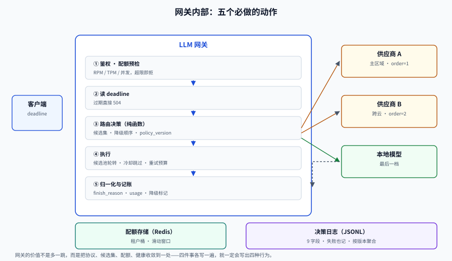

# 网关：把路由做成一层基础设施

如果一个系统里有两个服务各自实现了「选模型 + 重试 + 降级」，那它已经有了两套行为不一致的路由，而且**没有任何人能看到全局**。

网关这一层的价值不是「多一个代理」，而是把四件必须统一的事收敛到一处：**协议、候选集、配额、健康状态**。

## 判据族声明

本页判据族 `MRG-A` ~ `MRG-H`，共 8 条。定义表在第九节。

## 一、网关要收敛的四件事



| 收敛项 | 不收收敛的后果 |
| --- | --- |
| **协议** | 每个 SDK 一套字段映射，换供应商要改业务代码 |
| **候选集** | 每个服务自己写死模型名，新模型上线要改 N 个仓库 |
| **配额** | 各服务独立计数，供应商侧看到的总量永远超标 |
| **健康状态** | 一个服务知道供应商挂了，另一个还在往上撞 |

::: warning 网关不等于「所有请求都多一跳」
流式场景下，网关会引入额外的缓冲风险。要么用**直通转发**（不缓冲、不改写 chunk），要么让网关只做「签发与决策」、数据面直连。这一点在压测时必须单独量：**网关引入的 P99 增加应 < 20ms**。
:::

## 二、统一协议：只统一字段，不统一语义

对外只暴露一套 OpenAI 兼容的 `/v1/chat/completions`，差异在适配层吃掉。真正要维护的是一张**字段映射表**：

| 统一字段 | 供应商差异 | 处理方式 |
| --- | --- | --- |
| `messages[].role` | 有的用 `system`，有的用独立的 `system` 参数 | 适配层转换；无 system 角色的拼到第一条 user 前 |
| `tools` / `functions` | 工具调用格式不同（JSON Schema 位置、并行调用支持） | 选择支持工具调用的模型，不支持则拒绝而非降级 |
| `stream` | SSE 格式、`[DONE]` 标记、usage 是否在最后一帧 | 统一转成 `data: {...}\n\n` + `[DONE]`，usage 缺失时估算并标记 |
| `usage` | 有的返回缓存命中数，有的不返回 | 缺失时用 tokenizer 估算，标记 `usage_estimated=true` |
| `finish_reason` | `length` / `max_tokens` / `stop` 混用 | 归一成 `stop` / `length` / `tool_calls` / `content_filter` |
| `reasoning` 内容 | 有的单独字段，有的混在正文 | 统一放 `reasoning_content`，正文不含思考过程 |

```python
def normalize_response(raw, provider):
    return {
        "id": raw.get("id") or new_id(),
        "model": raw.get("model"),
        "choices": [{
            "index": 0,
            "message": {
                "role": "assistant",
                "content": extract_content(raw, provider),
                "tool_calls": extract_tool_calls(raw, provider),
            },
            "finish_reason": FINISH_MAP[provider].get(raw.get("finish_reason"), "stop"),
        }],
        "usage": normalize_usage(raw, provider),   # 缺失则估算并标记
    }
```

::: danger 统一协议最容易出的三个 bug
1. **把 `finish_reason=length` 当成正常结束**：输出被截断，下游解析半截 JSON。必须显式报错或续写。
2. **stream 的 usage 在最后一帧，但客户端提前断开**：成本统计丢失。要么在服务端聚合，要么断开时按已发送 chunk 估算。
3. **工具调用的并行语义被吞掉**：把多个 `tool_calls` 合并成一个，模型侧的多步规划就废了。
:::

## 三、模型注册表：候选集必须是一份可校验的配置

```yaml
models:
  - name: mid-model
    provider: vendor-a
    upstream: vendor-a/chat-v2
    region: cn-east
    context_window: 128000
    supports: [tools, json_mode, stream]
    price: { input: 0.0, output: 0.0 }   # 相对单位，从配置中心注入
    quota: { rpm: 600, tpm: 400000, max_concurrency: 64 }
    health: { probe: /v1/models, interval: 15s, timeout: 2s }
    tags: [general, cn]
```

注册表要有四条纪律：

1. **能力字段必须可校验**：`supports` 里写了 `tools` 但实际不支持，路由会把带工具的请求发过去，然后 400。
2. **价格是配置不是常量**：单价随时调，写死在代码里就要发版。
3. **每个部署独立健康状态**：同一模型的三个区域是三个部署，不是一个。
4. **配置有版本号**：`registry_version` 写进每次决策日志。

## 四、密钥池与配额：别让一个租户花光所有人

### 共享桶 vs 租户桶（实测）

场景：租户 A 在第 0 秒突发 400 个请求，另外 9 个租户在 10 秒内均匀发 200 个。

| 方案 | 租户 A 放行 | 其他租户放行 |
| --- | --- | --- |
| 共享桶（容量 150，15/s） | 150 / 400 | **150 / 200（25% 被拒）** |
| 租户桶（每租户容量 50，10/s） | 50 / 400 | **200 / 200（0 被拒）** |

共享桶把「一个租户的突发」变成了「所有人一起掉 25%」。租户桶把同样的突发变成了「A 自己 87.5% 被限」——这是**正确的失败方式**。

### 令牌桶的排队陷阱（实测）

容量 100、补充速率 20/s 的桶，在第 0 秒收到 150 个请求：**放行 100、拒绝 50**。如果选择排队而不是拒绝，后 50 个要等到 2.5 秒后才拿到令牌——而客户端 3 秒超时，已经先触发了。**拒绝比排队更友好**，因为客户端可以立刻降级或重试别处。

```python
class TokenBucket:
    def __init__(self, capacity, rate):
        self.capacity, self.rate = capacity, rate
        self.tokens, self.last = float(capacity), 0.0

    def take(self, now, n=1):
        self.tokens = min(self.capacity, self.tokens + (now - self.last) * self.rate)
        self.last = now
        if self.tokens >= n:
            self.tokens -= n
            return True
        return False          # 立即返回，不排队
```

### 三个限流维度必须都在

| 维度 | 为什么单独需要 | 超限动作 |
| --- | --- | --- |
| **RPM**（请求数/分） | 供应商按请求数限流 | 429 + `Retry-After` |
| **TPM**（token/分） | 长上下文请求会把 token 打满，而请求数不高 | 429，且提示「缩短输入」 |
| **并发** | 流式长连接会占满连接池 | 429 或排队（有上限） |

只做 RPM 的系统，会被一个「每次 100k token」的租户打穿。

## 五、探活与半开：健康检查要发真实请求

`GET /v1/models` 返回 200 不代表能推理。探活至少两级：

1. **浅探**：`/v1/models` 或 `/healthz`，15s 一次，只判「服务在不在」。
2. **深探**：每 60s 发一个 1 token 的真实补全，判「能不能推理」。

深探的成本可以忽略（每月几百分钱），但它能提前发现「鉴权过期」「模型下线」「配额耗尽」这三类浅探查不出的问题。

::: tip 探活与熔断的关系
探活决定「要不要把部署放回候选集」，熔断决定「请求失败时要不要继续打它」。两者都要有，且**半开状态应该由熔断器驱动，而不是由探活驱动**——否则探活成功但真实请求仍失败时，会反复打穿。
:::

## 六、自研还是用现成的

| 方案 | 适合 | 不适合 |
| --- | --- | --- |
| **LiteLLM Proxy** | 需要统一协议 + 多供应商 + 预算与配额，且接受 Python 技术栈 | 需要极低延迟（< 10ms 额外开销）或强定制路由算法 |
| **商业 LLM 网关** | 想要开箱的观测、密钥托管、团队权限 | 数据不能出内网 |
| **自研薄网关** | 路由策略高度定制、需要与内部权限/计费深度耦合 | 团队没有精力维护协议适配的长期差异 |
| **SDK 内路由** | 单体应用、只有一两个服务 | 多服务、多语言、需要统一配额 |

若选自研，LiteLLM 的四件事值得直接照抄（都是官方文档里的明确行为）：

| 机制 | 作用 | 自研时的对应实现 |
| --- | --- | --- |
| `order` 逐级降级 | order=1 全失败才走 order=2，每级有自己的重试 | 候选集分层，层内轮转、层间降级 |
| `fallbacks` / `context_window_fallbacks` / 内容策略降级 | 不同错误走不同降级链 | 错误分类矩阵（见 [降级链](../Fallback/index.md)） |
| `allowed_fails` + `cooldown_time` | 失败超阈值即冷却，429 立即冷却 | 部署级熔断器 |
| `max_parallel_requests` | 超限**立即 429**，不排队 | 并发信号量 + 快速失败 |

## 七、配置即代码：注册表的校验清单

上线前对注册表跑一遍校验（一条命令能红）：

```shell
python3 - <<'PY'
import yaml, sys
reg = yaml.safe_load(open("models.yaml"))
errs = []
for m in reg["models"]:
    for k in ("name", "provider", "upstream", "context_window", "quota"):
        if k not in m:
            errs.append(f"{m.get('name','?')} 缺字段 {k}")
    if m.get("context_window", 0) <= 0:
        errs.append(f"{m['name']} context_window 非法")
    if "tools" in m.get("supports", []) and not m.get("tool_protocol"):
        errs.append(f"{m['name']} 声明支持 tools 但没写 tool_protocol")
print("\n".join(errs) if errs else "registry OK")
sys.exit(1 if errs else 0)
PY
```

## 八、一次请求在网关里的完整时序

```text
① 鉴权与租户识别        → 401 / 403，不做降级
② 配额预检（RPM/TPM/并发）→ 429，带 Retry-After，1ms 内返回
③ 读取 deadline          → 已过期直接 504
④ 路由决策（≤ 20ms）     → 选候选、定降级顺序、记 policy_version
⑤ 取部署（跳过冷却中的）  → 全冷却则走 L3/L4
⑥ 调用（含超时与重试预算）→ 失败按分类矩阵处理
⑦ 归一化响应 + 降级标记   → x-degraded / x-route-reason
⑧ 记账（token、成本、延迟）→ 写决策日志
```

第 ② 步在第 ④ 步之前，是刻意的：**配额检查必须比路由便宜**，否则超限请求会先花掉一次路由开销再被拒。

## 九、判据定义表

| 判据 | 约定 | 定错了会怎样 | 怎么验证 |
| --- | --- | --- | --- |
| `MRG-A` | 对外只有一套协议，差异在适配层 | 换供应商要改业务代码 | 业务侧代码里不出现供应商名 |
| `MRG-B` | `finish_reason` 必须归一且截断要显式 | 半截 JSON 被当正常结果 | `length` 有独立错误码或续写逻辑 |
| `MRG-C` | 注册表能力字段可校验 | 声明支持 tools 实际不支持 | 上线前跑校验脚本 |
| `MRG-D` | 价格与配额来自配置，不写死 | 调价要发版 | 代码里无单价常量 |
| `MRG-E` | 配额必须按租户隔离 | 一个租户花光所有人 | 单租户突发时其他租户拒绝率不上升 |
| `MRG-F` | 超限快速拒绝，不排队 | 200ms 拒绝变 30s 超时 | 429 的 P99 < 10ms |
| `MRG-G` | 健康检查分浅探与深探 | 鉴权过期/模型下线发现不了 | 深探每 60s 一次且有指标 |
| `MRG-H` | 每次决策带 `registry_version` 与 `policy_version` | 无法回溯「当时用的是哪套配置」 | 决策日志含两个版本字段 |

## 如何验证

```shell
# ① 租户隔离自检：单租户突发时，其他租户的拒绝率
/Users/cuifendemac/.workbuddy/binaries/python/envs/default/bin/python3 - <<'PY'
class B:
    def __init__(s, cap, rate): s.cap, s.rate, s.t, s.last = cap, rate, float(cap), 0.0
    def take(s, now):
        s.t = min(s.cap, s.t + (now - s.last) * s.rate); s.last = now
        if s.t >= 1: s.t -= 1; return True
        return False
shared = B(150, 15)
a = sum(1 for _ in range(400) if shared.take(0.0))
others = sum(1 for i in range(1, 11) for _ in range(20) if shared.take(float(i)))
print(f"共享桶：A {a}/400，其他租户 {others}/200，拒绝率 {(200-others)/200:.0%}")
per = {k: B(50, 10) for k in ["A"] + [f"B{i}" for i in range(9)]}
a2 = sum(1 for _ in range(400) if per["A"].take(0.0))
o2 = sum(1 for i in range(1, 11) for j in range(20) if per[f"B{j%9}"].take(float(i)))
print(f"租户桶：A {a2}/400，其他租户 {o2}/200，拒绝率 {(200-o2)/200:.0%}")
PY
```

**预期输出**：`共享桶：A 150/400，其他租户 150/200，拒绝率 25%` 与 `租户桶：A 50/400，其他租户 200/200，拒绝率 0%`。判读：**其他租户拒绝率 > 0 就说明没有隔离**。

```shell
# ② 协议归一自检：同一请求打两家供应商，检查关键字段是否同构
for p in vendor-a vendor-b; do
  curl -s -X POST "https://gateway.internal/v1/chat/completions" \
    -H "authorization: Bearer $TOKEN" -H "content-type: application/json" \
    -d "{\"model\":\"mid-model\",\"messages\":[{\"role\":\"user\",\"content\":\"hi\"}],\"provider_hint\":\"$p\"}" \
  | jq '{finish_reason:.choices[0].finish_reason, usage_keys:(.usage|keys)}'
done
# 期望：两家的 finish_reason 都落在 {stop,length,tool_calls,content_filter}，usage 键一致
```

## 参考资料

- [LiteLLM Proxy · Load Balancing](https://docs.litellm.ai/docs/proxy/load_balancing)——`order`、冷却、team 作用域与 `encrypted_content_affinity`
- [LiteLLM · Fallbacks and Retries](https://deepwiki.com/BerriAI/litellm/7.1-fallbacks-and-retries)——三类降级路径
- [网关深入 · 流量管理](../../../Backend/GatewayDeep/TrafficManagement/index.md)——限流算法与灰度
- 下一站：[灰度：策略变更也要放量](../GrayRelease/index.md)
