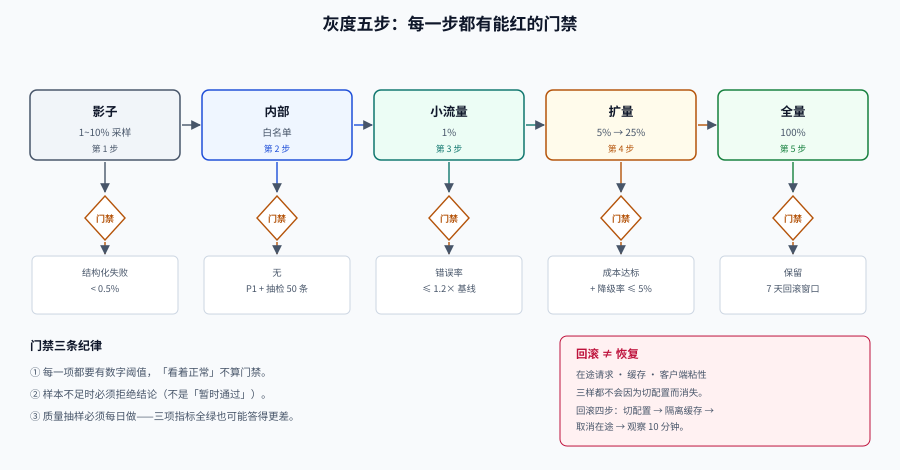

# 灰度：策略变更也要放量

上线一个新模型，改的是一行配置。这一行配置会让全量请求换一个模型——**风险等级和发一次代码发布是一样的**，但多数团队给它的是「改完刷新一下」的待遇。

这一页把「路由策略」当成一次发布来对待：分流怎么分、影子怎么跑、门禁怎么红、回滚为什么经常回不干净。

## 判据族声明

本页判据族 `MRU-A` ~ `MRU-H`，共 8 条。定义表在第八节。

## 一、灰度的对象是策略，不是代码

路由系统里，一次「发布」可以只是：

```yaml
# 这不是代码 diff，但它改变了全量用户拿到的答案
routing:
  version: 2026-10-18.3
  default_tier: mid-model
  downshift_ratio: 0.35     # ← 从 0.20 改到 0.35
  downshift_model: small-model
```

因此**策略配置必须有版本号、必须走灰度、必须可回滚**。三条具体要求：

1. 每次策略变更生成 `policy_version`，写进每条决策日志。
2. 灰度先按比例，再按租户/请求类型扩量。
3. 回滚是「切回上一个 `policy_version`」，不是「改回去再发一次」。

## 二、分流键：决定你能不能相信灰度结果



| 分流键 | 一致性 | 适用 | 风险 |
| --- | --- | --- | --- |
| `user_id` 哈希 | 同一用户始终同一组 | 有状态交互、体验一致性 | 新用户分布可能偏 |
| `tenant_id` 哈希 | 同一租户始终同一组 | B 端产品（租户内体验必须一致） | 大租户会主导结果 |
| `request_id` 哈希 | 每次请求独立 | 无状态、量大的场景 | 同一用户会看到两种行为 |
| 显式白名单 | 完全可控 | 内部员工、种子用户 | 样本有偏 |

::: danger 分流最容易被忽略的三件事
1. **哈希函数要固定**：换一次哈希实现，所有用户的分配都会变，灰度对照就废了。
2. **组别要落库**：只在请求时算哈希，无法回溯「这个用户当时在哪组」。至少要记录 `experiment_id` + `bucket`。
3. **不要用「随机数」分流**：`random() < 0.05` 会让同一用户在两次请求里进不同组，B 端场景直接引发投诉。
:::

## 三、影子流量：不改变用户，先看数据

影子（shadow）把真实请求**复制一份**发给新策略，结果只记录不返回。

| 维度 | 影子流量 | 灰度流量 |
| --- | --- | --- |
| 用户感知 | 无 | 有（5% 用户真实使用） |
| 成本 | **2×**（每次请求跑两遍） | 1× |
| 能测什么 | 质量差异、格式兼容、延迟 | 真实体验、留存、投诉 |
| 不能测什么 | 用户反馈、转化 | 极端个例（样本少） |
| 建议比例 | 1%~10%，只在低峰 | 1% → 5% → 25% → 50% → 100% |

影子的三条纪律：

1. **必须采样**：1% 采样已经能在一天内积累几千条对照，全量影子等于成本翻倍。
2. **必须比对**：不比对的影子流量是纯浪费。至少比四项：`finish_reason` 分布、输出长度分布、结构化字段的合法性、延迟分布。
3. **不得写副作用**：影子请求不能触发工具调用、不能扣费、不能发消息。

## 四、五步放量与门禁

| 步骤 | 比例 | 停留 | 门禁（任一不达标即回滚） |
| --- | --- | --- | --- |
| 0. 影子 | 1%~10% 采样 | 4~24h | 结构化失败率 < 0.5%；输出长度分布偏移 < 20% |
| 1. 内部 | 白名单 | 1 天 | 无 P1 问题；人工抽检 50 条 |
| 2. 小流量 | 1% | 1 天 | 错误率 ≤ 基线 × 1.2；P99 ≤ 基线 × 1.2 |
| 3. 扩量 | 5% → 25% | 各 1 天 | 成本/请求 ≤ 预算；降级率 ≤ 5% |
| 4. 半量 | 50% | 1 天 | 质量抽样不劣于基线 3 个百分点 |
| 5. 全量 | 100% | — | 保留 7 天快速回滚窗口 |

::: warning 「放量看一天」的前提是量够
每天 10 万请求、1% 放量 = 1000 条。如果基线错误率是 2%，想检出「涨到 3%」这种 1 个百分点的差异，样本量需要约 14,400 条（`n ≈ 16p(1-p)/δ²`）。**1000 条只能告诉你「没有灾难性故障」，不能告诉你「质量没退步」。**
:::

样本量速查（`δ` 为想检出的绝对差异）：

| 基线 | δ=3pp | δ=1pp | δ=0.3pp |
| --- | --- | --- | --- |
| 错误率 10% | 1,601 | 14,401 | 160,001 |
| 错误率 2% | 350 | 3,137 | 34,844 |
| 转化率 1% | 176 | 1,584 | 17,600 |

**量不够时的正确做法**：不要放量到 5% 然后看一天就下结论；要么延长观察窗口，要么用影子流量 + 离线比对。

## 五、门禁指标：四个必看，两个加分

| 指标 | 计算 | 阈值示例 | 为什么必须看 |
| --- | --- | --- | --- |
| **错误率** | 5xx + 超时 / 总请求 | ≤ 基线 × 1.2 | 最直接 |
| **P99 延迟** | 路由后到首 token / 到完成 | ≤ 基线 × 1.2 | 新模型可能更慢 |
| **每请求成本** | 总成本 / 请求数（含重试） | ≤ 预算 | 换模型的主要动机 |
| **降级率** | `degrade_total` / 总请求 | ≤ 5% | 掩盖故障的头号指标 |
| 质量抽样 | 每日 100~200 条人工/评测集打分 | 不劣于基线 3pp | 唯一能发现「静默变傻」的指标 |
| 格式合法率 | 结构化输出通过 schema 的比例 | ≥ 99% | 换模型最常见的回归 |

::: danger 只盯错误率会漏掉最危险的情况
新模型可能**错误率更低、延迟更低、成本更低，但答得更差**。这三项全绿的系统，可以在两周内把业务指标做下去而没人发现。质量抽样不是可选项。
:::

## 六、回滚：为什么不等于恢复

「切回上一个版本」只影响**新请求**。三样东西还在旧状态里：

| 残留 | 影响 | 处理 |
| --- | --- | --- |
| **在途请求** | 已经发出去的新模型请求会继续返回 | 设最大在途时间，超过即取消 |
| **缓存** | 新模型写入的语义缓存会继续被命中 | 缓存 key 带 `policy_version`，回滚时隔离 |
| **客户端粘性** | 客户端可能缓存了「当前模型」 | 响应头带 `x-policy-version`，客户端不缓存 |

所以回滚的完整动作是四步：**切配置 → 隔离缓存 → 取消在途 → 观察 10 分钟**。

```python
def rollback(to_version):
    set_active_policy(to_version)                       # 1. 切配置
    cache.namespace = f"policy:{to_version}"            # 2. 隔离缓存
    cancel_inflight(older_than_ms=5000)                 # 3. 取消在途
    alert.info(f"rolled back to {to_version}")          # 4. 观察窗口开始
```

::: tip 回滚时间要写成 SLO
「配置中心到网关生效 ≤ 30s、缓存隔离 ≤ 5s、在途取消 ≤ 1s」——这三个数要能实测。做不到的系统，回滚就是一句口号。
:::

## 七、把门禁写成脚本

门禁不能靠人看板子。一个能红的门禁脚本长这样：

```python
LIMITS = {
    "error_rate_ratio": 1.2,     # 相对基线
    "p99_latency_ratio": 1.2,
    "degrade_rate": 0.05,
    "cost_per_req_ratio": 1.0,
}

def gate(current, baseline):
    fails = []
    if current["error_rate"] > baseline["error_rate"] * LIMITS["error_rate_ratio"]:
        fails.append(f"error_rate {current['error_rate']:.3%} > 1.2x baseline")
    if current["p99_ms"] > baseline["p99_ms"] * LIMITS["p99_latency_ratio"]:
        fails.append(f"p99 {current['p99_ms']:.0f}ms > 1.2x baseline")
    if current["degrade_rate"] > LIMITS["degrade_rate"]:
        fails.append(f"degrade_rate {current['degrade_rate']:.1%} > 5%")
    if current["cost_per_req"] > baseline["cost_per_req"] * LIMITS["cost_per_req_ratio"]:
        fails.append("cost per request above budget")
    if current["samples"] < baseline["min_samples"]:
        fails.append("sample size too small — do not conclude")
    return fails
```

注意最后一条：**样本不足时必须拒绝出结论**，而不是「暂时通过」。这是门禁脚本和看板的本质区别。

## 八、判据定义表

| 判据 | 约定 | 定错了会怎样 | 怎么验证 |
| --- | --- | --- | --- |
| `MRU-A` | 策略配置必须有版本号并进灰度 | 一行配置改动全量生效 | 决策日志含 `policy_version` |
| `MRU-B` | 分流键必须稳定且可回溯 | 灰度结果无法解释 | 日志含 `experiment_id` + `bucket` |
| `MRU-C` | 影子流量必须采样、必须比对、不得有副作用 | 成本翻倍且无结论 | 影子开关含采样率与只读标记 |
| `MRU-D` | 每步放量必须有量化门禁 | 靠感觉放量 | 门禁脚本可执行且能红 |
| `MRU-E` | 样本不足时门禁必须拒绝结论 | 用 1000 条样本断定「没退步」 | 门禁输出含 `samples` 与最小样本判断 |
| `MRU-F` | 质量抽样必须每日执行 | 三项指标全绿但答得更差 | 有质量抽样记录与打分 |
| `MRU-G` | 回滚必须处理在途、缓存、粘性 | 回滚后仍看到新模型结果 | 回滚后 10 分钟内 `x-policy-version` 全为旧版本 |
| `MRU-H` | 回滚时间要写成可测的 SLO | 回滚是口号 | 有三个实测数字（配置/缓存/在途） |

## 如何验证

```shell
# ① 分流稳定性：同一 user 连续 100 次必须落在同一组
/Users/cuifendemac/.workbuddy/binaries/python/envs/default/bin/python3 - <<'PY'
import hashlib
def bucket(uid, salt="routing-v3"):
    h = hashlib.sha256(f"{salt}:{uid}".encode()).hexdigest()
    return int(h[:8], 16) % 100
g = {bucket("u-10086") for _ in range(100)}
print("同一用户的分桶集合", g, "稳定" if len(g) == 1 else "不稳定")
dist = [bucket(f"u-{i}") for i in range(10000)]
print(f"5% 组实际占比 {sum(1 for b in dist if b < 5)/len(dist):.2%}")
PY
```

**预期输出**：`同一用户的分桶集合 {63} 稳定` 与 `5% 组实际占比 5.02%`。判读：占比偏离超过 0.3 个百分点说明哈希分布不均，需要换 salt 或换哈希。

```shell
# ② 门禁自检：用一组「必然不达标」的数字跑一遍，确认脚本会红
python3 - <<'PY'
cur = {"error_rate": 0.031, "p99_ms": 2100, "degrade_rate": 0.08,
       "cost_per_req": 1.4, "samples": 800}
base = {"error_rate": 0.02, "p99_ms": 1500, "cost_per_req": 1.2, "min_samples": 14000}
fails = []
if cur["error_rate"] > base["error_rate"] * 1.2: fails.append("error_rate")
if cur["p99_ms"] > base["p99_ms"] * 1.2: fails.append("p99")
if cur["degrade_rate"] > 0.05: fails.append("degrade")
if cur["cost_per_req"] > base["cost_per_req"]: fails.append("cost")
if cur["samples"] < base["min_samples"]: fails.append("samples")
print("FAIL:", fails)
PY
# 期望：FAIL: ['error_rate', 'p99', 'degrade', 'cost', 'samples'] —— 五项全红，脚本才算有效
```

## 参考资料

- [RouteLLM](https://arxiv.org/abs/2406.18665)——阈值变更时的质量评估方法
- [观测驱动开发 · 灰度度量](../../../Tools/ObservabilityDriven/GrayMetrics/index.md)——样本量与自动回滚的相邻专题
- [自动部署与回滚](../../../Tools/CICD/DeployRollback/index.md)——发布分级、回滚与冻结期的工程约定
- 下一站：[可观测：一次决策留下的九个字段](../Observability/index.md)
