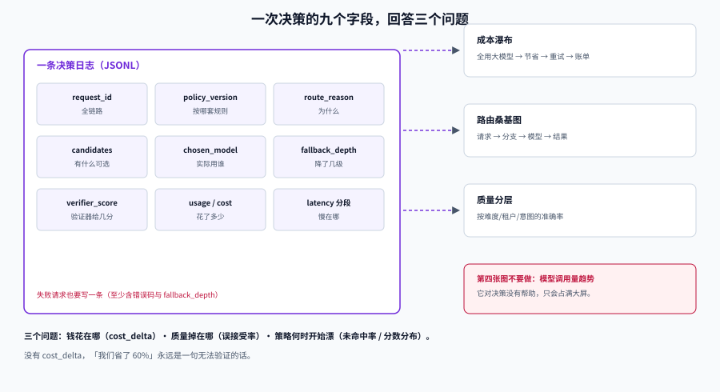

# 可观测：一次决策留下的九个字段

路由出问题时，最常见的一句话是：「这条请求为什么走了小模型？」——如果日志里只有 `model=small`，这个问题永远答不了。

这一页定义**一次决策必须留下什么**，以及怎么用这些字段回答三个问题：钱花在哪、质量掉在哪、策略什么时候开始漂。

## 判据族声明

本页判据族 `MRV-A` ~ `MRV-H`，共 8 条。定义表在第八节。



## 一、九个字段：少一个就答不了问题

```json
{
  "request_id": "req_01J9Z3K2",
  "policy_version": "routing-2026-10-18.3",
  "route_reason": "classifier_p_hard=0.71",
  "candidates": ["mid-model", "large-model"],
  "chosen_model": "large-model",
  "fallback_depth": 0,
  "verifier_score": null,
  "usage": {"in": 1840, "out": 220, "cached": 1024},
  "cost_units": 0.42,
  "latency_ms": {"route": 11, "queue": 3, "model": 1284, "total": 1301},
  "degraded": false
}
```

| 字段 | 回答什么问题 | 缺失的后果 |
| --- | --- | --- |
| `request_id` | 这条请求的全链路在哪 | 无法与 trace 关联 |
| `policy_version` | 当时按哪套规则跑的 | 策略变更后无法归因 |
| `route_reason` | 为什么选它 | 无法解释、无法调阈值 |
| `candidates` | 当时有哪些可选 | 无法判断「是不是没得选」 |
| `chosen_model` | 实际用了谁 | 最基本的 |
| `fallback_depth` | 降了几级 | 分不清「策略降档」与「故障降级」 |
| `verifier_score` | 级联时验证器给了多少分 | 无法校准阈值 |
| `usage` + `cost_units` | 这条花了多少 | 成本无法归因到决策 |
| `latency_ms` 分段 | 慢在哪一段 | 只会说「模型慢」 |

::: danger 三个让字段「看起来有、实际没用」的写法
1. **`route_reason` 写成 `"rule"`**：等于没写。必须是可判定的值，如 `rule:downgrade_ratio`、`classifier_p_hard=0.71`。
2. **`cost_units` 用估算值但不标记**：估算与账单对不上时，没人知道该信谁。必须带 `cost_estimated=true`。
3. **只在成功请求上记日志**：失败请求恰恰是最需要归因的。失败也要写一条（至少含错误码与 `fallback_depth`）。
:::

## 二、成本归因：三个层次，三种问题

| 层次 | 指标 | 回答的问题 | 计算方式 |
| --- | --- | --- | --- |
| **决策层** | `cost_delta` | 这次选择比「全用大模型」省了多少 | `cost(chosen) - cost(large)` |
| **请求层** | `cost_units` | 这条请求真实花了多少（含重试） | 所有尝试的 token × 单价之和 |
| **租户层** | `cost_by_tenant` | 哪个客户在花钱 | 按 `tenant_id` 聚合 `cost_units` |

**决策层的 `cost_delta` 是路由系统唯一能自证价值的指标。** 没有它，「我们省了 60%」永远是一句无法验证的话。

```sql
-- 按策略版本看「省了多少」与「质量保住没有」
SELECT policy_version,
       count(*)                                        AS requests,
       sum(cost_units)                                 AS cost,
       sum(cost_delta)                                 AS saved_vs_large,
       avg((verifier_score IS NOT NULL)::int)          AS cascade_share,
       avg(degraded::int)                              AS degrade_rate
FROM route_decisions
WHERE ts >= now() - interval '1 day'
GROUP BY policy_version
ORDER BY requests DESC;
```

## 三、四个路由质量指标

| 指标 | 定义 | 健康区间 | 异常含义 |
| --- | --- | --- | --- |
| **路由准确率** | 分到「该档」的请求占比（用离线评估集） | ≥ 85% | 信号失效或分布漂移 |
| **升级率 / CPT** | 升到最高档的请求占比 | 按预算定（如 10%~25%） | 突然升高 = 小模型退化或验证器变严 |
| **误接受率** | 小模型答错但被采纳的比例 | 客服 < 2%；资金/权限 < 0.5% | 验证器失效（最危险） |
| **降级率** | `degraded=true` 的占比 | < 5% | 上游不健康，或降级链被误触发 |

::: tip 四个指标要一起看
- 升级率↑ + 误接受率↑：验证器变宽了（有人调了阈值）。
- 升级率↑ + 成本↑ + 质量不变：验证器变严了，白花钱。
- 降级率↑ + 错误率不变：降级链在兜住故障，但没人知道。
- 路由准确率↓ + 请求分布不变：模型侧变了（换了版本、改了默认参数）。
:::

## 四、漂移：三类信号，越早越好

路由策略会**静默过期**，因为业务在变、模型在变、用户在变。三类最早出现的信号：

| 信号 | 观测方式 | 阈值示例 | 处理 |
| --- | --- | --- | --- |
| **未命中率上升** | 语义路由「无路由命中」占比 | 7 日均值 +50% | 补路由样例 |
| **分数分布位移** | 验证器分数的直方图（按周对比） | PSI > 0.2 | 重标定阈值 |
| **分桶质量下滑** | 每个难度桶的抽样准确率 | 任一桶 -5pp | 重训分类器或调阈值 |

分数分布的位移用 PSI（Population Stability Index）最直观：

```python
def psi(base_hist, curr_hist, eps=1e-6):
    """两个归一化直方图的 PSI；> 0.2 视为显著位移。"""
    return sum((c - b) * __import__("math").log((c + eps) / (b + eps))
               for b, c in zip(base_hist, curr_hist))
```

## 五、三张看板，够用

| 看板 | 图 | 用途 |
| --- | --- | --- |
| **成本瀑布** | 全用大模型的成本 → 路由节省 → 重试增加 → 降级节省 → 实际账单 | 一眼看出钱被谁省/谁花 |
| **路由分布** | 桑基图：请求 → 策略分支 → 模型 → 结果（成功/降级/失败） | 定位「哪条分支在漏」 |
| **质量分层** | 按难度/租户/意图分组的准确率与误接受率 | 发现结构性退化 |

不要做第四张「模型调用量趋势图」——它对决策没有帮助，只会占满大屏。

## 六、告警：配额比规则更重要

| 规则 | 阈值 | 级别 |
| --- | --- | --- |
| 误接受率超红线 | 客服 > 2% 持续 30min | P1 |
| 降级率突增 | > 5% 持续 10min | P1 |
| 升级率突增 | 相对 7 日均值 × 2 | P2 |
| 成本/请求超预算 | > 预算 × 1.2 持续 1h | P2 |
| 未命中率上升 | 相对 7 日均值 × 1.5 | P3（工单） |

**配额**：每服务 ≤ 7 条告警、P0/P1 ≤ 2 条。判断告警质量看**介入比**（收到告警后真的做了动作的比例）：低于 20% 是噪声，高于 80% 且每周超过 20 条是数量问题。

## 七、采样：日志成本也会失控

一条决策日志约 300~500 字节。100 万请求/天 = 300~500MB/天，30 天就是 15GB。三个控制手段：

1. **全量记字段精简版**（9 个必需字段），**采样记完整版**（含 messages 摘要）。
2. **失败与降级请求 100% 记录**，成功请求按 10% 采样。
3. **日志保留分层**：7 天热存（可查询）、90 天冷存（可导出）、之后只留聚合指标。

## 八、判据定义表

| 判据 | 约定 | 定错了会怎样 | 怎么验证 |
| --- | --- | --- | --- |
| `MRV-A` | 九个字段必须齐全，失败请求也要记 | 故障无法归因 | 抽查日志，字段缺失率为 0 |
| `MRV-B` | `route_reason` 必须可判定 | 等于没写 | 抽查 20 条，值都能对应到规则/分数 |
| `MRV-C` | `policy_version` 必须写入每条决策 | 策略变更后无法归因 | 日志中该字段非空率 100% |
| `MRV-D` | `cost_delta` 必须可计算 | 无法自证省了多少钱 | 报表有「相对全用大模型」一列 |
| `MRV-E` | 误接受率必须单独监控 | 静默变傻无人发现 | 有该指标且有红线告警 |
| `MRV-F` | 漂移检测至少覆盖未命中率与分数分布 | 策略静默过期 | 两个指标有周对比 |
| `MRV-G` | 告警有配额与介入比复盘 | 告警疲劳 | 每服务 ≤ 7 条，介入比被统计 |
| `MRV-H` | 日志采样策略显式且失败全量 | 成本失控或无法排查 | 采样率写在配置里 |

## 如何验证

```shell
# ① 字段齐全率：九个必需字段的缺失率
jq -r 'to_entries[] | select(.value == null) | .key' route.jsonl \
  | sort | uniq -c | sort -rn
# 期望：无输出（全部非空）；若有输出说明该字段在部分分支未赋值

# ② 成本归因：按策略版本对比「相对全用大模型」的节省
jq -s 'group_by(.policy_version) | map({
          v: .[0].policy_version,
          n: length,
          cost: (map(.cost_units) | add),
          saved: (map(.cost_delta) | add)
        })' route.jsonl
```

**预期输出**：每个 `policy_version` 一组，`saved` 为负值表示这一版比全用大模型还贵——出现负值必须先查是不是重试或输出变长导致的。

```sql
-- ③ 误接受率：验证器放过但答案错的比例（需要标注回流）
SELECT date_trunc('day', d.ts) AS day,
       count(*) FILTER (WHERE l.correct = false AND d.accepted = true)::float
         / nullif(count(*) FILTER (WHERE d.accepted = true), 0) AS false_accept_rate
FROM route_decisions d
JOIN labels l USING (request_id)
GROUP BY 1 ORDER BY 1 DESC LIMIT 7;
```

## 参考资料

- [LLM 应用观测 · 成本](../../LLMObservability/Cost/index.md)——账单口径与归集
- [LLM 应用观测 · 链路追踪](../../LLMObservability/Tracing/index.md)——span 结构与通用规范
- [观测驱动开发 · 指标先行](../../../Tools/ObservabilityDriven/MetricsFirst/index.md)——口径与基数控制
- 下一站：[实战：给客服问答接一层路由网关](../Practice/index.md)
