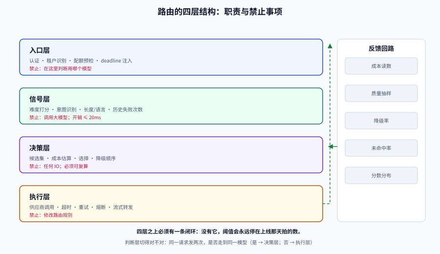

# 总览：三个约束与四层结构

模型路由这件事，**大多数失败不是算法失败，而是定位失败**：把「省钱的开关」放在了错误的层、用了一个测不出来的信号、或者干脆没有降级路径。

这一页给出三样东西：路由到底在解什么约束、这层东西应该长在哪、以及五种「看起来能用但一定出事」的失败模式。

## 判据族声明

本页判据族 `MRO-A` ~ `MRO-H`，共 8 条。定义表在第七节。

## 一、三个约束，缺一个就不用做路由

路由的每一次决策，都在同时挤三个约束：

| 约束 | 可测的形式 | 典型预算 | 谁在盯 |
| --- | --- | --- | --- |
| **成本** | 每请求单位成本、每答对一题成本、月度账单 | 比「全用大模型」低 50%~80% | 业务负责人 |
| **延迟** | P50 / P95 / 首 token 时间 | 交互式问答 P95 ≤ 3s；路由自身额外开销 ≤ 20ms | 体验负责人 |
| **确定性** | 同一请求是否稳定路由到同一档、质量下限是否守住 | 质量保持率 ≥ 95% 的「全用大模型」 | 质量负责人 |

三个约束的关系不是「都要满足」，而是**必须有一个是硬约束**：

- 硬约束是成本 → 走**级联**（先便宜后贵，用验证器卡关）：省得最多，但每次调用次数 > 1。
- 硬约束是延迟 → 走**静态分档 + 并发对冲**：路由判断必须便宜（不能调一次模型来判断该调哪个模型）。
- 硬约束是质量 → 走**只升不降**：默认大模型，只有明确命中「简单意图白名单」时才降档。

::: danger 三个最常见的定位错误
1. **把路由写成「分类再调用」两次模型调用**——用一次大模型判断该用哪个模型，成本直接翻倍，而且延迟多一段。路由信号的预算必须写死：**≤ 20ms 且不调用大模型**。
2. **用「模型自评置信度」当验证器**——模型对自己错的答案同样自信。验证器要么是独立的小模型/规则，要么是结构化约束校验（见 [成本与质量](../CostQuality/index.md)）。
3. **在业务代码里写路由分支**——每个服务一套阈值、一套降级、一套日志，三个月后没人说得清线上到底在按什么规则跑。路由必须收敛成**一层**（见 [网关](../Gateway/index.md)）。
:::

## 二、为什么单模型一定不够

对 2000 条合成分层请求（55% 简单 / 30% 中等 / 15% 困难）做一次算术。三档模型的相对单位成本取 **1 : 5 : 22**；小模型（S）的分层准确率取简单 0.94 / 中等 0.70 / 困难 0.35，加权后 `0.55×0.94 + 0.30×0.70 + 0.15×0.35 = 0.7795`，即表里的 **0.779**（四舍五入，可复算）；M 与 L 的 0.888 / 0.961 是**假设的整体准确率**。最后一列等于 `单位成本 ÷ 准确率`，三格分别是 1.28 / 5.63 / 22.89：

| 策略 | 单位成本/请求 | 准确率 | 每答对一题的成本 |
| --- | --- | --- | --- |
| 全用 S（小） | 1.0 | 0.779 | 1.28 |
| 全用 M（中） | 5.0 | 0.888 | 5.63 |
| 全用 L（大） | 22.0 | 0.961 | 22.90 |

三个读数值得盯着看：

1. **成本差 22 倍，准确率只差 18 个百分点**。这就是路由存在的全部理由——不是大模型不好，是**大部分请求不需要它**。
2. **「每答对一题的成本」比「每请求成本」更能说明问题**：小模型便宜 22 倍，但答对的题也少，折算下来只便宜 18 倍。做预算时用这个分母，才不会被「单价降了 90%」骗过去。
3. **0.779 这个数不能直接给业务看**。它意味着每 5 个请求就有 1 个错，而这 1 个错的分布是**结构性的**：简单题错 6%，困难题错 65%。

同一批请求上，级联策略（S → M → L，验证器阈值 0.60）的读数是：**单位成本 5.50（0.25×），准确率 0.974，平均调用 1.48 次**。换算下来，用四分之一的钱买到了比全用大模型略高的准确率——原因是不同模型的错误不在同一批题上，验证器把「小模型答错」的题挑出来升级了。

这不是「级联一定更好」，而是**质量不是单峰函数**：只要验证器比「随便猜」准，混合策略就可能超过任何单一模型。推导与阈值扫描见 [成本与质量](../CostQuality/index.md)。

## 三、四层结构：路由该长在哪



| 层 | 职责 | 不该做的事 | 失败表现 |
| --- | --- | --- | --- |
| **入口层** | 认证、租户识别、配额预检、deadline 注入 | 不在这里判断「用哪个模型」 | 配额算在路由之后，贵的请求先花完钱再被拒 |
| **信号层** | 抽取路由信号：任务类型、长度、语言、租户档位、历史失败次数 | 不调用大模型；单次信号开销 ≤ 20ms | 信号要 300ms，整条链路 P95 被它拖垮 |
| **决策层** | 按策略选候选、算成本差、定降级顺序 | 不做 IO；决策必须可复算（同一输入同一输出） | 决策里查了一次远程配置，配置抖动导致路由抖动 |
| **执行层** | 调供应商、超时、重试、熔断、降级、流式转发 | 不在这里改路由规则 | 每个 SDK 自己重试三次，叠加成九次 |

四层之上还有一条**反馈回路**：执行结果（成功/失败/质量分/实际成本）回流到信号层与决策层，用于标定阈值和发现漂移。没有这条回路的系统，阈值会永远停在「上线那天拍的那个数」。

::: tip 一个判断层是否切对的机械方法
把「同一个请求发两次，会不会走到同一个模型」当成断言。如果答案依赖「当前时刻哪家供应商健康」，那它属于**执行层**；如果依赖「这个请求本身有多难」，那它属于**决策层**。两层混在一起时，灰度就没法做——你无法判断效果变化是策略变了还是供应商变了。
:::

## 四、五种失败模式

这五处都不会报错，只会让系统「一直差一点」。

### 失败模式 1：成本下降了，但质量下降得更多

典型的错法是「按请求长度路由」——短请求给小模型。但**短不等于简单**：「证明 √2 是无理数」只有 12 个字。

对策：路由信号必须与「答对概率」相关，而不是与「请求长度」相关。相关性要在评估集上量出来（AUC 或分桶准确率），见 [策略谱系](../Strategy/index.md)。

### 失败模式 2：省下的钱被重试吃回去

路由到便宜模型后失败率上升，重试次数变成 2~3 次。**重试放大不是线性的**：单次成功率 0.7、最多 3 次尝试时，期望调用次数是 1.39；而如果容量只留了 20% 余量，这个放大直接把系统推过 100% 利用率（实测表见 [超时、重试与对冲](../TimeoutBudget/index.md)）。

对策：**重试预算与路由预算一起算**。省钱的策略必须把「多出来的调用次数」计入成本模型。

### 失败模式 3：降级路径从未被执行过

降级代码写了，但一年只在一次故障里跑过——那次跑挂了，因为它依赖的配置项早被删了。

对策：降级路径必须有**主动演练开关**（强制降级 1% 流量），并且降级结果带标记（见 [降级链](../Fallback/index.md)）。

### 失败模式 4：多供应商只是换了个域名

三家供应商，两家跑在同一个云、共用同一个 DNS、同一份证书、同一个上游模型家族。主供应商挂的时候，另外两家一起挂。

对策：算**共因故障**，不要算独立可用性。三个 99.9% 的独立组件串起来是 99.9999999%，但加一个 0.5% 的共因项就掉到 99.5%——见 [降级链](../Fallback/index.md) 的算术。

### 失败模式 5：路由决策不可复算

线上出了质量问题，你想知道「这条请求当时为什么走了小模型」，结果日志里只有 `model=gpt-small`，没有策略版本、没有信号值、没有候选集。

对策：一次决策落 9 个字段（见 [可观测](../Observability/index.md)），并且**策略配置要有版本号**。

## 五、三十秒决策树

```text
你的请求难度分布宽吗？（最难的 10% 与最简单的 50% 之间，小模型准确率差 > 20 个百分点）
├─ 不宽 → 不做路由；把力气花在压缩上下文与缓存上（见 ../LLMApp/CostRateLimit）
└─ 宽
   ├─ 延迟预算是硬约束（P95 ≤ 2s）吗？
   │  ├─ 是 → 静态分档 + 意图白名单；验证器只能做异步抽样，不能卡在链路上
   │  └─ 否 → 级联（小 → 中 → 大），验证器同步卡关
   └─ 有多个供应商吗？
      ├─ 有 → 路由层同时承担降级（同一层做两件事，注意别互相污染）
      └─ 没有 → 降级链只能到「同模型换区域 / 缓存 / 模板」
```

决策树只在两个地方分支：**难度分布是否够宽**、**延迟是否硬约束**。其余维度（用不用向量、用不用学习型路由器）都是这两个分支之后的实现细节。

## 六、什么时候不该做路由

| 判据 | 现象 | 先做什么 |
| --- | --- | --- |
| 请求同质化 | 95% 的请求是同一类短问答 | 直接选一档中间模型，把预算花在缓存上 |
| 量太小 | 每天几百次调用 | 路由的维护成本高于省下的钱（一次配置错误就是事故） |
| 没有评估集 | 说不出「质量保持率」 | 先建 200 条带标签的请求，见 [成本与质量](../CostQuality/index.md) |
| 质量不可测 | 输出是开放创作，没有对错 | 用人工抽样 + 成对比较，且不做自动降档 |
| 只有一个供应商 | 降级无路可走 | 先解决「第二家」，再谈路由 |

## 七、判据定义表

| 判据 | 约定 | 定错了会怎样 | 怎么验证 |
| --- | --- | --- | --- |
| `MRO-A` | 路由必须有**一个硬约束**，另外两个是软约束 | 三个都要最优，最后三个都不达标 | 设计文档里写明硬约束是成本/延迟/质量中的哪一个 |
| `MRO-B` | 路由信号开销 ≤ 20ms 且不得调用大模型 | 省下的钱被路由自身吃掉 | 链路耗时分解里有 `route_ms` 一项，且 < 20 |
| `MRO-C` | 四层职责分离，执行层不得修改路由规则 | 灰度无法归因，故障无法定位 | 决策日志含 `policy_version`，执行层日志不含策略字段 |
| `MRO-D` | 重试预算计入成本模型 | 省钱策略被重试吃回去 | 成本报表同时给出「首次调用」与「含重试」两个数 |
| `MRO-E` | 降级路径必须有主动演练开关 | 降级代码从未被执行过 | 配置里有 `force_degrade_ratio`，且能一键开 |
| `MRO-F` | 多供应商必须算共因故障 | 切换过去也是挂 | 故障预案里有共因清单（DNS/证书/配额/同上游） |
| `MRO-G` | 每次决策可复算：输入 + 策略版本 → 同一结果 | 线上问题无法复盘到规则 | 用日志里的信号值重放决策函数，结果一致 |
| `MRO-H` | 有明确的「不做路由」止损判据 | 在同质化请求上持续投入 | 评审记录里有第六节表格的核对结论 |

## 如何验证

```shell
# ① 你这批请求的难度分布，够不够支撑路由
/Users/cuifendemac/.workbuddy/binaries/python/envs/default/bin/python3 - <<'PY'
# 三档模型的相对单位成本与分难度准确率（替换成你自己的评估集读数）
tiers = {"S": (1.0, {"easy": .94, "medium": .72, "hard": .35}),
         "M": (5.0, {"easy": .97, "medium": .90, "hard": .62}),
         "L": (22.0, {"easy": .98, "medium": .95, "hard": .86})}
mix = {"easy": .55, "medium": .30, "hard": .15}
for t, (cost, acc) in tiers.items():
    a = sum(mix[d] * acc[d] for d in mix)
    print(f"{t}: 期望准确率 {a:.3f}  每请求成本 {cost:5.1f}  每答对一题 {cost/a:6.2f}")
gap = sum(mix[d] * (tiers["L"][1][d] - tiers["S"][1][d]) for d in mix)
print(f"大小模型的期望差距 = {gap*100:.1f} 个百分点（< 10 个百分点不建议做路由）")
PY
```

**预期输出**：`S: 期望准确率 0.779 …`、`L: 期望准确率 0.961 …`、`大小模型的期望差距 = 18.2 个百分点`。判读要点：**差距小于 10 个百分点时，路由的收益不足以覆盖一层基础设施的维护成本**。

```shell
# ② 路由自身的开销占比：拿真实链路耗时算一遍
/Users/cuifendemac/.workbuddy/binaries/python/envs/default/bin/python3 - <<'PY'
model_ms, route_ms = 1400, 18
print(f"路由开销占端到端 {route_ms/(model_ms+route_ms)*100:.2f}%")
print("判读：超过 3% 时先优化信号抽取，而不是继续加规则")
PY
```

**预期输出**：`路由开销占端到端 1.27%` 与判读提示。

## 与「端侧推理与模型量化」专题的分工（第 175 天补充）

| 那边回答什么 | 本页回答什么 |
| --- | --- |
| 跨**设备边界**的路由：合规 → 能力 → 网络 → 置信度 → 预算，五道闸门有固定顺序 | 服务端**多模型之间**的路由策略谱系（规则 / 学习型）与成本质量权衡 |
| 端侧「不可用」的判定（内存不足、后端缺失、模型未就绪） | 模型「不可用」的判定（超时、限流、5xx） |
| 离线队列的幂等键与 TTL | 降级链与对冲请求 |

**结论**：本页的路由发生在「一个机房内的多个模型」之间；端云路由多了一个**「网络可能根本没有」**的前提，所以它的第一道闸门是合规、第二道是能力，而不是成本。

**一条本页特有的坑**：端云路由里「流量预算」的结论会随时间反转——**首次使用时云端更省流量**（只传几 KB 文本），**长期使用端侧更省**（模型只下一次）。把「端侧省流量」写成无条件结论，会在冷启动场景给出相反的建议。

## 参考资料

- [RouteLLM](https://arxiv.org/abs/2406.18665)——强弱模型路由的评测口径（CPT / APGR）
- [FrugalGPT](https://arxiv.org/abs/2305.05176)——级联 + 验证器的原始方法
- [LiteLLM Proxy · Load Balancing](https://docs.litellm.ai/docs/proxy/load_balancing)——部署级优先级与冷却的工程实现
- 下一站：[策略谱系：从规则到学习型路由](../Strategy/index.md)
