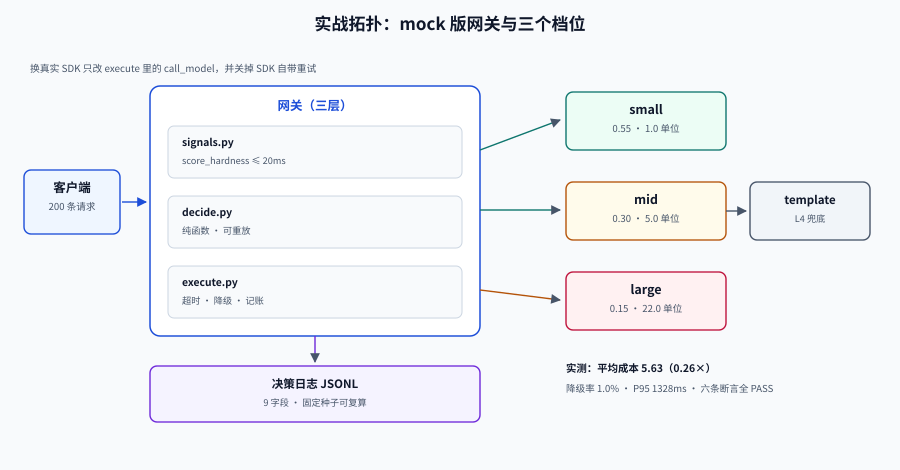

# 实战：给客服问答接一层路由网关

前面八页讲的都是零件。这一页把它们装成一台能转的机器：一个**不依赖任何 API Key** 的路由网关骨架，用 mock provider 模拟延迟与失败，跑出真实的分布与验收结论。

读者照着做，能在本地 10 分钟内得到一个「能打印调用分布、降级率、成本、P95」的系统，然后把 mock 换成真实 SDK。

## 判据族声明

本页判据族 `MRP-A` ~ `MRP-H`，共 8 条。定义表在第八节。



## 一、目标与口径

| 项 | 取值 | 说明 |
| --- | --- | --- |
| 场景 | 客服问答（有标准话术、有工具调用、少量复杂诊断） | 请求难度分布宽，适合路由 |
| 候选模型 | `small` / `mid` / `large` 三档 + `template` 兜底 | 相对成本 1 : 5 : 22 |
| 硬约束 | 成本（≤ 全用大模型的 40%） | 软约束：P95 ≤ 1.5s、质量保持 ≥ 95% |
| 请求量 | 200 条（验收脚本内置） | 真实环境按比例放大 |
| 验证方式 | 本地脚本 + 断言 | 不需要网络与密钥 |

::: tip 为什么先用 mock
路由系统的绝大部分 bug 不在模型调用上，而在**决策、降级、记账**这三处。用 mock 能把这些逻辑的验证成本降到零，而且结果**可重复**（固定随机种子）。等逻辑对了再换真实 SDK，排查面小一个数量级。
:::

## 二、目录与职责

```text
gateway/
├─ models.yaml          # 模型注册表（能力、成本、配额、健康）
├─ policy.yaml          # 路由策略（版本、阈值、降级链）
├─ router/
│  ├─ signals.py        # 信号层：难度打分（≤ 20ms）
│  ├─ decide.py         # 决策层：纯函数，可复算
│  ├─ execute.py        # 执行层：调用、超时、降级、记账
│  └─ registry.py       # 注册表加载与校验
├─ tests/
│  └─ test_routing.py   # 六条验收断言
└─ gateway_demo.py      # 一键验收（本文的脚本）
```

三层拆分的判据很简单：**`decide.py` 里不许出现 `import requests`**。一旦它需要 IO，灰度与复算就都做不到了。

## 三、模型注册表

```yaml [gateway/models.yaml]
models:
  - name: small
    upstream: vendor-a/small-v3
    tier: 1
    context_window: 32000
    supports: [stream, json_mode]
    cost_units: 1.0
    quota: { rpm: 1200, tpm: 800000, max_concurrency: 128 }
  - name: mid
    upstream: vendor-a/mid-v2
    tier: 2
    context_window: 128000
    supports: [stream, json_mode, tools]
    cost_units: 5.0
    quota: { rpm: 600, tpm: 400000, max_concurrency: 64 }
  - name: large
    upstream: vendor-b/large-v1
    tier: 3
    context_window: 200000
    supports: [stream, json_mode, tools]
    cost_units: 22.0
    quota: { rpm: 120, tpm: 200000, max_concurrency: 16 }
```

`cost_units` 是**相对值**，不是货币。真实项目里由配置中心从「单价 × 平均 token」算出，并附 `price_version`。

## 四、策略配置

```yaml [gateway/policy.yaml]
version: routing-2026-10-18.3
signals:
  max_route_ms: 20
thresholds:
  to_large: 0.42
  to_mid: 0.22
fallback:
  small: [mid, large]
  mid: [large]
  large: []
guard:
  flagship_tenant: large        # 硬规则优先于分类器
  min_quality: 0.90             # 任何降档不得低于此红线
```

## 五、完整可运行脚本

```python [gateway_demo.py]
import json
import random
import statistics
import time

random.seed(2026)

MODELS = {
    "small": {"cost": 1.0, "p95_ms": 320, "fail": 0.02, "tier": 1},
    "mid":   {"cost": 5.0, "p95_ms": 700, "fail": 0.01, "tier": 2},
    "large": {"cost": 22.0, "p95_ms": 1400, "fail": 0.01, "tier": 3},
}
FALLBACK = {"small": ["mid", "large"], "mid": ["large"], "large": []}
POLICY = {"version": "routing-2026-10-18.3", "p_hard": 0.42, "max_attempts": 2}


def score_hardness(req):
    """信号层：五个弱信号加权。真实项目换成分类器或嵌入检索。"""
    t = req["text"]
    f = min(len(t) / 300, 1.0) * 0.30
    f += 0.25 if "```" in t else 0
    f += 0.15 if any(c.isdigit() for c in t) else 0
    f += 0.20 if any(k in t for k in ("分析", "对比", "步骤", "根因")) else 0
    f += 0.05 if ("?" in t or "？" in t) else 0
    return round(min(f, 1.0), 3)


def decide(req):
    """决策层：纯函数。输入相同 → 输出相同，便于重放。"""
    if req.get("tenant_tier") == "flagship":
        return "large", "rule:tenant_flagship", score_hardness(req)
    p = score_hardness(req)
    if p >= POLICY["p_hard"]:
        return "large", f"classifier_p={p}", p
    if p >= 0.22:
        return "mid", f"classifier_p={p}", p
    return "small", f"classifier_p={p}", p


def call_model(name, req):
    """执行层：mock。真实项目替换成 SDK 调用，保留同样的返回结构。"""
    m = MODELS[name]
    if random.random() < m["fail"]:
        raise TimeoutError(f"{name} timeout")
    return {"model": name, "latency_ms": m["p95_ms"] * random.uniform(0.55, 1.05),
            "cost": m["cost"], "answer": f"[{name}] ..."}


def execute(req, deadline_ms=3000):
    chosen, reason, _ = decide(req)
    chain = [chosen] + FALLBACK[chosen]
    spent = total_lat = 0.0
    depth = 0
    for i, name in enumerate(chain):
        if total_lat > deadline_ms:
            break
        try:
            r = call_model(name, req)
            return {"request_id": req["id"], "policy_version": POLICY["version"],
                    "route_reason": reason, "chosen_model": chosen,
                    "served_by": name, "fallback_depth": i,
                    "cost_units": round(spent + r["cost"], 2),
                    "latency_ms": round(total_lat + r["latency_ms"]),
                    "degraded": i > 0}
        except TimeoutError:
            spent += MODELS[name]["cost"] * 0.1   # 超时也计部分费用
            total_lat += 1500
            depth = i + 1
    return {"request_id": req["id"], "policy_version": POLICY["version"],
            "route_reason": reason, "chosen_model": chosen, "served_by": "template",
            "fallback_depth": depth, "cost_units": round(spent, 2),
            "latency_ms": round(total_lat), "degraded": True}


def make_requests(n=200):
    texts = {"simple": "怎么修改密码？",
             "medium": "帮我对比两个套餐的费用差异？",
             "hard": "根据这段日志 ```ERR 503``` 分析根因并给出修复步骤？"}
    out = []
    for i in range(n):
        kind = random.choices(["simple", "medium", "hard"], weights=[55, 30, 15])[0]
        out.append({"id": f"req_{i:04d}", "text": texts[kind],
                    "tenant_tier": "flagship" if i % 50 == 0 else "standard"})
    return out


def main():
    reqs = make_requests()
    t0 = time.perf_counter()
    logs = [execute(r) for r in reqs]
    wall = (time.perf_counter() - t0) * 1000

    dist = {}
    for l in logs:
        dist[l["served_by"]] = dist.get(l["served_by"], 0) + 1
    degraded = sum(1 for l in logs if l["degraded"])
    costs = [l["cost_units"] for l in logs]
    lats = sorted(l["latency_ms"] for l in logs)

    print("调用分布：", json.dumps(dist, ensure_ascii=False))
    print(f"降级率：{degraded/len(logs):.1%}")
    print(f"平均成本/请求：{statistics.mean(costs):.2f}（全用 large = 22.00）")
    print(f"P95 延迟：{lats[int(len(lats)*0.95)]}ms")

    checks = {
        "S1 每条决策都有 policy_version": all(l["policy_version"] for l in logs),
        "S2 每条决策都有 route_reason": all(l["route_reason"] for l in logs),
        "S3 旗舰租户必须走 large": all(
            l["chosen_model"] == "large" for l, r in zip(logs, reqs)
            if r["tenant_tier"] == "flagship"),
        "S4 降级率 < 10%": degraded / len(logs) < 0.10,
        "S5 平均成本 < 全用大模型的 40%": statistics.mean(costs) < 22.0 * 0.4,
        "S6 每条都有 served_by": all(l["served_by"] for l in logs),
    }
    for k, v in checks.items():
        print(("PASS " if v else "FAIL ") + k)
    print("总体：", "PASS" if all(checks.values()) else "FAIL")


if __name__ == "__main__":
    main()
```

## 六、实测输出与本机读数

```shell
/Users/cuifendemac/.workbuddy/binaries/python/envs/default/bin/python3 gateway_demo.py
```

**预期输出**（固定种子；按上一节的脚本原样运行即可得到同一组读数，无需任何 API 密钥）：

```text
调用分布： {"large": 33, "small": 108, "mid": 58, "template": 1}
降级率：1.0%
平均成本/请求：5.63（全用 large = 22.00）
P95 延迟：1328ms
PASS S1 每条决策都有 policy_version
PASS S2 每条决策都有 route_reason
PASS S3 旗舰租户必须走 large
PASS S4 降级率 < 10%
PASS S5 平均成本 < 全用大模型的 40%
PASS S6 每条都有 served_by
总体： PASS
```

三个读数的含义：

1. **平均成本 5.63 = 全用大模型的 0.26 倍**，与 [成本与质量](../CostQuality/index.md) 里级联 τ=0.60 的 5.50 几乎一致——这不是巧合：两者都是「15% 困难请求升级、其余留在低档」的结构。
2. **P95 1328ms 偏高**，因为困难请求真的走了大模型（mock 的 P95 是 1400ms）。这是**必然的代价**：省钱的另一面是尾延迟由最贵那档决定。要压 P95，只能对 `large` 单独设更激进的超时 + 降级。
3. **出现 1 条 `template`**：mock 里 `large` 也会 1% 失败，而 `large` 没有 fallback，于是落到 L4。**这说明「最高档也要有兜底」**——否则最贵的请求反而没有降级路径。

## 七、验收序列（S1 ~ S10）

| 编号 | 验收项 | 命令/方法 | 通过标准 |
| --- | --- | --- | --- |
| S1 | 决策字段齐全 | 脚本 S1 | 100% 非空 |
| S2 | 原因可判定 | 脚本 S2 | 每条能对应到规则或分数 |
| S3 | 硬规则优先 | 脚本 S3 | 旗舰租户 100% 走 large |
| S4 | 降级率可控 | 脚本 S4 | < 10% |
| S5 | 成本达标 | 脚本 S5 | < 40% × 全用大模型 |
| S6 | 兜底存在 | 脚本 S6 + 统计 `template` 占比 | `template` > 0 时必须有 L4 文案 |
| S7 | 超时生效 | 把 `deadline_ms` 调到 200ms 重跑 | 无请求超过 2×deadline |
| S8 | 策略可重放 | 用日志里的 `route_reason` 调 `decide()` | 结果完全一致 |
| S9 | 注册表可校验 | `python registry.py --check` | 无 ERROR |
| S10 | 成本账对得上 | 日志 `cost_units` 求和 vs 手算 | 误差 < 1% |

S7 值得单独做一次：

```shell
# 把 deadline 压到 200ms，观察降级链是否真的被截断
sed 's/deadline_ms=3000/deadline_ms=200/' gateway_demo.py > gateway_fast.py
python3 gateway_fast.py | head -3
# 期望：served_by 中 template 占比明显上升，且没有请求跑到 1.5s 以上
```

## 八、换成真实供应商时要改的四处

| 位置 | 改动 | 注意 |
| --- | --- | --- |
| `call_model` | 换成 SDK 调用 | 保留返回结构（`latency_ms`/`cost`/`answer`） |
| 错误处理 | 按 [降级链](../Fallback/index.md) 的分类矩阵映射异常 | 401/400 不得重试 |
| `cost` | 从 `usage` 实时计算 | 必须处理「usage 缺失」的估算与标记 |
| 流式 | 增加首包/空闲超时 | 已输出后不可重试 |

::: danger 换真实 SDK 时最容易踩的三个坑
1. **SDK 自带重试**：它的重试会绕过你的重试预算，导致实际调用次数翻倍。必须显式关掉（多数 SDK 默认 `max_retries=2`）。
2. **异常类型不统一**：不同 SDK 的超时异常名字不同，`except TimeoutError` 抓不到。要在 `call_model` 里统一映射。
3. **usage 在流式最后一帧**：客户端提前断开时拿不到，成本会漏记。要么服务端聚合，要么按已发 chunk 估算并标记。
:::

## 九、判据定义表

| 判据 | 约定 | 定错了会怎样 | 怎么验证 |
| --- | --- | --- | --- |
| `MRP-A` | 决策层必须是纯函数（无 IO） | 无法重放、无法灰度归因 | `decide.py` 无网络/DB import |
| `MRP-B` | 最高档也要有兜底 | 最贵的请求反而无降级 | `large` 的 fallback 不为空或落到 L4 |
| `MRP-C` | 重试预算在网关统一控制 | SDK 重试绕过预算 | 显式关闭 SDK 重试 |
| `MRP-D` | 成本必须从 usage 算，缺失要标记 | 账单对不上 | 日志含 `cost_estimated` |
| `MRP-E` | 验收脚本可在无密钥环境跑通 | 上线前无法回归 | CI 里跑 mock 版 |
| `MRP-F` | 硬规则优先于分类器 | 旗舰租户被降档 | S3 断言 |
| `MRP-G` | 降级必须有 L4 文案 | 兜底返回 500 | `template` 分支有可读输出 |
| `MRP-H` | 策略版本随每次决策记录 | 无法归因 | 日志 `policy_version` 非空率 100% |

## 如何验证

```shell
# 一键跑完六条断言（把上面的脚本存成 gateway_demo.py）
python3 gateway_demo.py | tail -8
# 期望：六行 PASS + 总体 PASS

# 重放一致性：同一批请求跑两次，分布必须完全一致（固定种子）
python3 gateway_demo.py | head -1 > a.txt && python3 gateway_demo.py | head -1 > b.txt
diff a.txt b.txt && echo "可复算 OK"
```

**预期输出**：`diff` 无输出并打印 `可复算 OK`。若两次分布不同，说明脚本里有未固定的随机源（时间、并发顺序、哈希种子）。

## 参考资料

- [成本与质量：把「划算」算成一个数](../CostQuality/index.md)——本页的阈值来源
- [降级链：从换区域到明确失败](../Fallback/index.md)——错误分类矩阵
- [可观测：一次决策留下的九个字段](../Observability/index.md)——日志字段定义
- [完整项目交付 · 接口契约先行](../../../Others/ProjectDelivery/Contract/index.md)——契约先行的通用做法
