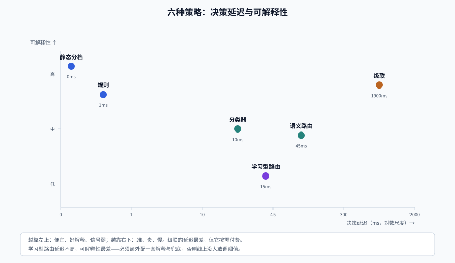
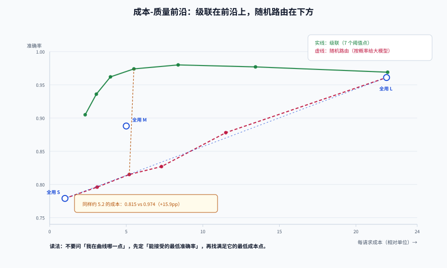

# 策略谱系：从规则到学习型路由

「用哪个模型」这个问题，答案有六种，成本差三个数量级、可解释性差一个数量级。选错策略的代价不是「效果差一点」，而是**你永远说不清为什么这条请求走了这个模型**。

这一页把六种策略放在同一张表上比较：需要什么信号、要花多少延迟、什么时候会失效。

## 判据族声明

本页判据族 `MRS-A` ~ `MRS-H`，共 8 条。定义表在第七节。

## 一、六种策略与它们的真实成本



| 策略 | 判断依据 | 信号成本 | 决策延迟 | 可解释 | 冷启动 | 典型失效 |
| --- | --- | --- | --- | --- | --- | --- |
| **静态分档** | 调用方显式指定 `tier`（如 `chat` / `reasoning`） | 0 | ~0ms | 极强 | 无 | 调用方全部填最贵那档 |
| **规则** | 关键词、长度、语言、租户、时段 | 极低 | < 1ms | 强 | 无 | 规则越加越多、互相覆盖 |
| **监督分类器** | 轻量模型（逻辑回归 / 小 BERT）打分 | 低 | 3~15ms | 中 | 需标注 | 分布漂移后静默失效 |
| **语义路由** | 请求嵌入与「路由样例」的距离 | 中（一次嵌入） | 20~60ms | 中 | 需样例 | 距离被当置信度、阈值跨模型不可移植 |
| **级联** | 先答再判，验证器决定是否升级 | 高（多次调用） | 1.5~3× | 强（每步有分数） | 无 | 验证器太差，等于随机升级 |
| **学习型路由** | 偏好数据训练的二分类器（RouteLLM 类） | 低（一次推理） | 5~20ms | 弱 | 需偏好数据 | 换模型后未重标定阈值 |

### 一个被忽略的事实：路由信号本身要花钱

语义路由要一次嵌入调用。以 300 token 的请求为例，一次嵌入的成本约为一次小模型补全的 1/30~1/10，延迟 20~60ms。**当你的小模型本身就能在 300ms 内答完时，用 50ms 去判断「要不要用它」是不划算的**。

判断公式：

```text
语义路由划算 ⟺ (省下的模型成本 × 降档比例) > (嵌入成本 × 全部请求数) 且 50ms 延迟可接受
```

## 二、策略一：静态分档（先做这个）

最被低估的策略。它把「选模型」变成**调用方的显式意图**，路由层只做校验：

```python
TIER_TO_MODEL = {
    "fast":     "small-model",      # 抽取、分类、改写、摘要
    "balanced": "mid-model",        # 常规问答、客服
    "deep":     "large-model",      # 多步推理、代码、长文档分析
}

def route_static(req):
    tier = req.headers.get("x-ai-tier", "balanced")
    if tier not in TIER_TO_MODEL:
        raise ValueError(f"unknown tier: {tier}")
    return TIER_TO_MODEL[tier]
```

它的价值不在「智能」，而在于**给系统一个可控的基线**：先让业务方自己标出哪些请求真的需要大模型，你才知道难度分布长什么样。没有这个基线就直接上级联，等于在不知道分布的情况下调阈值。

::: tip 先跑两周静态分档
两周后你会得到一张「各 tier 的实际调用量 + 满意度」表。这张表就是后续所有策略的评估基线，也是**唯一能证明路由有效的对照**。
:::

## 三、策略二：规则（能用，但要有退出机制）

规则适合两类场景：**合规强制**（含个人信息 → 必须走境内模型）与**业务硬约束**（租户买了「旗舰档」→ 不许降档）。

```python
RULES = [
    # (优先级, 条件, 动作, 原因码)
    (10, lambda r: r.tenant_tier == "flagship", "large-model", "tenant_flagship"),
    (20, lambda r: r.region == "cn", "cn-model", "data_residency"),
    (30, lambda r: r.has_tools, "mid-model", "tool_calling_required"),
    (40, lambda r: r.tokens_in > 60_000, "long-context-model", "context_window"),
]
```

三条纪律：

1. **每条规则必须有原因码**，写进响应头与日志，否则半年后没人敢删。
2. **规则数量上限**：超过 15 条就该考虑换成分类器或配置表——规则的维护成本是超线性的。
3. **规则之间必须有优先级且可判定**：不要写「如果复杂就用大模型」这种没有定义的规则。

## 四、策略三：监督分类器

把「这条请求有多难」变成一个可训练的标签问题。标签可以来自：线上 A/B 的胜负、人工标注、或「小模型答错而大模型答对」的差异样本。

```python
# 特征：长度、是否含代码块、是否含数字/公式、问句类型、历史失败次数、租户
FEATURES = ["tokens_in", "has_code", "has_math", "question_type", "prior_fail_count"]

def route_classifier(req, model):
    p_hard = model.predict_proba(req.features())[0][1]   # 需要大模型的概率
    return "large-model" if p_hard >= 0.42 else "mid-model"
```

关键指标不是准确率，是**分桶后的质量差**：

| 分桶 | 请求占比 | 小模型准确率 | 大模型准确率 | 差距 | 该走谁 |
| --- | --- | --- | --- | --- | --- |
| p < 0.2 | 48% | 0.93 | 0.96 | 3pp | 小 |
| 0.2 ~ 0.5 | 31% | 0.81 | 0.94 | 13pp | 小（差距可接受时） |
| 0.5 ~ 0.8 | 15% | 0.62 | 0.93 | 31pp | 大 |
| p > 0.8 | 6% | 0.35 | 0.91 | 56pp | 大 |

这张表本身就是路由策略：**阈值定在「差距开始变大」的位置**，而不是定在 0.5。

## 五、策略四：语义路由（三个必踩的坑）

语义路由把请求编码成向量，与每个「路由」下的一组样例比较，距离最小且小于阈值的胜出。

```python
def route_semantic(req, routes, embed, threshold=0.28):
    v = embed(req.text)                       # 一次嵌入，20~60ms
    best, best_d = None, 9.9
    for name, refs in routes.items():
        d = min(cosine(v, embed(r)) for r in refs)   # 每个路由取最近的样例
        if d < best_d:
            best, best_d = name, d
    # 距离大于阈值 = 没有路由命中 → 走默认档，而不是硬塞给最近的
    return best if best_d <= threshold else "default"
```

::: danger 语义路由的三个坑（都会静默出错）
1. **把距离当置信度。** COSINE 距离 0.35 不代表 35% 的把握。距离是**排序信号**，阈值必须在自己的评估集上标定——官方文档也明确写了「同样的阈值换一个嵌入模型就失效」。
2. **只取最近邻，不做「第二名拉开度」检查。** 当最近与次近的距离差小于 0.02 时，说明两个路由在这个请求上"分不开"，应该走澄清或默认，而不是赌一个。
3. **样例集永不更新。** 新意图出现时，它会被最近的老路由吸走，而且**距离看起来还挺小**。必须监控「未命中率」与「最近/次近距离差」的分布。
:::

补充一条工程约束：**语义路由的阈值要按路由分别设置**。高风险动作（退款、改权限）阈值更严，低风险（FAQ 选择、模型分档）可以放宽。

## 六、策略五：级联（省得最多，也最容易做错）

级联不问「这条请求有多难」，而是**先答，再判断答得够不够好**，不够就升级。



### 验证器决定上限

用同一批 2000 条合成请求做的实跑读数（阈值 0.60，`sigma` 越小验证器越准）：

| 验证器噪声 | 单位成本/请求 | 准确率 | 相对全用大模型 | 误接受率 |
| --- | --- | --- | --- | --- |
| `sigma=1.6`（很粗） | 6.62 | 0.945 | 0.30× | 4.8% |
| `sigma=1.0`（中等） | 5.51 | 0.978 | 0.25× | 1.5% |
| `sigma=0.6`（较准） | 4.21 | 0.995 | 0.19× | 0.2% |
| `sigma=0.3`（很准） | 3.33 | 0.997 | 0.15× | 0.0% |

同一套级联、同一个阈值，**只换验证器质量，成本差一倍、准确率差 5 个百分点**。这解释了一个常见现象：抄了别人的级联结构，效果却差很远——差的是验证器。

### 验证器的四种可用形态

| 形态 | 成本 | 适用 | 注意 |
| --- | --- | --- | --- |
| 结构化校验 | 0 | 抽取、分类、格式固定 | 只能判「格式对不对」，判不了「内容对不对」 |
| 规则断言 | 0 | 有硬约束的业务（金额、日期、ID 存在） | 覆盖面窄，但错杀率为 0 |
| 独立小模型打分 | 极低 | 通用问答、客服 | 必须与主模型**不同源**，否则同错 |
| 大模型评审 | 高 | 高价值、低 QPS | 成本可能超过升级本身，只适合抽样 |

::: warning 「模型自评」不是验证器
让生成答案的模型给自己的答案打 0~1 分，看起来零成本，但**它对自己错的答案同样自信**。实测中这种做法把误接受率从 1.5% 抬到 8% 以上，级联退化成「随机升级」。
:::

## 七、策略六：学习型路由（RouteLLM 类）

RouteLLM（arXiv 2406.18665）的做法：用人类偏好数据训练一个二分类器，预测「强模型比弱模型好」的概率，再按目标质量选阈值。论文报告在保持质量的前提下**成本降低 2 倍以上**，且路由器在换掉强弱模型后仍能迁移。

它的两个指标值得借用：

- **CPT（call-performance threshold）**：达到目标质量时，调用强模型的比例。CPT 越低越省钱。
- **APGR（average performance gain recovered）**：相对「全用弱模型」到「全用强模型」这段差距，你的策略挽回了多少。

工程上要补三件事，论文不管：

1. **阈值要和当前模型绑定**。换了模型（哪怕是同一家的新版本），必须重跑评估集重标定。
2. **要有 fallback 到规则的路**。学习型路由在分布外请求上会给出「高置信但错误」的判断。
3. **要能解释**。至少输出 top-3 特征或最近的 k 个训练样例，否则线上没人敢调。

## 八、怎么选：一张对照表

| 你的处境 | 选它 | 不要选 |
| --- | --- | --- |
| 刚上线，不知道请求难度分布 | 静态分档 | 级联（没有基线，阈值无从谈起） |
| 有明确合规/租户约束 | 规则（带原因码） | 学习型路由（不可解释，过不了评审） |
| 请求类型固定、可标注 | 监督分类器 | 语义路由（更贵且没有更准） |
| 意图多、变化快、要快速扩 | 语义路由 + 默认档 | 规则（维护成本超线性） |
| 成本是硬约束、可接受多次调用 | 级联 + 强验证器 | 单模型降档（质量断崖） |
| 有偏好数据、量大、要极致成本 | 学习型路由 + 规则兜底 | 纯学习型（分布外无人兜底） |

## 九、判据定义表

| 判据 | 约定 | 定错了会怎样 | 怎么验证 |
| --- | --- | --- | --- |
| `MRS-A` | 路由信号必须与「答对概率」相关，不能只看长度 | 短而难的请求被降档 | 分桶表里各桶的质量差单调递增 |
| `MRS-B` | 语义路由阈值必须按嵌入模型分别标定 | 换模型后路由全乱 | 阈值配置文件与嵌入模型版本绑定 |
| `MRS-C` | 距离不得当置信度使用 | 高风险请求被错分 | 决策日志记录距离与「最近/次近差」两个值 |
| `MRS-D` | 每条规则必须有原因码并写入响应头 | 半年后没人敢删规则 | 响应头含 `x-route-reason` |
| `MRS-E` | 级联验证器必须与主模型不同源 | 同错同升，级联失效 | 验证器与生成模型的部署清单不同 |
| `MRS-F` | 学习型路由换模型后必须重标定 | 阈值失效，成本或质量单边崩 | 有「换模型 checklist」，含重标定步骤 |
| `MRS-G` | 未命中必须有默认档，不得强行归到最近路由 | 新意图被老路由吞掉 | 未命中率指标存在且被监控 |
| `MRS-H` | 策略变更必须可回滚且有版本号 | 出问题只能改代码 | 策略配置含 `version`，可一键切回 |

## 如何验证

```shell
# 阈值标定：用评估集扫描「升级阈值 → 升级比例 / 准确率」
/Users/cuifendemac/.workbuddy/binaries/python/envs/default/bin/python3 - <<'PY'
import random
random.seed(1)
n = 2000
# 假设：小模型答对率 0.78；验证器分数 = 正确性 + 噪声
correct = [random.random() < 0.78 for _ in range(n)]
score = [min(1, max(0, (0.72 if c else 0.28) + random.gauss(0, 0.18))) for c in correct]
for tau in (0.3, 0.4, 0.5, 0.6, 0.7, 0.8):
    up = sum(s < tau for s in score) / n          # 低于阈值 → 升级
    acc = sum(c or (s < tau) for c, s in zip(correct, score)) / n
    print(f"tau={tau:.1f}  升级比例 {up:5.1%}  期望准确率 {acc:.3f}")
PY
```

**预期输出**：升级比例随阈值单调上升（0.3 → 约 12%，0.8 → 约 95%），准确率随之上升但边际递减。判读要点：**在「升级比例还能接受」的那一行停下**，而不是在准确率最高的那一行——最后 2 个百分点通常要用 40% 的升级率去换。

```shell
# 检查线上是否真的在按配置路由（决策可复算）
grep -c '"policy_version"' /var/log/gateway/route.jsonl
# 期望：等于总请求数；小于总数说明有请求走了默认分支，需查原因
```

## 参考资料

- [RouteLLM: Learning to Route LLMs with Preference Data](https://arxiv.org/abs/2406.18665)——CPT / APGR 与阈值标定方法
- [FrugalGPT](https://arxiv.org/abs/2305.05176)——级联与验证器
- [Azure Managed Redis · 语义路由教程](https://learn.microsoft.com/azure/redis/tutorial-semantic-router)——距离阈值、优先级、未命中处理
- [成本与质量：把「划算」算成一个数](../CostQuality/index.md)——本页的下一站
