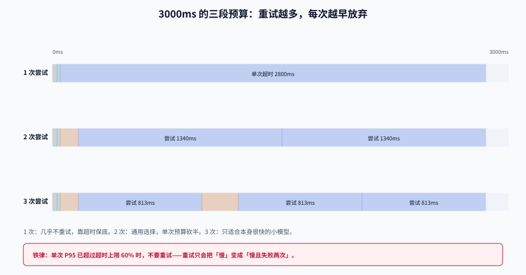

# 超时、重试与对冲

路由把请求发给「更便宜的模型」时，隐含地改变了失败率。失败率一变，重试次数就变；重试次数一变，**你以为的容量就不是你以为的容量**。

这一页只讲三件事：时间预算怎么切、重试什么时候会把系统打死、以及用「多打一份」换尾延迟到底划不划算。

## 判据族声明

本页判据族 `MRT-A` ~ `MRT-H`，共 8 条。定义表在第八节。



## 一、deadline 是全链路属性，不是单次调用参数

超时最常见的错法，是在**每一层各写一个超时**：客户端 30s、网关 10s、服务 5s、模型调用 60s。四层加起来 105s，而用户 3 秒就走了。

正确做法是**一个 deadline 从入口传到出口，每层只做减法**：

```text
客户端 deadline（3000ms）
  → 网关：读 request header `x-request-deadline-ms`，超过则直接 504，不再下发
  → 路由层：分类 + 选模型，扣掉实际耗时
  → 模型调用：timeout = 剩余预算 - 安全余量
  → 流式：首 token 超时与空闲超时分别设，不与总超时混用
```

::: danger 三个会让 deadline 失效的写法
1. **重试时不重算剩余预算**：第一次调用花了 2.8s 超时返回，第二次还用 2.8s 的超时，总耗时 5.6s——客户端早就断开了，服务端还在烧 GPU。
2. **`timeout` 只设在连接建立上**：连接 30ms 成功、响应永远不来。必须同时设「连接超时」与「读超时」，流式还要设「首包超时」。
3. **降级路径不检查预算**：主路径超时后还有 200ms，却又去调一次大模型。降级链的每一步都必须先问「还剩多少时间」。
:::

## 二、三段预算：把 3000ms 切开

以一个 3000ms 的交互式请求为例，实跑的切分结果：

```text
deadline 3000ms
 - 网关固定开销      30ms
 - 路由决策          20ms
 - 安全余量（序列化、网络抖动、客户端渲染）150ms
 = 可用 2800ms
```

| 尝试次数 | 退避 | 每次超时上限 | 适用 |
| --- | --- | --- | --- |
| 1 次 | 无 | 2800ms | 大模型长回答、流式 |
| 2 次 | 120ms | 1340ms | 通用（默认选这个） |
| 3 次 | 120 + 240ms | 813ms | 小模型快速失败场景 |

注意第二行：**加了 1 次重试，单次超时几乎砍半**（2800 → 1340）。这意味着重试不是免费的可靠性，它用「每次更早放弃」换「多一次机会」。对于本身就要跑 2s 的大模型调用，重试几乎没有意义——第一次就会在 1340ms 被砍断。

::: tip 一条经验规则
**单次 P95 延迟 > 单次超时上限的 60% 时，不要重试**。重试只会把「慢」变成「慢且失败两次」。
:::

## 三、重试放大：省下的钱可能在这里赔进去

设单次成功率 `p`，最多尝试 `N` 次，期望调用次数：

```text
E[attempts] = Σ(k × p × (1-p)^(k-1)) + N × (1-p)^(N-1)
```

实跑读数（容量按 1200 rps 计）：

| 单次成功率 p | N=2 | N=3 | N=4 | 容量 1200rps 可承载的稳态（N=3） |
| --- | --- | --- | --- | --- |
| 0.99 | 1.010 | 1.010 | 1.010 | 1188 |
| 0.95 | 1.050 | 1.052 | 1.053 | 1140 |
| 0.90 | 1.100 | 1.110 | 1.111 | 1081 |
| 0.80 | 1.200 | 1.240 | 1.248 | 968 |
| 0.70 | 1.300 | 1.390 | 1.417 | 863 |
| 0.50 | 1.500 | 1.750 | 1.875 | 686 |

两个必须记住的读数：

1. **p=0.70、N=3 时，放大 1.39 倍**。你按 1000 rps 买的容量，实际只能承接 719 rps 的新请求。
2. **N 从 2 加到 3，在 p=0.70 时把可承载稳态从 923 降到 863（-6.5%）**，而成功率只从 91.0% 提到 97.3%。再加到 4，成功率只多 1.9 个百分点，容量再降 1.9%。**边际收益递减得非常快。**

## 四、雪崩阈值：重试如何把系统推过 100%

这张表是本文最重要的一张。行是到达率，列是单次成功率，格子里是**含重试的系统利用率**（> 100% 表示排队发散）：

| 到达率 λ | p=0.95 | p=0.90 | p=0.80 | p=0.70 | p=0.60 |
| --- | --- | --- | --- | --- | --- |
| 700 | 61.8% | 66.3% | 77.9% | 92.1% | **107.8%** |
| 900 | 79.5% | 85.3% | **100.2%** | **118.4%** | **138.6%** |
| 1000 | 88.3% | 94.8% | **111.3%** | **131.6%** | **154.0%** |
| 1100 | 97.1% | **104.2%** | **122.5%** | **144.7%** | **169.4%** |

读法：**λ=900、p=0.80 时利用率刚好 100.2%**。也就是说，只要错误率从 5% 涨到 20%，一个本来有 25% 余量的系统就会进入正反馈——重试让错误率进一步升高，错误率继续推高重试。

::: danger 断路器不是可选项，是重试的配套件
没有熔断的重试 = 给故障加杠杆。三个必须有的护栏：
1. **重试预算**：整条链路共享一个「最多重试次数」配额，而不是每层各自重试（3 层各 2 次 = 最多 8 次调用）。
2. **失败即冷却**：某个部署在窗口内失败超阈值就移出轮转（LiteLLM 的 `allowed_fails` + `cooldown_time` 就是这个思路）。
3. **超限即拒**：并发/配额超限时**立刻返回 429**，不要排队——排队会把 200ms 的拒绝变成 30s 的超时。
:::

## 五、退避与抖动：别让所有客户端同时回来

指数退避解决「持续施压」，抖动解决「同步回来」。实测三种方式的累计等待（base=1s、cap=32s）：

| 方式 | 1 次 | 2 次 | 3 次 | 4 次 | 5 次 |
| --- | --- | --- | --- | --- | --- |
| 无抖动 | 1.00s | 3.00s | 7.00s | 15.00s | 31.00s |
| full jitter | 0.32s | 1.45s | 2.61s | 4.69s | 10.55s |
| equal jitter | 0.61s | 2.76s | 6.14s | 9.54s | 22.88s |

再看惊群：1000 个客户端在同一时刻失败，第一次重试的落点分布（0~1s 分 10 个桶）：

```text
无抖动   [0, 0, 0, 0, 0, 0, 0, 0, 0, 1000]   ← 全部挤在最后一桶（同一秒）
full     [104, 109, 121, 102, 96, 94, 81, 84, 97, 112]   ← 均匀摊开
```

**无抖动时，重试本身就是一次 DDoS。** 生产环境用 full jitter（`sleep = random(0, min(cap, base × 2^k))`），它的代价是平均等待只有理论上限的一半——比惊群便宜太多。

## 六、对冲请求：用 25% 的额外调用换 35% 的尾延迟

对冲（hedging）不是重试：**第一次请求还没失败，就并行发第二次，谁先成功用谁。**

实跑读数（对数正态延迟，p50≈420ms、p99≈1490ms，2 万次采样）：

| 策略 | P50 | P95 | P99 | 额外请求 |
| --- | --- | --- | --- | --- |
| 只发一次 | 421ms | 1043ms | 1487ms | 0% |
| 600ms 未返回即对冲 | 417ms | 924ms | **1155ms** | 25.8% |
| 800ms 未返回即对冲 | 424ms | 1010ms | 1254ms | 12.1% |
| 1000ms 未返回即对冲 | 419ms | 1044ms | 1370ms | 5.8% |

三个结论：

1. **对冲只改善尾部**，P50 几乎不动（417 vs 421）。指望它改善平均延迟是错的。
2. **600ms 阈值把 P99 从 1487 降到 1155（-22%）**，代价是四分之一的请求多打一份。按成本算，等于给这 25% 的请求付了双倍价钱。
3. **阈值要贴着 P95 设**（本例 P95=1043，阈值 1000ms 只增加 5.8% 调用）。阈值设太低，等于给所有慢请求都发两份。

::: warning 对冲的四个前置条件
- **请求必须幂等**：写操作、扣款、发消息不能对冲。
- **必须能取消**：胜者产生后取消败者，否则白烧算力（流式请求尤其要能 abort）。
- **必须计入配额**：对冲会真实消耗供应商的 RPM/TPM。
- **必须有上限**：每请求最多 2 份，且全局有对冲比例上限（如 10%），否则高峰期会自我放大。
:::

## 七、流式响应：两个超时，不是三个

流式场景的超时和普通请求不是一回事：

| 超时 | 定义 | 典型值 | 触发后 |
| --- | --- | --- | --- |
| **首 token 超时** | 从发出请求到收到第一个内容块 | 3~8s | 可重试（此时还没有向用户输出） |
| **空闲超时** | 两个内容块之间的最大间隔 | 15~30s | 不可重试（已经输出一半，重试会重复） |
| **总时长上限** | 整条流的最长持续时间 | 120~300s | 主动截断并标记 `truncated` |

一旦**已经开始向客户端输出**，就不能再重试了——重试会产生重复内容。正确做法是：发一个 `error` 事件，让客户端知道这次回答不完整，并保留已输出部分。

```python
async def stream_with_budget(resp, first_token_timeout, idle_timeout):
    first = await asyncio.wait_for(resp.__anext__(), first_token_timeout)
    yield first
    while True:
        try:
            chunk = await asyncio.wait_for(resp.__anext__(), idle_timeout)
        except asyncio.TimeoutError:
            yield {"event": "error", "data": {"code": "STREAM_IDLE_TIMEOUT",
                                              "retryable": False}}
            return
        yield chunk
```

## 八、判据定义表

| 判据 | 约定 | 定错了会怎样 | 怎么验证 |
| --- | --- | --- | --- |
| `MRT-A` | deadline 从入口透传，每层只做减法 | 各层超时叠加，总耗时远超用户耐心 | 日志里每层都有 `remaining_ms` 且单调递减 |
| `MRT-B` | 重试前必须重算剩余预算 | 客户端断开后服务端还在跑 | 重试日志的 `remaining_ms` > 0 |
| `MRT-C` | 连接超时、读超时、首包超时分别设置 | 连接成功但永不返回 | 配置里有三个独立参数 |
| `MRT-D` | 整条链路共享重试预算 | 三层各 2 次 = 8 次调用 | 重试计数在网关统一维护 |
| `MRT-E` | 超限必须快速拒绝，不排队 | 排队把 200ms 变成 30s | 429 的 P99 < 10ms |
| `MRT-F` | 退避必须带 jitter | 重试形成同步尖峰 | 重试时间戳分布无单一尖峰 |
| `MRT-G` | 对冲仅用于幂等请求且有全局比例上限 | 写操作重复执行 | 对冲开关只对 `GET`/只读意图生效 |
| `MRT-H` | 流式必须区分首包/空闲/总时长 | 半截输出被重试成重复内容 | 三种超时各自有错误码 |

## 如何验证

```shell
# ① 重试放大与可承载稳态：把你自己链路的 p 代进去
/Users/cuifendemac/.workbuddy/binaries/python/envs/default/bin/python3 - <<'PY'
cap = 1200
for p in (0.95, 0.9, 0.8, 0.7):
    for N in (2, 3, 4):
        e = sum(k * p * (1 - p) ** (k - 1) for k in range(1, N)) + N * (1 - p) ** (N - 1)
        print(f"p={p:.2f} N={N} 放大 {e:.3f} 可承载 {cap/e:6.1f} rps 成功率 {1-(1-p)**N:.3f}")
PY
```

**预期输出**：与第三节表格一致（`p=0.70 N=3 放大 1.390 可承载 863.3 rps 成功率 0.973`）。判读：**如果可承载值已经低于你的峰值 QPS，先减重试次数，再谈扩容**。

```shell
# ② 惊群自检：看重试时间戳是否成簇
python3 - <<'PY'
import random, collections
hits = collections.Counter(int(min(32, 2 ** k) * random.random()) for k in range(5) for _ in range(2000))
print(sorted(hits.items())[:8])
print("判读：某一个秒级桶占比 > 40% 说明 jitter 没生效")
PY
```

**预期输出**：各秒桶分布相对均匀，无单桶超过 40%。

## 参考资料

- [LiteLLM · Fallbacks and Retries](https://deepwiki.com/BerriAI/litellm/7.1-fallbacks-and-retries)——`num_retries`、冷却与错误映射的实现口径
- [AWS Architecture Blog · Exponential Backoff and Jitter](https://aws.amazon.com/blogs/architecture/exponential-backoff-and-jitter/)——full jitter 的原始出处
- [网关深入 · 流量管理](../../../Backend/GatewayDeep/TrafficManagement/index.md)——限流与熔断的通用算法
- 下一站：[降级链：从换区域到明确失败](../Fallback/index.md)
