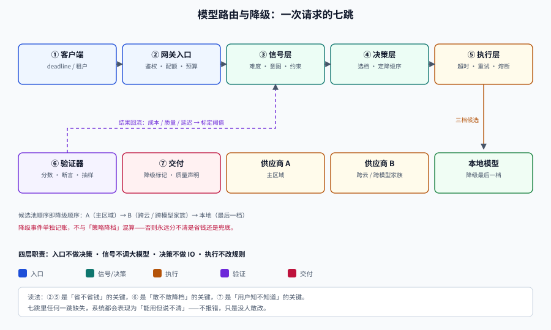

# 模型路由与降级

模型路由（Model Routing）要解决的问题只有一句：**同一个产品里，不是每个请求都值得用最贵的模型，但每个请求都必须得到能用的答案。**

这句话拆开是两个完全不同的工程问题。前半句是**选谁**——按难度、租户、延迟预算、合规要求，把请求分给不同档位的模型；后半句是**选不到怎么办**——主模型超时、限流、内容被拦、上下文超长时，用哪条路径把答案交付出去，并且让调用方知道这次拿到的是降级结果。

多数团队第一次做这件事，都是在一个 `if` 里写死「复杂问题用大模型」，三个月后变成二十个 `if`、没人敢删、也没人知道它到底省了多少钱。本专题要给的是一套**可算、可测、可回滚**的做法：路由是一次**带成本的决策**，降级是一次**带声明的交付**。

## 与相邻专题的分工

| 专题 | 负责什么 | 与本专题的边界 |
| --- | --- | --- |
| 本专题 | **路由信号、策略选型、成本质量换算、超时与降级链、网关落地、灰度、归因** | —— |
| [大模型应用开发 · 成本核算与限流降级](../LLMApp/CostRateLimit/index.md) | 成本由哪几块构成、六层控制手段、限流维度 | 那边回答「怎么把单价和用量压下去」；本专题回答「**这一条请求该发给谁**」 |
| [LLM 应用观测 · 成本](../../AI/LLMObservability/Cost/index.md) | 账单口径、成本看板与归集 | 那边是**事后归集**；本专题要的是**决策当下的成本差**（这一次选贵的多花了多少） |
| [LLM 应用观测 · 链路追踪](../LLMObservability/Tracing/index.md) | span 结构与通用追踪规范 | span 怎么建归那边；**一次路由决策必须落哪 9 个字段**归本专题 |
| [网关深入 · 流量管理](../../Backend/GatewayDeep/TrafficManagement/index.md) | 限流算法、灰度、熔断的通用实现 | 那边是南北向 HTTP 流量的通用治理；本专题只讲 LLM 多出来的三件事：**按 token 计价、流式响应、质量不可预知** |
| [大模型应用开发 · API 调用](../LLMApp/ApiCall/index.md) | SDK 调用、重试、错误码基础 | 单次调用怎么写归那边；**跨供应商的重试该由谁负责、重试几次**归本专题 |
| [本地模型部署](../LocalModel/index.md) | Ollama / vLLM、量化、GPU 规划 | 那边讲怎么把模型跑起来；本专题把本地模型当成**降级链的最后一档** |
| [大模型微调](../FineTuning/index.md) | 数据准备、LoRA/QLoRA、评测闭环 | 那边讲「把能力灌进小模型」；本专题讲**什么时候该路由而不是微调**（延迟与成本的权衡表在 [成本与质量](./CostQuality/index.md)） |
| [容量规划与成本治理](../../Ops/CapacityCost/UnitEconomics/index.md) | 单位成本口径、预算与承诺 | 分母口径引用那边；本专题补「**每答对一题的成本**」这个分母 |
| [AI 安全与合规 · 运行时护栏](../AISecurityCompliance/Guardrails/index.md) | 工具权限、预算上限、越权拦截 | 护栏负责**拦住**；本专题负责**拦住之后给什么** |

::: tip 一句话理解
路由是**在质量、成本、延迟三者之间做的一次可复算的取舍**；降级是**取舍失败时的一次有标记的交付**。
两者缺一，系统要么贵得没有理由，要么在故障时静默变傻。
:::

## 专题导航

- [总览：三个约束与四层结构](./Overview/index.md)：为什么单模型一定不够、路由的四层、五种失败模式、三十秒决策树
- [策略谱系：从规则到学习型路由](./Strategy/index.md)：六种策略的信号成本与失效条件、语义路由的三个陷阱、阈值怎么标定
- [成本与质量：把「划算」算成一个数](./CostQuality/index.md)：四种单位成本、质量-成本前沿实测、验证器质量决定上限
- [超时、重试与对冲](./TimeoutBudget/index.md)：deadline 三段预算、重试放大与雪崩阈值、抖动、对冲请求的收益与代价
- [降级链：从换区域到明确失败](./Fallback/index.md)：错误分类矩阵、五级降级阶梯、熔断器实测、共因故障算术
- [网关：把路由做成一层基础设施](./Gateway/index.md)：统一协议、模型注册表、密钥池、三种限流、租户隔离实测
- [灰度：策略变更也要放量](./GrayRelease/index.md)：影子流量、五步放量、门禁指标、回滚不等于恢复
- [可观测：一次决策留下的九个字段](./Observability/index.md)：成本归因三层、四个路由质量指标、漂移检测与看板
- [实战：给客服问答接一层路由网关](./Practice/index.md)：配置、决策函数、降级链、S1~S10 验收序列
- [常见问题与最佳实践](./FAQ/index.md)：十类症状分诊、十二问、上线自查十四项、术语表

## 按症状找页面

| 你遇到的现象 | 大概率先看 |
| --- | --- |
| 账单涨了三倍，但没人知道是哪类请求涨的 | [可观测](./Observability/index.md) → [成本与质量](./CostQuality/index.md) |
| 加了路由，质量掉了但成本没降多少 | [策略谱系](./Strategy/index.md)（信号太弱）→ [成本与质量](./CostQuality/index.md)（阈值没标定） |
| 高峰期一窝蜂超时，越重试越糟 | [超时、重试与对冲](./TimeoutBudget/index.md) 的「雪崩阈值」 |
| 主供应商挂了，切换过去也是挂 | [降级链](./Fallback/index.md) 的「共因故障」 |
| 换了模型，输出格式全乱了 | [网关](./Gateway/index.md) 的「统一协议」 |
| 灰度放了 5%，看不出好坏 | [灰度](./GrayRelease/index.md) 的「门禁指标与样本量」 |
| 小模型答得「看着像对」，其实错 | [成本与质量](./CostQuality/index.md) 的「验证器」与 [降级链](./Fallback/index.md) 的「误接受」 |
| 不知道该不该做路由 | [总览](./Overview/index.md) 的「什么时候不该做」 |

## 全专题的判据纪律

本专题十页共 **80 条判据**，每页 8 条，逐页独立前缀。判据只回答三件事：**约定是什么 / 定错了会怎样 / 怎么验证它没被破坏**。

| 页面 | 判据族 | 覆盖的约定 | 条数 |
| --- | --- | --- | --- |
| 总览 | `MRO-A` ~ `MRO-H` | 有约束才路由、四层不越界、失败模式有对策 | 8 |
| 策略谱系 | `MRS-A` ~ `MRS-H` | 信号可测、阈值有标定、策略可解释 | 8 |
| 成本与质量 | `MRC-A` ~ `MRC-H` | 分母明确、前沿可复算、验证器有 AUC | 8 |
| 超时与重试 | `MRT-A` ~ `MRT-H` | 预算向下传、重试有上限、错误可分类 | 8 |
| 降级链 | `MRF-A` ~ `MRF-H` | 阶梯有序、降级有标记、共因有预案 | 8 |
| 网关 | `MRG-A` ~ `MRG-H` | 协议统一、注册表可信、配额隔离 | 8 |
| 灰度 | `MRU-A` ~ `MRU-H` | 分流可复现、门禁能红、回滚够快 | 8 |
| 可观测 | `MRV-A` ~ `MRV-H` | 字段齐全、归因到决策、漂移可见 | 8 |
| 实战 | `MRP-A` ~ `MRP-H` | 配置可校验、链路可运行、验收可执行 | 8 |
| 常见问题 | `MRQ-A` ~ `MRQ-H` | 分诊可执行、术语不混用、自查可机器判 | 8 |

## 事实与口径速览（2026-10 核对）

| 事实 | 口径 | 对本专题的意义 |
| --- | --- | --- |
| RouteLLM（arXiv 2406.18665，2024-06-26，v4 2025-02-23） | 用偏好数据训练二分类路由，**成本降低 2 倍以上而不牺牲质量**；换掉强弱模型后仍能迁移；评测用 CPT（call-performance threshold）与 APGR 两个指标 | 「学习型路由」的基线方法，也是「阈值要按目标质量标定」的出处 |
| FrugalGPT（arXiv 2305.05176，TMLR 2024） | 级联三件套：提示适配、模型近似、**LLM 级联**；HEADLINES 上成本 \$33.1 → \$0.60（**-98.3%**）、准确率 0.857 → 0.872 | 级联不是「先小后大」这么简单，关键在**验证器**（论文用独立打分模型，不是模型自评） |
| 语义路由的距离 | 距离**不是置信度**：COSINE 距离 0.35 不代表 35% 把握；**阈值不可跨嵌入模型移植**（Azure Managed Redis 语义路由文档） | 所有「0.8 以上就路由」的写法都必须先在自己的评估集上标定 |
| LiteLLM Router | 支持 `order` 优先级逐级降级、`fallbacks` / `context_window_fallbacks` / 内容策略降级、`num_retries`、`allowed_fails` + `cooldown_time` 冷却、`routing_strategy`（simple-shuffle / latency-based / least-busy / usage-based）、`max_parallel_requests` 快速拒绝 | 自研网关时可以直接照抄它的四件事：**部署级隔离、失败冷却、错误分类、超限即拒** |
| 协议事实标准 | 主流网关都以 OpenAI 兼容的 `/v1/chat/completions` 作为对外接口，供应商差异在适配层吃掉 | 不自建协议，自建**字段映射表**（见 [网关](./Gateway/index.md)） |
| 单价与上下文长度 | 各厂商随时调整，**不写死在代码与文档里** | 本文所有金额都是**相对单位成本**，换算方法给出，数值请以官方定价页为准 |

::: warning 一个前置结论，能省掉两周弯路
**如果你的月调用量少于每天几千次、且只用得起一档模型，不要做路由。** 路由的价值来自「请求难度分布足够宽」——大量简单请求被贵模型处理才是浪费。请求同质化时，路由只会增加一层不确定性和一堆要维护的配置。
:::

## 建议阅读顺序

| 角色 | 顺序 |
| --- | --- |
| 第一次接触 | 总览 → 策略谱系 → 成本与质量 → 实战 |
| 正在被账单追 | 可观测 → 成本与质量 → 策略谱系 |
| 正在被故障追 | 超时与重试 → 降级链 → 网关 |
| 要把原型推上线 | 网关 → 灰度 → 可观测 → 实战 → 常见问题 |
| 只想先判断该不该做 | 总览 · 决策树 → 成本与质量 · 前沿图 |

## 参考资料

- [RouteLLM: Learning to Route LLMs with Preference Data](https://arxiv.org/abs/2406.18665)——学习型路由的基线，含 CPT / APGR 指标定义
- [FrugalGPT: How to Use Large Language Models While Reducing Cost and Improving Performance](https://arxiv.org/abs/2305.05176)——级联与验证器的原始出处
- [LiteLLM Proxy · Load Balancing 文档](https://docs.litellm.ai/docs/proxy/load_balancing)——`order` 逐级降级与冷却的工程口径
- [Azure Managed Redis · 语义路由教程](https://learn.microsoft.com/azure/redis/tutorial-semantic-router)——距离阈值、优先级与可观测项
- [大模型应用开发 · 成本核算与限流降级](../LLMApp/CostRateLimit/index.md)——成本构成与本专题的前置阅读
