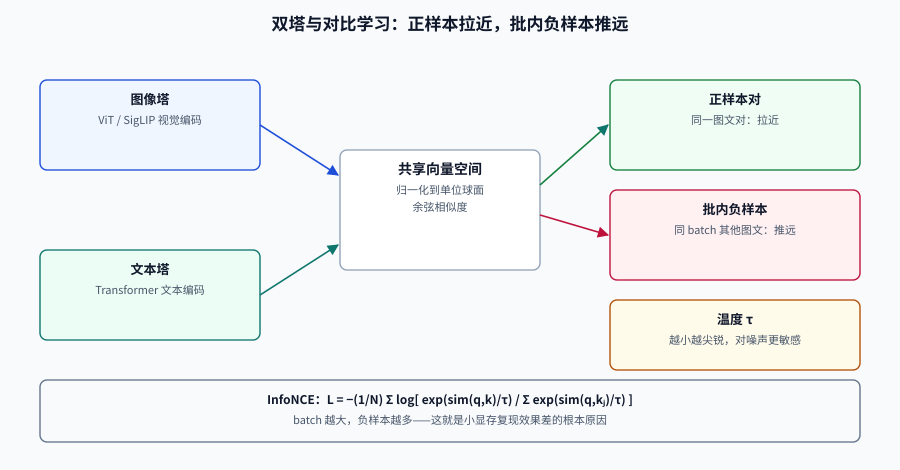

# 图文向量：相似度到底在比什么

把图片变成向量很容易，**知道这个向量在什么意义上「像」另一段文本，才是难点**。同一张图，用 CLIP 编码和用 DINOv2 编码，得到的相似度结构完全不同：前者对齐的是「图文描述」，后者对齐的是「视觉外观」。选错编码器，后面所有重排与阈值都是在错误的信号上做优化。

这一页讲四件事：双塔对比学习到底优化了什么、相似度的三个陷阱（归一化、温度、各向异性）、维度与截断的真实代价、以及 2026 年这个时间点上的模型格局。

## 判据族声明

本页判据族 `MME-A` ~ `MME-H`，共 8 条。定义表在第七节。

## 一、双塔与对比学习：模型在优化什么



CLIP 式模型有两个独立的塔（图像塔、文本塔），训练目标是**在一个 batch 里把配对的图文拉近、把不配对的推远**。标准损失是 InfoNCE：

```text
L = −(1/N) Σᵢ log [ exp(sim(qᵢ, kᵢ)/τ) / Σⱼ exp(sim(qᵢ, kⱼ)/τ) ]
```

三个符号决定了模型的行为：

| 符号 | 含义 | 工程影响 |
| --- | --- | --- |
| `sim` | 余弦相似度（向量先归一化） | 训练时归一化，推理时**必须**归一化，否则点积尺度漂移 |
| `τ` | 温度，CLIP 原始实现约为 0.07 且可学习 | 越小越「尖锐」，正负样本区分更强，但对噪声标签更敏感 |
| `N` | batch 内的负样本数 | batch 越大负样本越多，这也是小显存复现效果差的根本原因 |

**SigLIP 的改动**是把 softmax 换成 sigmoid：每一对图文独立判断「是否配对」，不再需要全 batch 归一化。好处是**小 batch 也能训**、语言与分辨率扩展更容易；代价是失去了「批内竞争」带来的强判别性，所以早期 SigLIP 在检索任务上略弱于同规模 CLIP，到 SigLIP 2 才通过多任务训练补回来。

::: tip 一句话理解
**双塔模型学到的不是「图片的含义」，而是「这张图和哪句话会被写在一起」。** 所以它擅长匹配「描述」，不擅长匹配「细节」——细节要靠重排或多向量来解决。
:::

## 二、相似度的三个陷阱

### 陷阱 1：忘了归一化

余弦相似度要求向量先归一化。多数库（Qdrant 的 `Cosine`、Milvus 的 `IP` + 归一化）会在写入时处理，但**自己算分时经常忘**：

```python
import numpy as np

def cosine(a, b):
    return float(a @ b / (np.linalg.norm(a) * np.linalg.norm(b)))

def dot(a, b):
    return float(a @ b)          # 未归一化时，模长会主导排序

v1 = np.array([3.0, 0.0]); v2 = np.array([1.0, 0.0]); q = np.array([1.0, 0.0])
print(cosine(v1, q), cosine(v2, q))   # 1.0 1.0  → 方向相同，余弦相等
print(dot(v1, q), dot(v2, q))         # 3.0 1.0  → 点积被模长拉开
```

这不是理论问题：**同一模型对不同长度的文本会输出不同模长的向量**，用点积排序会系统性偏向长文本。

### 陷阱 2：把相似度当概率

CLIP 的 logits 除以温度后才是「分类概率」，原始余弦只是**相对排序**。跨查询比较绝对值没有意义：

| 查询 | 正确结果余弦 | 错误结果余弦 | 能说明什么 |
| --- | --- | --- | --- |
| A | 0.31 | 0.28 | A 的正确结果排第一，但置信度很低 |
| B | 0.62 | 0.19 | B 的区分度很好 |

如果用一个固定阈值 0.3 过滤，A 会全部被滤掉。**阈值必须在评估集上按查询类型分别标定**，见 [评估](../Evaluation/index.md)。

### 陷阱 3：各向异性（anisotropy）

图文向量并非均匀分布在球面上，而是**聚集在一个窄锥里**。后果是「任意两张图的余弦都偏高」，看起来都很像。缓解手段有三种：

| 手段 | 做法 | 代价 |
| --- | --- | --- |
| 中心化 | 减去语料均值向量后再算余弦 | 均值必须随语料更新，旧索引失效 |
| 白化 | 用协方差矩阵做线性变换 | 计算量大，且会放大噪声方向 |
| 换模型 | 选训练时用过大 batch、分布更均匀的模型 | 需要重新评估 |

工程上最实用的是**中心化**：把均值向量存成一个常量，查询与文档都减掉它。注意这会改变索引，必须整库重建。

## 三、维度与截断：Matryoshka 不是免费午餐

Matryoshka Representation Learning（MRL）让向量的前 `d` 维本身就是可用的低维表示，于是可以「先存 1024 维、需要时截到 256 维」。

但**截断的代价与信息分布强相关**。做一个诚实的实验：随机生成 400 条 1024 维单位向量（各向同性，也就是每个维度承载同等信息），给查询加噪，看正确项在截断后还能不能排进前 10：

```shell
/Users/cuifendemac/.workbuddy/binaries/python/envs/default/bin/python3 - <<'PY'
import numpy as np
rng = np.random.default_rng(11)
n, d = 400, 1024
sig = rng.normal(size=(n, d)); sig /= np.linalg.norm(sig, axis=1, keepdims=True)
for k in (1024, 256, 64):
    hit = 0
    for _ in range(200):
        q0 = sig[0] + 0.55 * rng.normal(size=d); q0 /= np.linalg.norm(q0)
        v = sig[:, :k] / np.linalg.norm(sig[:, :k], axis=1, keepdims=True)
        q = q0[:k] / np.linalg.norm(q0[:k])
        hit += 0 in np.argsort(-(v @ q))[:10]
    print(f"dim={k:4d}  Recall@10={hit/200:.2f}")
PY
```

**预期输出**：`dim=1024 Recall@10=0.40`、`dim= 256 Recall@10=0.15`、`dim=  64 Recall@10=0.02`。

**怎么读这个结果**：它**不能**外推成「所有模型截断到 256 维都会掉一半」——真实嵌入是低内在维度的，信号集中在前几十维，所以 MRL 模型截断后掉得少。这个实验要说明的是另一件事：**截断的代价取决于信号是否集中在前几维，而这件事只能在自己的语料上测**。拿厂商曲线当自己的结论，是这一行最常见的错误之一。

::: danger 三个截断相关的坑
1. **截断后忘了重新归一化**——低维向量的模长变了，余弦会失真。
2. **索引按 1024 维建、查询按 256 维发**——维度不匹配，多数库直接报错，少数库静默补零，结果是随机排序。
3. **不同批次的语料用了不同维度**——同一索引里混着两种维度，距离不可比。维度必须写进索引元数据并做启动校验。
:::

## 四、2026-10 的模型格局

以下版本与参数为 2026 年 10 月核对结果；**厂商自报分数只能在同一榜单版本内比较**。

| 模型 | 规模 | 维度 | 能力 | 许可 | 适用 |
| --- | --- | --- | --- | --- | --- |
| **CLIP ViT-L/14** | 428M | 768 | 英文学术基准 | MIT | 基线、教学、老系统兼容 |
| **SigLIP 2** | 多种（So400m 等） | 1152 等 | 图文相似度强、多语言、原生分辨率 | Apache 2.0 / 开放 | 自托管跨模态的默认选择 |
| **jina-clip-v2** | 865M | 1024（MRL 可截到 64） | 89 语言、8192 token 文本、512×512 图像 | 开放（需核对条款） | 中文/多语言语料、需要长文本 |
| **jina-embeddings-v5-omni-small** | 1.74B | 1024（MRL 到 32） | 文/图/音/视频/PDF 统一空间，32K 上下文 | CC-BY-NC-4.0（**非商用**） | 多模态统一索引的研究与内部场景 |
| **Qwen3-VL 系嵌入** | 2B 起 | 视模型 | 跨模态检索强，第三方实测优于部分闭源 API | Apache 2.0 系 | 中文场景、需要自托管 |
| **Cohere Embed v4** | 闭源 | 视版本 | 多模态 MTEB 表现领先（第三方评测） | 商用 API | 不想运维、数据可出网 |

三条选型经验：

1. **中文语料优先测多语言模型**。CLIP 原版的中文能力接近于零，用它做中文文搜图，召回率会低到让你怀疑数据。
2. **需要长文本进同一空间时看上下文长度**。jina-clip-v2 的 8192 token 意味着可以把整段产品说明和主图放进同一空间，不必先切分。
3. **注意许可**。`jina-embeddings-v5-omni-small` 是 CC-BY-NC-4.0，商用需要单独授权；`jina-clip-v2` 的条款也要逐个版本核对。

## 五、度量与索引参数必须一起定

| 决策 | 选项 | 怎么选 |
| --- | --- | --- |
| 距离函数 | 余弦 / 内积 / 欧氏 | 向量已归一化时，三者排序等价；**混用会静默错序** |
| 量化 | float32 / float16 / int8 / 二值 | 先看召回损失，再看存储收益；二值量化通常需要重排兜底 |
| 索引 | HNSW / IVF / 暴力 | 百万级以内 HNSW 足够；多向量字段通常**不开** HNSW |
| 分片 | 按租户 / 按时间 / 不分片 | 有权限边界时按租户分片，过滤才能下推 |

**量化必须与重排配套**：int8 或二值量化会改变距离的精细结构，通常表现为「召回率掉 2~5 个点、但排序变差更多」。做法是量化索引只用于召回，取回候选后用 float32 原始向量重算一次。

## 六、把「像」变成「可判定」

给一个可执行的落地顺序：

1. **定任务**：文搜图、图搜图、还是文搜页？三者对编码器的要求不同。
2. **选 2~3 个候选模型**，在**自己的 200 条评估集**上跑 Recall@20。
3. **固定度量与归一化**，写进索引元数据。
4. **测截断与量化**：在评估集上看掉多少，不要看厂商曲线。
5. **留一条文本兜底通道**：任何多模态系统都要能用关键词搜到「字面上存在」的内容。

## 七、判据定义表

| 判据 | 约定 | 定错了会怎样 | 怎么验证 |
| --- | --- | --- | --- |
| `MME-A` | 距离函数在写入与查询两侧必须一致 | 排序静默错乱，指标无法复现 | 索引配置与查询代码中的 metric 同名 |
| `MME-B` | 向量必须归一化后再算余弦 | 点积被模长主导，长文本被系统性偏置 | 相似度函数里有 norm 或库配置为 Cosine |
| `MME-C` | 相似度不得直接当概率用于阈值过滤 | 低分正确结果被整体滤掉 | 阈值按查询类型在评估集上标定 |
| `MME-D` | 截断维度必须在自己语料上验证召回损失 | 照抄厂商曲线导致线上召回下降 | 有 dim=1024/256/64 的 Recall@k 对照 |
| `MME-E` | 量化索引必须配原始向量重排 | 召回够但排序变差，端到端指标下滑 | 量化前后 nDCG@10 有对照记录 |
| `MME-F` | 中文/多语言语料必须验证跨语言检索 | 用英文模型处理中文，召回接近随机 | 评估集含中文查询且指标达标 |
| `MME-G` | 模型许可必须与商用场景核对 | 上线后收到许可风险 | 选型记录里有许可字段与核对日期 |
| `MME-H` | 必须保留一条关键词兜底通道 | 字面明确的内容反而搜不到 | 同一查询在 BM25 通道可返回结果 |

## 如何验证

```shell
# ① 归一化对排序的影响：同一组向量，余弦与点积给出不同名次
/Users/cuifendemac/.workbuddy/binaries/python/envs/default/bin/python3 - <<'PY'
import numpy as np
q = np.array([1.0, 0.0])
docs = {"短文本": np.array([1.0, 0.05]), "长文本": np.array([4.0, 0.2])}
for name, v in docs.items():
    cos = float(q @ v / np.linalg.norm(v))
    print(f"{name}: 余弦={cos:.4f} 点积={float(q @ v):.2f}")
PY
```

**预期输出**：`短文本: 余弦=0.9988 点积=1.00`、`长文本: 余弦=0.9988 点积=4.00`。两者余弦相同、点积差 4 倍——**用点积排序时，长文本会无条件胜出**。

```shell
# ② 维度一致性校验：把索引维度写进元数据，启动时比对
/Users/cuifendemac/.workbuddy/binaries/python/envs/default/bin/python3 - <<'PY'
index_dim, query_dim = 1024, 256
assert index_dim == query_dim, f"维度不一致：索引 {index_dim}，查询 {query_dim}"
PY
```

**预期输出**：`AssertionError: 维度不一致：索引 1024，查询 256`。把这段断言放进服务启动钩子，可以拦住「换了模型忘了重建索引」这类事故。

## 参考资料

- [CLIP 论文](https://arxiv.org/abs/2103.00020)——对比学习与温度系数的来源
- [SigLIP 2](https://arxiv.org/abs/2502.14786)——sigmoid 损失与多语言扩展
- [jina-clip-v2 模型卡](https://huggingface.co/jinaai/jina-clip-v2)——89 语言、8192 token、MRL 参数
- [jina-embeddings-v5-omni-small](https://jina.ai/models/jina-embeddings-v5-omni-small/)——全模态统一空间与许可说明
- [MIEB 榜单](https://huggingface.co/spaces/mteb/leaderboard)——跨模态嵌入的公开对照
- 上一站：[总览](../Overview/index.md) · 下一站：[视觉文档检索](../VisualDocument/index.md)
