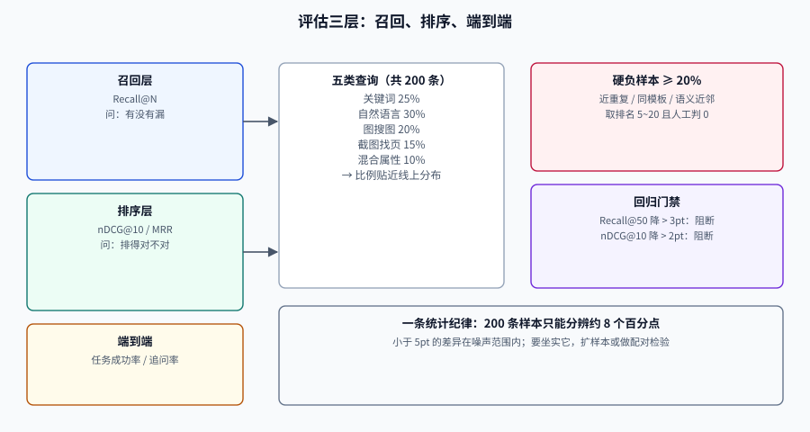

# 评估：先有能红的评估集，再谈模型

多模态检索的评估比文本检索更容易自欺，原因有三个：**相关性是主观的**（这张图算不算「同款」）、**样本量小**（人工标注贵）、**离线与线上分布不同**（用户上传的截图和你收集的样本长得不一样）。

这一页给出一套能落地的评估方案：查询怎么分层、相关性怎么标、指标怎么算、多少条才够、门禁怎么设成「会红」。

## 判据族声明

本页判据族 `MMX-A` ~ `MMX-H`，共 8 条。定义表在第七节。

## 一、三层评估，各问各的问题

| 层 | 问的问题 | 指标 | 什么时候看 |
| --- | --- | --- | --- |
| **召回层** | 正确结果有没有进候选池 | Recall@N | 换嵌入模型、改切分、加通道 |
| **排序层** | 进了候选池的，排得对不对 | nDCG@10、MRR | 换重排模型、调融合权重 |
| **端到端** | 用户拿到的东西有没有用 | 任务成功率、点击、追问率 | 上线与灰度 |

三层必须分开报。只报端到端，出了问题不知道该修哪一层；只报召回，会得到「指标很好但用户不用」的结论。

## 二、查询分层：200 条怎么分配

评估集的**构成比数量更重要**。多模态场景建议按五类分层：



| 类型 | 例子 | 占比 | 主要考验 |
| --- | --- | --- | --- |
| **关键词型** | 「MS-2841 说明书」 | 25% | 稀疏通道与编号精确匹配 |
| **自然语言型** | 「这个型号怎么重置密码」 | 30% | 稠密文本与跨语言 |
| **图搜图** | 上传一张商品图找同款 | 20% | 视觉编码器与近重复 |
| **截图找页** | 上传报错截图找文档页 | 15% | 视觉文档多向量 |
| **混合属性型** | 图 + 「北欧 三人位 布艺」 | 10% | 分路召回与融合 |

分配比例应**贴近线上真实分布**，而不是平均分。如果线上 80% 是关键词查询，评估集里就不该有 80% 是图搜图——那会让优化方向整体跑偏。

::: warning 一个常见错误：用「自己构造的查询」评估
产品团队构造的查询往往比真实用户更完整、更书面。**真实查询是短的、带错别字的、指代不清的**。评估集必须混入至少 30% 的线上真实查询（脱敏后），否则指标会系统性高估。
:::

## 三、相关性怎么标：分级 + 判定指南

二值标注（相关/不相关）在多模态里不够用，因为「部分相关」太常见。建议四级：

| 等级 | 定义 | 例子（商品图搜） |
| --- | --- | --- |
| **3 完全满足** | 就是用户要的那一个 | 同款同色同规格 |
| **2 部分满足** | 主体对，属性有差异 | 同款不同色 |
| **1 边缘相关** | 同类但不同款 | 同品类不同品牌 |
| **0 不相关** | 无关或误导 | 完全不同的商品 |

判定指南必须给**反例**，否则标注者会各自发挥：

```text
【判 3 的必要条件】
1. 主体一致：同型号/同款式，而不是「看起来差不多」；
2. 关键属性一致：颜色、规格、材质三项中不允许有实质差异；
3. 可直接用于回答：用户看到它不需要再找第二个。

【判 2 的典型情形】
- 同款不同色（颜色是用户明确约束时降为 1）；
- 同系列不同代（接口不兼容时降为 1）。

【判 0 的典型情形】
- 只有背景相似、主体不同；
- 图片含水印/拼接导致主体不可辨。
```

### 标注一致性：先算 kappa，再信标注

两个人各标 200 条，四格统计如下：

| | B 判相关 | B 判不相关 |
| --- | --- | --- |
| **A 判相关** | 120 | 15 |
| **A 判不相关** | 10 | 55 |

```text
po = (120 + 55) / 200 = 0.875
pe = (135×130 + 65×70) / 200² = 0.552
kappa = (0.875 − 0.552) / (1 − 0.552) = 0.721
```

`kappa ≥ 0.7` 才能认为标注可信；低于 0.6 时，**先改判定指南，不要急着扩样本**。

## 四、三个指标，手算一遍

### Recall@k

```text
Recall@k = 前 k 条中命中的人工标注相关项数 / 该查询的全部相关项数
```

它衡量「有没有漏」，**不关心顺序**。多模态检索里，一个查询可能有 5 个相关页，`Recall@10 = 0.6` 意味着只找到 3 个。

### MRR（Mean Reciprocal Rank）

```text
MRR = (1/|Q|) Σ 1 / rank_i     （rank_i 是第一个相关结果的排名）
```

适合「只有一个正确答案」的场景（找某一页、找某一个 SKU）。第一名的贡献是 1，第二名 0.5，第十名 0.1——**它对头部极其敏感**。

### nDCG@k

```text
DCG@k  = Σ_{i=1..k} (2^{rel_i} − 1) / log2(i + 1)
IDCG@k = 把相关性按降序排列后的 DCG
nDCG@k = DCG@k / IDCG@k
```

一个具体例子：系统给的相关性序列是 `[3, 1, 0, 2, 0]`。

```shell
/Users/cuifendemac/.workbuddy/binaries/python/envs/default/bin/python3 - <<'PY'
import math
rel = [3, 1, 0, 2, 0]
def dcg(rs):
    return sum((2**r - 1) / math.log2(i + 2) for i, r in enumerate(rs))
ideal = sorted(rel, reverse=True)
print(f"DCG={dcg(rel):.4f}  IDCG={dcg(ideal):.4f}  nDCG={dcg(rel)/dcg(ideal):.4f}")
PY
```

**预期输出**：`DCG=8.9230  IDCG=9.3928  nDCG=0.9500`。

**读法**：第 1 位就是最相关的（3），所以 DCG 接近上限。把最相关的那条从第 1 位挪到第 2 位（序列变成 `[0, 3, 2, 1, 0]`），nDCG 会掉到 **0.6758**——**nDCG 对「前面出现垃圾」的惩罚远大于「后面少一条好结果」**。

## 五、样本量：200 条能分辨多大的差异

用 Wilson 区间估算比例指标的置信区间（200 条样本）：

| 观测命中 | 比例 | 95% 置信区间 | 半宽 |
| --- | --- | --- | --- |
| 160/200 | 0.80 | [0.739, 0.850] | ±0.055 |
| 170/200 | 0.85 | [0.794, 0.893] | ±0.049 |
| 176/200 | 0.88 | [0.828, 0.918] | ±0.045 |

结论很直接：**200 条样本下，小于 5 个百分点的差异基本不可分辨**。两组各 200 条时，最小可检测差异约 **7.8 个百分点**（基线 0.80）。

所以两条纪律：

1. **不要因为「指标涨了 2 个点」就换模型**——它在噪声范围内。
2. **要么扩样本（1000 条级别），要么用配对检验**（同一批查询上比较两个系统），后者能显著降低方差。

## 六、硬负样本：让评估集「会红」

全是容易样本的评估集，指标很快饱和到 0.95，然后什么都测不出来。必须主动挖三类硬负样本：

| 类型 | 怎么挖 | 例子 |
| --- | --- | --- |
| **近重复** | 视觉相似度高但主体不同 | 同系列不同型号的商品图 |
| **同模板** | 版面几乎一致的文档 | 同一合同的甲乙双方版本 |
| **语义近邻** | 嵌入空间距离近但答案相反 | 「如何开启」与「如何关闭」 |

做法：用当前系统跑一遍全库，取 **排名 5~20 且人工判 0** 的结果，人工确认后加入评估集。这批样本正是系统当前最容易被骗的地方。

::: danger 评估集的三个自毁方式
1. **用系统自己的结果当标注候选**——只看到系统能召回的，评估集变成「系统能力的天花板」。
2. **标注完就不再更新**——语料变了、查询分布变了，评估集却还是去年的。
3. **把评估集当调参集**——反复在上面调阈值，最终它会过拟合，线上无感。
:::

## 七、判据定义表

| 判据 | 约定 | 定错了会怎样 | 怎么验证 |
| --- | --- | --- | --- |
| `MMX-A` | 评估集必须按查询类型分层且比例贴近线上 | 指标虚高，优化方向跑偏 | 报表含各类型样本数与线上占比 |
| `MMX-B` | 相关性必须分级且有判定指南与反例 | 标注者理解不一，指标不可比 | 指南文件存在，kappa ≥ 0.7 |
| `MMX-C` | 三层指标必须分开报 | 出问题无法定位到层 | 报告含 Recall@N、nDCG@10、端到端 |
| `MMX-D` | 样本量必须支撑结论（差异 vs 置信区间） | 把噪声当提升，频繁回滚 | 报告里每个指标带置信区间 |
| `MMX-E` | 评估集必须含硬负样本 | 指标饱和，测不出退化 | 硬负样本占比 ≥ 20% |
| `MMX-F` | 评估集与调参集必须分离 | 过拟合评估集，线上无感 | 有留出集（holdout）且未参与调参 |
| `MMX-G` | 换嵌入模型必须全量重建索引后评估 | 新旧向量混用，指标失真 | 评估记录含索引版本 |
| `MMX-H` | 回归门禁必须有明确的下降阈值 | 每次发版都「略降但可接受」 | CI 里有阈值与失败记录 |

### 回归门禁怎么设

| 指标 | 阈值 | 触发动作 |
| --- | --- | --- |
| Recall@50 | 下降 > 3 个百分点 | 阻断发布 |
| nDCG@10 | 下降 > 2 个百分点 | 阻断发布 |
| 任一查询类型 nDCG | 下降 > 5 个百分点 | 阻断并定位该类 |
| 端到端 P95 延迟 | 上涨 > 20% | 阻断 |

阈值不是拍的：**它应该大于置信区间半宽**，否则门禁会被噪声反复触发。

## 如何验证

```shell
# ① 复算 nDCG：确保你的实现与标注口径一致
/Users/cuifendemac/.workbuddy/binaries/python/envs/default/bin/python3 - <<'PY'
import math
def ndcg(rel, k=10):
    dcg = sum((2**r-1)/math.log2(i+2) for i, r in enumerate(rel[:k]))
    idcg = sum((2**r-1)/math.log2(i+2) for i, r in enumerate(sorted(rel, reverse=True)[:k]))
    return dcg/idcg
print("正确排序", round(ndcg([3,2,1,0,0]), 4))
print("最相关项被挤到第 2 位", round(ndcg([0,3,2,1,0]), 4))
PY
```

**预期输出**：`正确排序 1.0` 与 `最相关项被挤到第 2 位 0.6758`。用一个已知答案的算例校准实现，是防止「指标算错但一直没人发现」的最低成本手段。

```shell
# ② 置信区间：判断这次提升是不是噪声
/Users/cuifendemac/.workbuddy/binaries/python/envs/default/bin/python3 - <<'PY'
import math
def wilson(k, n, z=1.96):
    p = k/n; d = 1 + z*z/n
    c = (p + z*z/(2*n))/d
    h = z*math.sqrt(p*(1-p)/n + z*z/(4*n*n))/d
    return c-h, c+h
for k, n in [(160,200), (170,200)]:
    lo, hi = wilson(k, n)
    print(f"{k}/{n}={k/n:.2f}  95%CI [{lo:.3f}, {hi:.3f}]")
print("两区间是否重叠：", wilson(160,200)[1] > wilson(170,200)[0])
PY
```

**预期输出**：`160/200=0.80 95%CI [0.739, 0.850]`、`170/200=0.85 95%CI [0.794, 0.893]`、`两区间是否重叠： True`。

**判读**：区间重叠意味着「0.80 → 0.85」在 200 条样本下**还不足以宣布提升**。要坐实它，扩样本或做配对检验。

## 与『评测工程』专题的分工（第 171 天补充）

| 你想知道 | 去哪 |
| --- | --- |
| 分级相关性怎么标、nDCG 怎么手算 | [多模态检索评估](index.md)（本页） |
| 分级标注的一致性该用哪个统计量 | [人工基线与一致性](../../EvalEngineering/HumanAlignment/index.md) |
| 200 条能分辨多大的差异 | [区间、检验与样本量](../../EvalEngineering/Statistics/index.md) |
| 检索切片怎么防「整体持平、某类崩了」 | [评测集构建与冻结](../../EvalEngineering/DatasetDesign/index.md) |

::: danger 本页特有的一个坑：分级相关性必须用加权 κ，不能用 Cohen's κ
三级相关性（2/1/0）是有序档位，用未加权 Cohen's κ 会把「差一档」和「完全反了」算成同一种分歧，于是标注质量被系统性低估，团队会误以为「标注不可靠」而放弃一致性检查。改用**二次加权 κ**（或 Krippendorff's α，ordinal）之后，同一个混淆矩阵的读数会明显上升（本机算例：同一矩阵未加权 **0.6219**，二次加权 **0.7305**）。指标没变、数据没变，变的只是「分歧的计价方式」。
:::

## 参考资料

- [nDCG 的定义与实现](https://en.wikipedia.org/wiki/Discounted_cumulative_gain)——Järvelin & Kekäläinen 原始定义
- [Wilson 置信区间](https://en.wikipedia.org/wiki/Binomial_proportion_confidence_interval)——小样本比例指标的标准做法
- [ViDoRe 评估口径](https://huggingface.co/spaces/vidore/vidore-leaderboard)——视觉文档检索的公开指标（nDCG@5 / nDCG@10）
- [RAG · 效果评估](../../RAG/Evaluation/index.md)——文本链路的评估方法论，可复用
- 上一站：[重排](../Rerank/index.md) · 下一站：[服务化](../Serving/index.md)
