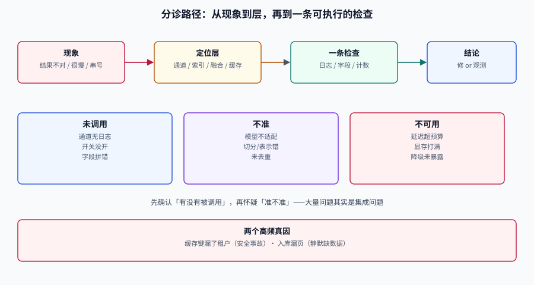

# 常见问题与最佳实践

多模态检索的故障有一个共同特征：**它不报错**。索引建完了、查询返回了、页面也渲染了，只是结果不对。所以分诊表比答案更重要——先定位是哪一层坏了，再谈怎么修。

这一页分四块：十二类现象的分诊路径、高频十二问、十二条可以立刻落地的实践、以及一组容易混用的术语。

## 判据族声明

本页判据族 `MMF-A` ~ `MMF-H`，共 8 条。定义表在第五节。

## 一、十二类现象分诊



| 现象 | 最可能坏的层 | 先做这一条检查 |
| --- | --- | --- |
| 文字能搜到，图搜图完全无结果 | 视觉通道未接入 | 查询日志里 `channel=visual` 是否有条目 |
| 图搜图能出结果，但都是同几张 | 近重复未去重 | 结果里 `doc_id` 去重后的数量 |
| 中文查询召回极差 | 模型语言能力 | 用同一查询的英文版本对比 Recall@10 |
| 表格内容搜不到 | 切分/表示方式 | 该页的 `text` 字段是否为空 |
| PDF 第 42 页怎么都搜不到 | 入库漏页 | 行数 + 跳过数 是否等于总页数 |
| 结果里同一文档占满前 10 | 折叠缺失 | 是否按 `doc_id` 折叠 |
| 加了重排反而更差 | 候选深度或权重 | Recall@N 曲线 + α 扫描 |
| 离线涨、线上不涨 | 查询分布不一致 | 线上抽样 50 条做人工评估 |
| P95 延迟突然翻倍 | 索引/批处理 | 分层命中率与 GPU 队列长度 |
| 换模型后全部结果变了 | 向量空间变更 | `index_version` 是否同步更新 |
| 偶发返回别的租户内容 | 过滤未下推 | 缓存键与检索请求是否含 `tenant` |
| 截图找页总是差一页 | 渲染偏移/页码基准 | 页码是从 1 还是 0 开始，是否含封面 |

::: danger 分诊的第一条纪律
**先确认「这一层有没有被调用」，再怀疑「这一层准不准」。** 大量「效果不好」的真实原因是某条通道根本没接上（超时被吞、开关没开、字段名拼错），而不是模型不行。
:::

## 二、高频十二问

### Q1：我到底该不该上视觉文档检索？

看三件事：文档里是否有表格/图表/多栏、OCR 错误率是否结构性偏高、答案是否需要引用原页。满足两条以上再上，否则成本不划算。详见 [总览](../Overview/index.md)。

### Q2：CLIP 和 SigLIP 2 怎么选？

自托管、多语言、需要原生分辨率 → SigLIP 2；只需英文且要最成熟的生态 → CLIP ViT-L/14 作为基线。中文语料必须实测，不要看英文榜单。

### Q3：为什么文搜图总是返回「风格像」而不是「内容像」？

因为 CLIP 类模型学的是**图文共现**，风格词在训练数据里与图片的关联很强。对策：加属性约束（颜色、材质、类目）做过滤，或引入重排看细节。

### Q4：多向量索引为什么这么大？

每页几百条 patch 向量，是单向量的几十到几百倍。三个压缩手段：int8 量化、减少 patch 数（降分辨率）、只对候选页保留多向量。

### Q5：MaxSim 能不能用普通向量库实现？

可以，但要在应用层做矩阵运算，且无法用 ANN 加速。做法是「单向量粗排 + 取回候选后应用层 MaxSim」。库原生支持（Qdrant 的 `multivector_config`）会省掉这一层。

### Q6：RRF 的 k 为什么要取 60？

原论文的经验值，作用是压低头部差异、让「多路都靠前」比「一路第一」更重要。它不是最优值，改 k 必须重跑评估。

### Q7：重排模型越大越好吗？

不是。候选深度 50、延迟预算 60 ms 时，一个大模型可能连一批都跑不完。**先定预算，再选模型**；listwise 适合长文档、离线或高预算场景。

### Q8：评估集要多少条？

200 条起家，能分辨约 8 个百分点的差异；要分辨 3 个百分点需要 1000 条级别，或用配对检验。数量不如分层重要。

### Q9：能不能用 LLM 自动标注？

可以做**初筛**（把明显不相关的剔掉），但相关性判定必须人工抽检。LLM 标注的系统性偏差（偏爱长文本、偏爱含关键词的结果）会直接变成你的指标偏差。

### Q10：为什么离线指标很好，线上没人用？

三种常见原因：查询分布不同（线上更短、更口语）、结果不可点击（没有页码/缩略图）、延迟太高（用户等不到）。逐个排查，不要先怀疑模型。

### Q11：多租户下最容易出的安全事故是什么？

**缓存键漏了租户**与**过滤在召回之后**。前者会把 A 租户的结果返回给 B，后者会让越权内容进入候选（即使最终被过滤，也已经泄露了「存在性」）。

### Q12：什么时候该换模型？

三个信号：评估集上 Recall@50 已成为瓶颈、现模型对你的语言/领域明显不适配、许可或成本不可接受。**不要因为榜单更新就换**——换模型意味着全量重建索引。

## 三、十二条最佳实践

1. **先建评估集，再选模型。** 200 条标注查询的成本，远低于一次错误选型的返工。
2. **元数据先于向量。** `doc_id`/`page_no`/`tenant` 缺失时，后面所有功能都做不了。
3. **入库对账。** 行数 + 跳过数 = 总页数，这一条能拦住大多数「某页搜不到」。
4. **过滤下推。** 权限、租户、时间范围必须进检索请求，不能后置。
5. **三路并行召回。** 字面、语义、视觉各管一段，融合用 RRF。
6. **路内先去重，再融合。** 否则名额会被同一文档的切片占满。
7. **相似度只用于召回。** 相关性交给重排或业务规则。
8. **重排前看召回曲线。** Recall@50 是端到端的天花板。
9. **阈值按查询类型标定。** 一个全局阈值必然误杀某一类。
10. **缓存键带三个版本。** 模型版本、索引版本、过滤条件摘要。
11. **降级要可见。** 响应头带当前档位，监控能告警。
12. **记录索引版本。** 「服务正常但索引是旧的」是最难发现的故障。

::: tip 如果只能做三件事
**建评估集、入库对账、过滤下推。** 前两件保证「你测的是真的」，第三件保证「不出安全事故」。模型选型可以后面再调。
:::

## 四、术语表

| 术语 | 英文 | 含义 | 容易混淆的点 |
| --- | --- | --- | --- |
| 模态鸿沟 | modality gap | 图文向量在空间中分成两簇的现象 | 不是「模型不准」，是训练目标导致的系统性偏移 |
| 后期交互 | late interaction | 各自编码、打分时逐 token 交互 | 与「交叉编码器」的早交互不同 |
| MaxSim | maximum similarity | 每个查询 token 取文档中最相似块的分数之和 | 不是最大单值，是**逐 token 求和** |
| 多向量 | multi-vector | 一个文档对应多条向量 | 不是「向量维度多」，是「条数多」 |
| 单向量 | single-vector / dense | 一个文档一条向量 | 与「稀疏向量」相对 |
| RRF | reciprocal rank fusion | 按名次倒数融合多路结果 | 不是加权平均，不能直接加分数 |
| nDCG | normalized DCG | 分级相关性下的排序质量 | 与 Recall 不同，它关心顺序 |
| 硬负样本 | hard negative | 看起来像但实际不相关的样本 | 不是随机负样本 |
| patch | patch | 页面/图片切出的小块 | 与「chunk」（文本切片）不是一回事 |
| 粗排/精排 | recall / rerank | 先保召回，再保精度 | 粗排不是「粗略的重排」 |

## 五、判据定义表

| 判据 | 约定 | 定错了会怎样 | 怎么验证 |
| --- | --- | --- | --- |
| `MMF-A` | 分诊必须先确认通道被调用 | 在没接上的通道上调参，白费时间 | 查询日志含各通道条数 |
| `MMF-B` | 每条分诊结论必须落到一条可执行检查 | 分诊表变成感想集 | 表里每行都有命令或字段名 |
| `MMF-C` | 术语必须在专题内保持单一含义 | 「多向量」被理解成高维向量，方案选错 | 术语表与正文用法一致 |
| `MMF-D` | 最佳实践必须能映射到具体判据 | 建议无法验证，等于没说 | 每条实践对应至少一条判据 |
| `MMF-E` | 故障复盘必须区分「未调用」与「不准」 | 把集成问题当模型问题 | 分诊记录含两层结论 |
| `MMF-F` | 换模型必须同时换索引版本 | 新旧向量混用，结果随机 | `index_version` 与 `model_version` 同步 |
| `MMF-G` | 降级与缓存问题必须有独立检查项 | 被当成「效果问题」长期搁置 | 分诊表含缓存/降级两行 |
| `MMF-H` | 问答必须给出适用前提 | 结论被无条件套用，场景错配 | 每个答案含条件或反例 |

## 如何验证

```shell
# 自查：六个最常漏的字段是否齐全（可直接改成 pytest 断言）
/Users/cuifendemac/.workbuddy/binaries/python/envs/default/bin/python3 - <<'PY'
required = {"doc_id", "page_no", "tenant", "text", "patch_count", "index_version"}
meta = {"doc_id":"ms-2841","page_no":3,"tenant":"t-01","text":"...","patch_count":612,"index_version":"2026-10-18-a"}
missing = required - meta.keys()
print("缺字段：", missing or "无")
print("结论：", "通过" if not missing else "阻断建索引")
PY
```

**预期输出**：`缺字段： 无` 与 `结论： 通过`。

```shell
# 自查：缓存键是否含三个必需维度
/Users/cuifendemac/.workbuddy/binaries/python/envs/default/bin/python3 - <<'PY'
def cache_key(model, index, tenant, filters, q):
    return "|".join([model, index, tenant, filters, q.strip().lower()])
k1 = cache_key("siglip2", "v3", "t-01", "kind=page", "MS-2841 重置")
k2 = cache_key("siglip2", "v3", "t-02", "kind=page", "MS-2841 重置")
print("同查询跨租户键相同？", k1 == k2)
print("键长度", len(k1))
PY
```

**预期输出**：`同查询跨租户键相同？ False`。如果输出 `True`，说明键里少了租户——这是安全事故级的缺陷。

## 参考资料

- [ColPali 论文](https://arxiv.org/abs/2407.01449)——多向量视觉检索的原理
- [Qdrant 文档](https://qdrant.tech/documentation/)——多向量、混合查询与过滤下推
- [ViDoRe 榜单](https://huggingface.co/spaces/vidore/vidore-leaderboard)——模型选型的公开对照
- [RAG · 常见问题](../../RAG/FAQ/index.md)——文本链路的对应分诊表
- 上一站：[实战](../Practice/index.md) · 回到：[专题首页](../index.md)
