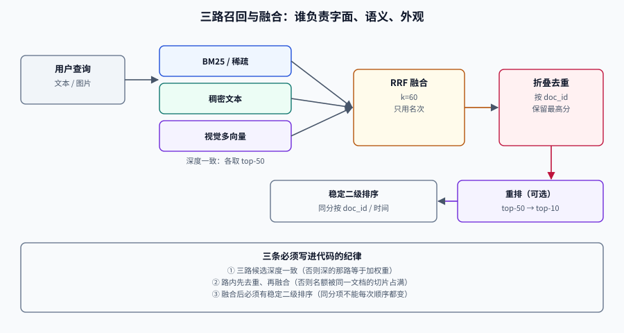

# 混合召回：三路候选怎么合成一份名单

单靠一路召回，在多模态场景里几乎必然漏。原因很朴素：**不同通道擅长的是不同的「像」**——BM25 擅长字面命中（型号、人名、条款号），稠密文本向量擅长语义改写（「退款」≈「退货退款」），视觉向量擅长「长得像」（同款、同版面）。把三者合成一份名单，是这一层唯一的工作。

难点不在「加权求和」这四个字，而在三件事：**分数不可比**、**候选会重复**、**融合后名额怎么分**。

## 判据族声明

本页判据族 `MMH-A` ~ `MMH-H`，共 8 条。定义表在第七节。

## 一、三路召回各自的能力边界



| 通道 | 打分方式 | 强项 | 盲区 | 典型故障 |
| --- | --- | --- | --- | --- |
| **BM25 / 稀疏** | 词频与逆文档频率 | 型号、编号、专有名词、条款号 | 同义改写、跨语言 | 查询词一个都不在文档里时全空 |
| **稠密文本** | 文本嵌入余弦 | 语义改写、长句意图 | 精确编号、罕见词 | 把「A 型号」召回成「B 型号」 |
| **视觉多向量** | MaxSim | 版面、图表、以图搜图 | 纯文字语义 | 相似版式的无关文档 |
| **元数据过滤** | 布尔条件 | 权限、时间、类目 | —— | 过滤过严导致候选不足 |

四者不是四选一，而是**四层漏斗**：元数据先缩小范围，三路各自召回，融合后交给重排。

::: tip 一句话理解
**融合的价值不是「让好结果分数更高」，而是「让只被一路召回到的结果不被丢掉」。** 一个结果只要被任意一路排进前 20，它就应该进入候选池。
:::

## 二、为什么不能直接把分数相加

三路分数的量纲完全不同：

| 通道 | 分数范围 | 分布形状 | 直接相加的后果 |
| --- | --- | --- | --- |
| BM25 | 0 ~ 几十（无上界） | 长尾 | 长文档天然占优 |
| 余弦 | −1 ~ 1（通常 0.2~0.9） | 窄峰 | 权重被 BM25 淹没 |
| MaxSim | 0 ~ token 数（如 0~12） | 与查询长度相关 | 长查询天然占优 |

所以融合只有两条正路：**只用名次（rank-based）** 或 **先归一化再用分数（score-based）**。

## 三、RRF：只用名次，最稳的默认

Reciprocal Rank Fusion 的公式只有一行：

```text
RRF(d) = Σ_r  w_r / (k + rank_r(d))
```

`k` 常取 60（原论文经验值），作用是**压低头部差异**：rank 1 与 rank 2 的贡献差是 `1/61 − 1/62 ≈ 0.00026`，而 rank 1 与 rank 20 的差是 `1/61 − 1/80 ≈ 0.0039`。也就是说，它更在意「有没有进前列」，而不是「第一还是第二」。

手算一遍（k=60，两路各 5 条）：

```shell
/Users/cuifendemac/.workbuddy/binaries/python/envs/default/bin/python3 - <<'PY'
k = 60
dense  = ["p7", "p3", "p11", "p2", "p9"]
sparse = ["p3", "p2", "p7", "p15", "p1"]
score = {}
for lst in (dense, sparse):
    for rank, doc in enumerate(lst, 1):
        score[doc] = score.get(doc, 0) + 1 / (k + rank)
for doc, s in sorted(score.items(), key=lambda x: -x[1]):
    print(f"{doc:5s} {s:.5f}")
PY
```

**预期输出**：

```text
p3    0.03252
p7    0.03227
p2    0.03175
p11   0.01587
p15   0.01562
p9    0.01538
p1    0.01538
```

**三个可读出来的结论**：

1. `p3` 在两路都是第 2/第 1，总分最高；`p7` 在第 1/第 3，紧随其后——**两路都靠前的结果自然胜出**。
2. `p11` 只被一路召回（第 3），仍排在只被另一路召回第 4 的 `p15` 前面——**单路高分不会被埋没**。
3. `p9` 与 `p1` 同分（0.01538）——**RRF 会产生并列**，必须有稳定的二级排序（通常按文档 ID 或时间），否则每次查询顺序都在抖。

### RRF 的三个参数与纪律

| 参数 | 建议 | 说明 |
| --- | --- | --- |
| `k` | 60 | 调小会让头部更集中，调大会更平均；**改 k 必须重跑评估** |
| 各路权重 `w_r` | 从 1.0 起 | 视觉通道在「以图搜图」场景可提到 1.5~2.0 |
| 各路候选深度 | 相同（如 50） | 深度不一致时，深的那路会系统性占优 |

::: danger RRF 的三个坑
1. **各路候选深度不同却直接融合**——深度 100 的那路会贡献更多条目，等于变相加权。
2. **把「未召回」当成 rank = ∞ 以外的某个大数**——公式里没有这一项，未召回就是不参与求和，不能补一个 1000 占位。
3. **融合后不做去重**——同一文档的不同切片会各占一个名次，把前 10 挤满（见第五节）。
:::

## 四、加权融合：需要归一化，也需要理由

当某一路明显更可信（例如自有评估集上视觉通道 nDCG 高 15 个点），可以用分数融合：

```text
score(d) = Σ_r w_r · norm_r(score_r(d))
```

归一化的三种做法与代价：

| 方法 | 做法 | 优点 | 缺点 |
| --- | --- | --- | --- |
| Min-Max | `(s − min) / (max − min)` | 简单 | 对离群值极敏感，单条异常分能压扁其余 |
| Z-Score | `(s − μ) / σ` | 保留分布形状 | 假设近似正态，长尾下不稳 |
| 分布归一（DBSF） | 按本次候选集的均值/方差归一后融合 | 自适应 | 每次查询的归一化基准不同，跨查询不可比 |

Qdrant 的实践口径值得借用：**默认 RRF，只有当分数分布本身可信、且你希望绝对分数影响排序时才用 DBSF**。

## 五、去重与多样性：名额比分数更稀缺

融合后的前 10 个名额，经常被同一份文档的 8 个切片占满。两种处理：

| 手段 | 做法 | 适用 |
| --- | --- | --- |
| **硬去重** | 同一 `doc_id` 只保留最高分切片 | 用户要「找文档」，不是「找段落」 |
| **MMR** | `argmax[ λ·sim(q,d) − (1−λ)·max sim(d, 已选) ]` | 用户要「看不同角度」，如调研、比价 |
| **配额** | 每个 `doc_id` 最多 2 条 | 折中，保留上下文又不刷屏 |

`λ` 的直觉：`λ=1` 退化为纯相关性排序，`λ=0` 只选「互相最不像」的。实践从 **0.7** 起，在评估集上看 nDCG 与「不同文档数」两个指标一起动。

::: warning 去重发生在哪一层，决定了它能不能救你
在**融合之后**去重，前 10 里可能已经全是重复项，去重后只剩 2 条；在**每路召回内部**先去重（同一文档多切片只留最高分），融合时才有足够的不同文档可选。正确顺序是：路内去重 → 融合 → 结果级折叠。
:::

## 六、跨模态查询改写

文本查询要打视觉索引时，直接拿原句编码往往不够——用户说「上次开会那张架构图」，图像塔没见过「上次开会」。三种改写策略：

| 策略 | 做法 | 成本 | 适用 |
| --- | --- | --- | --- |
| **属性展开** | 把查询拆成「视觉属性 + 文字约束」：`{主体: 架构图, 风格: 手绘, 文字: 支付}` | 一次小模型调用 | 商品、设计素材 |
| **描述生成** | 让 VLM 生成一句「这张图长什么样」，再用文本塔编码 | 一次 VLM 调用 | 通用场景，延迟敏感时不可用 |
| **查询侧多向量** | 查询也编码成多个 token 向量，直接与页面 patch 做 MaxSim | 无额外调用 | 已上视觉原生索引 |

反过来，**图搜文**的改写是「生成描述 + 抽取实体」：先用 VLM 产出 1~2 句描述与关键词，再分别打文本索引。这条路径的隐患是**描述会丢细节**，所以只用于召回，不用于最终判定。

## 七、判据定义表

| 判据 | 约定 | 定错了会怎样 | 怎么验证 |
| --- | --- | --- | --- |
| `MMH-A` | 各路候选深度必须一致或显式加权 | 深的那路系统性占优 | 配置里三路 `limit` 相同或有权重记录 |
| `MMH-B` | 融合必须用 RRF 或归一化后加权 | 原始分数相加，量纲大的通道垄断 | 融合代码里无裸分数相加 |
| `MMH-C` | 融合结果必须有稳定二级排序 | 同分项顺序抖动，体验不稳 | 排序键含 `doc_id` 或时间戳 |
| `MMH-D` | 必须在每路内部先去重再融合 | 同一文档多切片挤满名额 | 召回阶段按 `doc_id` 取最高分 |
| `MMH-E` | 多样性策略必须写明 λ 与目标 | 前 10 全是同文档，或全不相关 | 评估报表含「不同文档数」 |
| `MMH-F` | 元数据过滤必须下推到每一路 | 过滤后候选不足，或越权进候选 | 每路请求都带同一组过滤条件 |
| `MMH-G` | 跨模态改写只用于召回，不用于判定 | 描述丢细节，误判相关性 | 判定由重排或规则完成 |
| `MMH-H` | 融合参数变更必须重跑评估集 | 调参靠感觉，回退无依据 | 参数与指标同表记录 |

## 如何验证

```shell
# ① 三路融合：验证「单路高分不被埋没」与「并列有稳定次序」
/Users/cuifendemac/.workbuddy/binaries/python/envs/default/bin/python3 - <<'PY'
k = 60
lists = {
    "bm25":   ["a", "b", "c", "d"],
    "dense":  ["c", "a", "e", "b"],
    "visual": ["c", "e", "a", "f"],
}
score = {}
for name, lst in lists.items():
    for rank, doc in enumerate(lst, 1):
        score[doc] = score.get(doc, 0) + 1 / (k + rank)
rows = sorted(score.items(), key=lambda x: (-x[1], x[0]))
for doc, s in rows:
    print(f"{doc} {s:.5f}")
PY
```

**预期输出**：`c 0.04866`、`a 0.04840`、`e 0.03200`、`b 0.03175`、`d 0.01562`、`f 0.01562`。

**判读**：`c` 在三路都在前列，稳居第一；`f` 只被视觉路召回（第 4），仍然进榜——这正是融合要保住的「单路独有」。把 `sorted` 的第二个键去掉再跑几次，你会看到并列项顺序变化，这就是 `MMH-C` 要拦的问题。

```shell
# ② 路内去重：同一文档的多个切片只保留最高分
/Users/cuifendemac/.workbuddy/binaries/python/envs/default/bin/python3 - <<'PY'
hits = [("docA", 0.91, "p3"), ("docB", 0.88, "p1"), ("docA", 0.87, "p7"), ("docC", 0.85, "p2")]
best = {}
for doc, score, chunk in hits:
    if doc not in best or score > best[doc][0]:
        best[doc] = (score, chunk)
print(sorted(((d, s, c) for d, (s, c) in best.items()), key=lambda x: -x[1]))
PY
```

**预期输出**：`[('docA', 0.91, 'p3'), ('docB', 0.88, 'p1'), ('docC', 0.85, 'p2')]`。判据是**去重后每个 `doc_id` 恰好一条，且分数取该文档的最高值**。

## 参考资料

- [Reciprocal Rank Fusion 原论文](https://plg.uwaterloo.ca/~gvcormac/cormacksigir09-rrf.pdf)——`k=60` 的出处与实验
- [Qdrant 混合检索与融合](https://qdrant.tech/documentation/concepts/hybrid-queries/)——RRF 与 DBSF 的实现口径
- [RAG · 检索优化](../../RAG/Retrieval/index.md)——文本链路的查询改写与融合
- [向量数据库 · 混合检索](../../../DB/VectorDatabase/HybridSearch/index.md)——稠密 + 稀疏的融合细节
- 上一站：[视觉文档检索](../VisualDocument/index.md) · 下一站：[重排](../Rerank/index.md)
