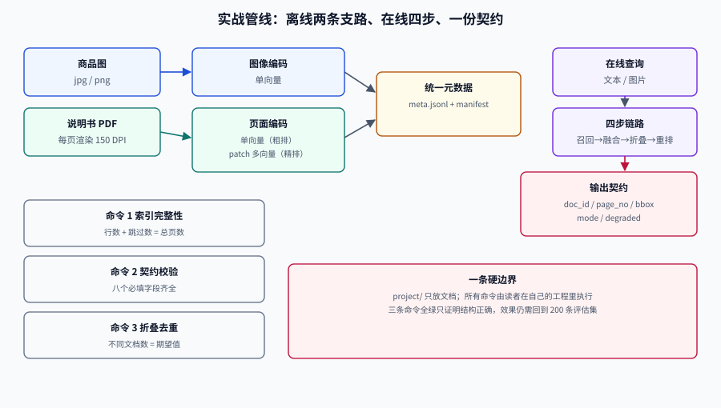

# 实战：商品图搜 + 说明书截图检索

这一页把前面六页拼成一条**可以照着搭起来**的管线：一个库同时装两类东西——**商品图**（图搜图、文搜图）与**产品说明书页**（文搜页、截图找页）。两类共用一个元数据层、一套融合逻辑、一份输出契约，但索引表示不同。

实战的目标不是「跑出一个 demo」，而是**跑出一套你能判断对错的系统**：每个阶段都有可验证的输入输出，每条判据都能被一条命令检查。

## 判据族声明

本页判据族 `MMP-A` ~ `MMP-H`，共 8 条。定义表在第七节。

## 一、需求与验收口径

| 编号 | 需求 | 验收方式 |
| --- | --- | --- |
| R1 | 文搜图：输入中文描述，返回商品图 | 30 条中文查询，Recall@10 ≥ 0.85 |
| R2 | 图搜图：上传商品图，返回同款/相似款 | 20 组同款对，Recall@10 ≥ 0.80 |
| R3 | 文搜页：输入问题，返回说明书页码 | 40 条问题，nDCG@10 ≥ 0.80 |
| R4 | 截图找页：上传截图，返回原页 | 15 张截图，Top-3 命中 ≥ 0.80 |
| R5 | 所有结果可回指原页 | 响应含 `doc_id` + `page_no` |
| R6 | P95 延迟 ≤ 300 ms | 压测 50 并发 |

::: tip 先用 R5 卡住架构
「结果能回指原页」这条看似简单，但它决定了整条链路的切片粒度与存储结构。很多项目在第三周才发现「结果只有图没有页码」，那时索引已经建完，只能重建。
:::

## 二、数据与目录约定

```text
corpus/
├─ images/                    # 商品图，jpg/png
│  └─ sku-1001/main.jpg
└─ manuals/                   # 说明书 PDF
   └─ ms-2841.pdf
work/
├─ pages/                     # 渲染后的页面图（每页一张）
├─ index/
│  ├─ meta.jsonl              # 元数据（每页/每图一行）
│  ├─ dense.faiss             # 单向量索引（示意）
│  └─ multi/                  # 多向量（patch 矩阵，按 doc 分片）
└─ manifest.json              # 索引版本、模型版本、维度、patch 预算
```

`meta.jsonl` 每行的最小字段（**缺一不可**）：

```json
{"id":"manual:ms-2841:p3","doc_id":"ms-2841","page_no":3,"kind":"page","tenant":"t-01","text":"...","image":"work/pages/ms-2841-3.png","patch_count":612,"index_version":"2026-10-18-a"}
```

| 字段 | 为什么必须有 |
| --- | --- |
| `id` | 检索结果主键，必须全局唯一 |
| `doc_id` + `page_no` | 结果折叠与回指原页 |
| `kind` | 区分「商品图」与「文档页」，决定走哪条打分 |
| `tenant` | 权限过滤下推的字段 |
| `text` | 稀疏通道与文本兜底 |
| `patch_count` | patch 预算与成本核算 |
| `index_version` | 缓存键与灰度回滚 |

## 三、离线索引：两条支路，一份元数据



| 支路 | 输入 | 处理 | 产物 |
| --- | --- | --- | --- |
| **商品图** | 原图 | 统一缩放（长边 1024）+ 图像编码 | 单向量 + 元数据 |
| **说明书** | PDF | 渲染 150 DPI → 空白页剔除 → patch 编码 + 页面级单向量 | 多向量 + 单向量 + 元数据 |

### 索引清单（可直接当验收表）

```text
1. 渲染：pdftoppm -r 150 -png ms-2841.pdf work/pages/ms-2841
2. 空白页剔除：像素方差 < 阈值 → 跳过，并记录 skipped 数
3. 页面单向量：整页缩放到 448 长边后编码（用于 L1 粗排）
4. patch 多向量：不缩放，按模型原生分辨率切 patch（用于 L2 精排）
5. 元数据落盘：每页一行 JSONL，含 patch_count 与 index_version
6. 计数对账：meta.jsonl 行数 + skipped 数 = PDF 总页数
```

第 6 步是**最容易被跳过、也最容易发现漏页**的一步。渲染失败、加密页、损坏页都会导致行数对不上，而这类缺失在检索时完全静默。

## 四、在线链路：四步与一份契约

```text
① 查询解析：文本 → 归一化 + 属性抽取；图片 → 编码
② 三路召回（并行）：BM25 / 页面单向量 / patch 多向量
③ 融合：RRF(k=60) → 按 doc_id 折叠 → 取 top-10
④ 重排（可选）：对 top-10 做交叉编码器或多向量精算
```

### 输出契约

```json
{
  "query": "MS-2841 怎么重置",
  "mode": "hybrid",
  "took_ms": 187,
  "degraded": null,
  "results": [
    {
      "doc_id": "ms-2841",
      "page_no": 3,
      "score": 0.0323,
      "title": "MS-2841 快速入门",
      "snippet": "长按 RESET 十秒恢复出厂设置",
      "image_url": "https://cdn.example.com/pages/ms-2841-3.png",
      "bbox": [120, 340, 880, 520]
    }
  ]
}
```

契约里有五个字段是**判据的落点**，不能省：

| 字段 | 用途 | 缺失后果 |
| --- | --- | --- |
| `mode` | 记录走了哪条链路（hybrid / text-only / degraded） | 出问题无法归因 |
| `degraded` | 降级原因 | 用户看到差结果但系统显示正常 |
| `page_no` | 回指原页 | 无法核对 |
| `bbox` | 命中区域（截图找页必需） | 用户还要自己找 |
| `score` | 排序依据 | 无法复现排序 |

## 五、冷启动：没有标注数据时怎么办

新库上线时没有评估集，但**不能没有判断标准**。三步走：

| 步骤 | 做法 | 产出 |
| --- | --- | --- |
| **合成查询** | 从文档标题、图表标题、商品属性生成 100 条查询 | 初版评估集（标注质量一般，但能跑） |
| **交叉标注** | 两人各标 50 条，算 kappa | 判定指南的第一版修订 |
| **真实查询注入** | 上线后每周抽 20 条真实查询脱敏补入 | 评估集逐步贴近线上 |

合成查询的**陷阱**是「查询与文档用词过于一致」，导致指标虚高。缓解办法：改写时强制加入同义词、口语化表达、错别字各 1/3。

## 六、验收：三条命令

### 命令 1：索引完整性

```shell
# 元数据行数 + 跳过页数 必须等于 PDF 总页数
/Users/cuifendemac/.workbuddy/binaries/python/envs/default/bin/python3 - <<'PY'
meta_lines, skipped, pdf_pages = 612, 8, 620
print("对账：", "OK" if meta_lines + skipped == pdf_pages else f"MISMATCH {meta_lines+skipped} != {pdf_pages}")
print("patch 预算：", "OK" if 0 < 612 <= 768 else "OVER BUDGET")
PY
```

**预期输出**：`对账： OK` 与 `patch 预算： OK`。任一不 OK 时**不要继续建索引**——后面所有指标都会建立在缺页的数据上。

### 命令 2：契约校验

```shell
/Users/cuifendemac/.workbuddy/binaries/python/envs/default/bin/python3 - <<'PY'
resp = {"query":"MS-2841 怎么重置","mode":"hybrid","took_ms":187,"degraded":None,
        "results":[{"doc_id":"ms-2841","page_no":3,"score":0.0323,"bbox":[120,340,880,520]}]}
need_top = {"query","mode","took_ms","results"}
need_item = {"doc_id","page_no","score","bbox"}
assert need_top <= resp.keys(), need_top - resp.keys()
assert all(need_item <= r.keys() for r in resp["results"])
assert resp["results"][0]["bbox"][2] > resp["results"][0]["bbox"][0]
print("契约 OK，结果数", len(resp["results"]))
PY
```

**预期输出**：`契约 OK，结果数 1`。

### 命令 3：折叠与多样性

```shell
/Users/cuifendemac/.workbuddy/binaries/python/envs/default/bin/python3 - <<'PY'
hits = [("ms-2841",3),("ms-2841",4),("ms-2841",5),("sku-1001",1),("ms-2842",2)]
seen, out = set(), []
for doc, page in hits:
    if doc in seen: continue
    seen.add(doc); out.append((doc, page))
print("折叠后", out)
print("不同文档数", len(out), "原始条数", len(hits))
PY
```

**预期输出**：`折叠后 [('ms-2841', 3), ('sku-1001', 1), ('ms-2842', 2)]`、`不同文档数 3 原始条数 5`。

三条命令都通过，只能说明**结构正确**；效果对不对，仍然要回到 [评估](../Evaluation/index.md) 的 200 条评估集。

## 七、判据定义表

| 判据 | 约定 | 定错了会怎样 | 怎么验证 |
| --- | --- | --- | --- |
| `MMP-A` | 元数据必须含 `doc_id`/`page_no`/`kind`/`tenant` | 无法折叠、无法鉴权、无法回指 | JSONL 字段校验脚本 |
| `MMP-B` | 入库必须做「行数 + 跳过数 = 总页数」对账 | 缺页静默，指标建立在残缺数据上 | 命令 1 |
| `MMP-C` | 每页 patch 数必须记录且不超预算 | 存储与延迟随个别大页失控 | `patch_count` 字段 + 阈值检查 |
| `MMP-D` | 响应契约必须含 `mode` 与 `degraded` | 降级不可见，问题无法归因 | 命令 2 |
| `MMP-E` | 结果必须按 `doc_id` 折叠 | 同一文档刷屏 | 命令 3 |
| `MMP-F` | 冷启动评估集必须含改写后的查询 | 指标虚高，上线即跌 | 评估集里有口语/同义/错字样本 |
| `MMP-G` | 索引必须带版本号并可回滚 | 换模型后无法回到上一版 | `manifest.json` 有版本与时间 |
| `MMP-H` | 验收必须同时覆盖结构正确与效果达标 | 结构全绿但结果无用 | 三条命令 + 评估集报告 |

## 参考资料

- [ViDoRe 数据集与基线](https://huggingface.co/vidore)——视觉文档检索的公开数据与评测口径
- [Qdrant 多向量与 `prefetch`](https://qdrant.tech/documentation/concepts/hybrid-queries/)——两段式检索的参考实现
- [RAG · 实战案例](../../RAG/Practice/index.md)——文本链路的端到端实战，可与本页对照
- [完整项目交付](../../../Others/ProjectDelivery/index.md)——把这条管线放进项目时的交付清单
- 上一站：[服务化](../Serving/index.md) · 下一站：[常见问题](../FAQ/index.md)
