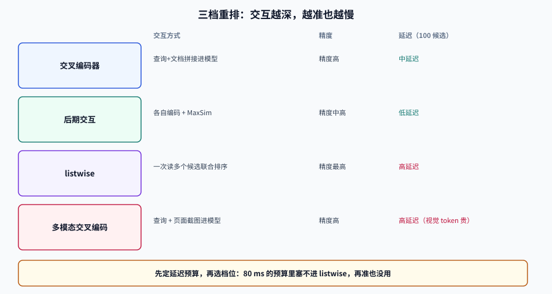

# 重排：把「可能相关」排成「确实相关」

召回阶段的目标是**别漏**，重排阶段的目标是**别错**。这两件事的代价结构完全不同：召回错一条，用户可能还能往下翻；重排把不相关的结果放在第一位，用户就直接走了。

多模态场景的重排比文本多一层麻烦：**候选可能是图片、页面或图块，判定「相关」往往需要同时看图和文字**。这一页讲三档重排的取舍、候选深度的算法、延迟预算怎么算，以及分数校准这件最容易被跳过的事。

## 判据族声明

本页判据族 `MMR-A` ~ `MMR-H`，共 8 条。定义表在第七节。

## 一、三档重排：交互越深，越准也越慢



| 档位 | 交互方式 | 代表 | 精度 | 延迟（100 候选） | 能否自托管 |
| --- | --- | --- | --- | --- | --- |
| **交叉编码器**（cross-encoder） | 查询与文档拼接后进模型，输出一个分 | BGE Reranker v2-m3、Qwen3-Reranker | 高 | 中（每对一次前向） | 能（Apache 2.0） |
| **后期交互**（late interaction） | 各自编码，MaxSim 打分 | ColBERT、ColPali/ColQwen | 中高 | 低（矩阵运算） | 能 |
| **listwise** | 一次读多个候选，联合排序 | jina-reranker-v3（最多 64 篇、131K 上下文） | 最高 | 高（长上下文） | 能（小模型）/API |
| **多模态交叉编码器** | 查询 + 图片/页面截图一起进模型 | Qwen3-VL-Reranker-2B/8B | 高 | 高（视觉 token 贵） | 能（Apache 2.0） |

选档位的顺序是**先看延迟预算，再看精度上限**。一个 80 ms 的预算里塞不进 listwise，再准也没用。

## 二、候选深度：重排只优化「已经召回的」

重排不能凭空找回没被召回的东西。这条常识有个精确版本：

```text
端到端 Recall@10 ≤ 召回阶段 Recall@N     （N = 重排候选深度）
```

所以重排之前必须先看**召回曲线**：如果 `Recall@50 = 0.72`，那么无论重排多好，端到端 Recall@10 的天花板就是 0.72。

| 候选深度 N | 典型 Recall@N | 重排成本 | 建议 |
| --- | --- | --- | --- |
| 20 | 0.55~0.70 | 低 | 只适合高精度小库 |
| 50 | 0.75~0.85 | 中 | **默认起点** |
| 100 | 0.85~0.92 | 中高 | 精度优先 |
| 200+ | 0.90~0.95 | 高 | 需要 listwise 或分批 |

::: tip 一条省钱的纪律
**先花时间把 Recall@50 从 0.72 提到 0.88，再考虑换更贵的重排模型。** 前者通常只需要改切分、加一路召回或换嵌入模型；后者是在一个已经很窄的天花板下继续投入。
:::

## 三、延迟与成本预算

重排的成本近似线性于 `候选数 × 每条长度`。算一笔账：

```text
100 个候选 × 每条 500 token = 50,000 token/查询
按 $0.05 / 1M token 计 → $0.0025/查询 → 日 100 万查询约 $2,500
```

三条压缩路径，按性价比排序：

| 手段 | 效果 | 代价 |
| --- | --- | --- |
| **截断候选**（100 → 50） | 成本减半 | 端到端召回上限下降 |
| **截断文档**（500 → 200 token） | 成本降 60% | 长文档的关键段可能被截掉 |
| **批处理 + GPU** | 吞吐提升 3~10 倍 | 需要自托管与显存规划 |
| **缓存**（查询归一化后哈希） | 重复查询近乎免费 | 命中率取决于查询分布 |

**截断文档这一条在多模态里格外危险**：页面截图被缩放后，小字会糊；正确做法是**按 patch 命中位置裁剪**，只把最相关的区域送去重排，而不是等比缩小整页。

## 四、分数校准：重排分不能直接当阈值

重排模型的输出分通常是**未校准的 logit**。同一个模型，对不同查询的分数分布可能完全不同：

| 查询类型 | 正确结果分数 | 错误结果分数 | 固定阈值 0.5 的后果 |
| --- | --- | --- | --- |
| 短关键词 | 0.31 | 0.12 | 正确结果被全部滤掉 |
| 长自然语言 | 0.88 | 0.35 | 正常 |

三种处理方式：

1. **不设绝对阈值，只取 top-k**——最简单，适合「总要有结果」的场景。
2. **按查询类型分组标定阈值**——在评估集上分别取 P10 / P25 分位。
3. **做概率校准**（Platt / 等渗回归）——需要标注数据，适合对「置信度」有对外承诺的场景。

### 与一阶段分数融合

常见做法是把重排分与召回分线性混合：

```text
final = α · norm(rerank) + (1 − α) · norm(first_stage)
```

**α 必须用评估集定，而且常常出现「纯重排更好」的结果。** 下面这组 10 个候选的例子就很典型：

```shell
/Users/cuifendemac/.workbuddy/binaries/python/envs/default/bin/python3 - <<'PY'
import math
cands = [("c1",0.82,0.11,3),("c2",0.80,0.72,3),("c3",0.78,0.05,0),
         ("c4",0.74,0.65,2),("c5",0.70,0.09,0),("c6",0.66,0.44,1),
         ("c7",0.61,0.58,2),("c8",0.58,0.02,0),("c9",0.52,0.31,1),("c10",0.49,0.66,3)]
def ndcg(order):
    dcg = sum((2**r-1)/math.log2(i+2) for i,(_,_,_,r) in enumerate(order))
    idcg = sum((2**r-1)/math.log2(i+2) for i,r in enumerate(sorted((c[3] for c in cands), reverse=True)))
    return dcg/idcg
first  = sorted(cands, key=lambda x: -x[1])
rerank = sorted(cands, key=lambda x: -x[2])
blend  = sorted(cands, key=lambda x: -(0.3*x[1] + 0.7*x[2]))
for name, order in [("一路召回", first), ("纯重排", rerank), ("0.3/0.7 混合", blend)]:
    print(f"{name:10s} nDCG@10={ndcg(order):.4f}  top3={[c[0] for c in order[:3]]}")
PY
```

**预期输出**：`一路召回 nDCG@10=0.9076 top3=['c1','c2','c3']`、`纯重排 nDCG@10=0.9572 top3=['c2','c10','c4']`、`0.3/0.7 混合 nDCG@10=0.9282 top3=['c2','c4','c10']`。

**判读**：这组数据里纯重排最好，混合反而把 `c1`（高召回分、低重排分、相关性 3）拉回了前面。结论不是「混合一定差」，而是**混合权重不能拍脑袋**——它必须和「重排模型在你的语料上是否可信」一起判断。如果重排模型只在部分类目上可靠，混合才有意义。

## 五、多模态重排的三个特殊问题

### 问题 1：视觉 token 太贵

一张 150 DPI 的 A4 页渲染成图，视觉 token 可能是纯文本的 10~30 倍。三个缓解手段：降分辨率（会糊小字）、裁剪命中区域（推荐）、先用后期交互粗筛再送交叉编码器。

### 问题 2：同一文档的多个切片互相「竞争」

重排是逐条打分的，同一文档的 5 个切片会各自拿到高分，把名额占满。**重排前按文档聚合**（取最高分或加权平均），或者重排后按 `doc_id` 折叠。

### 问题 3：相关性定义不唯一

「这张图相关吗」至少有三种含义：内容相关、风格相关、可回答问题。三者混在一个重排模型里，分数就没法解释。做法是**把相关性写成一句判据**，作为重排模型的指令（listwise 模型支持指令），并在评估集里按类型分层。

## 六、什么时候不该加重排

| 情况 | 判断依据 | 应该做什么 |
| --- | --- | --- |
| 召回 Recall@50 < 0.6 | 评估集读数 | 先修召回，重排无用 |
| 延迟预算 < 30 ms | 端到端 SLO | 用后期交互或不做重排 |
| 候选之间差异极小 | 同一模板的页面 | 去重 + 业务规则，不用模型 |
| 没有评估集 | 无法验证 | 先建 200 条评估集 |

## 七、判据定义表

| 判据 | 约定 | 定错了会怎样 | 怎么验证 |
| --- | --- | --- | --- |
| `MMR-A` | 候选深度必须由召回曲线决定并记录 | 深度随意，端到端指标无法解释 | 有 Recall@N 曲线与选值依据 |
| `MMR-B` | 重排前必须先看 Recall@N 天花板 | 在漏召回的数据上优化排序，白做功 | 报告里同时给召回与重排指标 |
| `MMR-C` | 重排分不得直接当概率阈值 | 不同查询类型被同一阈值误杀 | 阈值按查询类型标定或只取 top-k |
| `MMR-D` | 混合权重必须由评估集确定 | 拍脑袋的 α 让效果回退 | 有 α 扫描记录与选定值 |
| `MMR-E` | 视觉候选必须支持按命中区域裁剪 | 整页缩放导致小字不可读 | 重排输入来自 patch 命中区域 |
| `MMR-F` | 同一文档多切片必须在重排前后聚合 | 名额被同文档占满 | 结果按 `doc_id` 折叠 |
| `MMR-G` | 相关性定义必须写成可判定的判据 | 模型与标注者对「相关」理解不同 | 评估指南含判据与反例 |
| `MMR-H` | 重排上线必须有 A/B 或灰度对照 | 离线涨、线上跌，无法归因 | 有灰度流量与对照指标 |

## 如何验证

```shell
# ① 延迟预算：候选数 × 每条 token 数，换算成单查询成本
/Users/cuifendemac/.workbuddy/binaries/python/envs/default/bin/python3 - <<'PY'
def cost(n, tokens, price_per_m=0.05):
    total = n * tokens
    return total, total / 1e6 * price_per_m
for n, t in [(50, 500), (100, 500), (100, 200)]:
    total, c = cost(n, t)
    print(f"候选 {n:3d} × {t} token = {total:6d} token/查询，${c:.5f}/查询，日百万 ${c*1e6:,.0f}")
PY
```

**预期输出**：`候选  50 × 500 token =  25000 token/查询，$0.00125/查询，日百万 $1,250`；`候选 100 × 500 … $0.00250 … $2,500`；`候选 100 × 200 … $0.00100 … $1,000`。**先把这三个数和你的预算对齐，再选模型。**

```shell
# ② 聚合去重：同一文档多切片只保留最高分，验证名额不被占满
/Users/cuifendemac/.workbuddy/binaries/python/envs/default/bin/python3 - <<'PY'
rows = [("docA", 0.92, "p3"), ("docA", 0.90, "p5"), ("docB", 0.88, "p1"), ("docA", 0.85, "p9")]
best = {}
for doc, s, chunk in rows:
    best[doc] = max(best.get(doc, (0, "")), (s, chunk))
print(sorted(((d, s, c) for d, (s, c) in best.items()), key=lambda x: -x[1]))
PY
```

**预期输出**：`[('docA', 0.92, 'p3'), ('docB', 0.88, 'p1')]`。判据是**聚合后每个文档一条，且取最高分切片**。

## 参考资料

- [Qwen3-VL-Reranker](https://huggingface.co/Qwen)——多模态重排的开源选项（Apache 2.0）
- [jina-reranker-v3](https://jina.ai/)——listwise 重排与 131K 上下文
- [Cohere Rerank 4](https://cohere.com/rerank)——托管重排的 Pro / Fast 两档
- [BGE Reranker v2-m3](https://huggingface.co/BAAI/bge-reranker-v2-m3)——自托管基线
- 上一站：[混合召回](../HybridRecall/index.md) · 下一站：[评估](../Evaluation/index.md)
