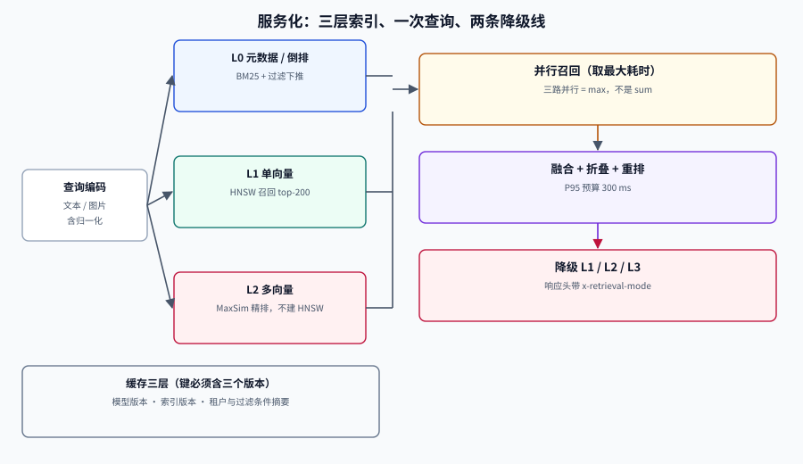

# 服务化：索引分层、批处理与降级

原型和线上系统的差别，不在模型，而在**四个约束同时成立**：P95 延迟、单查询成本、并发下的显存、以及「模型服务挂了怎么办」。多模态检索在这四条上都比文本检索更紧——一次查询要跑编码、多路召回、MaxSim、可能还有一次视觉重排。

这一页讲工程化的五件事：索引怎么分层、GPU 怎么排队、缓存怎么不串、延迟怎么拆、降级怎么设计。

## 判据族声明

本页判据族 `MMS-A` ~ `MMS-H`，共 8 条。定义表在第七节。

## 一、索引分层：三层结构，各司其职



| 层 | 存什么 | 查询方式 | 量级 | 更新频率 |
| --- | --- | --- | --- | --- |
| **L0 元数据 / 倒排** | 文档 ID、租户、时间、类目、OCR 文本 | 过滤 + BM25 | 与文档同量级 | 实时 |
| **L1 单向量** | 页面/图片的稠密向量 | HNSW / IVF | 每页 1 条 | 准实时 |
| **L2 多向量** | patch 矩阵 | MaxSim（不开 HNSW） | 每页几百条 | 天级重建 |

分层的意义是**让 90% 的查询只碰 L0 + L1**，只有需要细节的查询才下探到 L2。如果所有查询都走 L2，延迟和成本会同时失控。

| 分层策略 | 何时用 | 代价 |
| --- | --- | --- |
| 全部走 L2 | 库小于 10 万页、精度优先 | 延迟高、成本高 |
| L1 粗排 + L2 精排（推荐） | 大多数生产场景 | 需要两套表示，入库成本翻倍 |
| 只走 L1 | 纯文搜图、商品图搜 | 丢失版面细节 |

## 二、延迟预算：先分配，再优化

给一个 300 ms 的 P95 预算，按阶段拆分：

| 阶段 | 预算 | 说明 |
| --- | --- | --- |
| 查询理解 / 改写 | 30 ms | 小模型或规则；能省则省 |
| 查询编码（文本 + 图像） | 35 ms | 图像编码是变量，取决于分辨率 |
| L0 过滤 + L1 召回 | 60 ms | 三路并行，取最慢的一路 |
| 融合 + 去重 | 10 ms | 纯内存计算 |
| L2 精排（MaxSim） | 80 ms | 候选 200，随候选数线性增长 |
| 重排（可选） | 60 ms | 交叉编码器，候选 50 |
| 组装与序列化 | 15 ms | 含缩略图 URL 签名 |
| **合计** | **290 ms** | 留 10 ms 余量 |

::: danger 延迟预算的三个错误做法
1. **按平均值分配**——P95 才是用户感知的延迟，平均值会掩盖长尾。
2. **把各路召回串行执行**——三路本可并行，串行会让 60 ms 变成 180 ms。
3. **不留余量**——任何一次 GC 或冷启动都会击穿 SLO。
:::

**并行是最大的免费优化**：三路召回并行后，延迟从「三路之和」变成「三路最大值」。这一条通常能省 100 ms 以上，且不需要换任何模型。

## 三、GPU 与批处理：把「一次次算」变成「一批批算」

图像编码与重排都是 GPU 负载，单条推理的利用率极低。三件事必须做：

| 手段 | 做法 | 收益 |
| --- | --- | --- |
| **动态批处理** | 收集 5~10 ms 内的请求一起前向 | 吞吐提升 3~8 倍 |
| **请求排队上限** | 队列超过 N 条直接拒绝或降级 | 防止雪崩 |
| **异步索引** | 入库走离线队列，不与查询争 GPU | 查询延迟稳定 |

**入库与查询必须抢不同的资源池**。一个常见的生产事故是：白天批量重导入 20 万页，GPU 被离线任务占满，线上查询 P99 从 200 ms 涨到 4 s。做法是**离线任务限速**（例如不超过 GPU 的 50%）或干脆用独立实例。

### 显存估算的量级感

| 场景 | 显存 | 说明 |
| --- | --- | --- |
| 3B 级 VLM 编码（fp16） | ~8~12 GB | 单卡可跑，批大小 4~8 |
| 7B 级编码（fp16） | ~18~24 GB | 需要 A10 24G / L4 级别以上 |
| 交叉编码器重排（0.6B） | ~3~5 GB | 可与编码共卡，需限流 |
| 多向量索引常驻内存 | 见存储估算 | 100 万页 int8 约 98 GB，通常放磁盘 + 内存缓存 |

::: warning 「显存够」不等于「能上线」
模型能加载只是第一步。**并发 20 时的显存峰值**（含 KV cache、批处理缓冲、碎片）通常是单条推理的 2~3 倍。压测必须打到目标并发，而不是单条跑通就宣布完成。
:::

## 四、缓存：三层，各有各的失效条件

| 层 | 键 | 命中率（典型） | 失效条件 |
| --- | --- | --- | --- |
| **查询结果缓存** | `hash(归一化查询 + 过滤条件 + 索引版本)` | 20%~40% | 索引重建、权限变更 |
| **查询向量缓存** | `hash(查询文本/图片内容)` | 30%~50% | 换模型、改维度 |
| **图片/页面特征缓存** | `hash(文件内容)` | 高（重复上传） | 文件内容变化 |

三个必须写进键里的东西：**索引版本**、**模型版本**、**过滤条件**。少任何一个都会串：

```text
错误：key = md5(query_text)
正确：key = md5(model_id + index_version + tenant_id + filters + normalized_query)
```

「归一化查询」指大小写、空白、全半角统一后的查询——不归一化会让 `iPhone` 与 `iphone` 变成两个缓存项。

## 五、降级：三条线，按代价排序

| 降级级别 | 触发条件 | 动作 | 用户感知 |
| --- | --- | --- | --- |
| **L1 降精度** | L2 精排超时 | 跳过 MaxSim，直接用 L1 排序 | 结果略差，仍可用 |
| **L2 降通道** | 视觉编码服务不可用 | 只走 BM25 + 文本向量 | 图搜图失效，文搜可用 |
| **L3 降功能** | 向量库不可用 | 返回 BM25 结果 + 明确提示 | 可用但明显降级 |

降级必须有**明确的触发判据与恢复判据**，否则会出现「一直降级但没人发现」。推荐用错误率与延迟双指标触发，并在响应头里带 `x-retrieval-mode`，让前端与监控都能看见当前档位。

## 六、可观测：四个必须有的指标

| 指标 | 用途 | 告警建议 |
| --- | --- | --- |
| `recall_candidates_total{channel}` | 各路召回条数 | 某路持续为 0 → 服务异常 |
| `rerank_latency_seconds`（P50/P95/P99） | 重排延迟 | P95 超预算 80% 告警 |
| `fallback_total{level}` | 降级次数 | 任意级别 > 0 持续 5 分钟告警 |
| `index_version` / `model_version` | 版本一致性 | 与期望版本不一致告警 |

前三个是运行状态，第四个是**正确性状态**——「服务正常但索引是旧的」是最难发现的一类故障。

## 七、判据定义表

| 判据 | 约定 | 定错了会怎样 | 怎么验证 |
| --- | --- | --- | --- |
| `MMS-A` | 索引必须分层且默认查询不全走 L2 | 延迟与成本同时失控 | 查询日志含命中层级 |
| `MMS-B` | 三路召回必须并行 | 延迟变成三路之和 | 链路追踪显示并行 span |
| `MMS-C` | 缓存键必须含模型版本与索引版本 | 换模型后返回旧结果 | 键结构有版本字段 |
| `MMS-D` | 缓存键必须含租户与过滤条件 | 跨租户串结果（安全事故） | 键结构含 filter 摘要 |
| `MMS-E` | 入库任务必须与查询隔离或限速 | 批量导入打爆线上延迟 | 有独立队列或 GPU 配额 |
| `MMS-F` | 降级必须有触发与恢复判据 | 长期降级无人发现 | 响应头与监控含当前档位 |
| `MMS-G` | 压测必须打到目标并发 | 单条跑通、并发崩溃 | 压测报告含并发数与 P95/P99 |
| `MMS-H` | 必须暴露索引/模型版本指标 | 服务正常但数据是旧的 | 指标里有版本号且与期望比对 |

## 如何验证

```shell
# ① 延迟预算：串行 vs 并行的差距
/Users/cuifendemac/.workbuddy/binaries/python/envs/default/bin/python3 - <<'PY'
stages = {"query_embed": 35, "bm25": 40, "dense": 55, "visual": 60, "fuse": 10, "rerank": 60}
serial = sum(stages.values())
parallel = stages["query_embed"] + max(stages["bm25"], stages["dense"], stages["visual"]) \
           + stages["fuse"] + stages["rerank"]
print(f"串行 {serial} ms，并行 {parallel} ms，省 {serial-parallel} ms")
PY
```

**预期输出**：`串行 260 ms，并行 165 ms，省 95 ms`。把它代进你的真实阶段耗时；如果省下的量很大，说明你的实现还在串行。

```shell
# ② 缓存命中对 P95 的影响：命中率 35%、命中耗时 8 ms、未命中 290 ms
/Users/cuifendemac/.workbuddy/binaries/python/envs/default/bin/python3 - <<'PY'
hit, hit_ms, miss_ms = 0.35, 8, 290
avg = hit*hit_ms + (1-hit)*miss_ms
print(f"平均 {avg:.1f} ms；未命中占请求 {1-hit:.0%}")
print(f"若命中率提到 50%：平均 {0.5*hit_ms + 0.5*miss_ms:.1f} ms")
PY
```

**预期输出**：`平均 191.3 ms；未命中占请求 65%` 与 `若命中率提到 50%：平均 149.0 ms`。

**判读**：缓存把**平均值**拉得很漂亮，但 **P95 仍由未命中决定**。所以缓存不能替代对未命中路径的优化——这是「平均延迟达标、用户仍觉得慢」的常见原因。

## 参考资料

- [Qdrant 多向量与 `prefetch`](https://qdrant.tech/documentation/concepts/hybrid-queries/)——两段式检索的实现口径
- [Sentence Transformers · 高效推理](https://sbert.net/)——批处理与量化
- [性能与容量工程](../../../Ops/PerformanceEngineering/index.md)——压测与容量模型的方法论
- [可观测性深入](../../../Ops/Observability/index.md)——指标先行、采样与告警工程
- 上一站：[评估](../Evaluation/index.md) · 下一站：[实战](../Practice/index.md)
