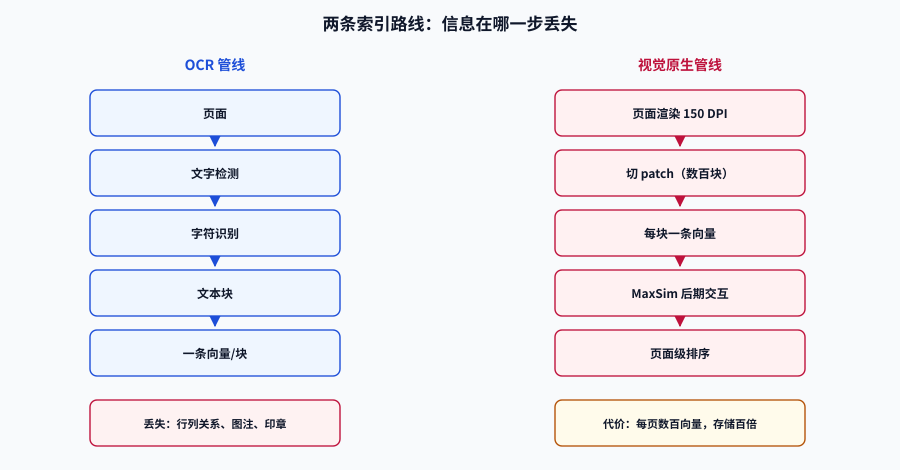

# 视觉文档检索：不 OCR 也能查页面

一份带合并单元格的财务报表，OCR 抽出来是一串失去行列关系的文字；一张跨栏排版的论文，阅读顺序可能被抽成「左栏第三段接右栏第一段」；一页盖了章、手写了批注的合同，OCR 干脆当没看见。**这些信息不是「文字」，而是「版面」**——一旦被压成纯文本，就永久丢失了。

视觉文档检索（Visual Document Retrieval）走的是另一条路：**把页面当图片编码，用多向量表示保留版面，用 MaxSim 做细粒度匹配。** 这一页讲清它的原理、成本与边界。

## 判据族声明

本页判据族 `MMV-A` ~ `MMV-H`，共 8 条。定义表在第七节。

## 一、两种索引方式的分水岭



| 环节 | OCR 管线 | 视觉原生管线 |
| --- | --- | --- |
| 解析 | 检测文字框、识别字符、还原阅读顺序 | 页面渲染成图，切成 patch |
| 表示 | 文本块 → 文本嵌入（一条向量/块） | 每个 patch 一条向量（几百条/页） |
| 检索单位 | 文本块 | 页面（或图块） |
| 版面信息 | **丢失**（除非额外抽表格结构） | 保留在 patch 的空间关系里 |
| 失败模式 | 扫描质量、手写、公式、多栏 | 分辨率、patch 预算、空白页 |

分水岭只有一句：**答案是否需要「位置」**。问「合同违约金比例是多少」，OCR 够用；问「违约金条款在签字页的哪一侧」，只有视觉方案能答。

## 二、ColPali 式多向量：把页面拆成 patch

ColPali（ICLR 2025）的做法可以拆成三步：

1. **页面渲染**：PDF 每页按固定 DPI 渲染成图（常用 150~200 DPI，够读小字又不至于 patch 爆炸）。
2. **VLM 编码**：用视觉语言模型（PaliGemma、Qwen2-VL 等）把图切成 patch，每个 patch 输出一条 `d` 维向量（常见 `d = 128`），并保留若干「查询意图」向量。
3. **后期交互打分**：查询也被编码成若干 token 向量，用 MaxSim 逐 token 找最相似的 patch，再求和。

```text
MaxSim(q, d) = Σᵢ maxⱼ ( qᵢ · dⱼ )
```

这条公式是全部差别的来源：**它不是把文档压成一条向量再比一次，而是让查询的每个 token 各自去找「页面上最像它的那一块」**。因此「表格第三行第二列」这种局部信息不会被整页的平均语义稀释。

::: tip 为什么叫「后期交互」
双塔是**不交互**（各自编码，最后点积）；交叉编码器是**早交互**（查询和文档拼在一起进模型）；ColBERT/ColPali 在中间——**各自编码，但在打分时逐 token 交互**。交互的粒度决定了精度与成本的档位。
:::

### MaxSim 的一个手算例子

查询 4 个 token、文档 6 个 patch、维度 4（真实场景是 128 维、几百 patch，结构完全一样）：

```shell
/Users/cuifendemac/.workbuddy/binaries/python/envs/default/bin/python3 - <<'PY'
import numpy as np
np.set_printoptions(precision=3, suppress=True)
Q = np.array([[1,0,0,0],[0,1,0,0],[0.7,0.7,0,0],[0,0,1,0]], float)
D = np.array([[1,0,0,0],[0,1,0,0],[0,0,0,1],[0.6,0.8,0,0],[0.5,0,0.5,0],[0,0,1,0]], float)
Q /= np.linalg.norm(Q, axis=1, keepdims=True)
D /= np.linalg.norm(D, axis=1, keepdims=True)
S = Q @ D.T
print(S)
print("每行最大", S.max(1), "总分", round(float(S.max(1).sum()), 4))
print("均值池化余弦", round(float(Q.mean(0) @ D.mean(0) /
      (np.linalg.norm(Q.mean(0)) * np.linalg.norm(D.mean(0)))), 4))
PY
```

**预期输出**：相似度矩阵 4×6，每行最大为 `[1. 1. 0.99 1.]`，`总分 3.9899`，`均值池化余弦 0.9445`。

**读法**：MaxSim 的上限是 token 数 4（每行最大值为 1），实际拿到 3.99 说明四个查询 token 都在页面上找到了几乎完美的对应块。均值池化只有 0.9445——因为文档里那条与查询无关的 patch 把均值拉偏了。**页面上无关内容越多，均值池化掉得越狠，MaxSim 越稳。**

## 三、patch 预算：先算存储，再选模型

多向量的成本是**每页几百条向量**，不是每页一条。三个数决定总成本：页数、每页 patch 数、每 patch 维度与精度。

| patch/页 | 每页 int8 | 100 万页 int8 | 100 万页 float32 |
| --- | --- | --- | --- |
| 256 | 0.033 MB | 33 GB | 131 GB |
| 512 | 0.066 MB | 66 GB | 262 GB |
| 768 | 0.098 MB | 98 GB | 393 GB |

对照：单向量 1024 维 float32 的 100 万页只有 **4.1 GB**。也就是说，768 patch 的视觉索引是它的 **96 倍**。

::: danger 三个与 patch 预算有关的坑
1. **按 DPI 调分辨率，却不看 patch 数**。分辨率翻倍，patch 数约翻四倍，存储与编码时间同步翻四倍。必须在入库前记录每页 patch 数并设上限。
2. **对空白页也做全量编码**。扫描件里空白页、分隔页占比可能到 10%，先做空白检测能直接省掉这部分。
3. **把多向量字段也建 HNSW**。多向量用 MaxSim 打分，HNSW 图对它没有意义；Qdrant 的标准做法是 `hnsw_config m=0`，只存不算。
:::

## 四、工程落法：两段式检索

多向量不适合做全库暴力扫描（除非库很小）。生产上统一是**粗排 + 精排**：

```text
① 粗排：用页面级单向量（页面嵌入的均值 / MUVERA / OCR 文本向量）取 top-200
② 精排：对这 200 页做 MaxSim，取 top-10
③ 去重：同一文档相邻页折叠成一条结果，附页码
```

Qdrant 把这两步压成一次 `query_points` 调用：`prefetch` 走单向量，主查询走多向量字段，候选深度建议 **100~500**。Elasticsearch 8.18+ 的 `rank_vectors` 与 OpenSearch 3.3+ 的 `lateInteractionScore` 是同类能力的不同封装。

| 决策 | 建议值 | 依据 |
| --- | --- | --- |
| 粗排候选数 | 100~500 | 低于 100 会漏，高于 500 精排延迟线性上涨 |
| 精排返回数 | 5~10 | 再往上用户不看，且下游生成会被噪声干扰 |
| 页面去重 | 按 `doc_id` + 相邻页 | 同一份合同的连续 5 页都相关时，应折叠成一条 |
| patch 量化 | int8 起步 | float32 存储翻四倍，int8 召回损失通常可接受 |

## 五、工具链现状（2026-10）

| 组件 | 状态 | 影响 |
| --- | --- | --- |
| `colpali-engine` | **已进入维护模式**（2026-08-24 仓库公告），仍发版（0.3.18） | 新项目不建议作为首选，存量项目可继续用 |
| Sentence Transformers 6.0.0（2026-08-18） | 新增 `MultiVectorEncoder`，官方支持 ColPali 家族 | 新项目的推荐接入方式 |
| 模型侧 | ColQwen2.5 v0.2（MIT）、ColNomic 7B（Apache-2.0）、Jina Embeddings v4（单/多向量双模，Qwen Research License） | 许可差异大，商用前逐个核对 |
| 存储侧 | Qdrant 原生 `multivector_config` + `MAX_SIM`；ES 8.18+ / OpenSearch 3.3+ 提供同类打分 | 选库时先确认「多向量是否一等公民」 |

::: warning 一个容易踩的时间差
公开教程里大量代码仍基于 `colpali-engine` 的 `ColQwen2` 类。它现在还能跑，但**新项目按旧教程写会在半年内遇到依赖与接口双重落后**。判断方法很简单：看教程里有没有出现 `MultiVectorEncoder`；没有，就是旧路径。
:::

## 六、五类页面的实测经验

| 页面类型 | 表现 | 处理建议 |
| --- | --- | --- |
| 纯文字页 | 与 OCR 管线持平或略好 | 不必上多向量，成本不划算 |
| 表格页 | 明显更好，能定位到单元格附近 | 保留原页图，供下游模型看图回答 |
| 图表页 | 更好，能匹配图注与图形 | patch 预算要给足，图表细节在小 patch 下会糊 |
| 扫描件/低质量 | 取决于渲染质量 | 先做去噪与纠偏，再渲染 |
| 手写批注 | 不稳定 | 不要承诺「能检索手写」，除非单独训练过 |

## 七、判据定义表

| 判据 | 约定 | 定错了会怎样 | 怎么验证 |
| --- | --- | --- | --- |
| `MMV-A` | 每页 patch 数必须有上限并记录 | 存储与编码时间随分辨率失控 | 入库元数据含 `patch_count`，有阈值告警 |
| `MMV-B` | 多向量字段不得建 HNSW | 索引体积与写入时间翻倍，查询无收益 | 集合配置中该字段 `m=0` |
| `MMV-C` | 检索结果必须能回指原页 | 用户无法核对，合规场景不可用 | 响应含 `doc_id`、`page_no`、`bbox` |
| `MMV-D` | 粗排候选深度必须在 100~500 | 过浅漏召回，过深延迟不可控 | 压测记录里有候选深度与 Recall 曲线 |
| `MMV-E` | 相邻页结果必须去重折叠 | 同一文档占满前 10，用户看不到别的 | 结果列表按 `doc_id` 折叠并标页码区间 |
| `MMV-F` | 空白页与分隔页必须预先剔除 | 10% 的存储与算力花在无内容页上 | 入库报告里有空白页比例 |
| `MMV-G` | 多向量必须支持「原始向量重算」 | 量化后排序失真无法纠正 | 精排阶段可取回 float 向量 |
| `MMV-H` | 工具链版本必须写明并核对维护状态 | 按已弃用的库写新项目，半年后返工 | 选型记录含库版本与维护状态 |

## 如何验证

```shell
# ① patch 预算核对：给定页数与 patch 数，算总存储与编码量
/Users/cuifendemac/.workbuddy/binaries/python/envs/default/bin/python3 - <<'PY'
pages, dim = 300_000, 128
for patches in (256, 512, 768):
    gb = pages * patches * dim * 1 / 1e9          # int8
    print(f"patch={patches:4d}  总存储 {gb:5.0f} GB  单页 {patches*dim/1e6:.3f} MB")
PY
```

**预期输出**：`patch= 256 总存储 10 GB`、`patch= 512 总存储 20 GB`、`patch= 768 总存储 29 GB`。把它换成你的真实页数，再对比预算——**这一步应该在选模型之前做**。

```shell
# ② 去重逻辑：相邻页折叠成一条，验证前 10 条里没有同文档刷屏
/Users/cuifendemac/.workbuddy/binaries/python/envs/default/bin/python3 - <<'PY'
hits = [("合同A", 12), ("合同A", 13), ("合同B", 3), ("合同A", 14), ("合同C", 9)]
seen, folded = {}, []
for doc, page in hits:
    if doc in seen:
        seen[doc].append(page); continue
    seen[doc] = [page]; folded.append(doc)
print("折叠后：", [(d, seen[d]) for d in folded])
PY
```

**预期输出**：`折叠后： [('合同A', [12, 13, 14]), ('合同B', [3]), ('合同C', [9])]`。判据是**折叠后条数 ≤ 原始条数，且每个文档只出现一次**。

## 参考资料

- [ColPali 论文](https://arxiv.org/abs/2407.01449)——多向量视觉文档检索的原始工作
- [ColQwen2.5 v0.2 模型卡](https://huggingface.co/vidore/colqwen2.5-v0.2)——MIT 许可的成熟基线
- [Sentence Transformers · MultiVectorEncoder](https://sbert.net/)——现行接入方式
- [Qdrant 多向量检索](https://qdrant.tech/documentation/concepts/vectors/)——`multivector_config`、`m=0` 与 `prefetch`
- 上一站：[图文向量](../Embedding/index.md) · 下一站：[混合召回](../HybridRecall/index.md)
