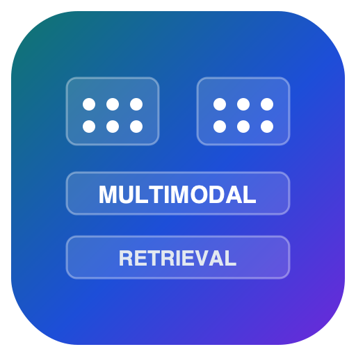
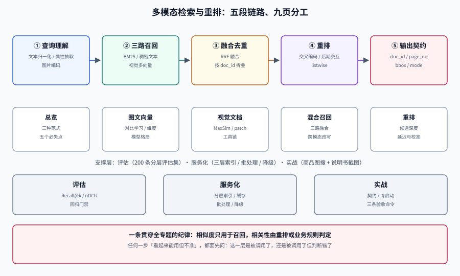

# 多模态检索与重排

多模态检索（Multimodal Retrieval）要解决的问题只有一句：**用户给的线索和答案所在的载体，往往不是同一种模态。** 用户用一句话找一张图，用一张截图找一段文档，用一张商品图找同款，用一段视频找操作步骤——而库里存的是图片、PDF 页面、幻灯片和表格截图。

这件事的难点不在「把图片也变成向量」这一步。真正的难点是三个：**跨模态的相似度到底在比什么**、**一份视觉文档该切成多少块才既存得下又找得回**、**召回回来的候选怎么在几十毫秒内重新排对**。前两个决定上限，第三个决定体验。

本专题与相邻专题的分工写死如下，避免重复阅读：

| 专题 | 负责什么 | 与本专题的边界 |
| --- | --- | --- |
| 本专题 | **跨模态召回、视觉文档索引、混合融合、重排、评估、服务化** | —— |
| [多模态应用](../Multimodal/index.md) | 图像理解、语音、视频处理、模型接入 | 那边讲**怎么把原始信号变成模型输入**；本专题讲**变成向量之后怎么找** |
| [RAG 检索增强](../RAG/index.md) | 文本链路的切分、向量化、检索、生成 | 文本链路的完整方法论在那；本专题只处理**跨模态与视觉载体**这一段，并复用它的评估口径 |
| [RAG · 检索优化](../RAG/Retrieval/index.md) | 查询改写、混合召回、RRF、重排 | 那边是**文本对文本**；本专题补的是「查询与文档不同模态」时多出来的四件事 |
| [向量数据库](../../DB/VectorDatabase/index.md) | HNSW、量化、混合检索、多向量存储 | 那边讲**库怎么选、索引怎么建**；本专题讲**多模态场景下这些参数为什么必须重算** |
| [向量数据库 · 混合检索](../../DB/VectorDatabase/HybridSearch/index.md) | 稠密 + 稀疏融合 | 融合公式引用那边，本专题只讲**三路以上、且其中一路是视觉**时的权重与去重 |
| [提示词工程](../../AI/PromptEngineering/index.md) | 提示词结构、few-shot | 生成阶段怎么把图文上下文喂给模型归那边，本页不重复 |
| [数据可视化](../../Frontend/DataVisualization/index.md) | 图表渲染与大数据量 | 图表**被检索**属于本专题，图表**怎么画**属于那边 |

::: tip 一句话理解
文本检索比的是「词像不像」，多模态检索比的是「**意思像不像，而字面根本对不上**」。
一旦字面对不上，所有依赖「重叠」的技巧（BM25、精确匹配、关键词高亮）都会同时失效——这就是本专题存在的理由。
:::

## 专题导航

- [总览：三种范式与五个必失点](./Overview/index.md)：文本代理 / 统一向量 / 视觉原生三条路线、任务矩阵、五个一错就全错的决策点
- [图文向量：相似度到底在比什么](./Embedding/index.md)：对比学习与温度、CLIP → SigLIP 2 → 多语言 CLIP、维度与 Matryoshka、归一化与度量选择
- [视觉文档检索：不 OCR 也能查页面](./VisualDocument/index.md)：ColPali 式多向量与 MaxSim、patch 预算与存储估算、与 OCR 管线的对照、工具链现状
- [混合召回：三路候选怎么合成一份名单](./HybridRecall/index.md)：BM25 + 稠密 + 视觉三路、RRF 与加权融合、跨模态查询改写、候选深度
- [重排：把「可能相关」排成「确实相关」](./Rerank/index.md)：交叉编码器、后期交互、listwise 三种重排、延迟预算、分数校准与阈值
- [评估：先有能红的评估集，再谈模型](./Evaluation/index.md)：查询分层、分级相关性、Recall@k / MRR / nDCG 手算、硬负样本、回归门禁
- [服务化：索引分层、批处理与降级](./Serving/index.md)：粗排 + 精排两层索引、GPU 批处理与缓存、延迟分解、降级路径
- [实战：商品图搜 + 说明书截图检索](./Practice/index.md)：从 0 搭一条可运行管线，含契约、冷启动、验收命令与判据
- [常见问题与最佳实践](./FAQ/index.md)：十二类现象分诊、高频十二问、十二条实践、术语表

## 按症状找页面

| 你遇到的现象 | 大概率先看 |
| --- | --- |
| 文字能搜到、图片搜不到（或反过来） | [总览](./Overview/index.md) → [图文向量](./Embedding/index.md) |
| 搜出来的图「风格像但内容不对」 | [重排](./Rerank/index.md)（粗排只保证召回，排序要靠精排） |
| PDF 里的表格怎么都搜不到 | [视觉文档检索](./VisualDocument/index.md) |
| 同一份文档的 8 个切片全进了前 10 | [混合召回](./HybridRecall/index.md)（去重与多样性） |
| 加了重排，效果反而变差 | [重排](./Rerank/index.md) 的「分数校准」与 [评估](./Evaluation/index.md) |
| 离线指标涨了，线上没感觉 | [评估](./Evaluation/index.md) 的「离线与在线口径」 |
| 一上量就超时、显存爆 | [服务化](./Serving/index.md) |
| 不知道选哪个模型 | [图文向量](./Embedding/index.md) 的选型表 + [视觉文档检索](./VisualDocument/index.md) 的成本对照 |

## 全专题的判据纪律

本专题九页共 **72 条判据**，每页 8 条，编号按页分组。判据只回答三件事：**约定是什么 / 定错了会怎样 / 怎么验证它没被破坏**。

| 页面 | 判据族 | 覆盖的约定 | 条数 |
| --- | --- | --- | --- |
| 总览 | `MMO-A` ~ `MMO-H` | 范式选型有依据、任务矩阵不漏、必失点有对策 | 8 |
| 图文向量 | `MME-A` ~ `MME-H` | 度量与归一化一致、维度与截断可解释、跨语言有验证 | 8 |
| 视觉文档检索 | `MMV-A` ~ `MMV-H` | patch 预算有上限、多向量可存可查、页面身份不丢 | 8 |
| 混合召回 | `MMH-A` ~ `MMH-H` | 三路可复算、融合可解释、去重与多样性达标 | 8 |
| 重排 | `MMR-A` ~ `MMR-H` | 候选深度有依据、延迟在预算内、阈值可校准 | 8 |
| 评估 | `MMX-A` ~ `MMX-H` | 评估集分层、指标口径固定、门禁能红 | 8 |
| 服务化 | `MMS-A` ~ `MMS-H` | 索引分层、缓存不串、降级有判据 | 8 |
| 实战 | `MMP-A` ~ `MMP-H` | 管线可运行、契约可校验、冷启动有路径 | 8 |
| 常见问题 | `MMF-A` ~ `MMF-H` | 分诊可执行、术语不混用、自查可机器判 | 8 |

::: warning 一个前置结论，省掉你两周的弯路
**如果你的语料是纯文本，不要用多模态检索。** 视觉原生检索的索引体积是单向量方案的几十到几百倍，查询延迟也高一个量级；它换来的是「版面、表格、图表、手写、印章」这些 OCR 一定会丢的信息。没有这些信息，它就是纯粹的成本。
:::

## 建议阅读顺序

| 角色 | 顺序 |
| --- | --- |
| 第一次接触这个方向 | 总览 → 图文向量 → 视觉文档检索 → 实战 |
| 正在做文档类 RAG，效果卡住 | 视觉文档检索 → 混合召回 → 重排 → 评估 |
| 要把原型推上线 | 服务化 → 评估 → 实战 → 常见问题 |
| 只想知道「该选哪个模型」 | 图文向量 · 选型表 → 视觉文档检索 · 成本对照 → 评估 · 自建评估集 |

## 参考资料

- [ViDoRe / MIEB 榜单](https://huggingface.co/spaces/mteb/leaderboard)——视觉文档检索与多模态嵌入的公开对照，**读榜先看版本与数据集构成**
- [ColPali 论文（ICLR 2025）](https://arxiv.org/abs/2407.01449)——视觉文档检索的多向量范式来源
- [Sentence Transformers 文档](https://sbert.net/)——`MultiVectorEncoder` 与 ColPali 家族的现行接入方式
- [Qdrant 多向量文档](https://qdrant.tech/documentation/concepts/vectors/)——MaxSim、`m=0` 与 `prefetch` 的实现口径
- [RAG 检索增强](../RAG/index.md)——文本链路的完整方法论，本专题的前置阅读
