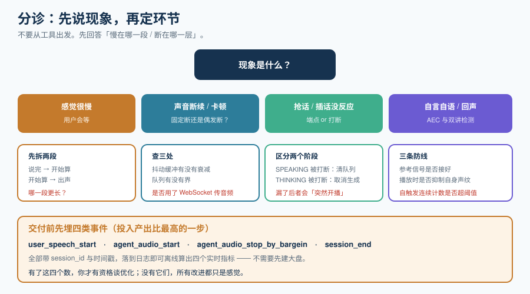

# 常见问题与最佳实践

这一页是整个专题的出口：**从现象出发，而不是从工具出发**。先找到你卡在哪一格，再翻到对应页面。

## 一、分诊表：从现象到原因

| 现象 | 先问的第二个问题 | 优先去看 | 去哪一页 |
| --- | --- | --- | --- |
| **感觉很慢，用户会等** | 慢在「用户说完→开始算」还是「开始算→出声」？ | 端点判定与 LLM 首 token | [概述](../Overview/index.md)延迟预算、[流式语音识别](../StreamingASR/index.md) |
| **声音断续、卡顿** | 是固定断还是偶发断？ | 传输层与抖动缓冲 | [实时传输协议](../StreamingProtocols/index.md) |
| **AI 老是抢话** | 是不是用户说话中间有停顿？ | 端点检测阈值 | [流式语音识别](../StreamingASR/index.md)端点检测 |
| **用户插话没反应** | 是不是还在 THINKING 阶段？ | 打断状态机 | [端到端语音到语音](../SpeechToSpeech/index.md)轮次管理 |
| **AI 突然自言自语** | 是不是 AEC 失效了？ | 双讲检测与自触发计数 | [流式语音识别](../StreamingASR/index.md)双工识别 |
| **工具一调就卡住对话** | 有没有填充语？ | 工具调用的时间处理 | [语音智能体工程](../VoiceAgent/index.md) |
| **通话越久越延迟** | 是不是队列在堆积？ | 背压策略 | [实时传输协议](../StreamingProtocols/index.md)背压 |
| **账单比预期高很多** | 会话时长分布是什么样？ | 静音期计费与打断浪费 | [语音智能体工程](../VoiceAgent/index.md)成本 |
| **换模型后体验变差** | VAD 与打断阈值重新标定了吗？ | 阈值与模型代际不匹配 | [端到端语音到语音](../SpeechToSpeech/index.md) |
| **自建跑不起来** | 卡在哪一个组件？ | 逐段替换验证 | [实战](../Practice/index.md) |
| **有回声 / 啸叫** | 用户戴耳机吗？ | AEC 与参考信号 | [实时音视频（RTC）](../RTC/index.md) |
| **弱网就断** | 降级顺序是什么？ | 分级降级表 | [实时音视频（RTC）](../RTC/index.md) |

## 二、高频十二问

**Q1：首包延迟到底要压到多少？**
看你的业务档位。[概述](../Overview/index.md)给了五档参考：< 700ms 自然，700ms~1.2s 可接受，> 2s 不可用。**先量出你在哪一档，再看值不值得为下一档付钱。**

**Q2：WebSocket 能不能用来传实时音频？**
**用户侧不建议**：公网 TCP 的队头阻塞会把音频切碎。**服务端之间可以**（同机房、抖动小）。这是微软 Azure Realtime 文档的明确口径，见[实时传输协议](../StreamingProtocols/index.md)。

**Q3：Gemini Live 和 OpenAI Realtime 能共用一套代码吗？**
不能直接共用。两者都是「有状态长连接」，但**配置结构、事件名、轮次生命周期完全不同**（一个是 `response.create` 驱动的回合制，另一个有「主动音频」的概念）。**抽象层要建在你自己的会话模型上**，不要建在厂商事件的形状上。

**Q4：一定要用全双工模型吗？**
不一定。**绝大多数业务（客服、下单、问答）用「很快的半双工」完全够用。** 只有在**需要模型反馈音**（陪伴、口语陪练）或**真重叠对话**的场景下，全双工才值。而且当前商业端 API 里，**真正的全双工仍属少数**——OpenAI 的 Realtime 被描述为「很快的半双工」。

**Q5：开源的全双工模型能上生产吗？**
**目前不建议。** Moshi 是唯一开箱即用的开源全双工，但**发布节奏已停滞**（PyPI 版本停在 2026-02，最新提交 2026-05）。把它当研究基线，生产用级联。

**Q6：级联链路里 LLM 是不是最大的瓶颈？**
**通常是**（200~800ms），但**不要凭直觉优化**。先按[概述](../Overview/index.md)的方法逐段量。有些团队的真实瓶颈在 TTS 首包（因为用了「整句合成再播」），有些在传输缓冲。

**Q7：怎么在不改架构的前提下开始优化？**
**先埋四类事件**：`user_speech_start`、`agent_audio_start`、`agent_audio_stop_by_bargein`、`session_end`，都带 `session_id` 与时间戳。有了这四类事件，四个实时指标就能离线算出来。**这是投入产出比最高的一步。**

**Q8：为什么打断之后 AI 还在说？**
两种可能：① 只停了当前帧、没清空播放队列；② 用户在 `THINKING` 阶段（还没出声）打断，而你的状态机只处理了 `SPEAKING` 的打断。见[实战](../Practice/index.md)的状态机表。

**Q9：音色克隆能直接用在对外电话上吗？**
**不行，除非有被克隆者的明确书面授权，且符合当地的合成内容标识要求。** 见[流式语音合成](../StreamingTTS/index.md)的三条红线。

**Q10：实时语音能不能全本地跑？**
**级联可以**（本地 VAD + 本地 ASR + 本地 LLM + 本地 TTS）。**端到端全本地选择很少**，开源全双工只有 Moshi 一条线且已停滞。**先确认这条路能走通，再谈延迟指标。**

**Q11：怎么估算并发容量？**
按[语音智能体工程](../VoiceAgent/index.md)的公式：峰值并发 × 单会话实测占用 ÷ (单实例容量 × 安全水位)。**要实测单实例容量到「再多一个就 P95 破线」，而不是 CPU 100%。**

**Q12：滚动发布会不会断掉正在进行的通话？**
**会，除非你做了处理。** 三个选项：排空（drain）、状态外置、接受中断并重连。**没有第四个。** 见[概述](../Overview/index.md)的「会话粘性」。

## 三、上线自查清单（C1 ~ C15）

- [ ] **C1** 已量出当前的首包延迟基线（P50 与 **P95**），且知道每一段的占比
- [ ] **C2** 端点检测不是纯固定静音阈值，或至少有一个兜底 + 模型判断
- [ ] **C3** 有「回滚窗口」：端点判早了之后 200ms 内重新检测到人声可取消本次生成
- [ ] **C4** 状态机是显式的表/枚举，覆盖了 `THINKING + user_speech`（未出声就被打断）
- [ ] **C5** 打断时会**清空播放队列**，并向合成侧发取消
- [ ] **C6** 对话历史只写 **final** 文本，且写的是「**已播出**」而非「已生成」
- [ ] **C7** 四个实时指标的事件都已埋点，且都带 `session_id`
- [ ] **C8** 音频入队有**有界队列**，且队列深度能翻译成一个时间上界
- [ ] **C9** 抖动缓冲有**衰减**（不只会变大）
- [ ] **C10** 客户端产物中搜不到长期 API key（`grep -rn "sk-"` 无命中）
- [ ] **C11** 音色来源有完整授权链；合成内容有标识方案
- [ ] **C12** 会话状态外置，滚动发布不会清空正在进行的通话
- [ ] **C13** 工具调用有填充语或异步执行，且填充语**可被打断**
- [ ] **C14** 有分级降级顺序（弱网时先关视频再降音频码率），且写在代码里而非临场决定
- [ ] **C15** 成本字段里区分「已合成时长」与「已播放时长」（打断浪费可见）

## 四、最佳实践十二条

1. **先量再优化。** 没有首包延迟基线，所有优化都是猜。
2. **盯 P95/P99，不看平均。** 用户记住的是最差的那几次。
3. **把「打断」当成一等公民。** 它的体感收益大于绝大多数延迟优化。
4. **任何超过 400ms 的计算都要被盖住**（填充语或异步执行）。
5. **历史只写 final、只写「已播出」。** 这两条错了会持续污染对话。
6. **队列必须有界，且上界要能翻译成毫秒。**
7. **按会话 ID 建模，不按连接建模。** 连接会断，会话要能续。
8. **在架构图上标出每一处采样率转换。** 只允许在边界发生，且只发生一次。
9. **不要克隆没授权的声音。** 这是唯一一条「技术上能做但不该做」的事。
10. **先做级联再考虑端到端。** 可观测、可替换、可全本地，三条优势在早期远远大于延迟优势。
11. **模型换代时重新标定 VAD 与打断阈值。** 官方已明确提示：更快的模型会让原阈值「过早触发」。
12. **把「什么时候不需要实时」写进文档。** 异步转写、命令式交互、极短会话——省下的钱和时间可以投到真正需要的地方。

## 五、术语表

| 术语 | 英文 / 缩写 | 含义 |
| --- | --- | --- |
| **首包延迟** | TTFA / Time To First Audio | 从「用户说完」到「用户听到第一个音」的时间 |
| **TTFT** | Time To First Token | LLM 从请求到产出第一个 token 的时间 |
| **端点检测** | Endpointing | 判断「用户说完了没有」 |
| **VAD** | Voice Activity Detection | 人声活动检测，判「现在有没有人在说」 |
| **双工** | Duplex | 输入输出同时存在；全双工 = 能同时说与听 |
| **打断** | Barge-in | 用户开口时中断模型输出 |
| **反馈信号** | Backchannel | 「嗯」「对」这类表示在听的短音 |
| **抖动缓冲** | Jitter Buffer | 多存几帧再播，用延迟换稳定 |
| **背压** | Backpressure | 下游慢于上游时的处理策略（实时场景应为丢旧保新） |
| **AEC** | Acoustic Echo Cancellation | 回声消除，去掉自己播出的声音 |
| **NS / AGC** | Noise Suppression / Auto Gain Control | 噪声抑制 / 自动增益 |
| **SFU** | Selective Forwarding Unit | 只转发不解码的多人音视频服务器 |
| **ICE / STUN / TURN** | — | 打通网络路径的三件套；TURN 在对称 NAT 下必需 |
| **内心独白** | Inner Monologue | Moshi 的并行文本流，让模型「用文本思考、用语音说话」 |
| **主动音频** | Proactive Audio | 模型自己决定何时开口（Gemini Live 能力） |

## 参考资料

- OpenAI Realtime API：https://platform.openai.com/docs/guides/realtime
- Gemini Live API：https://ai.google.dev/gemini-api/docs/live
- LiveKit Agents / Pipecat 文档：https://docs.livekit.io/agents/ 、 https://docs.pipecat.ai/
- WebRTC 规范：https://www.w3.org/TR/webrtc/
- 相关专题：[概述](../Overview/index.md)、[实战](../Practice/index.md)、[多模态应用](../../Multimodal/index.md)、[AI 应用观测与评估](../../LLMObservability/index.md)
