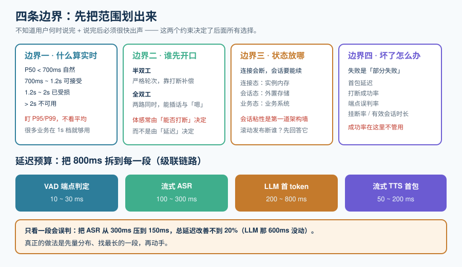

# 概述：从「文件进文件出」到「边说边出」

把一段录音转成文字，和让一个系统在你说话的同时接话，是两种完全不同的工程。前者的输入是**一个已经存在、长度已知的文件**；后者的输入是**一个此刻还没有结束的流**。

整个专题的结论都可以从这一句话推出来：**你不知道用户什么时候说完，但你必须在他说完之后很快出声。** 「不知道」和「很快」这两个约束，分别决定了后面所有的技术选择。



## 一、四条边界：先把范围划出来

### 边界一：什么算「实时」

「实时」不是一个形容词，是一条可以量化的线。行业里反复出现的一组经验值：

| 端到端首包延迟 | 用户的感受 | 结论 |
| --- | --- | --- |
| < 300 ms | 与真人对话无异 | 端到端模型的主场 |
| 500 ~ 700 ms | 略有一点停顿，但自然 | **自建级联链路的现实目标** |
| 700 ms ~ 1.2 s | 明显在等，但能接受 | 只能做「指令式」交互，做不了闲聊 |
| 1.2 s ~ 2 s | 用户会开始重复、抢话或沉默 | 体验已经受损 |
| > 2 s | 挂断率显著上升 | 不可用 |

::: tip 这条线怎么用
它不是一个「达标/不达标」的开关，而是一把**决策尺**：先量出你当前在哪一档，再决定要不要为下一档付出成本。**很多业务在 1 秒档完全够用**——下单确认、报工单号、IVR 导航，用户本来就不指望它像人。盲目追 300ms 会把成本推高一个数量级。
:::

### 边界二：谁先开口

人类对话里，**双方会同时说话**：一方在组织语言时会发出「嗯」「对」，另一方会在这类信号出现时判断「他还在说」。这类信号叫**反馈信号（backchannel）**。

| 模式 | 机制 | 能不能处理重叠 | 代表 |
| --- | --- | --- | --- |
| **半双工（Half-duplex）** | 严格的「你说→我说」轮次 | 不能；靠打断补偿 | 绝大多数级联链路、Realtime API 的当前形态 |
| **全双工（Full-duplex）** | 输入输出两路同时存在，模型自己决定何时开口 | 能；能自然插话与反馈 | Kyutai Moshi、Gemini Live 的主动音频 |

**这是本专题最重要的一次分辨。** 很多团队以为「延迟低 = 自然」，其实在 500ms 这个量级上，**决定体感的往往不是延迟，而是「能不能被打断、会不会抢话」**。

### 边界三：状态放在哪

实时会话是一个**长连接里的有状态对象**，这和请求-响应式 API 有本质区别：

| 维度 | 请求-响应式 | 实时会话 |
| --- | --- | --- |
| 生命周期 | 一次请求 | 一次通话，可能几十分钟 |
| 状态 | 无（或每请求重建） | **必须在服务端保持**（对话历史、轮次、打断点） |
| 失败语义 | 返回错误码 | **连接断了要能续、要能收尾** |
| 扩容 | 无状态水平扩 | **会话粘性**（同一通话必须回到同一实例，或状态外置） |
| 计费 | 按 token | 按 token **+ 按时长** |

::: danger 最容易低估的一条
**「会话粘性」是实时语音第一个会撞到的架构墙。** 请求-响应式服务可以随便扩缩容；实时会话一旦落在某个实例上，扩容、滚动发布、节点故障都会中断正在进行的通话。上线前必须回答：**滚动发布时，正在通话的 1000 个用户会怎样？** 常见答案有三种——排空（drain，新连接不给旧实例）、状态外置（把会话状态放 Redis，实例可换）、以及**接受中断并做重连**（对短会话可接受，对电话场景不可接受）。没有第四个答案。
:::

### 边界四：坏了怎么办

实时链路的失败是**部分失败**：ASR 在出字但 TTS 卡了、网络抖了一下、模型烧了 3 秒算工具。这些都**不是「请求失败了」**，而是「**对话正在变糟**」。所以判据也不能沿用「成功率」：

| 指标 | 定义 | 为什么不能沿用成功率 |
| --- | --- | --- |
| **首包延迟** | 用户说完 → 用户听到第一个音 | 成功率 100% 也挡不住每次 3 秒 |
| **打断成功率** | 用户打断后，模型在 N ms 内停止出声的比例 | 打断失败是「用户说话但 AI 还在说」，不是错误 |
| **端点误判率** | 把「思考中的停顿」判成「说完了」的比例 | 提前抢话是最伤的体验缺陷，且不产生任何错误日志 |
| **挂断率 / 有效会话时长** | 用户主动挂断的比例 | 这是**唯一与业务直接挂钩**的实时指标 |

## 二、延迟预算：把 800ms 拆到每一段

「首包 < 800ms」是一句口号，落地必须变成一张能逐段验收的预算表。级联式链路（VAD → ASR → LLM → TTS）的典型拆分：

| 环节 | 预算 | 这一段的真正瓶颈 | 关键手段 |
| --- | --- | --- | --- |
| **VAD / 端点判定** | 10 ~ 30 ms | 不是算力，是**判定窗口**——为了不误判必须多等一会儿 | 用小模型做端点判定，把「静音多久算说完」从固定值换成模型输出 |
| **流式 ASR** | 100 ~ 300 ms | **不能在整句结束后才开始** | 用流式（chunk）识别，部分结果直接喂下一段 |
| **LLM 首 token** | 200 ~ 800 ms | **这一段通常最大** | 热 KV cache、小模型、减少上下文、把工具调用挪到后台 |
| **流式 TTS 首包** | 50 ~ 200 ms | 不能用「整句合成完再播」 | 按标点分句，第一句一出就播 |
| **传输与抖动缓冲** | 20 ~ 100 ms | 缓冲越大越稳、也越慢 | 缓冲深度按网络抖动而非固定值设定 |

::: danger 四条最容易搞错的地方
1. **只优化一段**。把 ASR 从 300ms 压到 150ms，总延迟改善不到 20%——因为 LLM 那 600ms 没动。**先量再优化，不要凭直觉挑一段**。
2. **把「平均首包」当成绩**。要盯 **P95 / P99**。平均 600ms 而 P99 是 3 秒的系统，用户会记住那 3 秒。
3. **忘了端到端里还有系统提示词与历史**。上下文越长，LLM 首 token 越慢；**实时会话里「记住全部」是一个会随时间恶化的性能决策**。
4. **把模型侧的首包当成用户听到的首包**。中间还有传输、抖动缓冲、客户端解码与播放缓冲——**每一层都默认给自己加了一点缓冲**，加起来常常超过 100ms。
:::

## 三、两条路线：级联还是端到端

这是本专题唯一一个「很难回头」的决定，值得在动手前想清楚。

| 维度 | **级联式**（VAD → ASR → LLM → TTS） | **端到端**（语音进、语音出） |
| --- | --- | --- |
| 首包延迟 | 500 ~ 900 ms（调优后） | 200 ~ 500 ms，全双工模型可更低 |
| 每段可换 | **能**，任意一段可替换、可本地化 | 不能，模型是整体 |
| 可观测性 | **好**，四段都有中间产物（转写文本、回复文本） | 弱，中间没有必然的文本形态 |
| 可控性 | **强**：能改提示词、能加规则、能强制话术 | 弱：只能通过 instructions 与少量参数引导 |
| 打断与重叠 | 需要显式做状态机 | **模型原生支持**（全双工线） |
| 能否全本地 | **能**（Silero VAD + 本地 ASR + 本地 LLM + 本地 TTS） | 开源全双工仅有 Moshi 一条线，且发布节奏已停滞 |
| 成本 | 四段各自计费，可控性强 | 有一个「按分钟」的模型费；长会话成本是文本链路的另一个量级 |
| 语气与情绪 | 丢失（ASR 出的是纯文本） | **保留**（模型直接听原始音频） |

::: tip 一个务实的默认答案
**默认从级联开始**，理由有三条：① 可观测（出问题能定位到具体一段）；② 可替换（某一段变贵或不准时能换）；③ 可全本地（合规场景的入场券）。只有当你**已经量出**级联的延迟无法达标、或者**业务本身依赖语气与情绪**（陪伴、口语教练、情感客服）时，才转向端到端。反过来则很痛苦：先做了端到端，再想加「必须按话术回答」这类硬约束时，几乎没有位置可加。
:::

## 四、成熟度五档：先补哪一件事

| 档位 | 你现在是这样 | 只补这一件事 |
| --- | --- | --- |
| **L0 回合式** | 用户说完、上传、等整段返回 | 把 ASR 或 TTS 换成流式，让「出声」不再等整句 |
| **L1 能出声** | 有流式，但仍是严格的「你说完我才能答」 | 端点检测从固定静音时长换成模型判定，把首包拉进 1.2 秒 |
| **L2 可打断** | 用户开口能打断；工具调用时会「卡住」 | 会话状态机 + 填充语，让长任务不冻结对话 |
| **L3 自然** | 首包 < 700ms，支持轻微重叠 | 把体感变成指标：首包、打断成功率、端点误判率、挂断率 |
| **L4 可运营** | 四条线各有 SLO 与责任人 | 按季度复核模型代际与线协议，做**迁移演练**而不是等关停通知 |

## 五、什么时候**不需要**做到这个程度

下面这些场景，做实时是一件昂贵且没必要的事——**把结论说在前面，可以省掉大量返工**：

- **输入本身是异步的**：会议纪要、客服质检、播客转写。这些的输入是一份**会完整存在**的录音，延迟预算以分钟计，精度优先。
- **交互是命令式的**：报工单号、IVR 按键导航。用户预期就是「说完等一下」，1 秒档完全够用。
- **网络本身不可靠**：弱网移动端、车机、卫星链路。此时瓶颈在传输抖动，不在模型；先把「降级到文本」这条路做出来，比压 200ms 更值。
- **数据不能出网且有严格延迟要求**：全本地方案在 2026 年仍以级联为主，端到端全本地选择很少，**先确认这条路能不能走通再谈延迟**。
- **会话很短且代价极低**：一句话指令类应用，用户重试成本几乎为零，**没人会因为 800ms 而挂断**。

## 六、最小起步三步

不想读完整专题、只想先跑起来，按这三步走：

1. **量出你现在的首包延迟**。不需要任何新工具——用手机录一段「我说完到听到第一个音」的屏幕录像，逐帧量。**没有这个基线，后面所有优化都是猜。**
2. **把最长的那一段换掉**。通常是 LLM 首 token 或 TTS 首包。换完再量一次，确认改善。
3. **加一条打断路径**。哪怕只是「用户开口就静音当前播放」这种最粗糙的实现——**打断是体感拐点，性价比最高**。

## 七、可执行验证

下面三条命令在**你自己的工程**里执行，用于确认「链路是活的」。它们不依赖本仓库的任何文件。

```shell
# ① 端到端连通性：发送一段 0.3 秒音频，量「从发完到收到第一个音频分片」的毫秒数
#    以 WebSocket 形态的 Realtime 端点为例（按自己的服务地址替换）
python3 - <<'PY'
import time, json, base64, asyncio, websockets

async def main():
    async with websockets.connect("ws://localhost:8080/v1/realtime") as ws:
        await ws.send(json.dumps({"type": "session.update",
                                  "session": {"instructions": "简短回答"}}))
        audio = base64.b64encode(b"\x00" * 9600).decode()   # 0.3s @16k mono s16le
        t0 = time.perf_counter()
        await ws.send(json.dumps({"type": "input_audio_buffer.append", "audio": audio}))
        await ws.send(json.dumps({"type": "input_audio_buffer.commit"}))
        await ws.send(json.dumps({"type": "response.create"}))
        while True:
            ev = json.loads(await ws.recv())
            if "audio.delta" in ev.get("type", ""):
                print(f"首包延迟 = {(time.perf_counter() - t0) * 1000:.0f} ms")
                return
asyncio.run(main())
PY
# 预期：打印出一个毫秒数；这条数字就是你后面所有优化的基线

# ② 会话是否真的是长连接（而不是每次新建）
ss -tn state established '( dport = :8080 )' | wc -l   # 通话进行中应稳定 > 0

# ③ 打断是否生效：通话中对着麦克风说话，确认播放中的音频在一个短窗口内停止
#    预期：体感上「你一开口它就停」，可以用屏幕录像逐帧确认停止时间
```

::: warning 关于「本地能不能验证」
实时语音链路的**完整验证必须有音频设备与一个正在监听的实时服务**。本专题的实战页会把能静态验证的部分（协议消息形状、配置、脚本逻辑）与必须有音频设备的部分**分开标注**，不会把期望值写进实测列。
:::

## 参考资料

- OpenAI Realtime API 指南：https://platform.openai.com/docs/guides/realtime
- Gemini Live API 概览：https://ai.google.dev/gemini-api/docs/live
- Kyutai Moshi 论文与仓库：https://github.com/kyutai-labs/moshi
- 相关专题：[多模态应用 · 语音处理](../../Multimodal/SpeechProcessing/index.md)（离线链路）、[AI 应用观测与评估](../../LLMObservability/index.md)（指标体系）
