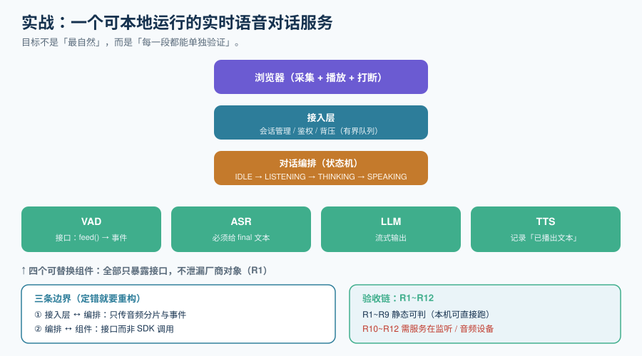

# 实战：可本地运行的实时语音对话服务

前面每一页都给了「一部分」。这一页把它们拼成一个**能跑起来、能被验收**的最小系统：一个**级联式实时语音对话服务**。

选级联而不是端到端，理由在前几页说过：可观测、可替换、可全本地。**这个实战的目标不是「最自然」，而是「每一段都能单独验证」。**



::: warning 本仓库只有文档，没有代码
下面给出的目录结构与代码片段，是**读者在自己的工程仓库里要建立的东西**。本仓库不存放任何源码、脚本与构建文件；「运行 `xxx`」一律指「先按本节创建好该文件，再执行」。
:::

## 一、目标系统与显式非目标

### 要做的

一个跑在自己机器上的实时语音对话服务，支持：

1. **浏览器说一句、它答一句**（半双工 + 可打断）；
2. **首包延迟可测量**（暴露首包延迟指标）；
3. **四个组件可以分别替换**（VAD / ASR / LLM / TTS 各是一个接口）；
4. **全链路可本地运行**（不依赖任何云服务，用本地模型即可跑通）。

### 明确不做的四件事

| 不做 | 原因 |
| --- | --- |
| **不做多人通话** | 那是 [RTC 页](../RTC/index.md)的范围；单人对话更能暴露延迟问题 |
| **不做数字人 / 视频** | 视频会把「音画同步」这个独立问题混进来，模糊验收口径 |
| **不做端到端模型接入** | 级联的可观测性是本章验收的前提；端到端见[端到端语音到语音](../SpeechToSpeech/index.md) |
| **不做模型微调** | 微调属[大模型微调](../../FineTuning/index.md)；本章只做工程装配 |

## 二、架构：三条边界

```text
浏览器（麦克风 + 播放）
   │  WebSocket（音频分片 + 事件）
   ▼
接入层  ── 会话管理 / 鉴权 / 背压 ──────────┐
   │                                        │
   ▼                                        │
对话编排（状态机：IDLE→LISTENING→THINKING→SPEAKING）
   │        │            │            │
   ▼        ▼            ▼            ▼
 VAD       ASR          LLM          TTS        ← 四个可替换的接口
   │        │            │            │
   └────────┴────────────┴────────────┘
                     │
                     ▼
              会话存储（外置）+ 事件日志（四个指标）
```

**三条边界（决定了组件之间怎么换）**：

| 边界 | 约定 | 定错的后果 |
| --- | --- | --- |
| **接入层 ↔ 编排** | 只传「音频分片」与「事件」，不传厂商对象 | 换传输协议（WebSocket→WebRTC）时要改编排逻辑 |
| **编排 ↔ 四个组件** | 每个组件是一个**接口**（`feed(bytes) -> events`），不是一个 SDK 调用 | 换模型时要改状态机 |
| **编排 ↔ 存储** | 状态通过一个 `SessionStore` 读写，不直接碰 Redis | 换存储时全链路改 |

## 三、工程骨架

```text
realtime-voice/
├─ server/
│   ├─ transport/            # WebSocket 接入（可换成 WebRTC）
│   │   └─ ws.ts
│   ├─ orchestrator/         # 状态机与会话编排（本章的核心）
│   │   ├─ state.ts          # IDLE/LISTENING/THINKING/SPEAKING
│   │   └─ session.ts        # 一轮对话的完整流程
│   ├─ components/           # 四个可替换组件，每个都只暴露一个接口
│   │   ├─ vad.ts
│   │   ├─ asr.ts
│   │   ├─ llm.ts
│   │   └─ tts.ts
│   ├─ store/                # 会话状态外置
│   │   └─ session-store.ts
│   ├─ metrics/              # 四个实时指标的事件埋点
│   │   └─ events.ts
│   └─ index.ts
├─ web/                      # 浏览器端：采集、播放、打断
│   ├─ audio-input.ts        # AudioWorklet 采集，20ms 分片
│   └─ audio-output.ts       # 播放队列 + 打断时清空
├─ scripts/
│   ├─ check-contracts.sh    # 三条边界的静态校验
│   └─ measure-ttfa.py       # 首包延迟测量
└─ README.md
```

::: tip 目录划分的依据
**`components/` 单独成目录，是因为它的四个文件是「会被替换」的**——今天用本地 Whisper，明天可能换云 ASR。把它们混在编排逻辑里，替换就会变成一次重构。**判据：如果这个文件的内容可能因为「换个供应商」而整体重写，它就应该在 `components/` 下。**
:::

## 四、核心实现：状态机

```typescript [server/orchestrator/state.ts]
export type State = "IDLE" | "LISTENING" | "THINKING" | "SPEAKING";
export type Event = "user_speech" | "endpoint" | "first_audio" | "done" | "cancel";

// 全部合法转移写在一张表里 —— 不散落在回调中，才能被单测枚举
const TRANSITIONS: Record<State, Partial<Record<Event, State>>> = {
  IDLE:      { user_speech: "LISTENING" },
  LISTENING: { endpoint: "THINKING", cancel: "IDLE" },
  THINKING:  { first_audio: "SPEAKING", user_speech: "LISTENING", cancel: "IDLE" },
  SPEAKING:  { done: "IDLE", user_speech: "LISTENING", cancel: "IDLE" },
};

export function next(cur: State, ev: Event): State {
  const nx = TRANSITIONS[cur][ev];
  if (!nx) throw new Error(`非法转移: ${cur} + ${ev}`);
  return nx;
}
```

::: danger 注意 `THINKING + user_speech`
表里刻意把「还没出声就打断」也映射到 `LISTENING`。这是最容易被漏掉的一条：**用户打断时，模型可能还没播出一个音**。此时若只处理 `SPEAKING` 的打断，生成的音频会在稍后突然开播——表现为「AI 突然自言自语」。**这一点在[端到端语音到语音](../SpeechToSpeech/index.md)里也专门写过。**
:::

## 五、核心实现：一轮对话

```typescript [server/orchestrator/session.ts]
// 一轮对话的骨架（约 120 行；这里给出关键路径与不变量）
export async function runTurn(s: Session) {
  s.state = next(s.state, "endpoint");           // LISTENING -> THINKING
  const t0 = Date.now();

  // ① 用 final 文本（不是 partial）作为输入
  const userText = s.asr.finalText();
  s.store.appendTurn(s.id, { role: "user", text: userText });

  // ② 填充语：THINKING 超过 400ms 就出声，盖住沉默
  const filler = setTimeout(() => s.tts.speak(FILLERS.next()), 400);

  // ③ LLM 流式输出 -> 按子句切分 -> 每句立刻送 TTS
  let firstAudioSent = false;
  for await (const chunk of s.llm.stream(s.history())) {
    for (const clause of splitClauses(chunk)) {
      if (!firstAudioSent) {
        clearTimeout(filler);
        s.state = next(s.state, "first_audio");   // THINKING -> SPEAKING
        s.metrics.record("first_audio", Date.now() - t0);  // ← 首包延迟
        firstAudioSent = true;
      }
      await s.tts.speak(clause);                  // 流式送入，边合成边播
      if (s.cancelled) return s.onBargeIn();      // 打断：立刻退出
    }
  }

  s.state = next(s.state, "done");                // SPEAKING -> IDLE
  s.store.appendTurn(s.id, { role: "assistant", text: s.tts.playedText() });
}
```

::: danger 三个不变量（任何一条破了都会出体验缺陷）
1. **历史只写 final 文本**。`s.asr.finalText()` 而不是 `partialText()`——部分结果会变，写进去会污染对话。
2. **历史写的是「已播出文本」**（`s.tts.playedText()`），不是「已生成文本」。用户没听到的部分不该算模型说过。
3. **打断是「立刻 return」**，不是「标记后继续循环」。继续循环会让已经在管里的句子接着播完。
:::

## 六、核心实现：接入层的背压

```typescript [server/transport/ws.ts]
// 接入层最重要的一条：不设无界队列（详见「实时传输协议」的背压一节）
const MAX_QUEUE_FRAMES = 10;      // 10 帧 × 20ms = 200ms 上限
const queue: Buffer[] = [];

function enqueue(frame: Buffer) {
  if (queue.length >= MAX_QUEUE_FRAMES) {
    queue.shift();                     // 丢旧保新：宁可丢一段，不让延迟增长
    metrics.increment("audio_frames_dropped");
  }
  queue.push(frame);
}
```

::: tip 为什么把常量写成 10
因为它有一个**可解释的上界**：10 帧 × 20ms = **200ms**，也就是「最坏情况下我给自己加的延迟不超过 200ms」。**队列深度必须能被翻译成一个时间上界**，否则你就不知道自己的延迟上限在哪。这个数应当作为一条指标暴露出来，见[语音智能体工程](../VoiceAgent/index.md)。
:::

## 七、验收判据 R1 ~ R12

| 编号 | 断言 | 验证方式 | 本机可判 |
| --- | --- | --- | --- |
| **R1** | 三条边界在代码里可见（组件只暴露接口，不泄漏厂商类型） | `grep -rn "openai\|dashscope\|volc" server/orchestrator/` 期望无命中 | ✅ 静态 |
| **R2** | 状态机全部转移可枚举，非法转移会抛错 | 单测遍历 `TRANSITIONS` 表 | ✅ 静态 |
| **R3** | `THINKING + user_speech` 有明确转移（不丢打断） | 单测断言该组合存在 | ✅ 静态 |
| **R4** | 接入层有有界队列，且有对应指标 | `grep -n "MAX_QUEUE_FRAMES"` 与指标名同时存在 | ✅ 静态 |
| **R5** | 对话历史只写 final 文本 | 代码审查 `appendTurn` 的两处调用参数 | ✅ 静态 |
| **R6** | 对话历史写的是「已播出文本」 | 同上，确认用的是 `playedText()` | ✅ 静态 |
| **R7** | 分句器不会把句子切在数字中间 | 单测：`splitClauses("金额是1280元，请确认。")` 期望不在 `12` 与 `80` 之间断 | ✅ 静态 |
| **R8** | 四个实时指标的事件名齐全且都带 `session_id` | `grep -o "user_speech_start\|agent_audio_start\|agent_audio_stop_by_bargein\|session_end"` | ✅ 静态 |
| **R9** | 服务端到模型/组件的鉴权密钥不出现在客户端产物 | `grep -rn "sk-" web/dist/` 期望无命中 | ✅ 静态 |
| **R10** | 首包延迟可测量 | 运行 `scripts/measure-ttfa.py`，输出一个毫秒数 | ⏳ 需服务在监听 |
| **R11** | 打断在一个短窗口内生效 | 屏幕录制逐帧量「开口→静音」的帧差 | ⏳ 需音频设备 |
| **R12** | 端点误判率在可接受范围内 | 20 段真实对话人工抽样 | ⏳ 需音频设备 |

::: tip 实测列纪律
上表「本机可判」列 **R10~R12 标为 `⏳` 并写明原因**：它们分别需要**服务在监听**、**音频设备**、**真实通话数据**。R1~R9 是纯静态判据，本机可以直接跑。**不要把期望值抄进结果列**——第 132 天起把这条纪律固化在本专题。
:::

## 八、当日做了什么

1. 定稿目标系统与**四条显式非目标**（不做多人、不做视频、不做端到端、不做微调）；
2. 画出三条边界（接入↔编排、编排↔组件、编排↔存储）并写明各自定错的后果；
3. 定稿工程骨架（`server/` 五个子目录 + `web/` + `scripts/`），给出「什么时候该放进 `components/`」的判据；
4. 给出状态机的**完整转移表**与「`THINKING + user_speech` 必须存在」这条容易被漏的约束；
5. 给出一轮对话的关键路径与**三个不变量**（final 文本 / 已播出文本 / 打断即 return）；
6. 给出接入层背压的实现，并把队列深度**翻译成一个时间上界**（10 帧 = 200ms）；
7. 产出 `R1~R12` 验收判据表，并把「本机可判 / 需环境」分开标注。

## 九、如何验证

```shell
# 1) 边界纪律：编排层不应出现任何厂商名（期望无输出）
grep -rn "openai\|dashscope\|volc\|azure" server/orchestrator/ || echo "clean"

# 2) 状态机可枚举（本机可跑，不依赖任何服务）
node -e '
const T={IDLE:{user_speech:"LISTENING"},LISTENING:{endpoint:"THINKING"},
THINKING:{first_audio:"SPEAKING",user_speech:"LISTENING"},SPEAKING:{done:"IDLE"}};
if(!T.THINKING.user_speech) throw new Error("缺少 THINKING+user_speech 转移");
console.log("R2/R3 PASS");
'

# 3) 背压上界可解释（期望打印出 frame=10 ms=200）
node -e 'const n=10;console.log(`frame=${n} ms=${n*20}`)'

# 4) 四个指标事件齐全（期望四行）
grep -rho "user_speech_start\|agent_audio_start\|agent_audio_stop_by_bargein\|session_end" \
     server/ | sort -u

# 5) 密钥不外泄（期望 clean）
grep -rn "sk-" web/dist/ || echo "clean"

# 6) 首包延迟（需服务在监听；否则按纪律标 ⏳）
python3 scripts/measure-ttfa.py --url ws://localhost:8080/v1/realtime
```

## 十、下一步

- **接上你真正的模型**：把 `components/` 里的四个文件分别换成你选定的实现，用 `measure-ttfa.py` 逐段量，**找出最长的那一段**（方法论见[概述](../Overview/index.md)的延迟预算一节）。
- **补四个指标的看板**：把 `metrics/events.ts` 的事件接到 [AI 应用观测与评估](../../LLMObservability/index.md) 的 Trace 与告警上。
- **决定要不要转端到端**：如果量完发现级联的延迟下不去，或者业务需要语气与情绪，再按[端到端语音到语音](../SpeechToSpeech/index.md)的取舍表评估一次。
- **若要去多人或电话场景**：进入[实时音视频（RTC）](../RTC/index.md)，补 AEC、音画同步与分级降级。

## 参考资料

- 相关专题：[实时传输协议](../StreamingProtocols/index.md)、[流式语音识别](../StreamingASR/index.md)、[流式语音合成](../StreamingTTS/index.md)、[语音智能体工程](../VoiceAgent/index.md)
- 观测侧：[AI 应用观测与评估](../../LLMObservability/index.md)、[大模型应用开发 · 成本核算与限流降级](../../LLMApp/CostRateLimit/index.md)
- 项目方法论：[完整项目交付](../../../Others/ProjectDelivery/index.md)
